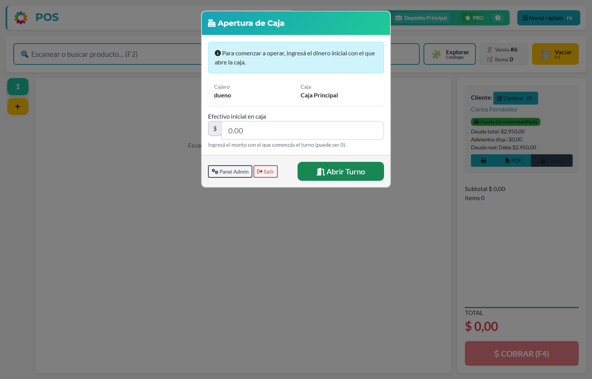
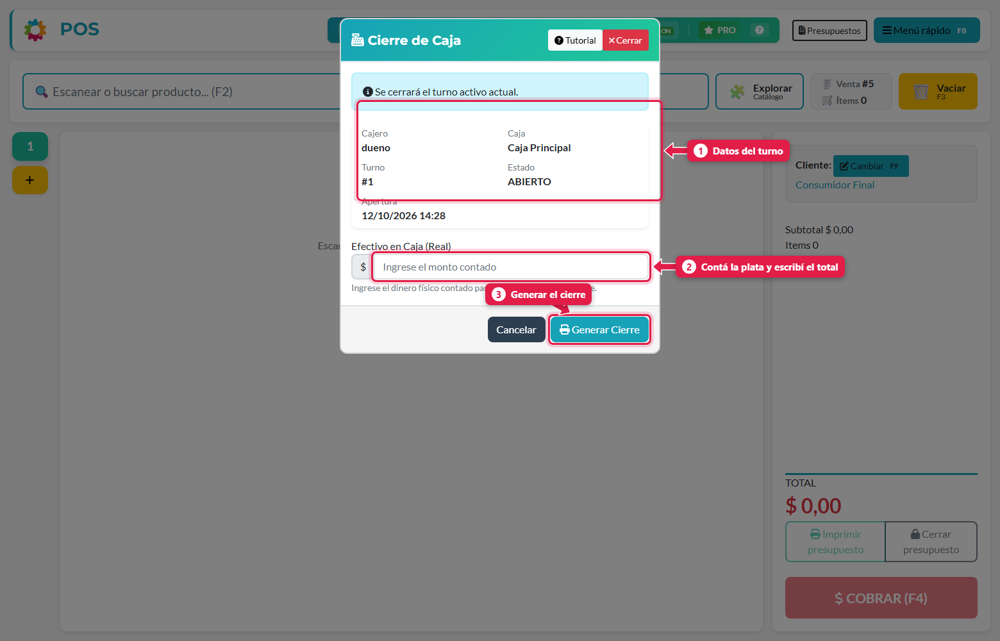
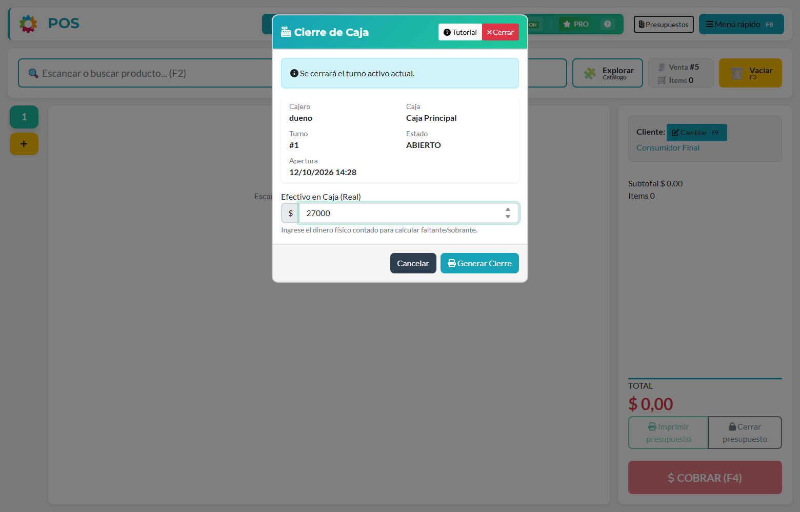
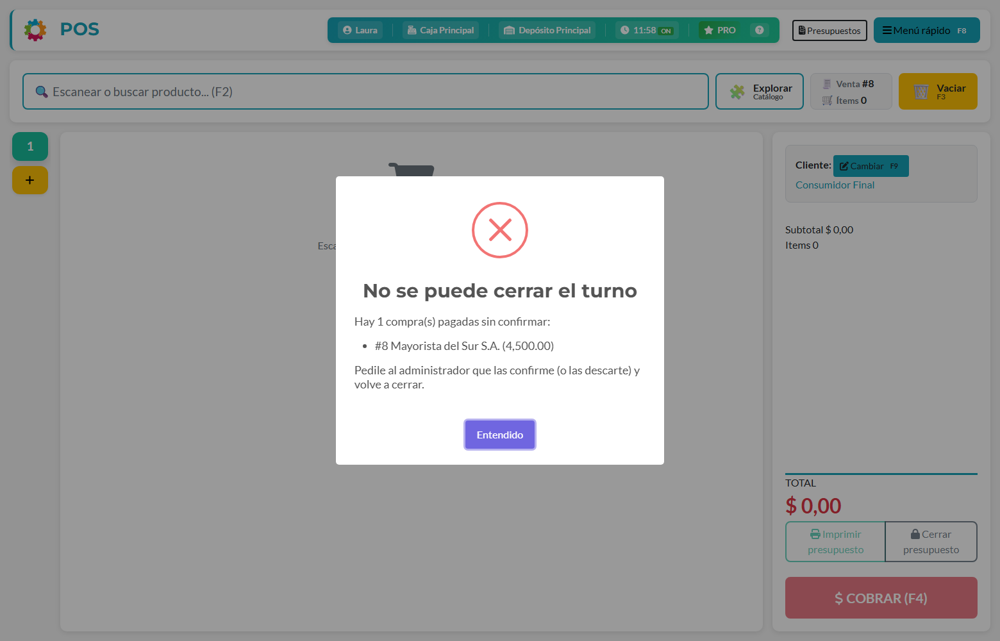

## Qué vas a lograr

Abrir tu turno con el efectivo con el que arrancás, sacar plata de la caja cuando haga falta y **cerrar el turno contando el efectivo** para saber si hay faltante o sobrante.

## Qué es un turno

Un **turno** es el período en el que trabajás con una caja: arranca cuando lo abrís y termina cuando hacés el cierre. Todo lo que cobrás, retirás o gastás mientras tanto queda **asociado a ese turno**. Por eso, al cerrar, el sistema sabe exactamente cuánta plata debería haber.

## 1. Abrir el turno

Al entrar al POS sin turno abierto, el sistema te muestra la ventana **Apertura de Caja**. Escribí el **efectivo inicial** (con cuánta plata arrancás, puede ser $ 0) y tocá **Abrir Turno**.



Mientras no abras el turno, el POS no te deja cobrar. Desde esa misma ventana podés ir al **Panel Admin** o **Salir**.

## 2. Durante el turno

| Qué necesitás | Dónde |
|---|---|
| Sacar efectivo de la caja (por ejemplo, pasarlo a la caja fuerte) | Menú rápido → **Retiro de caja** |
| Registrar un gasto pagado de la caja | Menú rápido → **Gastos** |
| Pagar una compra o un adelanto a un proveedor con plata de la caja | [Cargar una compra](/tutoriales/cargar-compra-manual/) y [Pagar a un proveedor](/tutoriales/pagar-proveedor/) |

Ambos se explican en [Registrar un gasto y un retiro de caja](/tutoriales/registrar-gastos-y-retiros/).

> **Todos los pagos y cobros se hacen desde el POS**, con el turno abierto. No se cargan desde el panel de administración. Así cada movimiento queda siempre en el turno y la caja donde ocurrió, y **no se pasa a otro turno**.

## 3. Cerrar el turno (arqueo)

Menú rápido (**F8**) → **Cierre de caja**.



| # | Elemento | Qué es |
|---|---|---|
| 1 | **Datos del turno** | Quién cierra, qué caja, número de turno y hora de apertura |
| 2 | **Efectivo en caja (real)** | **Contá la plata que hay físicamente** y escribí el total |
| 3 | **Generar Cierre** | Cierra el turno y emite el comprobante |

Escribí lo que contaste y tocá **Generar Cierre**.



Al generar el cierre:

1. El turno **queda cerrado**.
2. Se **manda a imprimir el ticket de cierre** (si hay impresora configurada) con el resumen y la diferencia.
3. El POS te pide **abrir un turno nuevo** para seguir vendiendo.

## Cómo se calcula lo que "debería haber"

El sistema solo cuenta el **efectivo**. Los pagos con tarjeta, transferencia o cuenta corriente no entran al arqueo.

```
Efectivo esperado  =  Efectivo inicial
                    + Ventas cobradas en efectivo
                    + Cobros de deudas en efectivo
                    ± Notas de crédito / débito en efectivo
                    − Retiros de caja en efectivo
                    − Gastos pagados en efectivo
                    − Pagos de compras confirmadas en efectivo
                    − Pagos y adelantos a proveedores en efectivo
                    − Pagos y adelantos a proveedores en efectivo
Diferencia         =  Efectivo contado − Efectivo esperado
```

### Ejemplo

| Concepto | Importe |
|---|---|
| Efectivo inicial | $ 5.000,00 |
| + Ventas en efectivo | $ 22.457,14 |
| + Cobro de una deuda en efectivo | $ 3.000,00 |
| − Retiro de caja | $ 2.000,00 |
| − Gasto en efectivo | $ 1.200,00 |
| **= Efectivo esperado** | **$ 27.257,14** |
| Efectivo contado | $ 27.000,00 |
| **Diferencia** | **− $ 257,14 (faltante)** |

Una diferencia **negativa** es un **faltante** (hay menos plata de la que debería); una **positiva** es un **sobrante**.

## Antes de cerrar: las compras pagadas tienen que estar confirmadas

Si en tu turno **cargaste compras** y las **pagaste con dinero (o con otro medio que no sea cuenta corriente)**, esas compras tienen que estar **confirmadas** antes de cerrar. Una compra pendiente **no descuenta** plata del arqueo, y si se confirmara después de cerrar quedarían saldos descuadrados.

Si hay compras sin confirmar, el sistema **no te deja cerrar** y te muestra un aviso con cuáles son (número de compra, proveedor y total pagado):



Tocá **Entendido**: el turno sigue abierto. Pedile al **dueño o a un administrativo** que las confirme desde el panel de administración (*Compra → Compras → Confirmar compra*; más adelante también desde la app del dueño). Cuando estén confirmadas, volvé a **Cierre de caja**.

| Caso | ¿Frena el cierre? |
|---|---|
| Compra pagada con efectivo, transferencia, tarjeta u otro medio, **sin confirmar** | **Sí** |
| Compra **solo a cuenta corriente** cargada por alguien con permiso para comprar a cuenta corriente | No |
| Compra ya **confirmada** | No |
| Compra pendiente que se **descarta** (se anula o se borra) | No |

## ¿Qué pasa si me olvido de cerrar?

Si dejás el turno abierto de un día para el otro, el comportamiento depende de un ajuste del dueño (*Configuración → Ventas y caja → Permitir operar con turno abierto de otro día*):

| Ajuste | Qué pasa al día siguiente |
|---|---|
| **Apagado** | El POS **te obliga a cerrar** la caja del día anterior antes de vender |
| **Encendido** | Podés seguir vendiendo con ese turno |

## Qué pasa por detrás

| Qué | Detalle |
|---|---|
| Cada pago, retiro y gasto | Guarda el turno al que pertenece |
| Cierre | Calcula los movimientos del turno, guarda el efectivo contado y la diferencia, y marca el turno como cerrado |
| Ticket | Se encola para la impresora de la caja; si falla, intenta imprimir directo |
| Pagos de compras y a proveedores | Cada pago queda asociado al turno en el que se registró, igual que los gastos y retiros |
| Resumen guardado | El detalle por medio de pago queda guardado con el turno. **Un turno cerrado no se modifica**: si se descarga su PDF más tarde, muestra los mismos números |

## Problemas frecuentes

| Si te pasa… | Es porque… | Qué hacer |
|---|---|---|
| "No hay un turno de caja abierto para cerrar" | No abriste turno, o ya lo cerraste | Abrí un turno nuevo |
| Me da faltante y no sé por qué | Algún retiro, gasto o cobro no se registró | Revisá en *Ventas anteriores*, *Gastos* y *Retiro de caja* del turno |
| El cierre no imprime | No hay impresora o agente configurado | Menú rápido → Configuración → Impresora de tickets |
| "Hay compras pagadas sin confirmar" al cerrar | Cargaste compras pagadas con dinero u otro medio y nadie las confirmó | Pedile al dueño o a un administrativo que las confirme en el panel (*Compra → Compras → Confirmar compra*) |
| Cerré sin querer | - | Abrí un turno nuevo; el cierre anterior queda registrado |

## Siguiente paso

- Registrar un gasto y un retiro de caja
- Cobrar la deuda de un cliente
