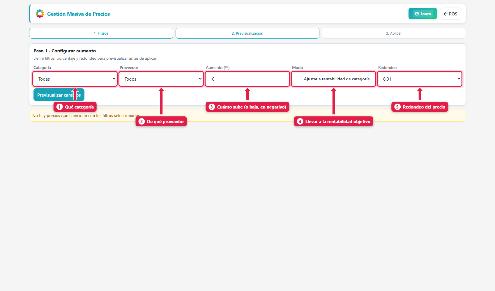
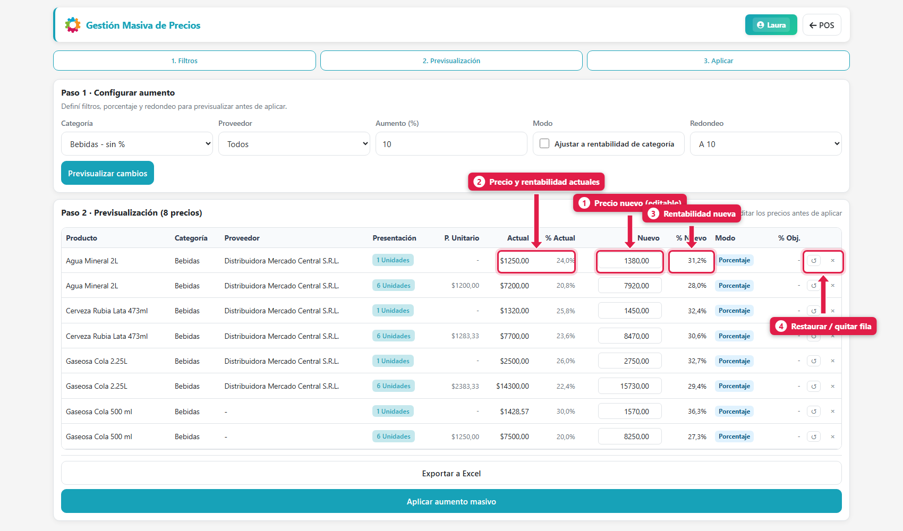
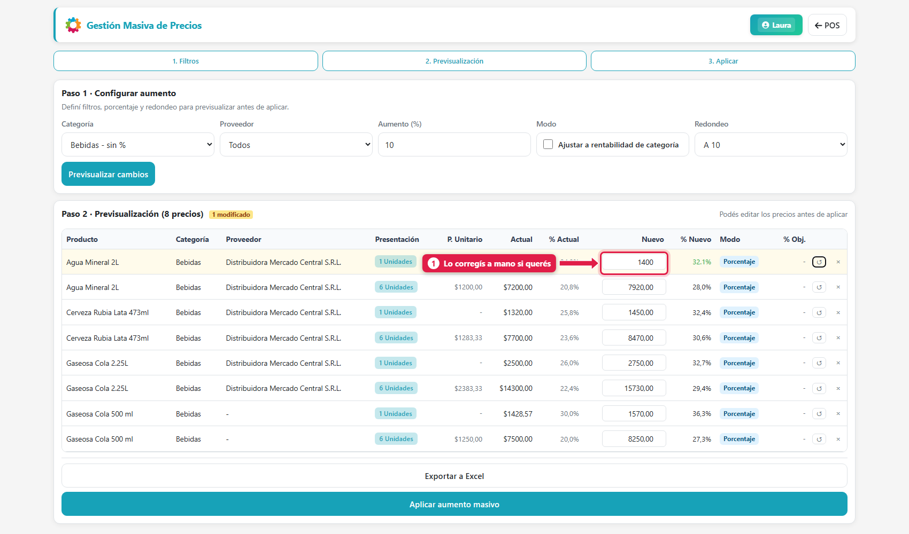
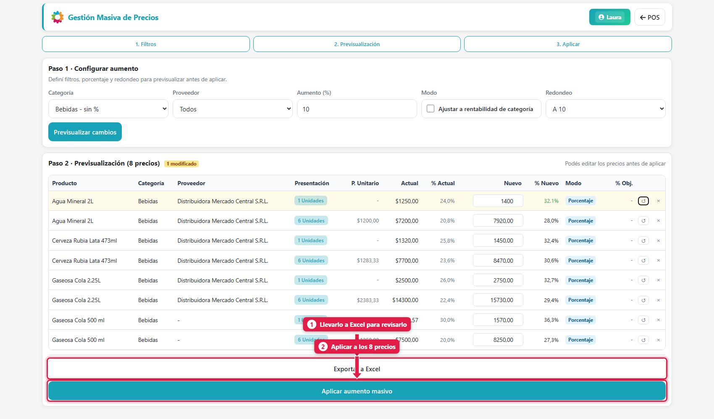
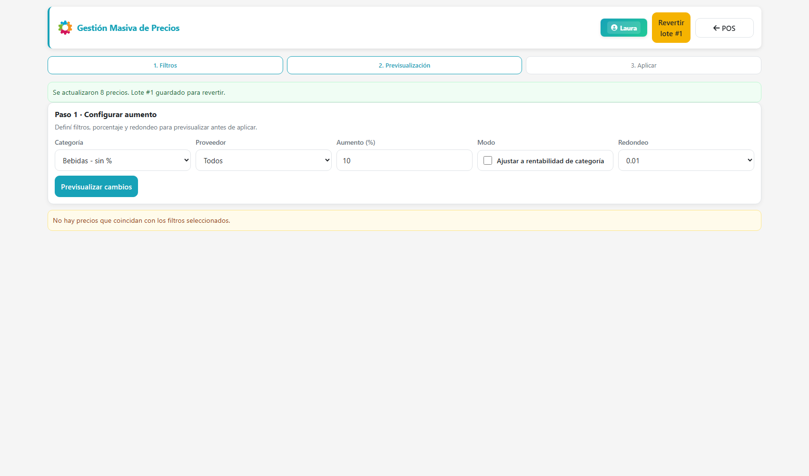
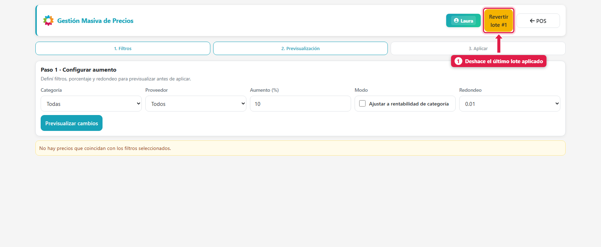
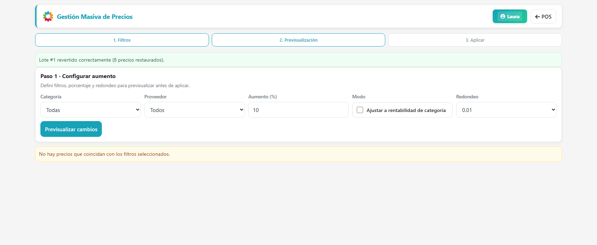

## Qué vas a lograr

Subir (o bajar) **muchos precios de una sola vez** por un porcentaje, por categoría o proveedor, con **redondeo**, viendo **antes de aplicar** cómo queda cada precio y su rentabilidad, y con la posibilidad de **deshacerlo**.

## Cuándo usarlo

- Subió la inflación o un proveedor aumentó y querés trasladarlo a los precios.
- Querés llevar una categoría a una **rentabilidad objetivo**.
- Querés redondear los precios (a 10, a 100 o terminados en .99).

Para cambiar el precio de **un solo** producto, usá *Editar producto* (ver *Cargar tus primeros productos*).

## Paso a paso

### 1. Abrí Precios masivos

Menú rápido (**F8**) → **Precios masivos**.

| # | Campo | Qué hace |
|---|---|---|
| 1 | **Categoría** | Solo los productos de esa categoría. Al lado ves la rentabilidad objetivo de la categoría (*sin %* si no tiene) |
| 2 | **Proveedor** | Solo los productos de ese proveedor |
| 3 | **Aumento (%)** | Cuánto sube. En **negativo** baja (`-5`) |
| 4 | **Ajustar a rentabilidad de categoría** | En lugar de un % fijo, lleva cada precio a la **rentabilidad objetivo** de su categoría |
| 5 | **Redondeo** | `0.01` (centavos), *Entero*, *A 10*, *A 100* o *x.99* |

Si no elegís categoría ni proveedor, aplica a **todos** los productos.

### 2. Previsualizá

Tocá **Previsualizar cambios**. El sistema te muestra **cada precio afectado**, con su valor actual y el nuevo:

| # | Columna | Qué es |
|---|---|---|
| 1 | **Nuevo** | El precio que va a quedar (**editable**) |
| 2 | **Actual / % Actual** | Precio de hoy y su rentabilidad |
| 3 | **% Nuevo** | La rentabilidad que va a tener con el precio nuevo |
| 4 | **↺ / ×** | Restaurar el valor de esa fila, o quitarla del cambio |

Cada **presentación** (1 unidad, pack de 6…) tiene su propia fila. En el ejemplo: **+10 %** con redondeo **A 10** llevó la botella de agua de $ 1.250 a **$ 1.380** (porque 1.375 se redondea hacia arriba a un múltiplo de 10).

### 3. Corregí lo que quieras

Podés **escribir otro precio** en cualquier fila. El sistema recalcula la rentabilidad al instante.

Con **×** sacás los productos que no querés tocar.

### 4. Exportá (opcional) y aplicá

- **Exportar a Excel:** baja la previsualización para revisarla o mostrarla.
- **Aplicar aumento masivo:** aplica los precios de la tabla.

El sistema te confirma cuántos precios cambió:

> *Se actualizaron 8 precios. Lote #1 guardado para revertir.*

## Deshacer un aumento

Cada aplicación queda guardada como un **lote**. Arriba a la derecha aparece **Revertir lote #N**:

Al tocarlo, los precios vuelven a como estaban:

> *Lote #1 revertido correctamente (8 precios restaurados).* Se revierte **el último lote** aplicado.

## Cómo se entiende la rentabilidad

La **rentabilidad** es el margen que te queda sobre cada precio. Cómo se calcula depende de un ajuste del dueño (*Configuración → Precios y productos → Calcular rentabilidad sobre venta*):

| Ajuste | Fórmula del precio | Ejemplo con costo $ 1.000 y 30 % |
|---|---|---|
| **Sobre la venta** (recomendado) | `costo ÷ (1 − %)` | **$ 1.428,57** |
| Sobre el costo | `costo × (1 + %)` | $ 1.300 |

En el primer caso, de cada $ 100 que cobrás, $ 30 son ganancia.

### Rentabilidad objetivo por categoría

Cada categoría puede tener una **rentabilidad objetivo** (se define en el panel de administración → Categorías). Con *Ajustar a rentabilidad de categoría* tildado, **Precios masivos** lleva todos los productos de esa categoría a ese margen, partiendo de su costo actual. Si un producto no tiene categoría, o su categoría no tiene rentabilidad cargada, o no se puede calcular su costo, **usa el % de aumento que escribiste**.

### Congelar el precio cuando sube el costo

Si en *Configuración → Precios y productos* activás **Congelar precio de venta al actualizar costo**, cuando le comprás a un proveedor y tu costo sube **el precio de venta no cambia** (tu margen baja). Con eso apagado, el precio se recalcula con la rentabilidad cargada. Precios masivos es la herramienta para **subirlos a propósito**.

## Listas de precios (mayorista, minorista…)

Si vendés a distintos tipos de cliente, podés tener **más de un precio por producto**:

1. **Configuración → Precios y productos → Habilitar listas de precios** y ponerles nombre a las columnas.
2. En **Configuración → Puntos de venta**, elegí qué listas ve cada caja.
3. En el formulario de producto, cada precio puede asignarse a una lista.

Con las listas apagadas, **todas las cajas usan los mismos precios**.

## Qué pasa por detrás

| Qué | Detalle |
|---|---|
| Precio | Se modifica el precio de cada presentación (`ProductoPrecio`) |
| Lote | Cada aplicación guarda los precios anteriores, para poder revertir |
| Costo | **No cambia**: solo cambia el precio de venta y, por lo tanto, la rentabilidad |
| Redondeo | Se aplica sobre el precio nuevo, hacia el múltiplo elegido |

## Problemas frecuentes

| Si te pasa… | Es porque… | Qué hacer |
|---|---|---|
| "No hay precios que coincidan con los filtros" | La categoría o el proveedor no tiene productos con precio | Probá con *Todas* / *Todos* |
| El precio quedó más alto de lo que esperaba | El redondeo sube al múltiplo siguiente | Usá *0.01*, o corregí el precio a mano en la tabla |
| Me equivoqué | — | **Revertir lote** (solo el último) |
| Quiero ver cuánto gano por producto | — | La columna **% Actual / % Nuevo** de la previsualización, o la app del dueño (Productos) |
| La categoría dice "sin %" | No tiene rentabilidad objetivo | Cargala en el panel de administración, o usá un % fijo |

## Siguiente paso

- Ofertas y variantes
