## Qué vas a lograr

Registrar los movimientos de stock que **no son una compra ni una venta**:

| Situación | Herramienta |
|---|---|
| Se **rompió, venció o se perdió** mercadería | **Merma** |
| Querés **mover mercadería** de un depósito a otro | **Transferencia de inventario** |
| Querés **cargar o corregir** el stock de muchos productos (carga inicial, Excel) | **Ajuste de inventario** |
| Contaste y el stock real no coincide | **Conteo de stock** (ver [Conteo de stock](/tutoriales/contar-stock/)) |

> Estas pantallas están en el **panel de administración**, no en el POS. El conteo y el lápiz de stock sí están en el POS.

---

## Mermas (roturas, vencimientos, pérdidas)

Una **merma** descuenta del stock lo que se perdió y le pone un **costo** a esa pérdida (para que aparezca en los reportes).

### 1. Cargá la merma

Panel de administración → **Producto → Mermas → Agregar**.

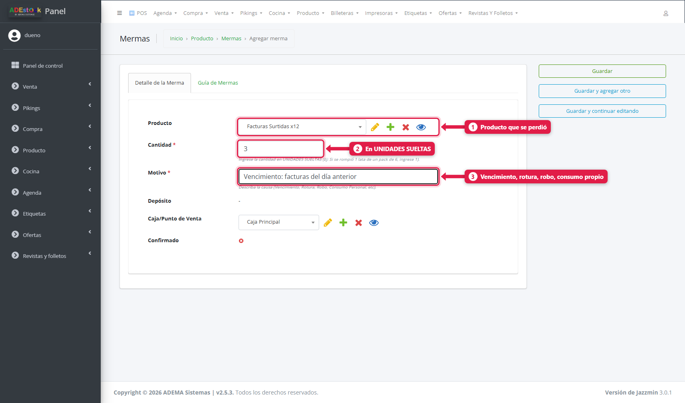

| # | Campo | Qué poner |
|---|---|---|
| 1 | **Producto** | El que se perdió |
| 2 | **Cantidad** | En **unidades sueltas**. Si se rompió 1 lata de un pack de 6, poné **1** |
| 3 | **Motivo** | La causa: vencimiento, rotura, robo, consumo propio… |
| — | **Caja / Punto de venta** | De qué caja descontar (define el depósito) |

Tocá **Guardar**. La merma queda **Pendiente**.

### 2. Confirmala

La merma **no descuenta stock hasta confirmarla**. En el listado, tildala y elegí la acción **Confirmar mermas**.

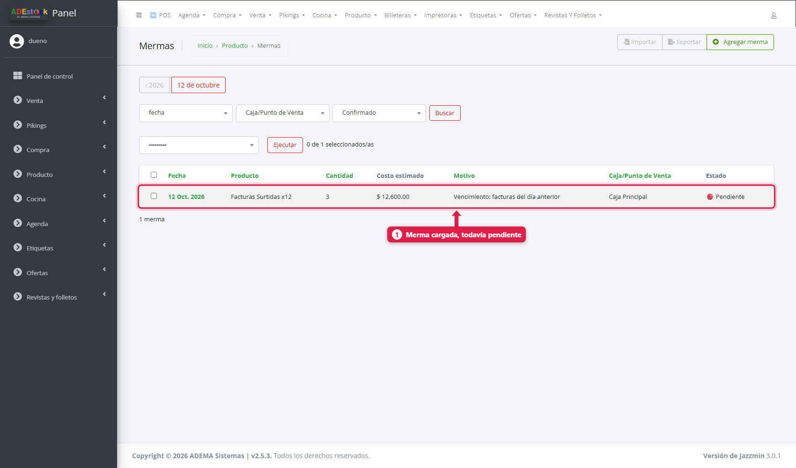

Cada merma muestra producto, cantidad, **costo estimado** (lo que perdiste a costo), motivo, caja y estado (🔴 *Pendiente* / ✅ *Confirmada*).

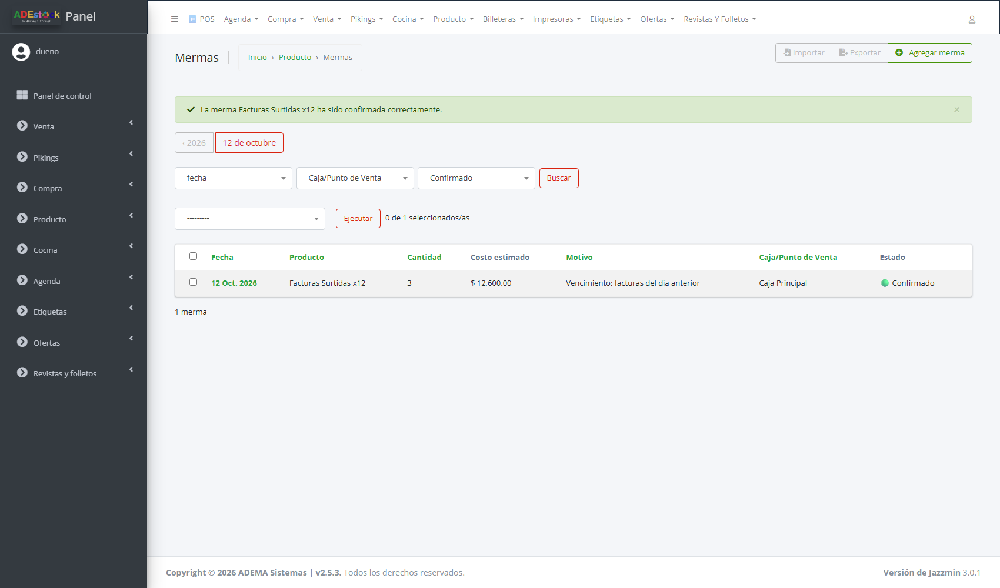

En el ejemplo, se confirmaron **3 facturas vencidas** y el stock bajó de **36 a 33**. Costo estimado: **$ 12.600**.

---

## Transferencias entre depósitos

Sirve cuando tenés **más de un depósito** (por ejemplo, *Depósito Principal* y *Depósito Salón*) y querés mover mercadería de uno a otro. El **stock total no cambia**: sale de uno y entra en el otro.

### Antes: los estados de transferencia

Cada transferencia pasa por **estados** que definís vos. Uno de ellos es el **estado final**, que es el que **mueve el stock**.

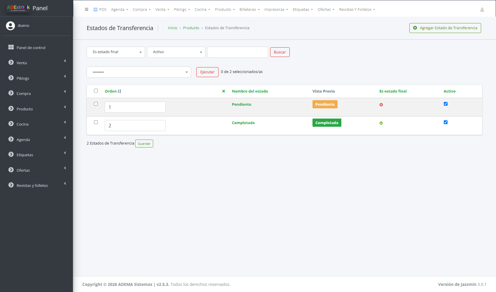

Panel de administración → **Producto → Estados de transferencia**. Lo habitual:

| Estado | Es final | Qué hace |
|---|---|---|
| **1. Pendiente** | No | La transferencia está preparada pero **no mueve stock** |
| **2. Completada** | **Sí** | Al llegar acá, el stock **sale del depósito de origen y entra al de destino** |

> Si no hay estados cargados, el desplegable *Estado* aparece vacío. Creá al menos un estado normal y uno final.

### 1. Creá la transferencia

Panel de administración → **Producto → Transferencias de inventario → Agregar**. El formulario tiene pestañas:

**Depósitos**

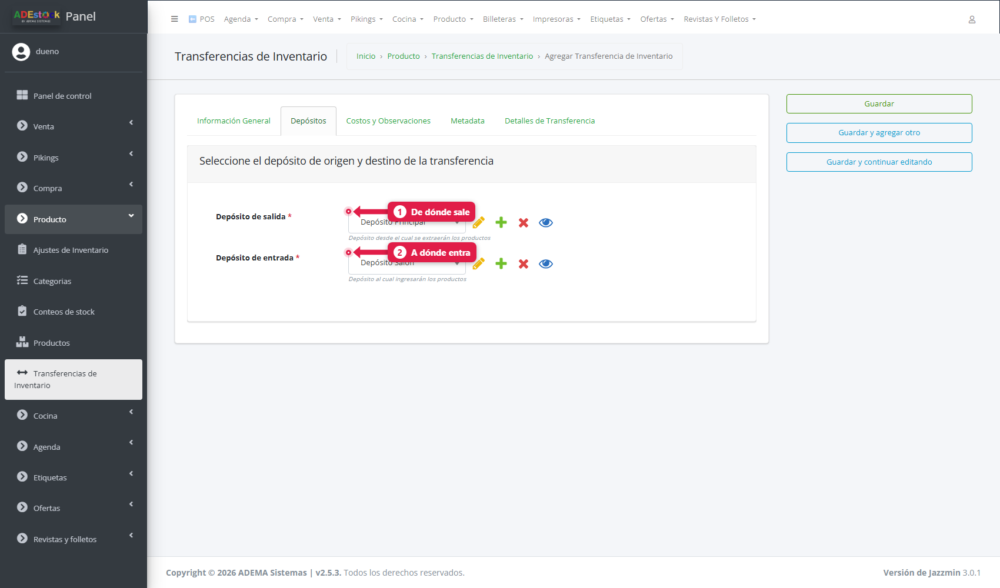

| # | Campo | Qué es |
|---|---|---|
| 1 | **Depósito de salida** | De dónde sale la mercadería |
| 2 | **Depósito de entrada** | A dónde llega |

**Información general**

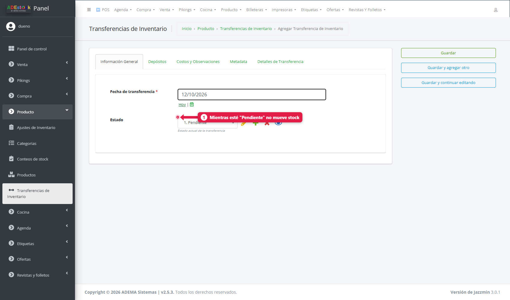

Fecha (con el botón *Hoy*) y **Estado**. Dejala en **Pendiente** mientras preparás la mercadería.

**Detalles de transferencia**

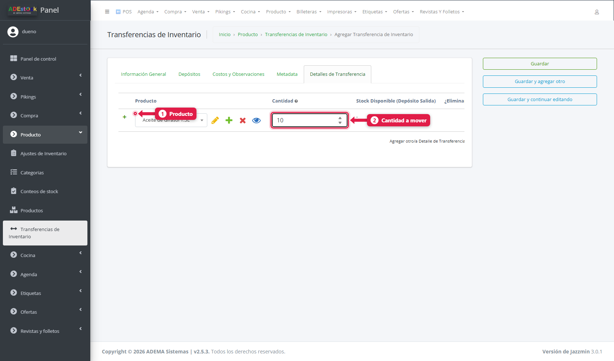

Agregá una fila por producto y la **cantidad** a mover. El sistema te muestra el **stock disponible en el depósito de salida**.

En **Costos y observaciones** podés cargar un **gasto de traslado/flete** y notas.

Tocá **Guardar**.

### 2. Completala

En el listado de transferencias, cada una muestra su estado y un botón **▶ Avanzar**.

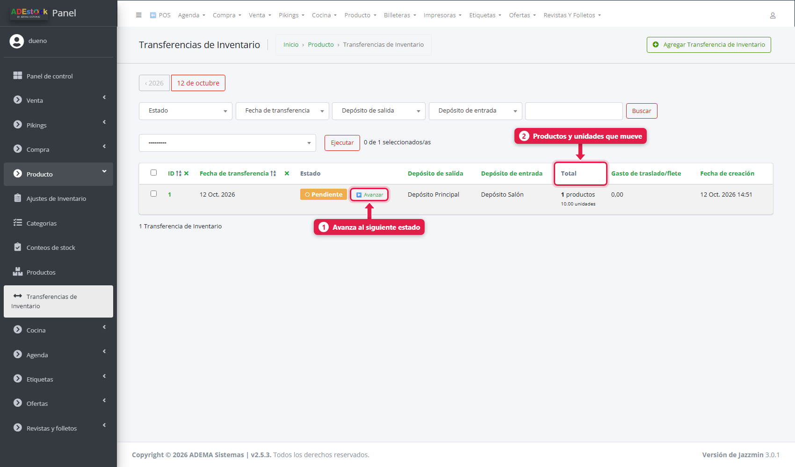

Al tocar **Avanzar** pasa al siguiente estado. Cuando llega al estado **final**, se mueve el stock:

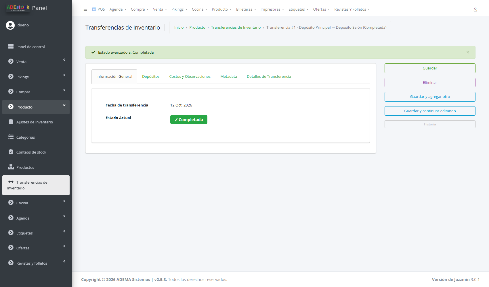

| Depósito | Aceite de Girasol 1.5L antes | Después |
|---|---|---|
| Depósito Principal | 28 | **18** |
| Depósito Salón | 0 | **10** |

> **Una transferencia completada no se puede modificar.** Si te equivocaste, hacé una transferencia inversa.

---

## Ajustes de inventario

El **ajuste de inventario** es el documento que respalda un cambio de stock. Lo generan solos los **conteos** del POS, y también podés crear uno **a mano** (por ejemplo, para la carga inicial desde un Excel).

Panel de administración → **Producto → Ajustes de inventario**.

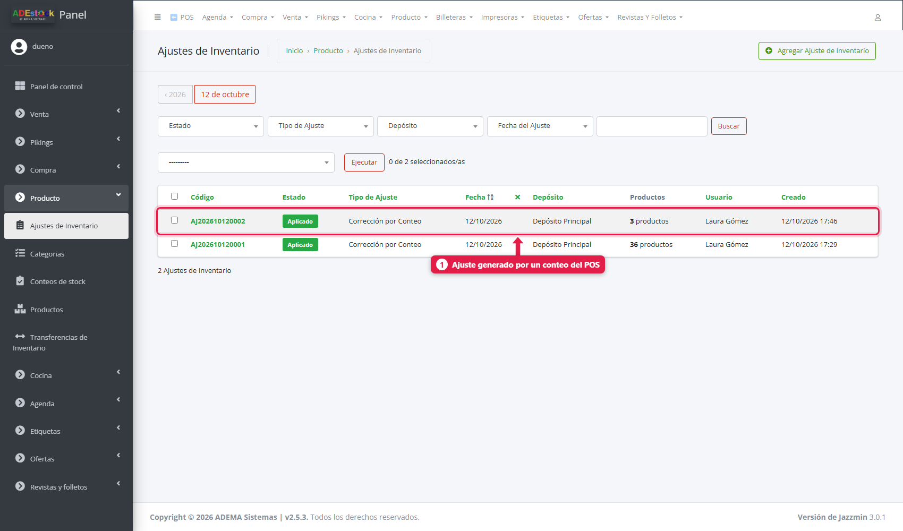

Cada ajuste muestra su código (`AJ…`), **estado** (Borrador / Aplicado / Anulado), **tipo**, fecha, depósito y cuántos productos incluye.

### Crear un ajuste a mano

**Agregar Ajuste de Inventario**:

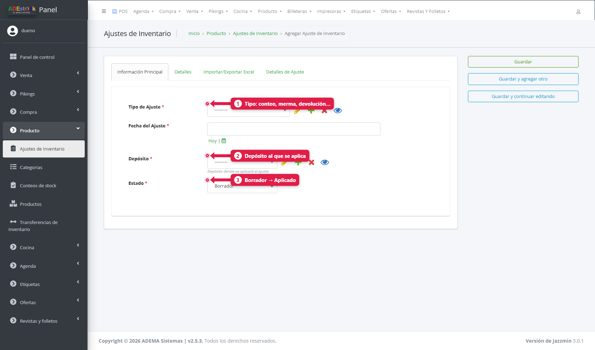

| # | Campo | Qué es |
|---|---|---|
| 1 | **Tipo de ajuste** | *Inventario inicial*, *Corrección por conteo*, *Merma / producto dañado*, *Devolución* u *Otro* |
| 2 | **Depósito** | Dónde se aplica |
| 3 | **Estado** | *Borrador* mientras lo preparás; *Aplicado* cuando impacta el stock |

En la pestaña **Detalles de ajuste** cargás los productos y cantidades. Con **Importar / Exportar Excel** subís o bajás todo en una planilla:

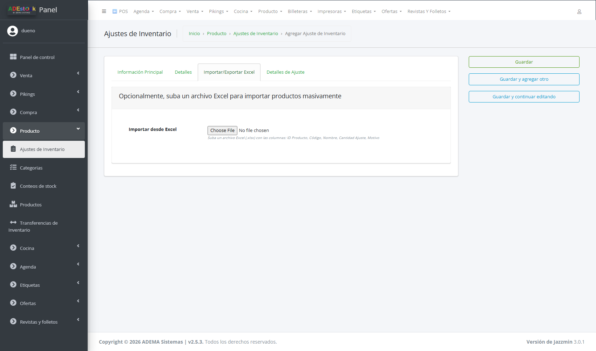

### Acciones del listado

| Acción | Para qué |
|---|---|
| **Aplicar ajustes seleccionados** | Pasa los borradores a *Aplicado* (impacta el stock) |
| **Anular ajustes seleccionados** | Revierte el ajuste: el stock vuelve a lo anterior |
| **Exportar a Excel** | Descarga el listado |

> Un ajuste **aplicado no se borra**: se **anula**. Así queda siempre el rastro de qué pasó.

## Qué pasa por detrás

| Qué | Detalle |
|---|---|
| Stock | Se calcula sumando compras, ajustes, fabricación y transferencias de entrada, y restando ventas, mermas, consumo y transferencias de salida |
| Merma | Resta del stock cuando se confirma, y suma su costo estimado a las pérdidas |
| Transferencia | Resta del depósito de salida y suma al de entrada al llegar al estado final |
| Ajustes del conteo | Son de **impacto directo**: no generan compras virtuales |

## Problemas frecuentes

| Si te pasa… | Es porque… | Qué hacer |
|---|---|---|
| El desplegable *Estado* de la transferencia está vacío | No hay estados cargados | Creá los estados en *Producto → Estados de transferencia* |
| La transferencia no mueve stock | Está en un estado que no es final | Tocá **▶ Avanzar** hasta el estado final |
| "No se puede modificar una transferencia completada" | Ya movió el stock | Hacé una transferencia inversa |
| La merma no descontó | Quedó pendiente | Tildala y usá **Confirmar mermas** |
| Quiero corregir el stock de varios productos | — | Usá el **Conteo de stock** del POS |

## Siguiente paso

- Gestión de precios y listas de precios
