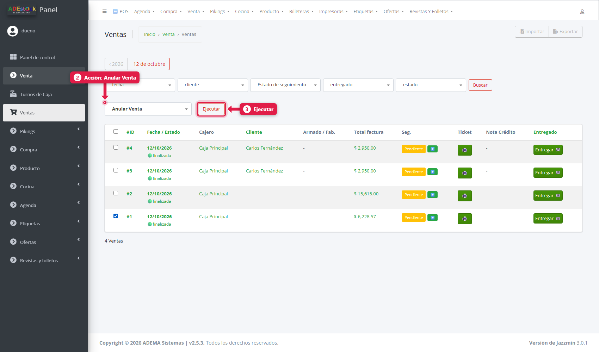
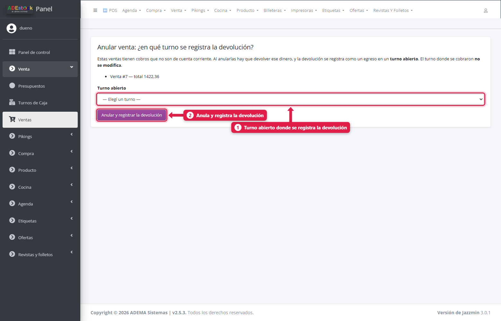
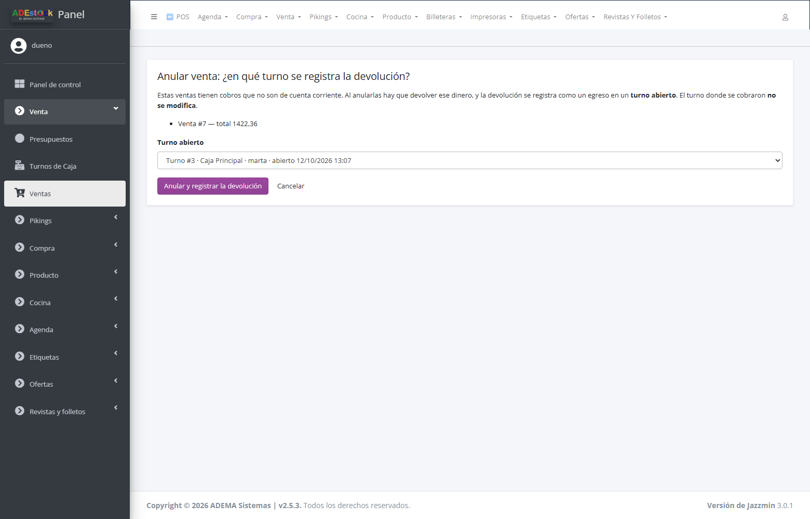
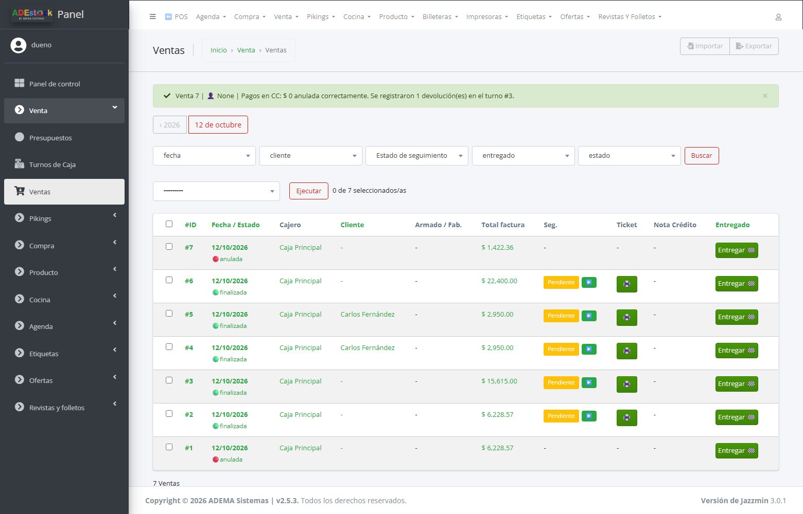
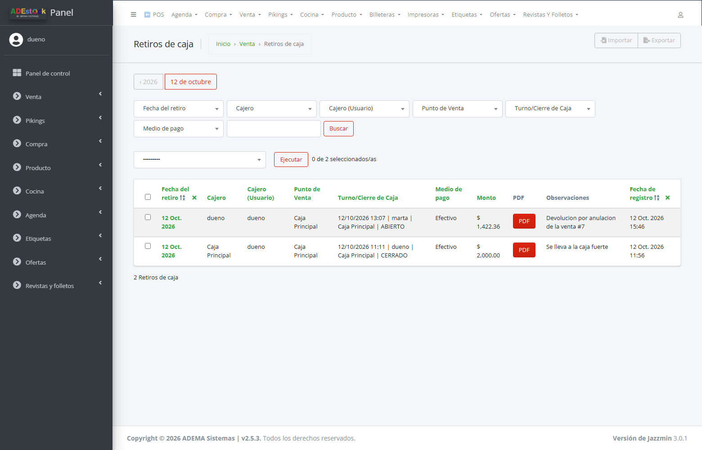

## Qué vas a lograr

- **Reimprimir** el ticket de una venta ya cerrada (esto lo hace cualquier cajero desde el POS).
- **Anular** una venta hecha por error, para que **deje de contar** en caja, stock y reportes.

> **Hoy la anulación de una venta se hace desde el panel de administración, no desde el POS.** Desde el POS solo se consultan y reimprimen las ventas.

## Reimprimir un ticket (desde el POS)

Menú rápido (**F8**) → **Ventas anteriores**.

Cada venta muestra su número, fecha y hora, cliente, caja y total. Con **Ticket** reimprimís el ticket y con **Hoja A4** la versión en A4.

- Un cajero ve solo las ventas de **su turno actual**. Con el permiso **Puede ver todos los tickets** ve las de todas las cajas y turnos.

## Anular una venta (desde el panel de administración)

### 1. Entrá al listado de ventas

Desde el POS: Menú rápido → **Panel de administración** → **Venta → Ventas**.

### 2. Elegí la venta y la acción

Tildá la casilla de la venta (o ventas) a anular. Arriba de la lista, en el desplegable de acciones, elegí **Anular Venta** y tocá **Ejecutar**.

En el listado ves por cada venta: número, fecha y estado, cajero, cliente, total, seguimiento, ticket, nota de crédito y el botón **Entregar**.

### 3. Elegí el turno de caja de la devolución

Si la venta tenía **cobros que movieron plata** (efectivo, tarjeta, transferencia…), el sistema te muestra la pantalla *Anular venta: ¿en qué turno se registra la devolución?*:

| # | Elemento | Qué es |
|---|---|---|
| 1 | **Turno abierto** | Elegí **en qué turno abierto** se registra la devolución. Si hay un solo turno abierto en la caja de la venta, ya viene elegido; si hay más de uno, tenés que elegir. Cada opción muestra el número de turno, la caja, el cajero y la hora de apertura |
| 2 | **Anular y registrar la devolución** | Anula la venta y registra el egreso |

> **Siempre hace falta un turno abierto.** Podés anular una venta de **otro día**, pero la devolución se registra en un turno que esté abierto **hoy**. Si no hay ninguno, el sistema no te deja anular: abrí un turno desde el POS y volvé a intentar. El turno donde se cobró originalmente **no se modifica**.

Si la venta fue **solo a cuenta corriente** (sin cobro), no pide turno: se anula y la deuda se revierte.

### 4. Verificá el resultado

El sistema muestra un aviso: *Venta N anulada correctamente. Se registraron 1 devolución(es) en el turno #N*, y la venta pasa al estado **anulada**.

La devolución queda como un **retiro de caja** del turno elegido, con la observación *Devolución por anulación de la venta #N* (una por cada pago que se cobró). Lo ves en **Venta → Retiros de Caja** y en la pestaña *Retiros de caja* del turno:

## Qué se puede anular

Solo se anulan las ventas en estado **pagada, facturada o finalizada**. Una venta ya anulada, o una que todavía está en carrito (creada), no se puede anular.

## Qué pasa al anular

| Qué | Efecto |
|---|---|
| Venta | Pasa a estado **anulada**, con el motivo "Anulada desde admin" |
| Stock | Las ventas anuladas **dejan de descontar**: el stock de esos productos vuelve a estar disponible |
| Cierre de caja | La devolución queda registrada como un **egreso en el turno abierto que elegiste** (mismo medio de pago que el cobro original). Si anulás en el mismo turno en que se cobró, el efecto neto en el arqueo es cero |
| Billetera | La devolución resta de la billetera del medio de pago, igual que cualquier otro egreso |
| Cobros de deuda asociados | Si la venta fue a cuenta corriente y el cliente ya había pagado, esos pagos se **anulan** y las deudas se restauran |
| Registro | La venta **no se borra**: queda para auditoría |

> **Importante:** el sistema registra la devolución en el turno que elegís, pero **la plata se la devolvés vos al cliente** con lo que haya en esa caja. No hace falta cargar un retiro de caja aparte.

## Cuándo usar otra herramienta

| Situación | Qué usar |
|---|---|
| El cliente devuelve **parte** de la mercadería | **Nota de crédito** (desde el panel de administración) |
| Se cobró de menos o de más en un **cobro de deuda** | Acción *Anular cobro* (solo superusuario), en el panel de administración |
| El carrito sigue abierto y quiero empezar de cero | **Vaciar** (F3) en el POS |

## Entregar una venta

En el listado de ventas, junto a cada una está el botón **Entregar**. Marca la venta como entregada y **descuenta el stock físico** si tenés activado *Seguimiento de entregas* (ver *La configuración del POS*). Con ese ajuste apagado, el stock se descuenta al cobrar y no hace falta.

## Problemas frecuentes

| Si te pasa… | Es porque… | Qué hacer |
|---|---|---|
| "La venta no está en un estado válido para anular" | Está en carrito o ya anulada | Solo se anulan ventas cobradas |
| No veo "Anular Venta" | Tu usuario no tiene permisos sobre Ventas en el panel | Pedíselo al dueño |
| "Abrí un turno de caja para registrar la devolución" | No hay ningún turno abierto y la venta tenía cobros | Abrí un turno desde el POS y anulá de nuevo |
| La venta anulada sigue en el listado | Las ventas anuladas no se borran | Es lo esperado; el estado figura como *anulada* |

## Siguiente paso

- Turno de caja: apertura, retiros y cierre
- Cobrar la deuda de un cliente
