## Para qué sirve

Cuando vendés con entrega o recibís pedidos de la tienda online, la venta ya está hecha pero la mercadería hay que **juntarla**. El armado sirve para que quien prepara el pedido use el celular como lista: ve qué sacar, marca lo que va juntando y avisa si algo faltó. Si faltó mercadería, el sistema arma una nota de crédito por lo que no se entregó (ver [notas de crédito y débito](/tutoriales/notas-de-credito-y-debito/)).

## Qué vas a lograr

Vas a **preparar pedidos desde el celular con el picking de ADEstock**: ver qué productos juntar, marcar las cantidades preparadas y registrar faltantes. El armado puede venir de una venta del POS o de un pedido de la tienda online.

Si faltó mercadería, generá la nota de crédito y revisala en el panel antes de aplicarla. Finalizar el armado por sí solo deja el faltante registrado, pero no genera una devolución.

Sirve para ventas con **entrega** (reparto, retiro por el depósito, pedidos de la [tienda online](/tutoriales/configurar-tienda-online/)): la venta ya se cobró o se anotó, y ahora hay que **preparar la caja**.

## Antes de empezar

- El módulo de **Armado** tiene que estar **activado**. Si en el onboarding elegiste *Ferretería*, viene desactivado.
- Hay un **flujo de estados de armado** (Pendiente → En Armado → Listo…). Viene cargado de fábrica; se ve y se edita en el panel: **Pikings → Estados de Armado**.

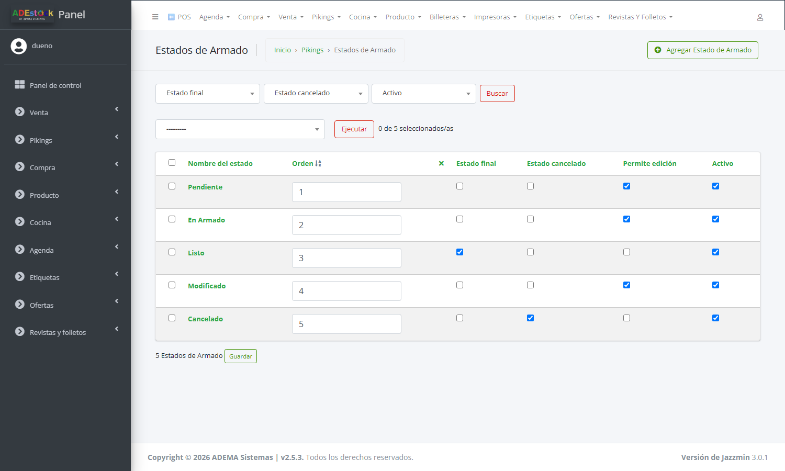

| Estado | Para qué sirve |
|---|---|
| **Pendiente** | El pedido espera que alguien lo arme |
| **En Armado** | Alguien lo está juntando |
| **Listo** | Es el estado **final**: el armado terminó (no permite edición) |
| **Modificado** | Para pedidos que cambiaron después de empezar |
| **Cancelado** | El armado se canceló (no permite edición) |

Las casillas **Estado final**, **Estado cancelado** y **Permite edición** definen cómo se comporta cada uno. Podés cambiar nombres, colores y el **Orden**; el orden es el camino que recorre el botón *Siguiente estado*.

> En el panel el menú se llama **«Pikings»** (así figura hoy). Ahí están *Armado de Pedidos*, *Estados de Armado* y los ítems y eventos.

## Paso a paso

### 1. Generá el armado de una venta

Hay tres caminos. Todos terminan en lo mismo: un **armado** con un ítem por cada producto de la venta.

**a) A mano, desde el panel** (el más simple para empezar)

1. **Venta → Ventas**.
2. Tildá la venta (tiene que estar **finalizada**).
3. En *Acción* elegí **Crear armado de pedido** y tocá **Ejecutar**.

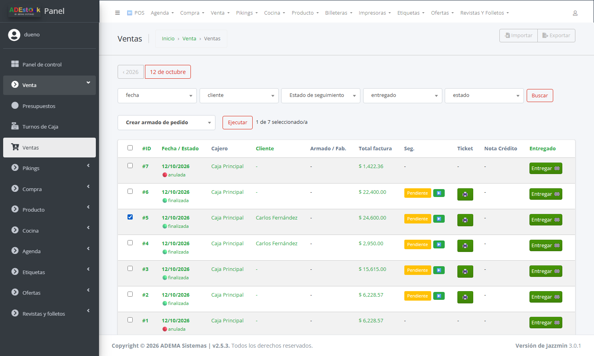

El sistema avisa cuántos armados creó. Si la venta ya tenía uno, la omite (una venta solo puede tener **un armado activo**).

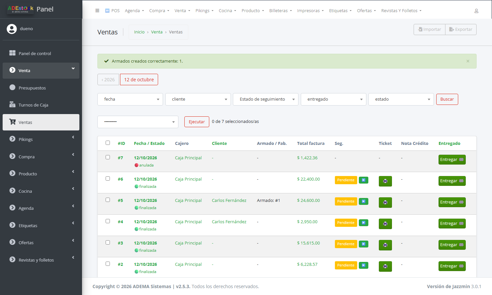

**b) Automático, por estado de seguimiento**

Cada venta tiene un **estado de seguimiento** (Pendiente, Confirmado, Entregado…). Si a un estado le tildás **Generar armado de pedido**, **toda venta que llegue a ese estado genera su armado sola**.

En el panel: **Venta → Estados de Seguimiento**.

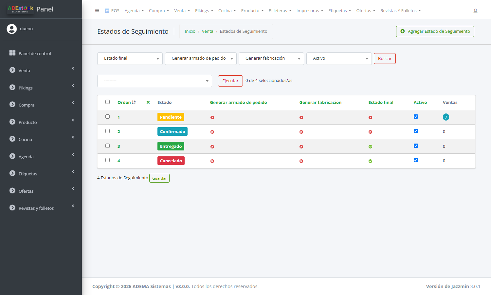

Abrí el estado, pestaña **Configuración**, y tildá la casilla:

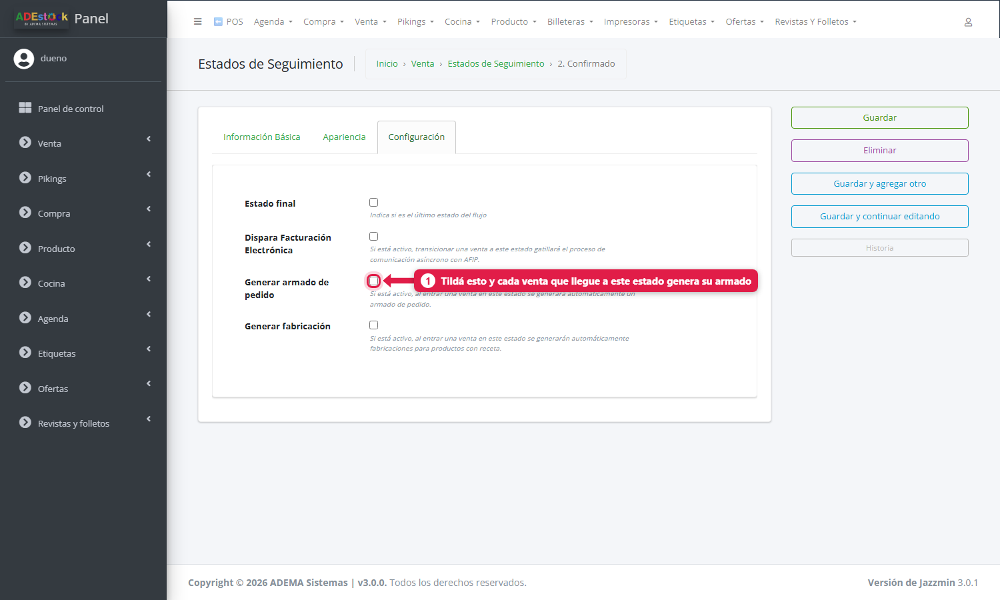

> Cuando el **primer** estado del flujo tiene esa casilla tildada, la acción manual *Crear armado de pedido* deja de aparecer en la lista de ventas: ya no hace falta, todas las ventas arrancan con su armado.

**c) Desde la tienda online**

Cada pedido que entra por la tienda crea un armado con origen **Pedido Web** (ver [Tienda online](/tutoriales/configurar-tienda-online/)). No tenés que hacer nada.

### 2. Revisá los armados en el panel

**Pikings → Armado de Pedidos**.

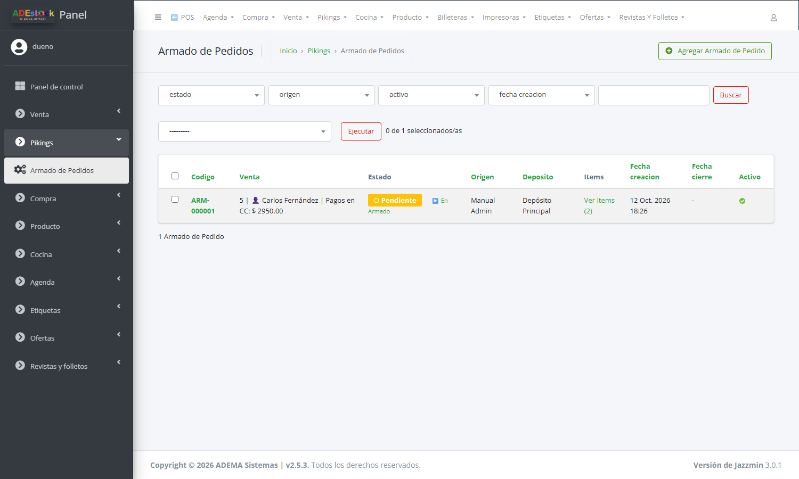

| Columna | Qué es |
|---|---|
| **Codigo** | `ARM-000001`… lo asigna el sistema |
| **Venta** | De qué venta viene (cliente incluido) |
| **Estado** | Estado actual, con un botón **▶** para pasarlo al siguiente |
| **Origen** | *Automático POS*, *Manual Admin* o *Pedido Web* |
| **Deposito** | De qué depósito sale la mercadería |
| **Items** | Cuántos ítems tiene; el enlace los lista |

Al abrir un armado ves sus **ítems** (pedido, pickeado, faltante, sobrante) y el **historial de eventos** (quién lo creó y los cambios de estado hechos desde el panel).

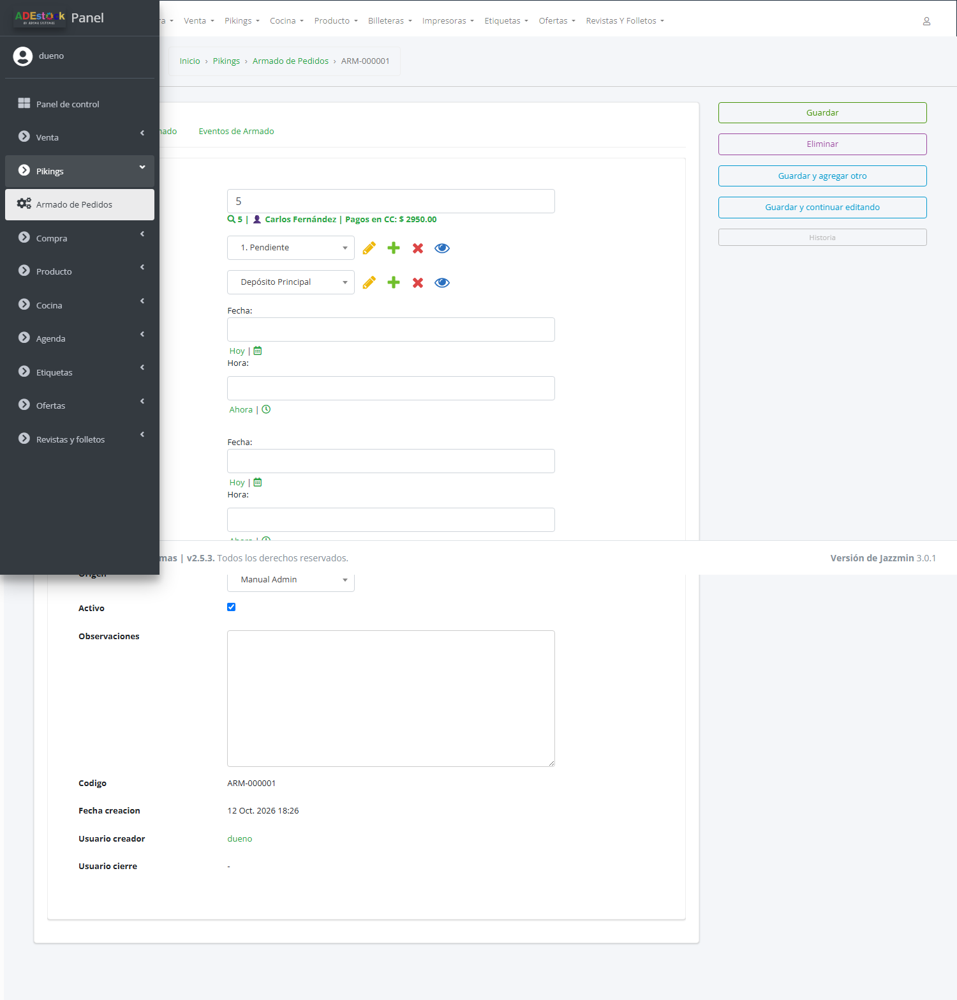

### 3. Armá el pedido desde el celular

El armador entra a **`/picking/`** (en el POS: Menú rápido → **Picking**). Solo ve la pantalla si su usuario tiene el permiso **«Puede acceder a la vista de picking móvil»** (se da en [Crear usuarios y asignar permisos](/tutoriales/usuarios-y-permisos/)).

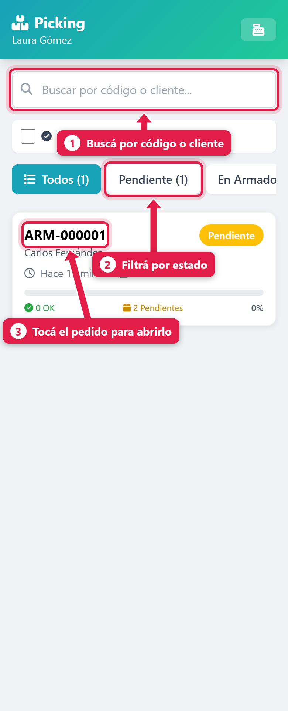

| # | Zona | Para qué sirve |
|---|---|---|
| 1 | **Buscador** | Por código de armado (`ARM-…`), código de venta o nombre del cliente |
| 2 | **Filtros por estado** | *Todos*, *Pendiente*, *En Armado*… con la cantidad de cada uno |
| 3 | **Tarjeta del pedido** | Código, cliente, hace cuánto se creó, cantidad de ítems y progreso |

Los más antiguos aparecen primero. Por defecto **no se ven los finalizados ni cancelados**; tildá *Mostrar pedidos finalizados* para verlos.

Tocá un pedido para abrirlo:

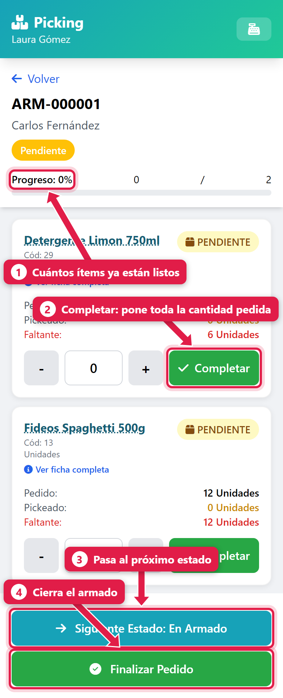

| # | Zona | Qué hace |
|---|---|---|
| 1 | **Progreso** | Cuántos ítems están completos sobre el total |
| 2 | **Completar** | Marca el ítem con **toda** la cantidad pedida |
| 3 | **Siguiente Estado** | Pasa el pedido al próximo estado (pide confirmación) |
| 4 | **Finalizar Pedido** | Cierra el armado |

Cada ítem muestra el producto, el **código**, la presentación, lo **pedido** y lo **pickeado**. La cantidad pedida ya viene multiplicada por la presentación: si la venta fue «1 pack de 6», el pedido dice **6 unidades**.

### 4. Marcá lo que vas juntando

1. Tocá **Siguiente Estado** para pasar a **En Armado** (así el dueño ve que alguien lo está preparando). El sistema pregunta *«¿Cambiar a estado "En Armado"?»* y confirma.
2. Por cada producto:
   - Si juntaste **todo**, tocá **Completar**.
   - Si juntaste **menos** (o más), escribí la cantidad en el cuadro del medio, o usá **−** y **+**.
3. El estado del ítem cambia solo:

| Estado del ítem | Cuándo |
|---|---|
| **PENDIENTE** | Todavía no lo tocaste (pickeado = 0) |
| **OK** | Juntaste lo pedido o más |
| **FALTANTE** | Juntaste menos de lo pedido; se muestra cuánto falta |

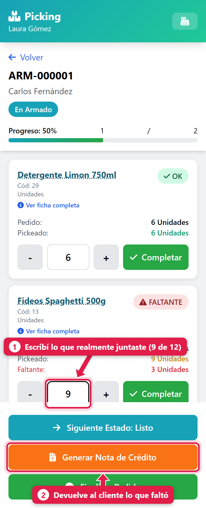

En el ejemplo se pidieron 12 paquetes de fideos y solo había 9: el ítem queda en **FALTANTE (3)** y aparece el botón naranja **Generar Nota de Crédito**.

**Ver ficha completa** (debajo del nombre del producto) abre una ficha con foto, categoría, proveedor, **stock actual**, códigos de barras y presentaciones. Sirve para confirmar que agarraste el producto correcto.

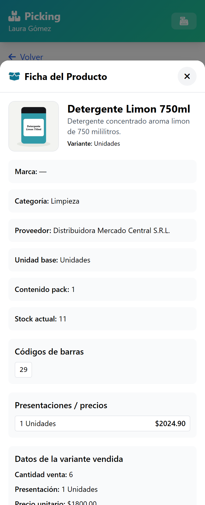

> Si el estado actual **no permite edición** (por ejemplo, *Listo* o *Cancelado*), el sistema no deja cambiar cantidades: *«Este pedido no permite edición en su estado actual»*.

### 5. Si faltó mercadería: generá la nota de crédito

Tocá **Generar Nota de Crédito**. El sistema te muestra:

1. La lista de faltantes con su subtotal y el **total de la nota**: *«¿Generar nota de crédito para ARM-000001? … Fideos Spaghetti 500g: 3 faltantes ($3450.00)»*.
2. Un listado de **medios de pago** para devolver el dinero (no incluye cuenta corriente). Escribís el **número** del medio; viene sugerido el medio con el que se pagó la venta.

Al terminar, avisa: *«Nota de crédito NC-000001 generada en borrador»*.

> La nota queda en **borrador**: todavía **no movió stock ni caja**. Hay que **aplicarla** desde el panel. Los pasos están en [Notas de crédito y débito](/tutoriales/notas-de-credito-y-debito/).

La nota se genera **una sola vez** por armado: si ya existe una (en borrador o aplicada), el botón no vuelve a crearla.

### 6. Finalizá el pedido

Cuando todos los ítems están en **OK** o **FALTANTE** (ninguno **PENDIENTE**), tocá **Finalizar Pedido**.

- Te pide **Observaciones** (opcional): por ejemplo, *«Faltó 1 paquete de fideos, se avisó al cliente»*.
- El pedido pasa al estado **final** (*Listo*), queda con fecha de cierre y con el nombre de quien lo cerró.

Si quedan ítems **PENDIENTES**, avisa *«Hay N items sin procesar»* y no deja cerrar hasta marcarlos (o hasta generar la nota de crédito, que da por procesados los faltantes).

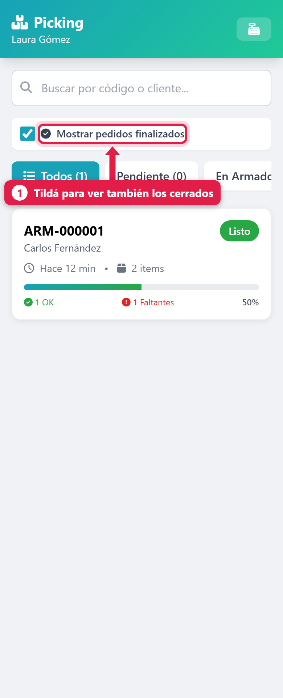

> **Orden recomendado si hay faltantes:** primero **Generar Nota de Crédito** y **después Finalizar Pedido**. *Finalizar* por sí solo no genera la nota: cierra el armado con el faltante anotado, pero sin devolver nada al cliente.

> **Usá *Finalizar Pedido* para cerrar, no *Siguiente Estado* cuando el próximo estado es el final.** En esa situación hoy aparece el mensaje «Error: undefined» y el pedido no avanza (ver *Problemas frecuentes*).

### 7. Reabrir un pedido cerrado

Si te equivocaste, abrí el pedido (con *Mostrar pedidos finalizados* tildado) y tocá **Reabrir Pedido**.

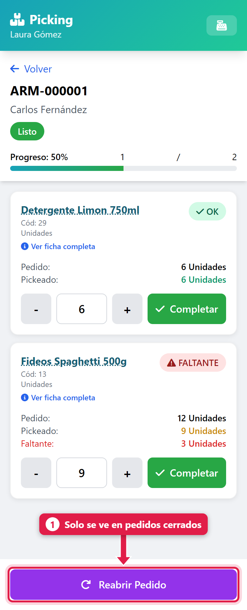

El pedido vuelve al **primer estado no final** y se puede editar de nuevo. Queda registrado el evento *Reapertura* en el historial del armado.

> **Importante:** reabrir desde el celular **no anula** la nota de crédito que ya se hubiera generado. Si hay que deshacerla, hacelo desde el panel (ver [Aplicar y anular notas de crédito](/tutoriales/notas-de-credito-y-debito/)).

## Qué pasa por detrás

| Qué hacés | Qué se mueve |
|---|---|
| Crear el armado | Se copian los productos de la venta como ítems; se registra el evento *Creado* y se toma el depósito de la venta |
| Completar / cambiar cantidades | Se guardan cantidad pickeada, faltante y sobrante, con quién y cuándo |
| Cambiar de estado | Se guarda el nuevo estado y, la primera vez, la fecha de inicio |
| Finalizar | Se guarda fecha y usuario de cierre; **no toca stock** |
| Generar nota de crédito | Se crea la nota en **borrador** con los faltantes a precio de venta |

El armado **no descuenta stock por sí mismo**. La venta afecta el stock disponible; el descuento del stock físico depende de la configuración de seguimiento de entregas (ver [Hacer una venta](/tutoriales/hacer-una-venta/)). La **nota de crédito aplicada** registra el ajuste de las cantidades no entregadas.

## Problemas frecuentes

| Si te pasa… | Es porque… | Qué hacer |
|---|---|---|
| No veo *Picking* o dice «Permiso denegado» | Tu usuario no tiene el permiso de picking, o el módulo está desactivado | Pedile al dueño que revise tus [permisos de usuario](/tutoriales/usuarios-y-permisos/) o activá el módulo en el engranaje |
| No aparece la acción *Crear armado de pedido* | La venta no está finalizada, el módulo está apagado, o el primer estado de seguimiento ya genera armados solo | Revisá las tres cosas; si el primer estado tiene la casilla tildada, los armados ya se crean automáticamente |
| «La venta ya tiene un armado activo» | Una venta admite un solo armado activo | Trabajá con el que existe |
| «Error: undefined» al tocar *Siguiente Estado: Listo* | La pantalla no maneja la confirmación del estado final | Usá **Finalizar Pedido** (es una limitación documentada de esta versión) |
| «Este pedido no permite edición en su estado actual» | El estado tiene *Permite edición* apagado | Reabrí el pedido o cambialo a un estado que permita edición |
| El pedido cerró pero el cliente no recibió la devolución | Se finalizó sin generar la nota de crédito | Creá la nota a mano en el panel (ver [Notas de crédito y débito](/tutoriales/notas-de-credito-y-debito/)) |
| «Hay N items sin procesar» | Quedan ítems en PENDIENTE | Marcá cada uno (Completar o cantidad real) |

## Cómo comprobar que salió bien

Verificá que todos los ítems estén procesados y que el pedido figure en el estado final. Si hubo faltantes, comprobá que exista la nota de crédito y revisá si sigue en borrador o ya fue aplicada. Reabrir el armado no anula una nota existente.

## Siguiente paso

- [aplicar y anular notas de crédito y débito en ADEstock](/tutoriales/notas-de-credito-y-debito/)
- [activar y diseñar tu tienda online en ADEstock](/tutoriales/configurar-tienda-online/)
- [crear usuarios y asignar permisos en ADEstock](/tutoriales/usuarios-y-permisos/)
