## Qué vas a lograr

Saber **cuánta plata tenés en cada lugar** (la caja de efectivo, el banco, Mercado Pago…) y llevar sus movimientos: qué entró, qué salió y cuándo. También **pasar plata de una cuenta a otra** (por ejemplo, del banco a la caja) y **corregir saldos** (comisiones, intereses, ajustes).

## Cómo funciona (leelo una vez)

- Una **billetera** es un "lugar donde hay plata": efectivo, una cuenta bancaria, Mercado Pago, etc. Cada una lleva su propio saldo.
- **Los movimientos se cargan solos.** Cuando cobrás una venta, pagás a un proveedor, registrás un gasto o hacés un retiro **desde el POS**, el sistema anota el movimiento en la billetera **vinculada al medio de pago** que usaste. No cargás nada dos veces, y los pagos y cobros **no se cargan desde el panel**: lo único que se mueve a mano acá son las **transferencias** entre billeteras y los **ajustes**.
- **Saldo actual = saldo inicial + ingresos − egresos.**
- Para que un pago impacte en una billetera, su **medio de pago** tiene que estar vinculado a ella (ver *Vincular un medio de pago*, más abajo). Los medios sin billetera (por ejemplo *Cuenta Corriente*) no mueven ninguna.

## Paso a paso

### 1. Mirá tus billeteras

Menú de arriba **Billeteras → Billeteras y Cuentas**.

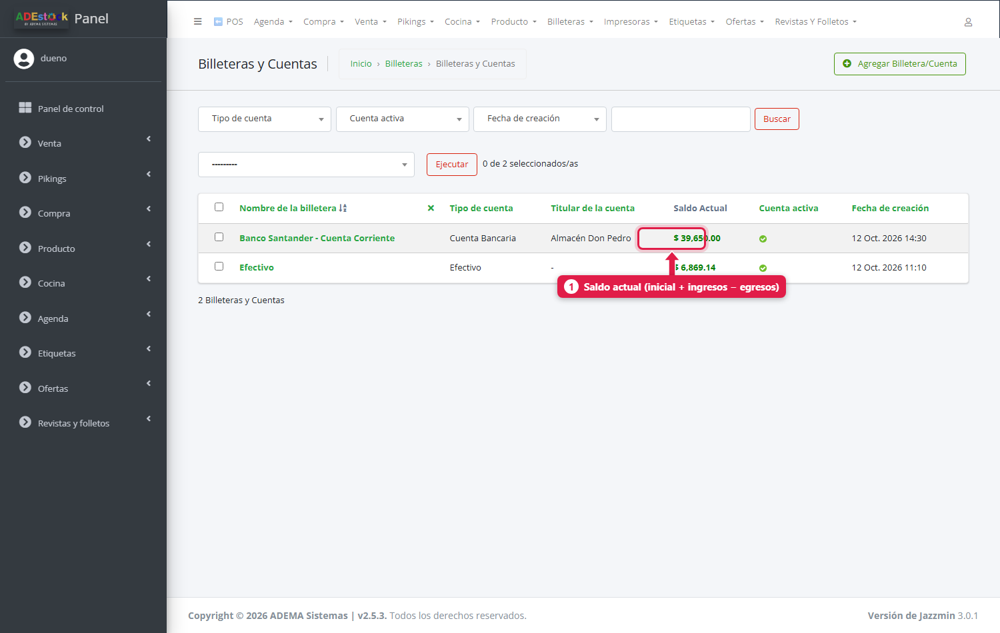

| Columna | Qué es |
|---|---|
| **Nombre** | Cómo la reconocés |
| **Tipo de cuenta** | Cuenta bancaria, efectivo, MercadoPago, PayPal, criptomonedas u otro |
| **Titular** | De quién es la cuenta |
| **Saldo Actual** (1) | Cuánta plata hay hoy según los movimientos. En rojo si es negativo |
| **Cuenta activa** | Si se puede usar en nuevas operaciones |

Si instalaste el sistema con el asistente inicial, ya tenés una billetera **Efectivo**. Las demás las agregás vos.

### 2. Creá una billetera nueva

Tocá **Agregar Billetera/Cuenta**. El formulario tiene pestañas:

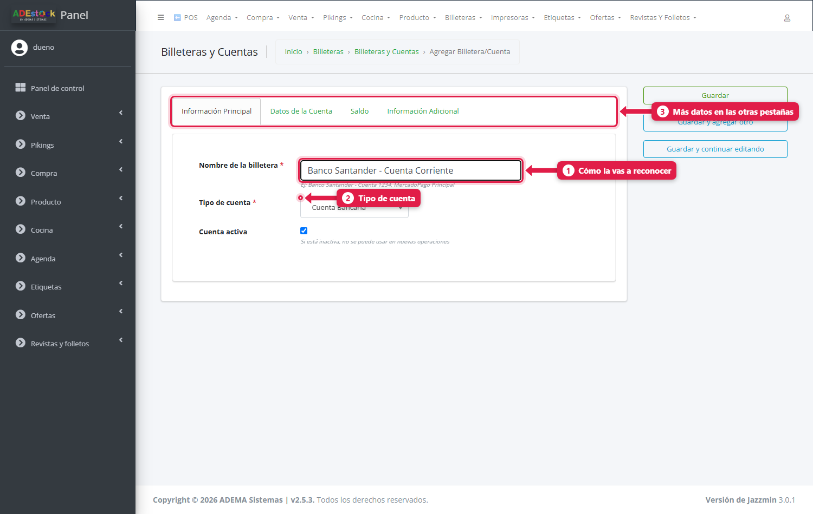

| # | Campo | Qué poner |
|---|---|---|
| 1 | **Nombre de la billetera** | Algo claro, por ejemplo *Banco Santander - Cuenta Corriente* |
| 2 | **Tipo de cuenta** | Cuenta bancaria, efectivo, MercadoPago, PayPal, criptomonedas u otro |
| 3 | Pestañas | *Datos de la Cuenta*, *Saldo* e *Información Adicional* |

En **Datos de la Cuenta** completás titular, banco y número de cuenta (opcionales):

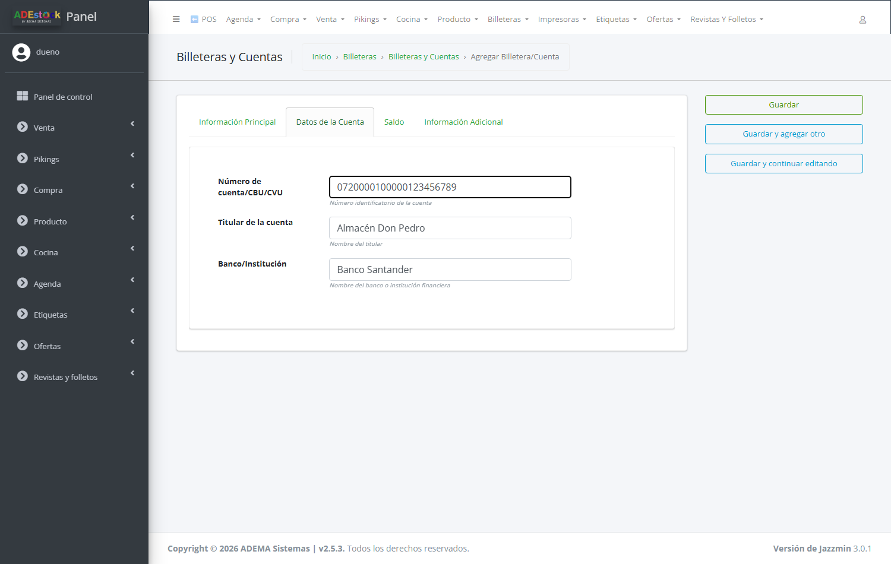

En **Saldo**, el **saldo inicial**: con cuánta plata arranca esta cuenta hoy.

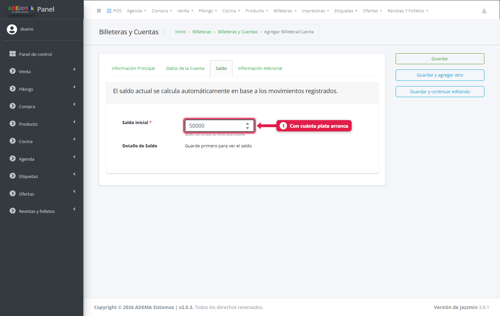

Tocá **Guardar**.

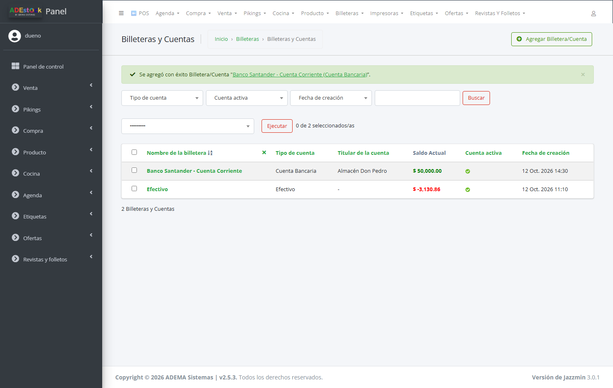

> **El saldo inicial se puede cambiar solo mientras la billetera no tenga movimientos.** Después queda bloqueado: si hay que corregir el saldo, se hace con un **ajuste** (paso 5).

Una cuenta **inactiva** (desmarcando *Cuenta activa*) no se puede usar en operaciones nuevas, pero conserva su historial.

### 3. Vinculá un medio de pago a la billetera

Para que, por ejemplo, **las transferencias que te hacen los clientes** entren al banco, el medio de pago *Transferencia* tiene que estar vinculado a esa billetera. Se hace desde el engranaje del POS (**Menú rápido → Configuración → Medios de cobro**, campo **Billetera**) como se explica en [La configuración del POS](/tutoriales/configurar-punto-de-venta/), o desde el panel en **Agenda → Medios de pago** (columna *Billetera asociada*). Lo mismo para los **medios de compra** (con qué pagás a los proveedores).

> Si un medio de pago **no tiene billetera**, sus cobros y pagos **no se registran** en ninguna billetera.

### 4. Pasá plata de una billetera a otra (transferencia)

Por ejemplo, sacaste $ 10.000 del banco para tener cambio en la caja. **Billeteras → Transferencias entre Billeteras → Agregar**.

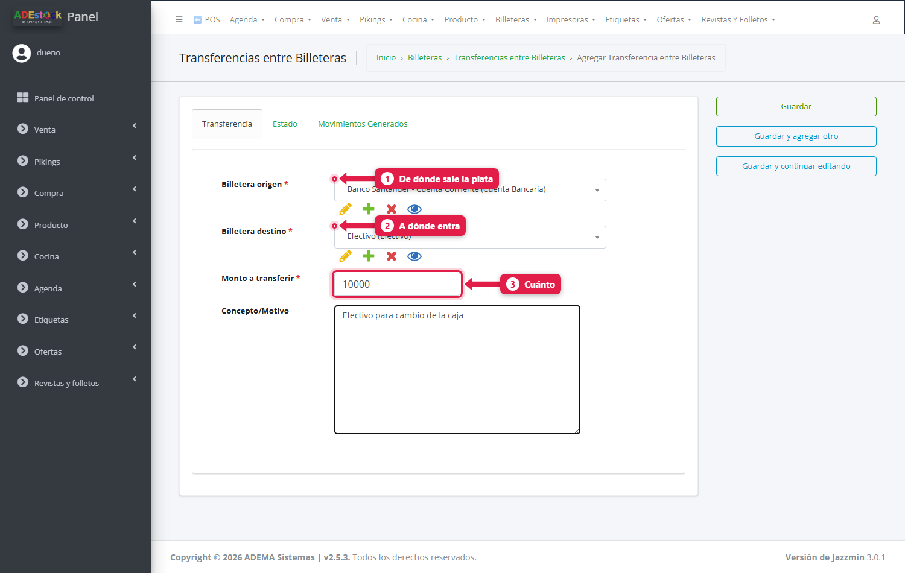

| # | Campo | Qué poner |
|---|---|---|
| 1 | **Billetera origen** | De dónde sale la plata |
| 2 | **Billetera destino** | A dónde entra |
| 3 | **Monto a transferir** | Cuánto |
| — | **Concepto/Motivo** | Para qué (por ejemplo, *Efectivo para cambio de la caja*) |

Al guardar, la transferencia queda **pendiente**: todavía no movió plata. El sistema te lo recuerda: *«Recuerde confirmarla para que se apliquen los movimientos»*.

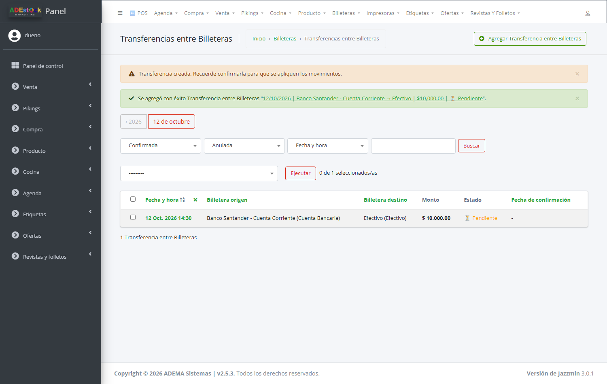

Para **confirmarla**, tildala en la lista, elegí la acción **Confirmar transferencias seleccionadas** y tocá **Ejecutar**:

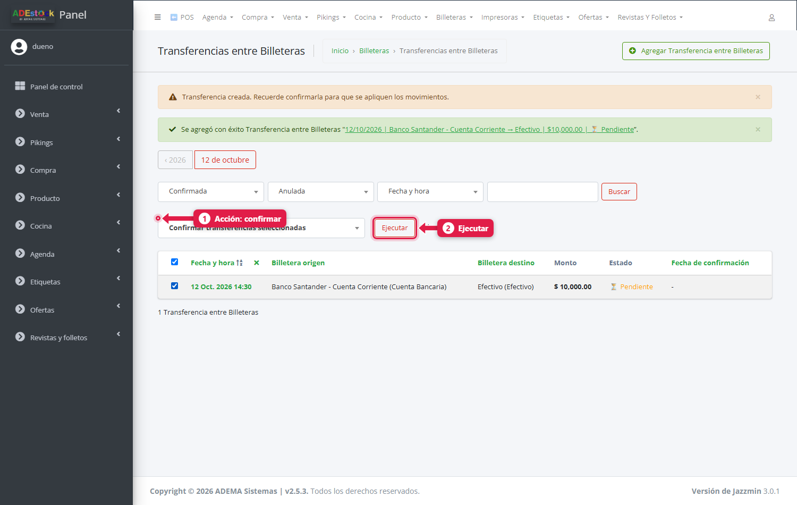

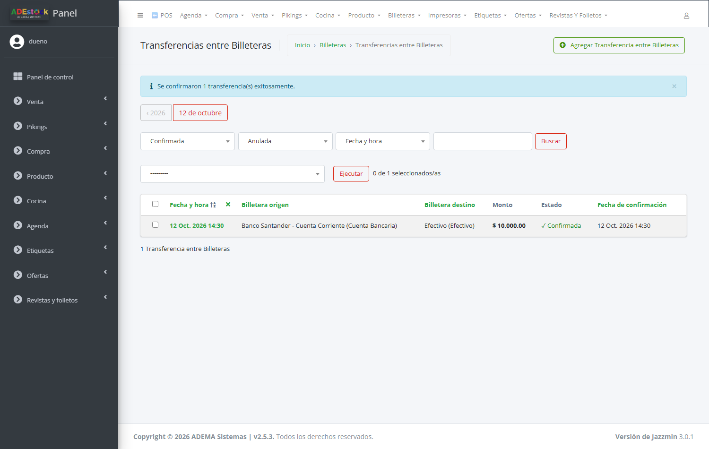

Al confirmar, el sistema genera **dos movimientos**: un **egreso** en la billetera origen y un **ingreso** en la destino. Una transferencia confirmada ya no se puede modificar.

Reglas que controla el sistema:

- El origen y el destino **no pueden ser la misma** billetera.
- El monto tiene que ser **mayor a cero**.
- Las dos billeteras tienen que estar **activas**.
- Si el origen **no tiene saldo suficiente**, no te deja (salvo que esté permitido el saldo negativo, ver *Saldos negativos*).

### 5. Corregí un saldo (ajuste manual)

Para movimientos que **no vienen de una venta, compra o gasto**: la comisión del banco, un interés, un ingreso que no pasó por el sistema, o una corrección. **Billeteras → Ajustes de Billeteras → Agregar**.

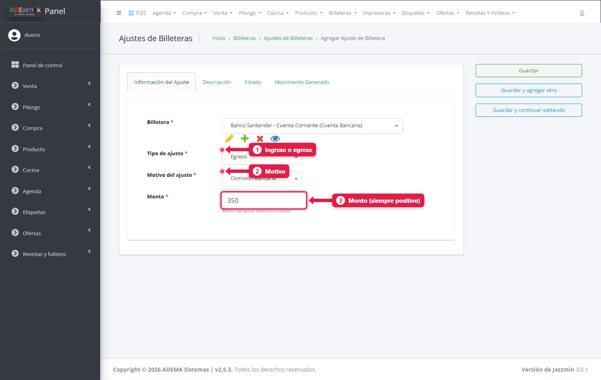

| # | Campo | Qué poner |
|---|---|---|
| — | **Billetera** | A cuál afecta |
| 1 | **Tipo de ajuste** | *Ingreso* (suma) o *Egreso* (resta) |
| 2 | **Motivo del ajuste** | Ajuste de saldo inicial, Corrección de saldo, Ingreso externo, Egreso externo, Comisión bancaria, Interés bancario u Otro |
| 3 | **Monto** | Siempre **positivo**: el tipo decide si suma o resta |
| — | **Descripción** | Detalle (pestaña *Descripción*) |

Igual que la transferencia, el ajuste queda **pendiente hasta que lo confirmes** (acción **Confirmar ajustes seleccionados**). Al confirmar, queda registrado **quién** lo confirmó y **cuándo**.

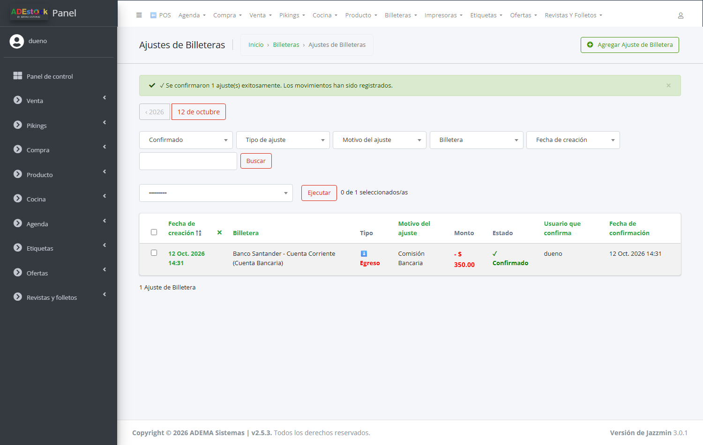

### 6. Revisá los movimientos

**Billeteras → Movimientos de Billeteras** es el **libro mayor**: cada movimiento con su fecha, billetera, tipo (ingreso o egreso), **origen**, monto, **saldo anterior** y **saldo nuevo**.

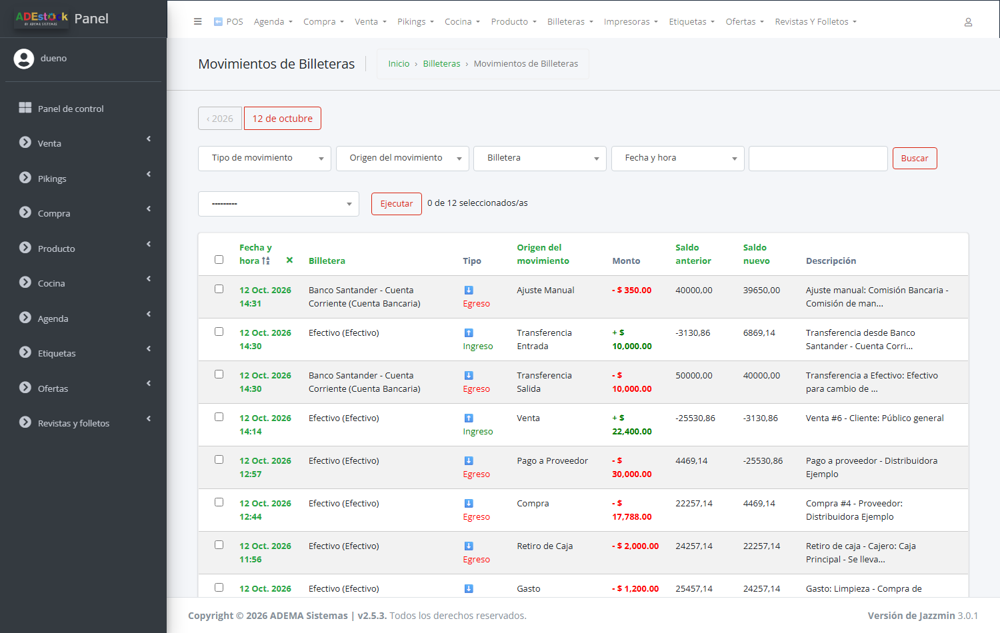

El **origen** te dice qué lo generó: *Venta*, *Compra*, *Gasto*, *Retiro de Caja*, *Cobro de Deuda*, *Pago a Proveedor*, *Transferencia Entrada*, *Transferencia Salida* o *Ajuste Manual*. En el ejemplo se ve la secuencia del día: un gasto, un retiro, una compra y un pago a proveedor, una venta, y después la transferencia del banco a la caja y la comisión.

Podés filtrar por **tipo**, **origen**, **billetera** y **fecha**, y buscar por texto de la descripción. Los movimientos son de **solo lectura**: no se editan ni se borran, porque son el respaldo de los saldos.

### 7. Entendé el saldo de una billetera

Entrá a una billetera y abrí la pestaña **Saldo**: muestra el **resumen de cuenta** (saldo inicial, total de ingresos, total de egresos y saldo actual).

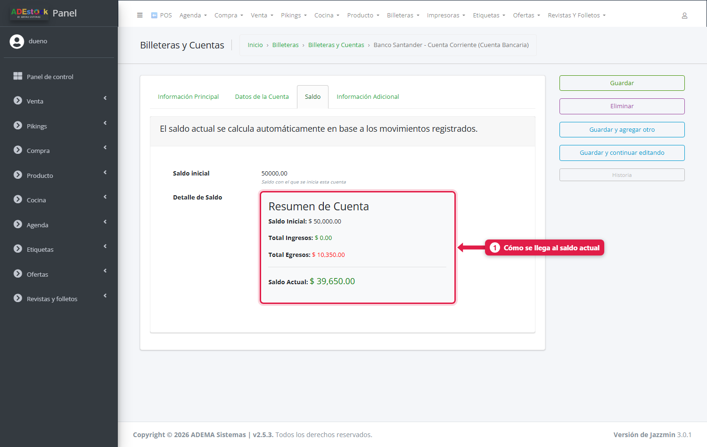

Los saldos finales de la lista:

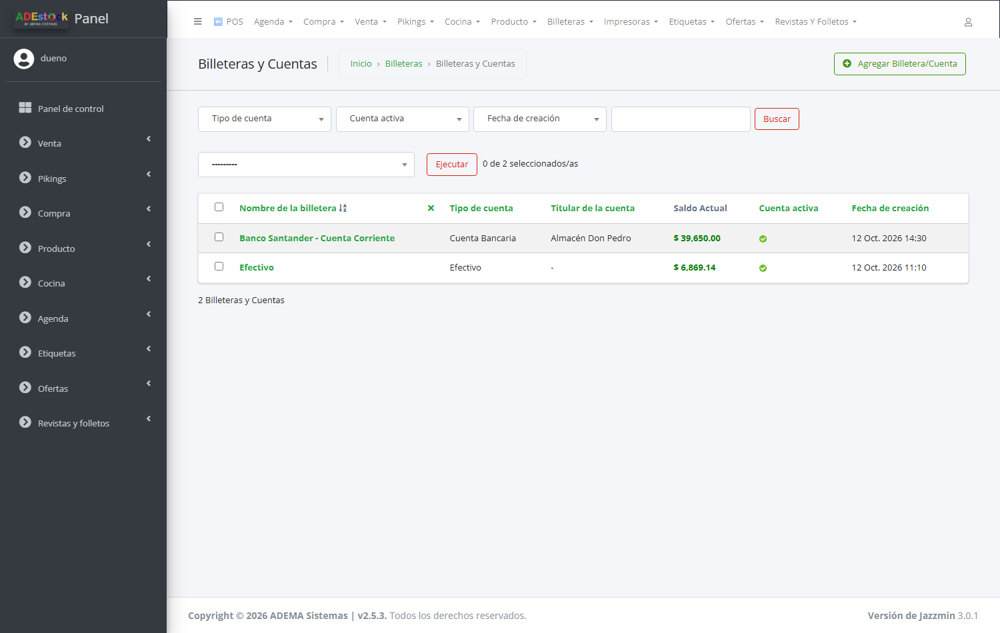

## Saldos negativos

Una billetera puede quedar **en rojo**. Ocurre, por ejemplo, si pagaste compras o proveedores en efectivo más de lo que se había cobrado, o si la caja se abrió sin registrar el efectivo inicial. Casi siempre indica **plata que falta registrar** (un ingreso, o el saldo inicial).

Hay un ajuste para decidir qué hace el sistema cuando una **transferencia o egreso** supera el saldo: en **Agenda → Configuración**, la casilla **Permitir saldo negativo en billeteras**.

| Ajuste | Qué pasa |
|---|---|
| **Apagado** (recomendado) | El sistema **valida** que haya saldo antes de transferir o pagar |
| **Encendido** | Permite operar aunque el saldo sea insuficiente |

## Qué pasa por detrás

| Qué | Detalle |
|---|---|
| Saldo | Se calcula en el momento: saldo inicial + ingresos − egresos de los movimientos |
| Movimientos automáticos | Los crea el sistema al registrar ventas, compras, gastos, retiros, cobros y pagos a proveedores desde el POS, si el medio de pago tiene billetera. Al **anular una venta** con cobros, la devolución resta de la billetera del medio usado |
| Transferencia | Al confirmarla crea un egreso (origen) y un ingreso (destino) |
| Ajuste | Al confirmarlo crea un movimiento *Ajuste Manual* |
| Registro de origen | Cada movimiento guarda el registro que lo generó (la venta, la compra, etc.) |

## Problemas frecuentes

| Si te pasa… | Es porque… | Qué hacer |
|---|---|---|
| Un cobro no aparece en el banco | El medio de pago no tiene billetera vinculada | Vinculalo (paso 3) |
| «Saldo insuficiente en …» al transferir | El origen no tiene saldo suficiente y el saldo negativo no está permitido | Revisá el saldo, registrá el ingreso que falta o activá *Permitir saldo negativo* |
| No puedo cambiar el saldo inicial | La billetera ya tiene movimientos | Usá un **ajuste** de tipo *Corrección de saldo* |
| La transferencia no movió plata | Quedó pendiente | Confirmala con la acción *Confirmar transferencias seleccionadas* |
| La billetera Efectivo está en negativo | Faltan ingresos o el saldo inicial | Cargá un ajuste de *Ajuste de saldo inicial* o revisá los movimientos |
| No puedo usar una billetera en una operación | Está inactiva | Marcá *Cuenta activa* |

## Siguiente paso

- [La configuración del POS](/tutoriales/configurar-punto-de-venta/) (medios de cobro y billeteras)
- [Pagar a un proveedor](/tutoriales/pagar-proveedor/)
