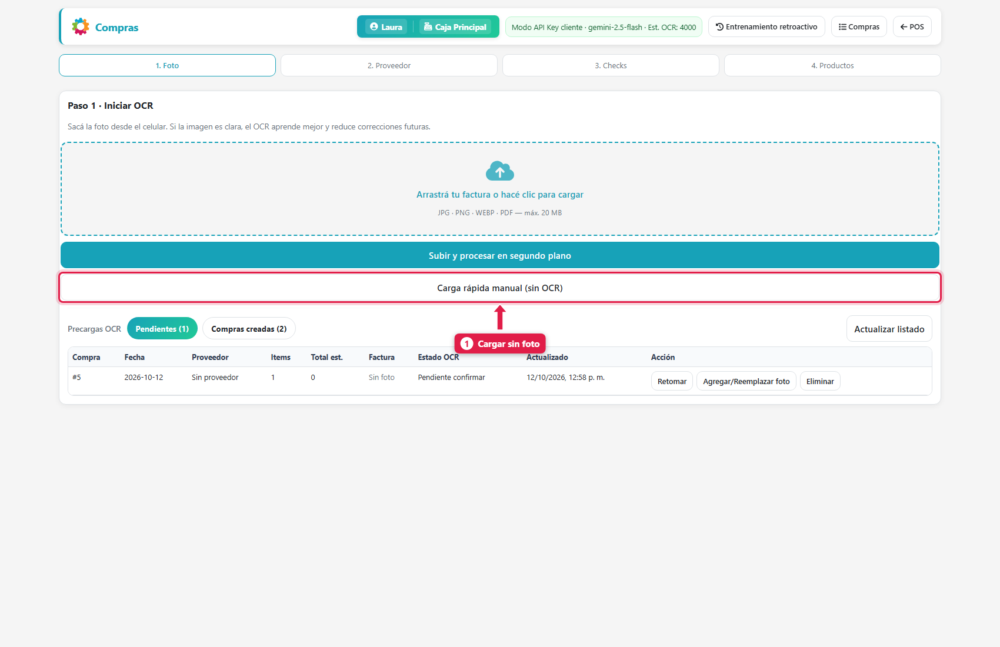
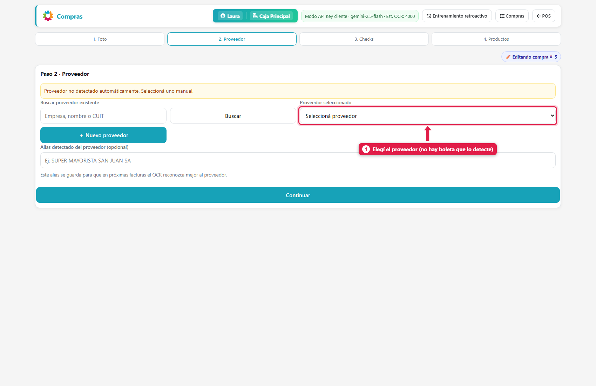
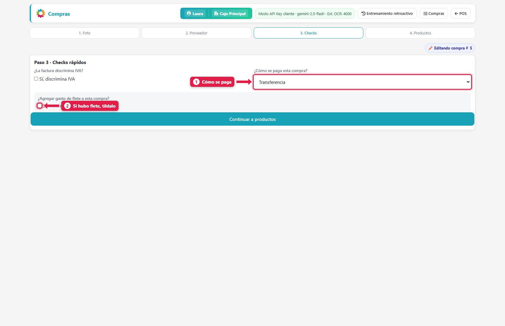
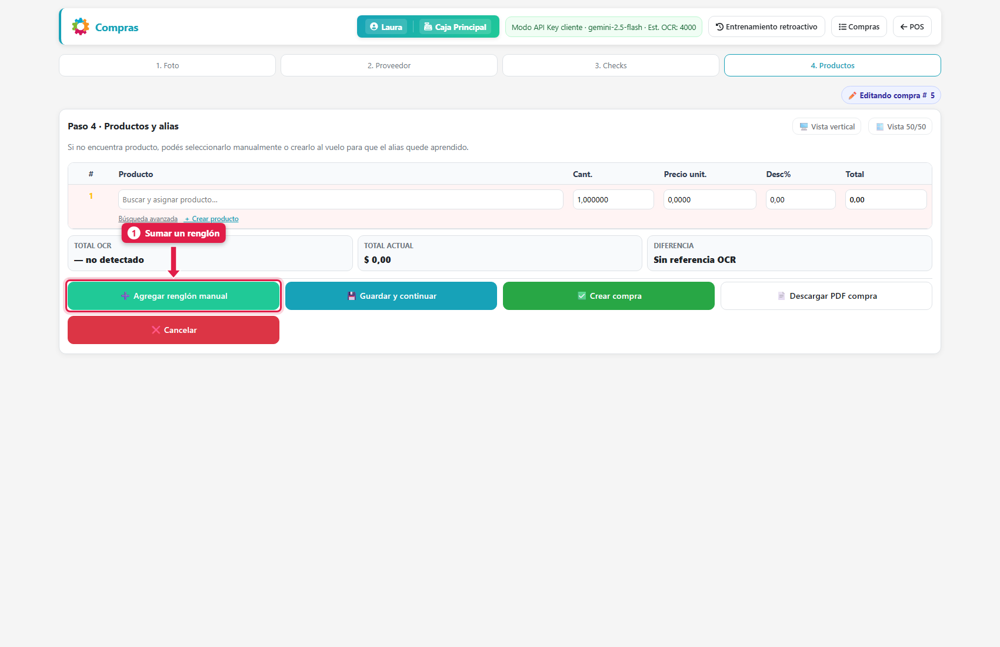
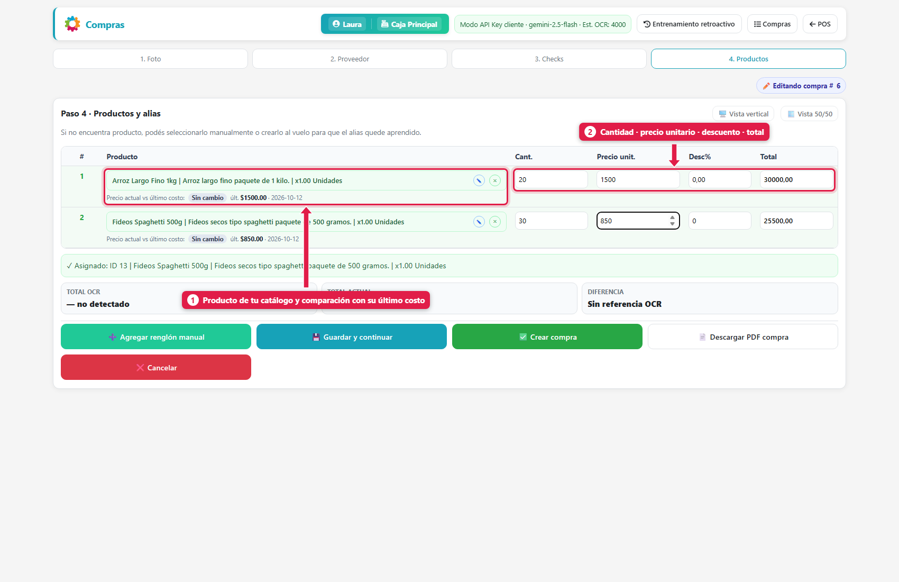
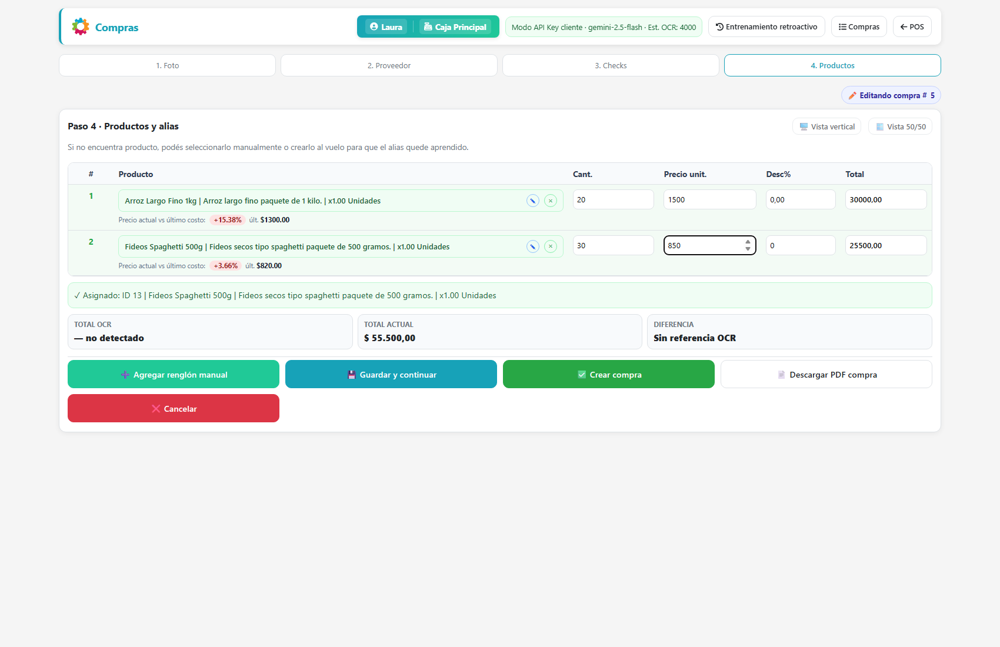
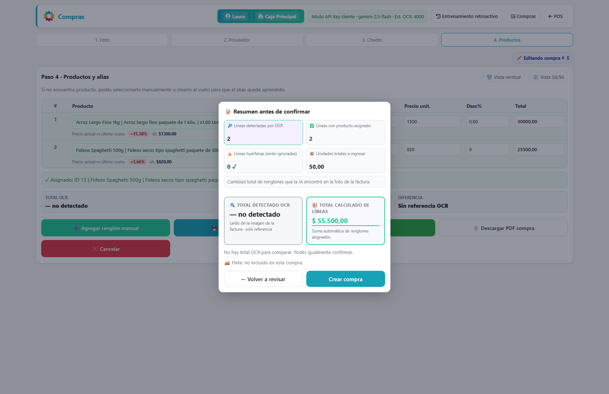
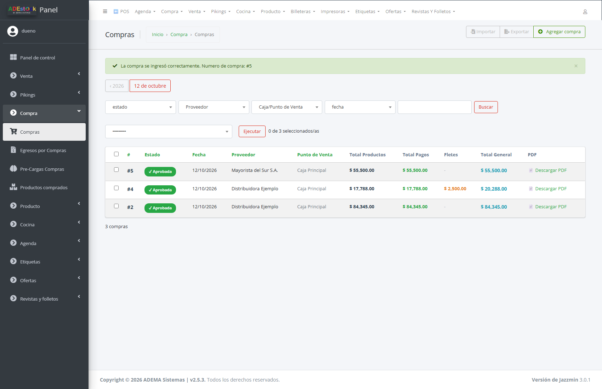

## Qué vas a lograr

Registrar una compra **tecleando los renglones** (sin sacar foto ni usar IA), para que **sume stock**, **actualice los costos** y deje **pagada o a cuenta corriente** con el proveedor.

Es el mismo asistente de 4 pasos que usa la compra con foto, pero sin lectura automática. Sirve cuando:

- No tenés la boleta a mano, o es un remito escrito a mano.
- Querés cargar algo rápido de pocos renglones.
- No tenés configurada la IA, o se alcanzó el límite diario.

## Paso a paso

### 1. Elegí "Carga rápida manual"

Abrí **Menú rápido (F8) → Compras (carga rápida)** (dirección `/compras/simple/`) y tocá **Carga rápida manual (sin OCR)**.

### 2. Elegí el proveedor

No hay boleta que lo detecte: lo elegís vos de la lista (o lo creás con **＋ Nuevo proveedor**).

### 3. Checks: forma de pago y flete

| # | Pregunta | Qué responder |
|---|---|---|
| 1 | **¿Cómo se paga?** | *Efectivo*, *Transferencia* o *Cuenta Corriente Proveedor* (queda como deuda) |
| 2 | **¿Hubo flete?** | Si tildás, elegís si es un gasto aparte, si se paga con la compra y si se prorratea. Está explicado en [Cargar una compra con la foto de la boleta](20-comprar-con-foto-ocr.md#el-flete-tres-formas-de-manejarlo) |

También podés indicar si **la factura discrimina IVA**.

### 4. Cargá los renglones

En el paso 4 la tabla empieza vacía. Cada renglón se agrega con **➕ Agregar renglón manual**.

En cada renglón:

1. Escribí parte del **nombre del producto** y elegí el correcto de la lista. Si es nuevo, tocá **＋ Crear producto**.
2. Completá **cantidad** y **precio unitario**. El **total** se calcula solo. Si tenés un descuento, ponelo en **Desc%**.

| # | Qué ves | Para qué sirve |
|---|---|---|
| 1 | **Producto** y **Precio actual vs. último costo** | Te muestra si el precio de esta compra **subió o bajó** respecto del último costo registrado. Por ejemplo: `+15,38 %` indica que el arroz que costaba $ 1.300 ahora te lo cobran $ 1.500. Si es igual, dice *Sin cambio* |
| 2 | **Cant. · Precio unit. · Desc% · Total** | Los valores del renglón |

> **Act. costo:** cada renglón tiene un casillero para que el costo del producto se **actualice** con el precio de esta compra. Viene tildado.

### 5. Revisá los totales

Como no hay boleta, **Total OCR** dice *no detectado* y **Diferencia** dice *Sin referencia OCR*. Controlá vos que **Total actual** coincida con tu remito.

### 6. Resumen y creación

Tocá **Crear compra**. Aparece el resumen previo (renglones, unidades a ingresar, total y flete):

Tocá **Crear compra** otra vez para guardar.

### 7. Confirmala en el panel de administración

La compra queda **pendiente**. Para que mueva stock y plata, confirmala:

**Panel de administración → Compra → Compras** → tildá la compra → acción **Confirmar compra** → *Ejecutar*.

Pasa a **✓ Aprobada**. En el ejemplo: 20 × $ 1.500 + 30 × $ 850 = **$ 55.500**.

## ¿Y si la pagué a cuenta corriente?

Si en el paso 3 elegiste *Cuenta Corriente Proveedor*, la compra confirmada suma **deuda** con el proveedor. La saldás desde **Menú rápido → Pagar a un proveedor** (ver [Pagar a un proveedor](21-pagar-a-un-proveedor.md)).

Si la pagaste en efectivo o transferencia, ya queda **pagada** al confirmar.

## Qué pasa por detrás

| Qué | Detalle |
|---|---|
| Stock | Suma la cantidad comprada de cada producto, al confirmar |
| Costo | Con *Act. costo* tildado, el costo del producto pasa a ser el precio de esta compra |
| Pago | Se registra un pago con el medio elegido. Si es cuenta corriente, queda sin cancelar (deuda) |

## Problemas frecuentes

| Si te pasa… | Es porque… | Qué hacer |
|---|---|---|
| No me deja crear la compra | Hay un renglón sin producto, o con cantidad 0 | Asigná el producto o quitá el renglón |
| La compra no suma stock | Quedó pendiente | Confirmala desde el panel de administración |
| Cargué mal un precio | — | Antes de confirmar: eliminá la compra pendiente y volvela a cargar |
| El proveedor no está | Es nuevo | **＋ Nuevo proveedor** en el paso 2 |

## Siguiente paso

- Pagar a un proveedor y revisar su cuenta corriente
- Cargar una compra con la foto de la boleta
