## Para qué sirve

Cargar a mano una boleta larga es lento y propenso a errores. Con la foto, el sistema **lee los renglones**, los asocia a tus productos y deja la compra lista para confirmar. Lo importante: **la primera vez que le comprás a un proveedor**, el sistema aprende cómo escribe ese proveedor cada producto, y desde la segunda boleta los reconoce solo. Por eso la primera carga es la más trabajosa y las siguientes son cada vez más rápidas.

## Qué vas a lograr

Vas a **cargar una compra en ADEstock a partir de una foto o un PDF del proveedor**. La lectura con IA (OCR) propone proveedor, productos, cantidades y precios; vos revisás los datos, corregís lo necesario y elegís cómo registrar el pago y el flete.

La compra se guarda pendiente y debe confirmarse antes de afectar stock y pagos. El sistema conserva las asociaciones entre los nombres del comprobante y tus productos para ayudar en próximas cargas, pero cada lectura requiere revisión.

Al asociar los productos, el sistema guarda los nombres que usa ese proveedor como **alias**. En próximas boletas puede reutilizarlos para sugerir coincidencias. Revisá esas sugerencias, especialmente cuando cambia la descripción o presentación del producto. Mirá [cómo se guardan los alias](#el-sistema-aprende-de-cada-compra).

## Antes de empezar (una sola vez, lo hace el dueño)

### 1. Activar el módulo

**Menú rápido → Configuración → Módulos y sistema → Compras con foto (OCR)** y *Guardar cambios*.

### 2. Cargar tu API key de IA

El OCR usa **tu propia cuenta de un proveedor de IA**. Necesitás cargar una API key compatible con la configuración de ADEstock. El costo de lectura depende del proveedor, del modelo y del archivo procesado; revisá el consumo y los límites de esa cuenta.

Panel de administración → **Billeteras → Configuraciones API OCR → Agregar**.

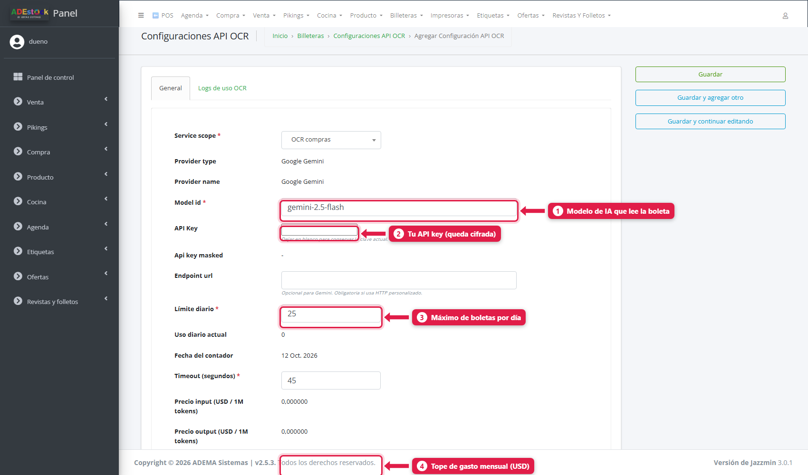

| # | Campo | Qué poner |
|---|---|---|
| 1 | **Model id** | El identificador del modelo compatible que va a leer los comprobantes. Usá uno disponible en tu cuenta y validá la configuración con soporte |
| 2 | **API Key** | Tu clave. Se guarda **cifrada** y después solo se muestra enmascarada |
| 3 | **Límite diario** | Máximo de boletas por día (protege tu gasto) |
| 4 | **Presupuesto mensual (USD)** | Tope de gasto mensual del OCR |

Guardá. Queda así, con la clave enmascarada:

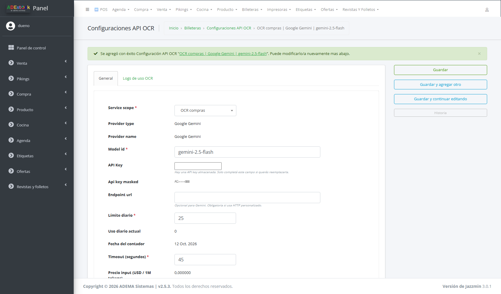

> **Consejo:** si el modelo que viene por defecto ya no existe en tu proveedor, la lectura falla. Probá con uno vigente de la lista de modelos de tu cuenta.

En la parte de arriba de la pantalla de compras vas a ver el estado: *Modo API Key cliente · modelo · Est. OCR: N* (tokens estimados por lectura).

## Paso a paso

Abrí **Menú rápido (F8) → Compras (carga rápida)** (*Cargar facturas con IA*). Aparece cuando el módulo *Compras con foto (OCR)* está activado. La pantalla vive en la dirección `/compras/simple/`: podés guardarla como favorito o como acceso directo en el celular. Son 4 pasos.

### Paso 1 · La foto

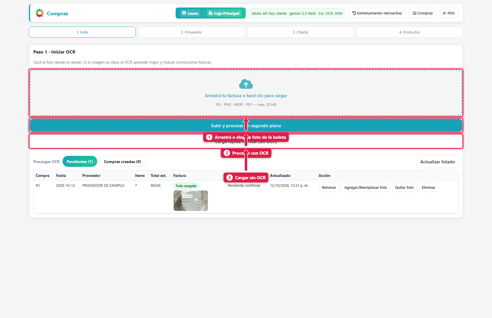

1. **Zona de carga:** arrastrá la foto o hacé clic para elegirla. Acepta **JPG, PNG, WEBP o PDF** (hasta 20 MB). Desde el celular abre la cámara.
2. **Subir y procesar:** manda la boleta al OCR en segundo plano.
3. **Carga rápida manual (sin OCR):** si no querés usar IA, cargás los renglones a mano.

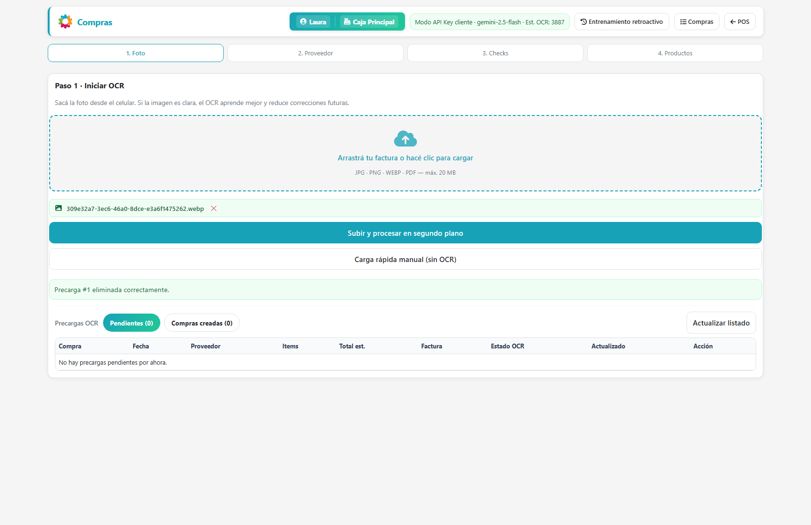

Mientras la IA lee, ves este aviso y podés cargar otra boleta:

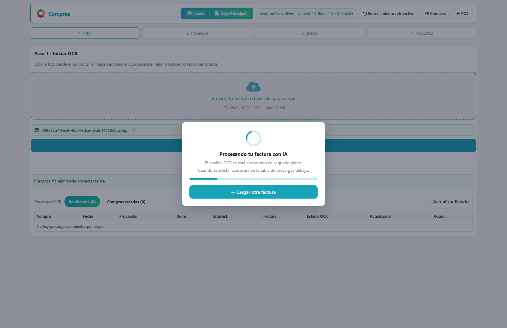

**Para que la lectura salga bien:**

- Foto **derecha**, de frente y completa (que se vea el total).
- Con **buena luz** y sin sombras ni dedos tapando renglones.
- Si la boleta es larga, sacala en partes con la foto del total incluida.
- Cuanto más clara la foto, mejor aprende el sistema y menos tenés que corregir.

Cuando termina, el sistema pasa solo al paso 2. Si salís y volvés, la boleta queda en **Precargas pendientes** y la retomás con **Retomar**.

### Paso 2 · El proveedor

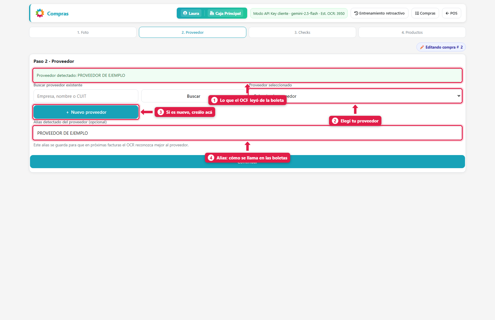

| # | Elemento | Qué es |
|---|---|---|
| 1 | **Proveedor detectado** | El nombre que la IA leyó en la boleta |
| 2 | **Proveedor seleccionado** | Elegí cuál de **tus** proveedores es |
| 3 | **Nuevo proveedor** | Si es la primera vez que le comprás, lo creás en el momento (empresa y CUIT alcanzan) |
| 4 | **Alias del proveedor** | Cómo figura en las boletas. **Se guarda** para reconocerlo la próxima vez |

Elegí el proveedor y tocá **Continuar**.

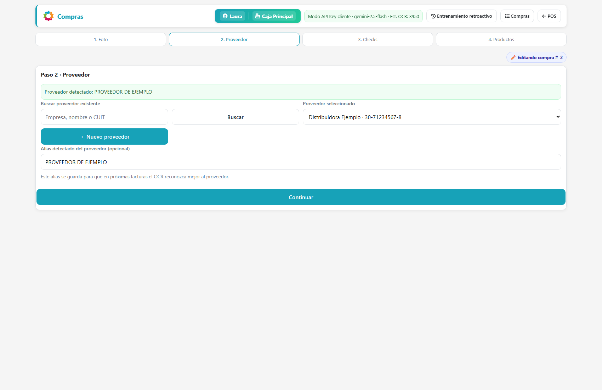

> **Primera vez:** elegís vos el proveedor. **Próximas veces:** el sistema puede reconocerlo por el alias y dejarlo seleccionado. Verificá que sea el correcto (lo ves en [la segunda boleta](#la-segunda-boleta-reutilizar-los-alias-del-proveedor)).

### Paso 3 · Revisá IVA, forma de pago y flete

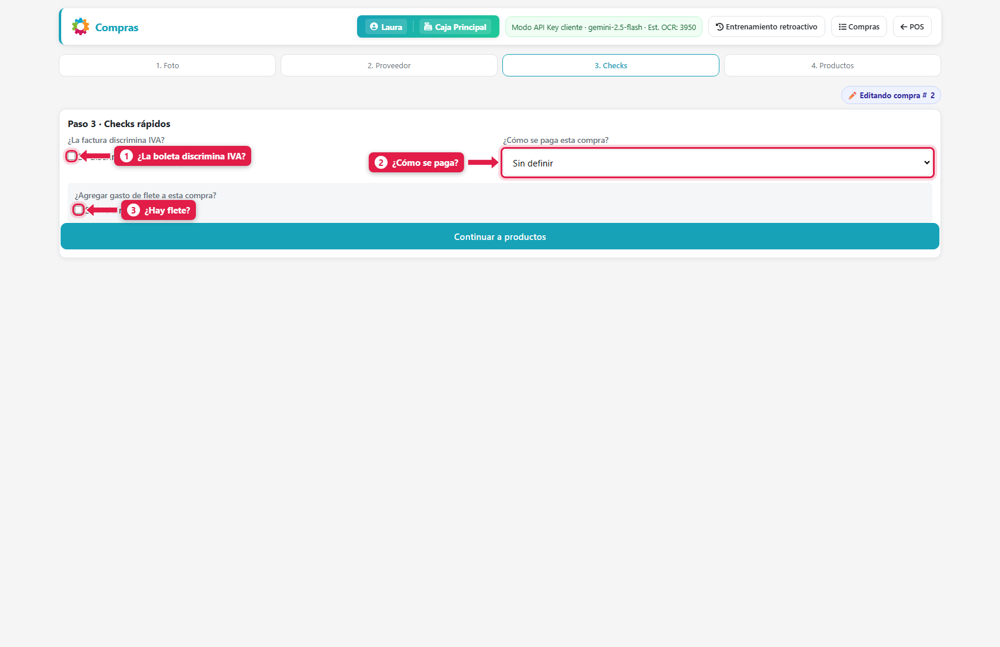

| # | Pregunta | Qué responder |
|---|---|---|
| 1 | **¿La factura discrimina IVA?** | Tildalo si la boleta es una factura con IVA separado. Una boleta común, no |
| 2 | **¿Cómo se paga esta compra?** | *Efectivo*, *Transferencia* o *Cuenta Corriente Proveedor* (la pagás después: queda como deuda con el proveedor) |
| 3 | **¿Agregar gasto de flete?** | Si la compra tuvo un envío, tildalo (ver abajo) |

#### El flete: tres formas de manejarlo

Cuando tildás **Sí, incluir flete** aparecen las opciones. Primero indicás **cuánto** es:

- **$ Monto fijo:** el importe en pesos del flete.
- **% del total de productos:** un porcentaje sobre el total de la compra.
- **Redondear a múltiplo de $:** para que el flete quede en un número redondo.

Después decidís **quién lo cobra y cómo se registra**. Hay tres combinaciones:

##### A. El flete se paga aparte (opción por defecto)

*Los dos tildes apagados.* Es lo que pasa cuando **el flete lo cobra otra persona** (un transportista) o lo pagás por otro lado.

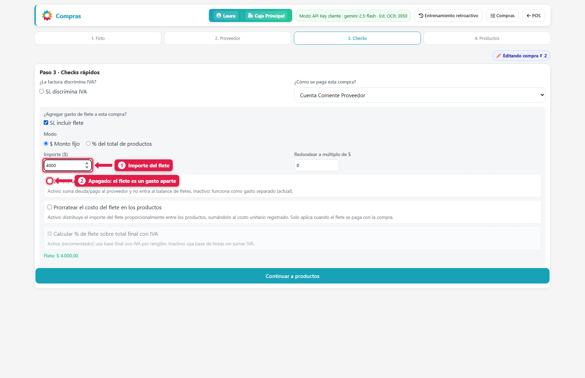

- El flete queda como un **gasto separado** (balance de fletes).
- **No** se suma a lo que le debés al proveedor.
- **No** cambia el costo de los productos.

##### B. El flete se paga con la compra, al mismo proveedor

*Tildás **"El flete se paga con esta compra al proveedor"**.* Es cuando el proveedor te factura el flete junto con la mercadería.

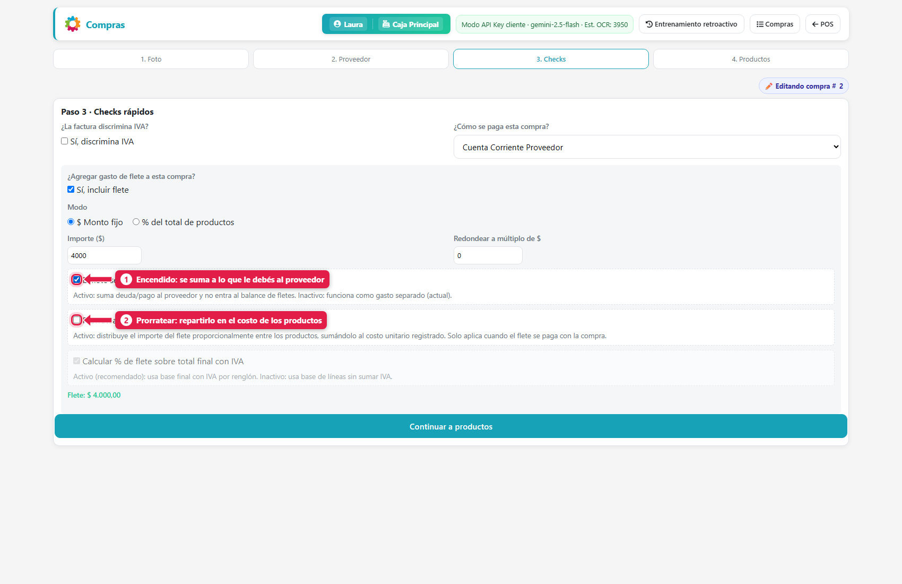

- El flete **se suma a lo que le debés (o le pagás) al proveedor**.
- **No** va al balance de fletes.
- El costo de los productos **no cambia**: el flete queda como un renglón aparte.

##### C. El flete se paga con la compra y se prorratea en los productos

*Tildás los dos: "se paga con esta compra" y **"Prorratear el costo del flete en los productos"**.* Es la opción correcta si querés que **el costo real de cada producto incluya su parte del envío**.

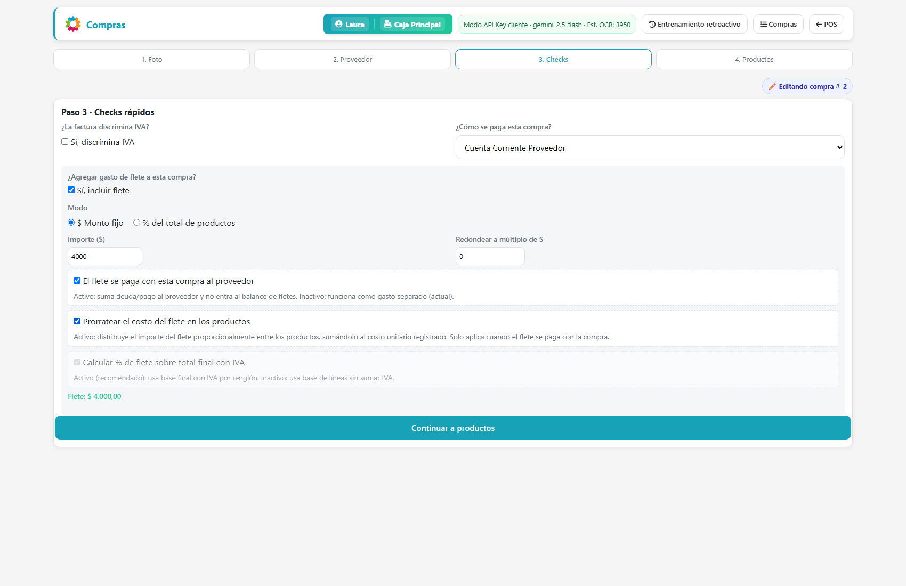

- El flete se **reparte proporcionalmente** entre los productos, según lo que cuesta cada uno.
- Cada producto **sube su costo unitario** con su parte del flete.
- Ya **no queda un renglón de flete**: está dentro de los productos.
- Lo que le debés al proveedor es el total de productos (que ya incluye el flete).

> **El prorrateo solo se puede usar si el flete se paga con la compra.** Si el flete es un gasto aparte, no se prorratea.

#### Ejemplo con números

Boleta de $ 80.345 y un flete de $ 4.000:

| | A. Aparte | B. Con la compra | C. Con la compra + prorrateo |
|---|---|---|---|
| Le debés al proveedor | $ 80.345 | **$ 84.345** | **$ 84.345** |
| El flete figura como | Gasto de fletes | Flete de la compra | *(dentro de los productos)* |
| Costo del Actron (comprado a $ 9.008) | $ 9.008 | $ 9.008 | **$ 9.456,47** |
| ¿Cambia el costo de los productos? | No | No | **Sí**, +4,98 % |

El 4,98 % sale de $ 4.000 ÷ $ 80.345: cada producto absorbe esa proporción del flete.

#### ¿Cuál elijo?

| Situación | Opción |
|---|---|
| El flete lo cobra un transportista distinto del proveedor | **A** |
| El proveedor te factura el flete, y no te importa repartirlo | **B** |
| El proveedor te factura el flete y querés que tus costos y márgenes sean reales | **C** (recomendada) |

Tocá **Continuar a productos**.

### Paso 4 · Productos y alias

Acá se asocia **lo que dice la boleta** con **tus productos**.

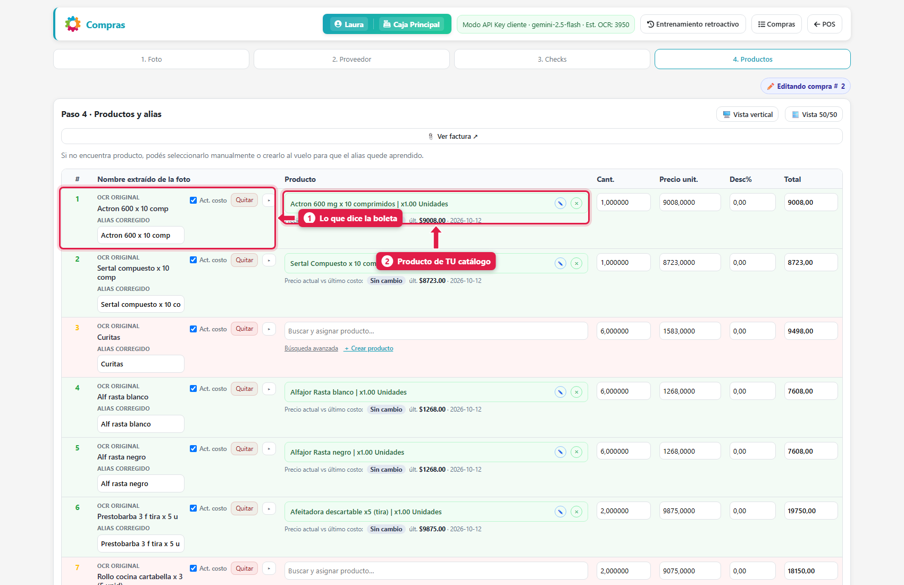

La tabla tiene una fila por renglón de la boleta:

| Columna | Qué es |
|---|---|
| **Nombre extraído de la foto** | Lo que la IA leyó. Debajo está el **alias corregido**: podés editarlo |
| **Producto** | El producto **de tu catálogo** al que corresponde |
| **Cant. / Precio unit. / Desc% / Total** | Los valores leídos. Podés corregirlos |
| **Act. costo** | Si lo dejás tildado, el costo del producto se actualiza con este precio de compra |
| **Quitar** | Saca el renglón de la compra |

**Los colores indican el estado de cada renglón:**

- 🟢 **Verde:** ya tiene producto asignado.
- 🔴 **Rojo:** falta asignarle un producto.

#### Productos que el sistema sugiere solo

Cuando el nombre de la boleta se parece a uno de tus productos, el sistema **lo propone solo** (verde). Revisá que sea el correcto.

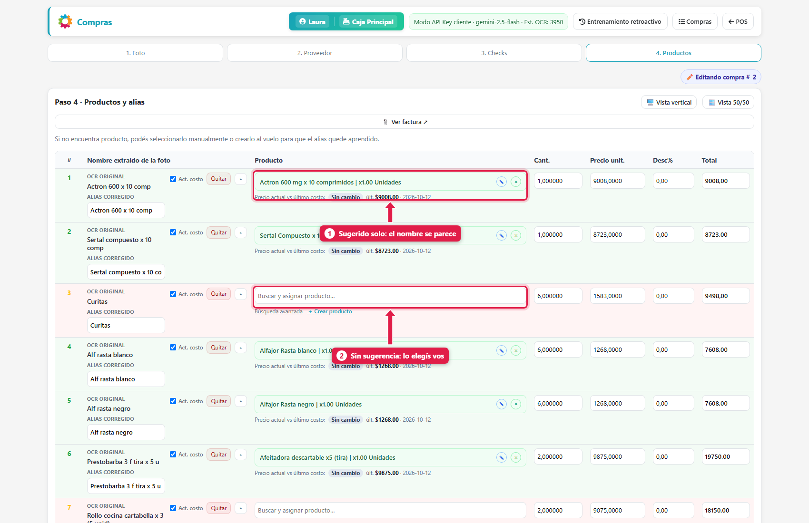

#### Productos que tenés que asignar vos

Para los renglones en rojo, escribí parte del nombre en **Producto** y elegí el correcto de la lista (se ve el stock y el costo actual).

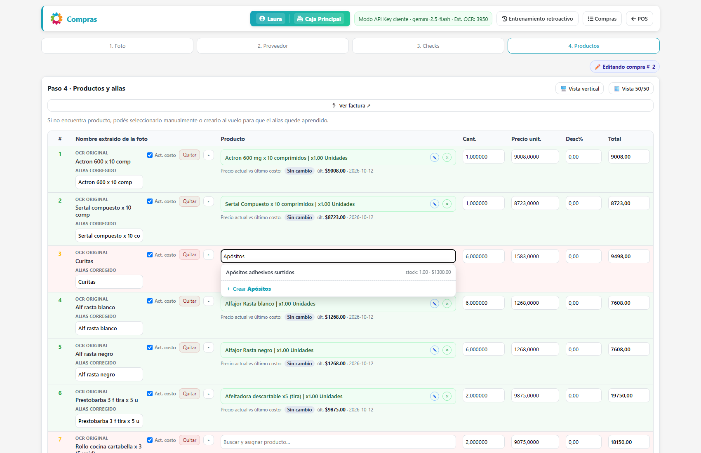

Si no sabés cuál es, usá **Búsqueda avanzada**.

#### Productos nuevos: crearlos al vuelo

Si es un producto que **todavía no tenés**, tocá **＋ Crear producto**. Se abre un formulario con el **nombre y el costo ya cargados** desde la boleta. Completás categoría y precio de venta y listo: el producto queda creado y asignado al renglón.

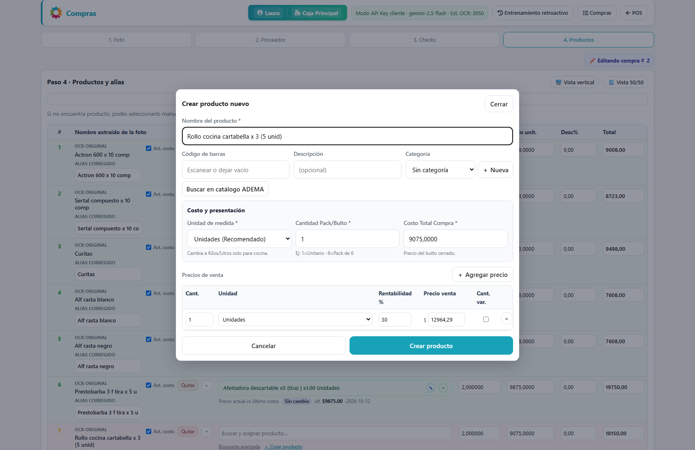

#### Controlá los totales

Cuando todos los renglones están en verde:

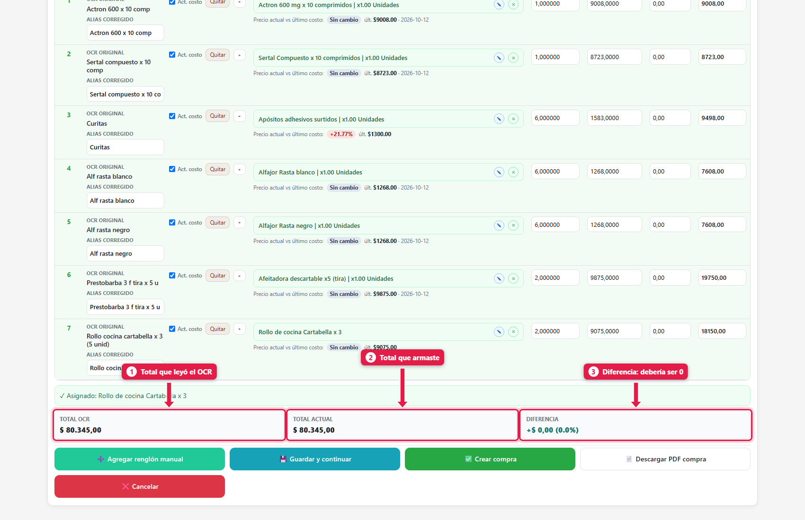

| # | Total | Qué es |
|---|---|---|
| 1 | **Total OCR** | Lo que la IA leyó como total de la boleta |
| 2 | **Total actual** | La suma de los renglones tal como los dejaste |
| 3 | **Diferencia** | Debería ser **$ 0** si cargaste toda la boleta. Si no coincide, revisá cantidades, precios y renglones omitidos o sin asignar |

Botones de abajo: **Agregar renglón manual** (por si la IA salteó uno), **Guardar y continuar** (queda como precarga para seguir después), **Crear compra**, **Descargar PDF compra** y **Cancelar**.

### Resumen y creación de la compra

Tocá **Crear compra**. Antes de guardar, el sistema te muestra un **resumen**:

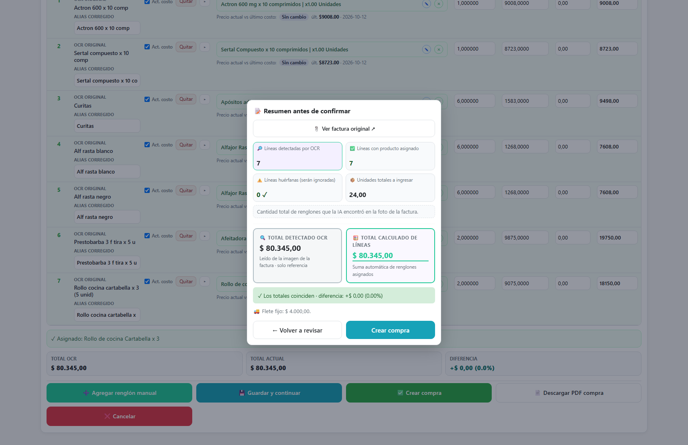

| Dato | Qué significa |
|---|---|
| **Líneas detectadas por OCR** | Cuántos renglones leyó la IA |
| **Líneas con producto asignado** | Cuántas quedaron asociadas |
| **Líneas huérfanas** | Sin producto: **se ignoran** al guardar. Idealmente 0 |
| **Unidades totales a ingresar** | Cuánto stock va a sumar |
| **Total detectado vs. calculado** | Debe coincidir. Si no, te avisa con la diferencia |
| **Flete** | Lo que configuraste en el paso 3 |

Si todo está bien, **Crear compra**. Si no, **Volver a revisar**.

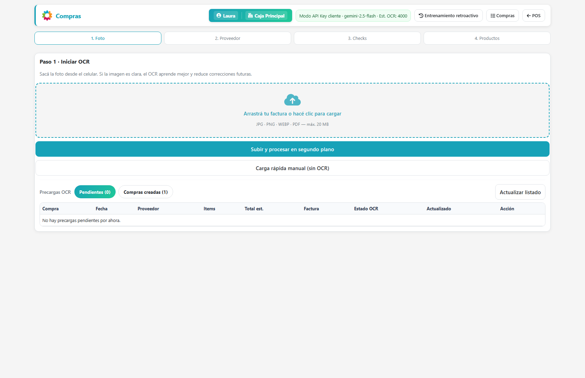

La compra aparece en **Compras creadas**. **Todavía no impactó en el stock**: falta el último paso.

## Confirmar la compra

La compra se crea **pendiente de confirmación**, para que puedas revisarla antes de que mueva stock y plata. La confirma el **dueño o un administrativo** desde el panel de administración. Mientras esté pendiente **no descuenta** plata del arqueo, y si se pagó con dinero u otro medio (no cuenta corriente) **tiene que estar confirmada antes de cerrar el turno** (ver [Turno de caja](/tutoriales/abrir-y-cerrar-caja/#antes-de-cerrar-las-compras-pagadas-tienen-que-estar-confirmadas)):

**Panel de administración → Compra → Compras**.

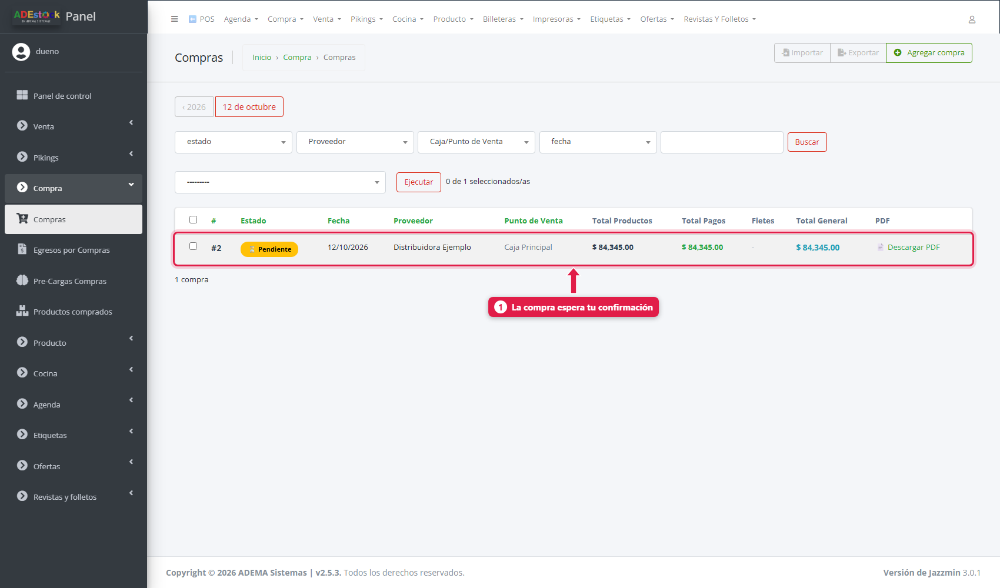

La compra figura con estado **⏳ Pendiente**. Marcá la casilla y elegí la acción **Confirmar compra**:

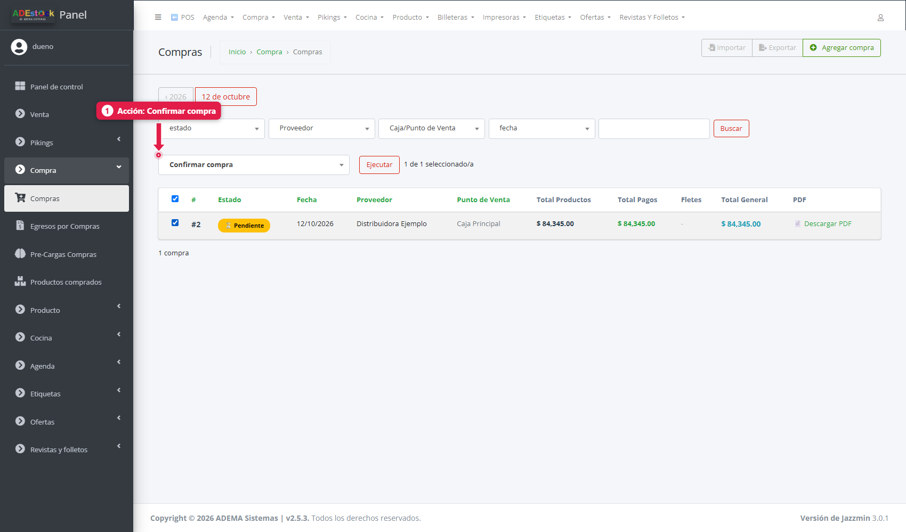

Aparece *La compra se ingresó correctamente* y el estado pasa a **✓ Aprobada**:

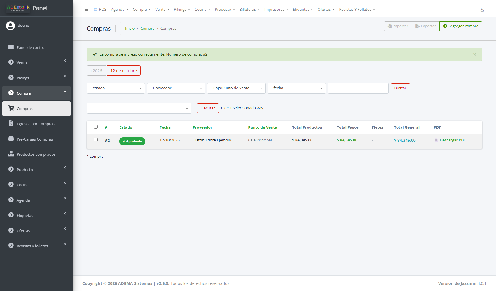

Recién ahí:

- el **stock** de cada producto **aumenta** en lo comprado;
- el **costo** de los productos se **actualiza** (los que tienen *Act. costo* tildado);
- se registra el **pago** o la **deuda con el proveedor**, según lo que elegiste.

## El sistema aprende de cada compra

Esta es la parte que hace que cada boleta sea más rápida que la anterior.

### Qué guarda el sistema

Cada vez que **asociás un renglón de la boleta con uno de tus productos**, el sistema guarda esa relación **para ese proveedor**:

> *"Cuando **Distribuidora Ejemplo** escribe **`Actron 600 x 10 comp`**, se trata de tu producto **`Actron 600 mg x 10 comprimidos`**."*

Eso se llama **alias**. Se guarda por proveedor, junto con el historial de compras (precios, fechas, cantidades).

### Por qué es por proveedor

Cada proveedor escribe a su manera. Lo que un proveedor llama `Alf rasta negro` otro lo puede llamar `Alfajor Rasta Choc.`. Guardarlo por proveedor evita confundir productos.

### Qué pasa en las primeras compras

| Compra | Qué tenés que hacer |
|---|---|
| **1.ª boleta** de un proveedor | Elegir el proveedor y asociar **cada renglón** a tu producto (o crearlo). El sistema aprende todo |
| **2.ª boleta** | Los renglones ya conocidos aparecen **solos**. Asociás solo los nuevos |
| **A partir de ahí** | Casi todo se reconoce solo. Solo revisás precios y totales |

> **Por eso conviene hacer bien las primeras compras de cada proveedor**: elegir con cuidado el producto correcto es lo que "entrena" al sistema. Un alias mal asociado se repite en las próximas boletas.

### Dónde ver lo que aprendió el sistema

En el panel de administración, menú **Compra**, hay dos listados:

- **Aliases OCR de Productos:** cada nombre de boleta asociado a tu producto, por proveedor.
- **Aliases OCR de Proveedores:** cómo aparece cada proveedor en sus boletas.

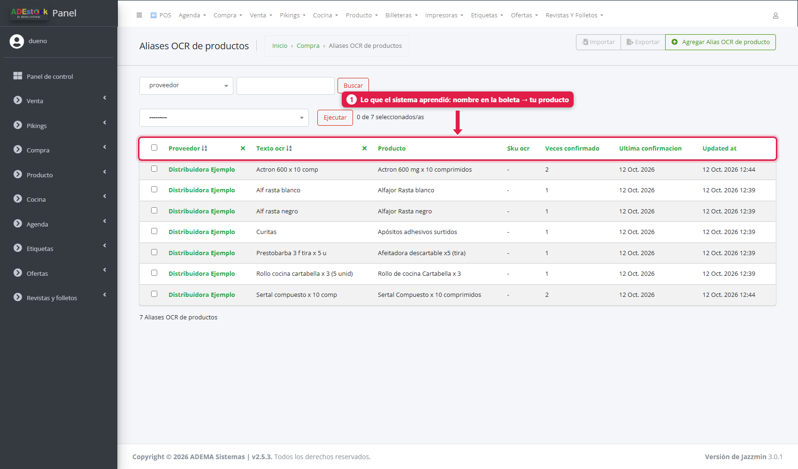

| Proveedor | Texto OCR (como lo escribe la boleta) | Producto (el tuyo) | Veces confirmado |
|---|---|---|---|
| Distribuidora Ejemplo | `Actron 600 x 10 comp` | Actron 600 mg x 10 comprimidos | **2** |
| Distribuidora Ejemplo | `Sertal compuesto x 10 comp` | Sertal Compuesto x 10 comprimidos | **2** |
| Distribuidora Ejemplo | `Curitas` | Apósitos adhesivos surtidos | 1 |
| Distribuidora Ejemplo | `Alf rasta negro` | Alfajor Rasta negro | 1 |

La columna **Veces confirmado** sube cada vez que el sistema vuelve a ver ese nombre y lo confirmás: cuantas más veces, más confiable es el alias. Los dos primeros ya pasaron por **dos boletas**.

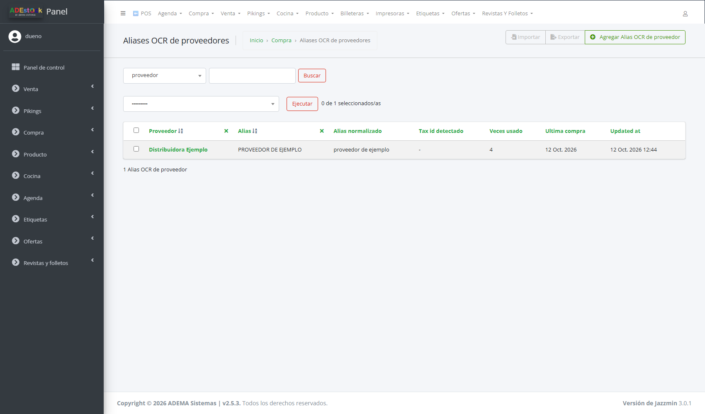

El alias del proveedor (`PROVEEDOR DE EJEMPLO`) también cuenta cuántas veces se usó. Con él, el sistema selecciona al proveedor solo.

### La segunda boleta: reutilizar los alias del proveedor

Subimos una segunda boleta del mismo proveedor. Ahora el sistema:

1. Lee el proveedor y **lo deja seleccionado solo**:

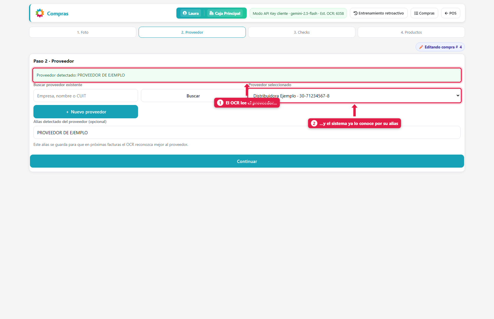

2. Reconoce los productos que ya compraste (`Actron`, `Sertal`, `Prestobarba`) sin que hagas nada. Los **nuevos** quedan en rojo:

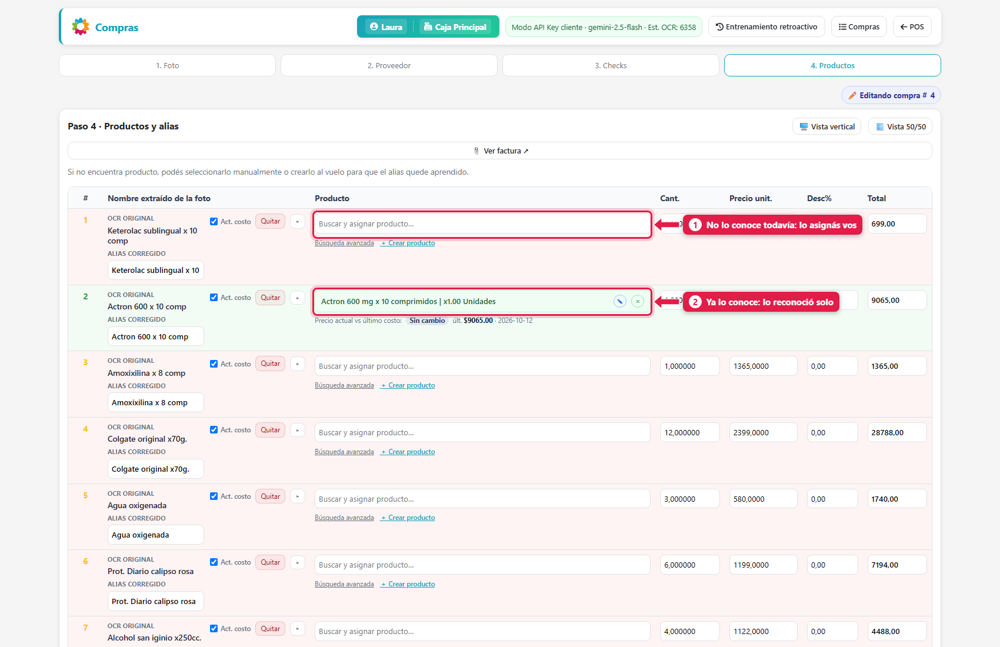

En cada renglón reconocido, el sistema te muestra además el **último costo** y la **fecha** de la compra anterior, para que veas de un vistazo si el proveedor cambió el precio.

3. Los renglones que no conoce los podés **asignar, crear o quitar**:

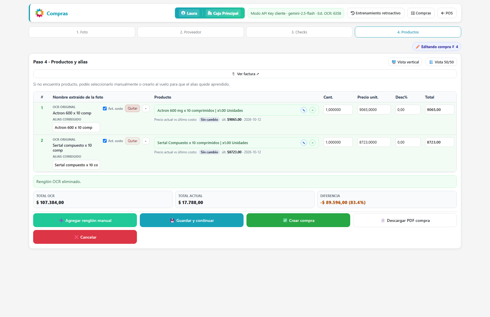

Si quitás renglones, el resumen te avisa que el total calculado difiere del de la boleta (porque dejaste productos afuera). Es normal si lo hiciste a propósito:

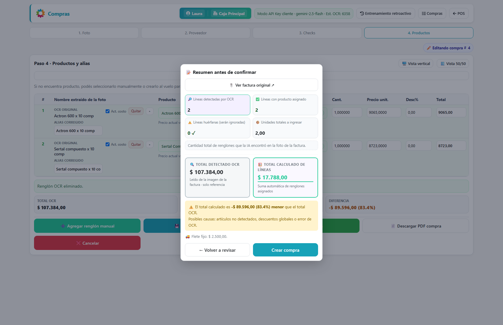

### Flete aparte, en la segunda boleta

En esta segunda compra usamos la opción **A** (flete aparte, $ 2.500) y pagamos en **efectivo**:

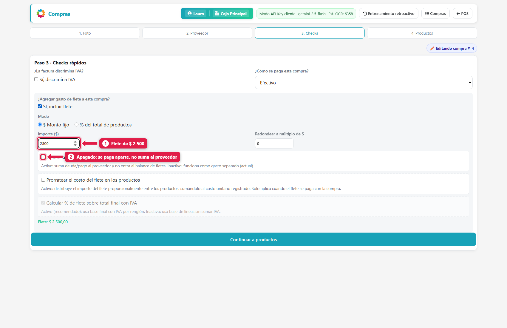

En el listado de compras se ve la diferencia con la primera:

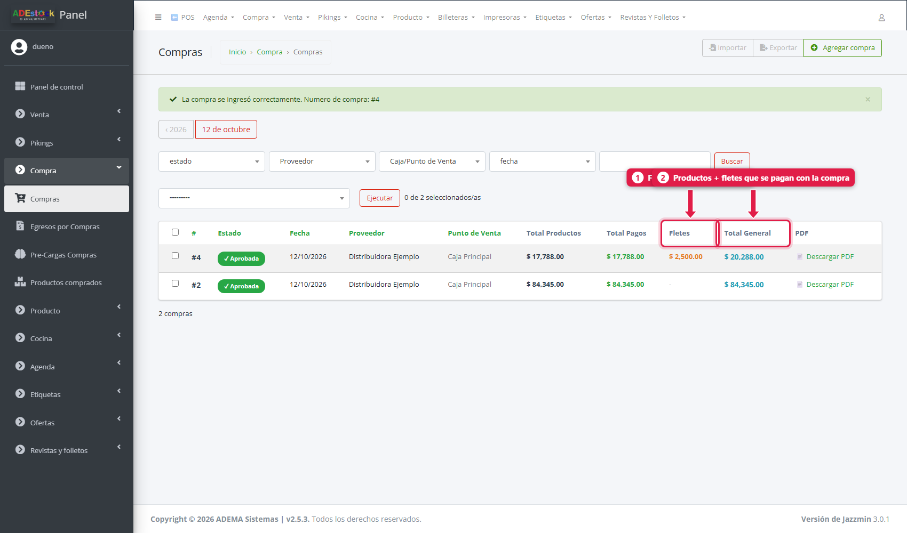

| Compra | Total productos | Total pagos | Fletes | Total general |
|---|---|---|---|---|
| **#2** (flete prorrateado, a cuenta corriente) | $ 84.345 | $ 84.345 | - | $ 84.345 |
| **#4** (flete aparte, en efectivo) | $ 17.788 | $ 17.788 | **$ 2.500** | $ 20.288 |

En la #2 el flete está **dentro** de los productos (por eso 84.345 y sin columna de flete). En la #4 el flete es **un concepto aparte** y no sube lo que se le paga al proveedor.

## Qué pasa por detrás

| Qué | Detalle |
|---|---|
| Lectura | La foto se manda al modelo de IA con tu API key. Devuelve proveedor, renglones, cantidades y precios |
| Alias | Se guardan por proveedor y producto: el nombre leído de la boleta, el producto elegido y el historial de precios |
| Compra | Se crea **sin confirmar**. No toca stock ni plata hasta que la confirmás |
| Flete prorrateado | Se reparte proporcional al total de cada renglón y se suma al precio unitario. El último renglón absorbe el redondeo |
| Flete que se paga con la compra | Suma a `total a pagar al proveedor` |
| Flete aparte | Queda como gasto separado, fuera de lo que se le debe al proveedor |
| Costo del producto | Con *Act. costo* tildado, pasa a ser el precio de compra (más el flete prorrateado, si hubo) |
| Límites | Si se alcanza el límite diario o el presupuesto mensual, el sistema **no usa más IA** y te habilita la **carga manual** para que puedas seguir |

## Problemas frecuentes

| Si te pasa… | Es porque… | Qué hacer |
|---|---|---|
| No veo *Compras con foto* | El módulo está apagado | Configuración → Módulos y sistema → *Compras con foto (OCR)* |
| "La configuración OCR no tiene API key" | Falta cargar la clave | Panel admin → Configuraciones API OCR |
| Falla la lectura con error del proveedor de IA | El modelo configurado ya no existe, o la clave no tiene saldo | Cambiá el modelo o revisá tu cuenta del proveedor de IA |
| "Se alcanzó el límite diario" / "presupuesto mensual" | Llegaste al máximo configurado | Subí el límite o continuá con **carga manual** (se habilita sola) |
| El OCR leyó mal una cantidad o un precio | Foto poco clara | Corregilo a mano en el paso 4 (los campos son editables) |
| La *Diferencia* no es $ 0 | Un renglón mal leído, faltante o sin asignar | Compará con la boleta y corregí; usá *Agregar renglón manual* |
| Un producto se asocia mal siempre | El alias quedó mal aprendido | Corregí el producto en ese renglón y revisá los alias (ver *Dónde ver lo que aprendió el sistema*) |
| La compra no mueve el stock | Quedó **pendiente** | Confirmala en Panel admin → Compra → Compras → *Confirmar compra* (la hace el dueño o un administrativo) |
| No me deja cerrar la caja | Hay compras pagadas sin confirmar en tu turno | Pedí que las confirmen en el panel |
| Me equivoqué con el flete | - | Antes de confirmar, no hay efecto: eliminá la compra pendiente y volvela a cargar |

## Cómo comprobar que salió bien

Antes de crear la compra, compará los renglones y el total con el comprobante original, revisá los productos asociados y resolvé las líneas sin producto. Después de confirmarla en el panel, comprobá el stock, los costos y el pago o deuda del proveedor. Una foto procesada o una compra pendiente todavía no completa ese ingreso.

## Siguiente paso

- [cargar una compra manual en ADEstock](/tutoriales/cargar-compra-manual/)
- [crear y editar proveedores en ADEstock](/tutoriales/crear-y-editar-proveedores/)
- [pagar a proveedores y registrar adelantos en ADEstock](/tutoriales/pagar-proveedor/)
