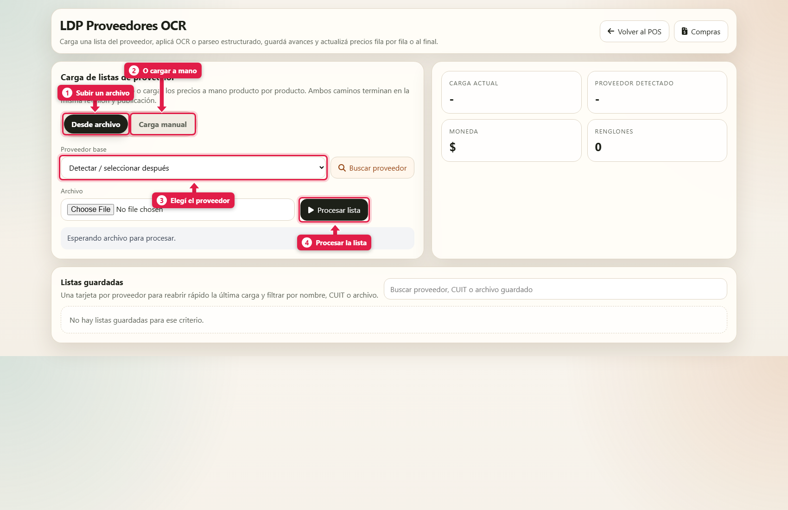
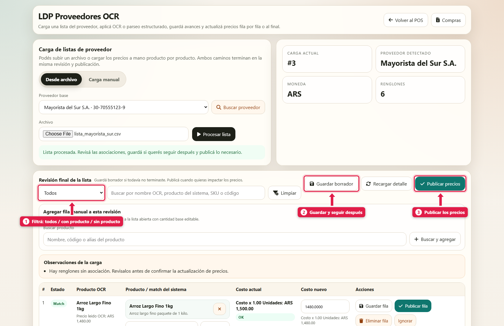
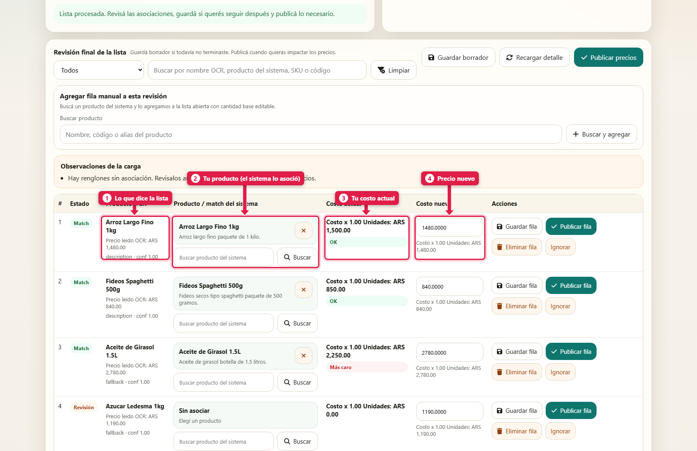
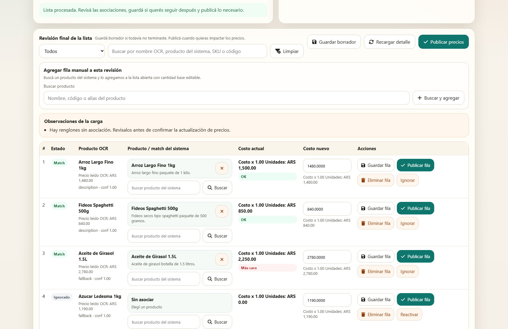
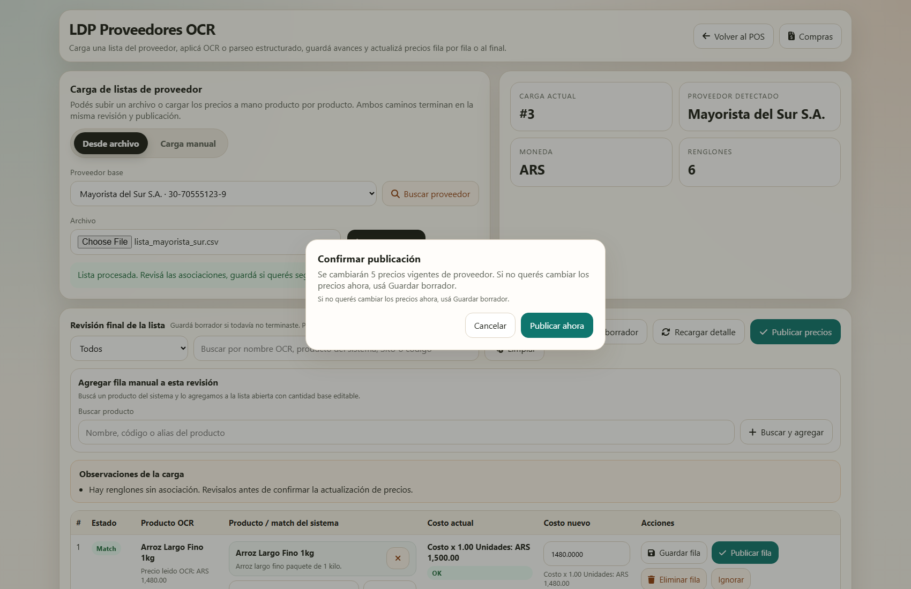
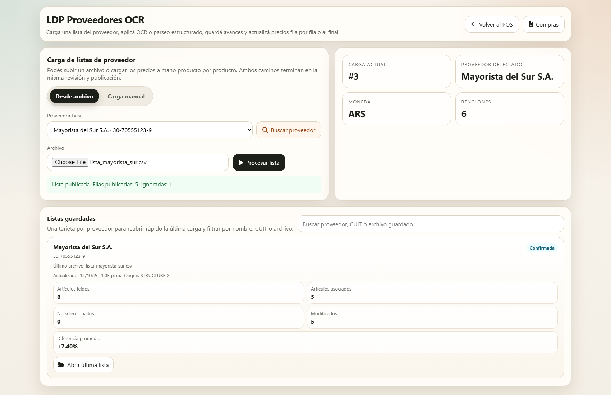
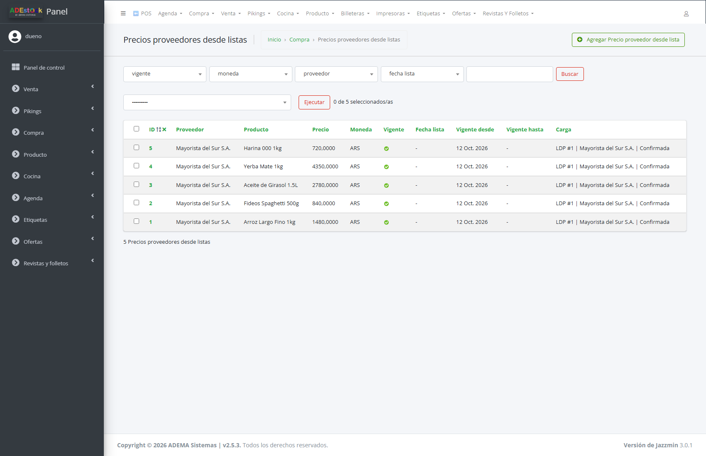

## Qué vas a lograr

Subir la **lista de precios** que te manda un proveedor, que el sistema **asocie cada renglón con tus productos**, te **avise en qué productos te conviene o no** (comparando contra tu costo actual) y **guarde el precio vigente de ese proveedor**.

> **Importante:** publicar una lista **no cambia el costo de tus productos**. Guarda *el precio que ofrece ese proveedor*. Tu costo cambia recién cuando le **comprás** (ver *Cargar una compra*).

## Antes de empezar

El dueño activa el módulo en **Menú rápido → Configuración → Módulos y sistema → Listas de precios de proveedores**.

Formatos aceptados: **CSV, XLSX, DOCX, PDF** y **fotos** (JPG, PNG, WEBP). Con CSV y Excel el sistema lee las columnas directamente; con PDF y fotos usa lectura con IA (como en la compra con foto).

## Paso a paso

Abrí **Menú rápido (F8) → Listas de proveedores** (dirección `/compras/proveedores-ocr/`). Aparece cuando el módulo está activado.

### 1. Elegí el proveedor y el archivo

| # | Elemento | Qué es |
|---|---|---|
| 1 | **Desde archivo** | Subís la lista del proveedor |
| 2 | **Carga manual** | Cargás los precios a mano, producto por producto |
| 3 | **Proveedor base** | El proveedor de la lista. Si no lo elegís, el sistema trata de detectarlo |
| 4 | **Procesar lista** | Lee el archivo |

Elegí el proveedor, el archivo y tocá **Procesar lista**.

### 2. Revisá lo que leyó

Arriba ves un resumen: **proveedor detectado**, **moneda** y **cantidad de renglones**. Abajo, la revisión:

| # | Botón | Qué hace |
|---|---|---|
| 1 | **Filtro** | Muestra todos, solo los asociados (*Matcheados*), los *No matcheados*, los *Actualizados* o los *Ignorados* |
| 2 | **Guardar borrador** | Guarda tu avance para seguir después (queda en *Listas guardadas*) |
| 3 | **Publicar precios** | Confirma y deja vigentes los precios de esta lista |

### 3. Controlá cada renglón

| # | Columna | Qué significa |
|---|---|---|
| 1 | **Producto OCR** | Lo que dice la lista del proveedor, con el precio leído |
| 2 | **Producto / match del sistema** | **Tu** producto asociado. Si está en verde (*Match*) ya lo reconoció |
| 3 | **Costo actual** | Lo que hoy te cuesta ese producto, con un indicador |
| 4 | **Costo nuevo** | El precio de la lista. Podés corregirlo |

**El indicador de costo** compara el precio del proveedor contra tu costo actual:

- 🟢 **OK**: el proveedor te lo ofrece al mismo precio o **más barato**.
- 🔴 **Más caro**: el proveedor te lo ofrece **más caro** que tu costo actual.

En el ejemplo, el aceite figura **Más caro** ($ 2.780 contra tu costo de $ 2.250), mientras que el arroz ($ 1.480 vs. $ 1.500) y los fideos ($ 840 vs. $ 850) están **OK**.

Cada renglón tiene sus propias acciones:

| Botón | Qué hace |
|---|---|
| **Buscar** | Si está *Sin asociar* (estado **Revisión**), buscás tu producto y lo asociás |
| **Guardar fila** | Guarda solo ese renglón |
| **Publicar fila** | Publica el precio de ese renglón sin esperar al resto |
| **Eliminar fila** | Lo saca de la carga |
| **Ignorar** | Lo marca para que no se publique (queda registrado como ignorado) |

También podés **agregar una fila manual** a la revisión con el buscador de arriba (*Agregar fila manual a esta revisión*).

### 4. Ignorá o asociá los renglones sin producto

El renglón que no encontró producto (*Sin asociar*) queda en **Revisión**. Asocialo con **Buscar**, o tocá **Ignorar** si no lo vendés.

### 5. Publicá

Tocá **Publicar precios**. El sistema te pregunta cuántos precios va a cambiar:

> *Se cambiarán 5 precios vigentes de proveedor. Si no querés cambiar los precios ahora, usá Guardar borrador.*

Confirmá con **Publicar ahora**.

## Dónde quedan los precios

En el panel de administración, **Compra → Precios proveedores desde listas**: un renglón por proveedor y producto, con su precio, moneda y de qué carga viene.

## Comparar proveedores

Hay dos formas de comparar, según lo que quieras saber:

| Quiero saber… | Dónde |
|---|---|
| **Qué me conviene según las listas que me mandaron** | En esta pantalla, columna *Costo actual* / *Costo nuevo* con el indicador **OK / Más caro**; y en el panel de administración, **Precios proveedores desde listas** |
| **A quién le compré más barato de verdad** (y cuánto pagué de más) | En la **app de la dueña** (`/app/`), pantallas **Proveedores** y **Comparar proveedores**. Esa comparación usa **tus compras reales confirmadas**, no las listas |

## Qué pasa por detrás

| Qué | Detalle |
|---|---|
| Lectura | CSV/Excel: se leen las columnas (código, descripción, precio). PDF/foto: lectura con IA |
| Asociación | Cada renglón se compara con tus productos por nombre; lo que no encuentra queda en *Revisión* y lo asociás vos |
| Publicar | Guarda el precio del proveedor para cada producto como **precio vigente** de esa lista |
| Costo del producto | **No cambia**: se actualiza solo cuando cargás una compra |
| Historial | Cada carga queda guardada (borrador, confirmada) y se puede reabrir desde *Listas guardadas* |

## Problemas frecuentes

| Si te pasa… | Es porque… | Qué hacer |
|---|---|---|
| No veo la pantalla | El módulo está apagado | Configuración → Módulos y sistema → *Listas de precios de proveedores* |
| Muchos renglones quedan en *Revisión* | Los nombres de la lista difieren de los tuyos | Asocialos uno a uno con **Buscar** (o ignoralos) antes de publicar |
| Me equivoqué al publicar | - | Cargá la lista correcta y publicá de nuevo |
| Quiero seguir mañana | - | **Guardar borrador** y reabrí desde *Listas guardadas* |
| El precio se leyó mal (PDF/foto) | Calidad de la imagen | Corregilo en **Costo nuevo** antes de publicar |

## Siguiente paso

- Comparar proveedores en la app del dueño (tutorial de la app)
- Cargar una compra con la foto de la boleta
