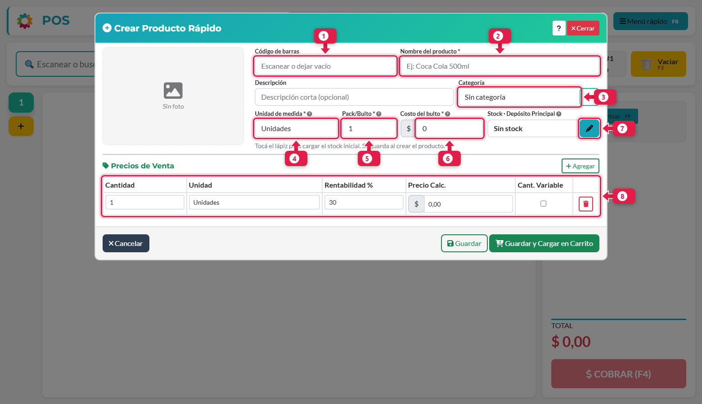
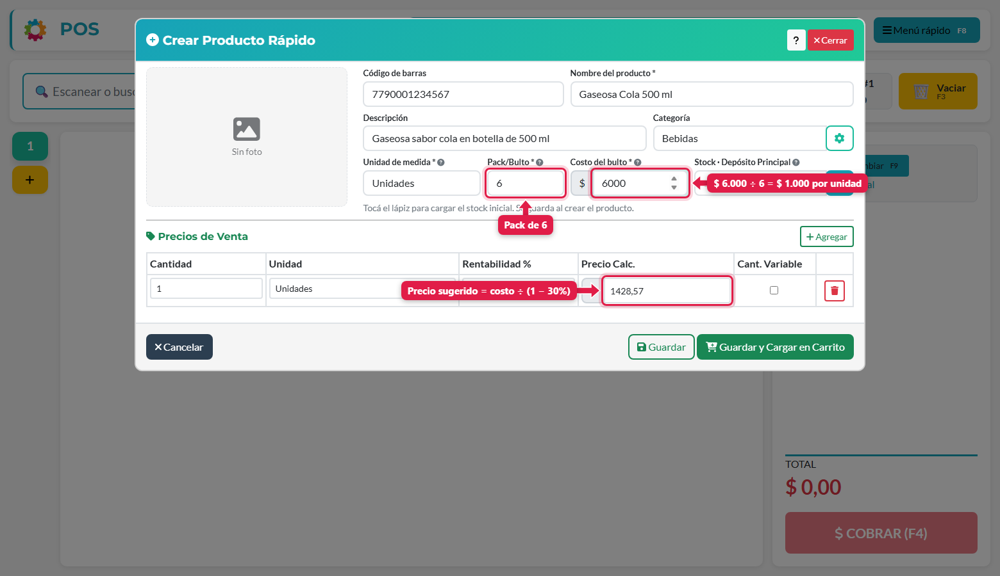
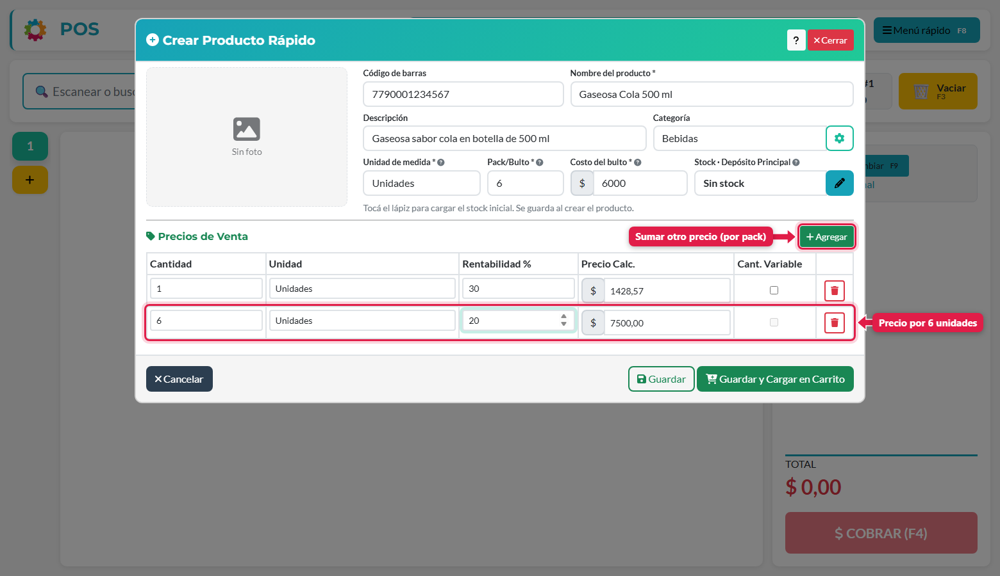
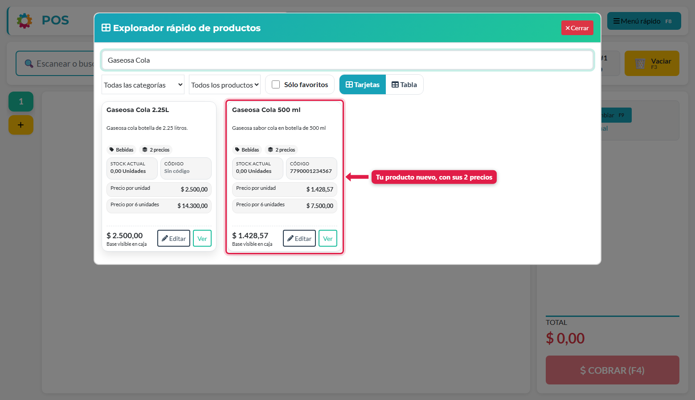

## Para qué sirve

Un producto bien cargado es la base de todo lo demás: de él salen la venta, el stock, el costo y la ganancia. Esta guía sirve para dar de alta un artículo con lo mínimo que el sistema necesita para trabajar: **cuánto te cuesta**, **cuánto tenés** y **a qué precio lo vendés**. La usás cada vez que sumás un artículo nuevo al catálogo.

## Qué vas a lograr

Vas a **cargar un producto en ADEstock** desde el punto de venta (POS), con su costo por bulto, stock inicial y precios de venta por unidad o pack. Al guardarlo, queda disponible en el catálogo para agregarlo a una venta.

La guía también explica cómo calcular el costo por unidad y distinguir el margen sobre venta del recargo sobre costo.

> Si elegiste un rubro en el onboarding, el sistema ya cargó productos de ejemplo. Podés editarlos, o dejarlos y sumar los tuyos.

## Antes de empezar

Necesitás un **turno de caja abierto** y el permiso **Gestionar productos**. Para cargar el stock inicial también necesitás **Modificar stock**. El dueño tiene estos permisos.

Tené a mano tres datos del producto: **cuánto te cuesta** (lo que pagás por el bulto cerrado), **cuántas unidades trae** ese bulto y **a cuánto querés venderlo**.

## Paso a paso

### 1. Abrí "Crear producto"

Menú rápido (**F8**) → **Crear producto**, o directamente la tecla **F6**.

### 2. Conocé el formulario



| # | Campo | Qué poner |
|---|---|---|
| 1 | **Código de barras** | Escaneá el código con el lector o dejalo vacío. Si está activada la integración con el catálogo ADEMA, aparece un botón de nube que completa nombre, foto y precios de referencia |
| 2 | **Nombre del producto** *(obligatorio)* | Como lo vas a buscar y como lo va a ver el cliente. Ej.: `Gaseosa Cola 500 ml` |
| 3 | **Categoría** | Para ordenar y filtrar. El engranaje de al lado permite crear o editar categorías |
| 4 | **Unidad de medida** *(obligatorio)* | `Unidades` en la mayoría de los casos. Usá Kilos, Litros, Metros, Horas… para granel o servicios |
| 5 | **Pack / Bulto** *(obligatorio)* | Cuántas unidades trae lo que comprás: 1 si es suelto, 6 si es un pack de 6 |
| 6 | **Costo del bulto** *(obligatorio)* | Lo que pagás por el bulto **cerrado** |
| 7 | **Stock** (lápiz) | Cuánto hay físicamente. Solo aparece si tenés permiso para modificar stock |
| 8 | **Precios de venta** | Una fila por cada precio al que vendés este producto |

> **Muy importante:** el costo es **del bulto**, no de la unidad. El sistema lo divide solo. Si una caja de 24 cuesta $24.000, cada unidad cuesta $1.000.

### 3. Completá costo y pack

Completá nombre, categoría, pack y costo. El sistema calcula el costo por unidad y **sugiere el precio**.



En el ejemplo: la gaseosa viene en pack de **6** y el pack cuesta **$6.000**, o sea **$1.000 por unidad**. Con una rentabilidad del 30 %, el precio sugerido es **$1.428,57**.

### 4. Cómo se calcula el precio sugerido

La columna **Rentabilidad %** funciona sobre el **precio de venta**, no sobre el costo:

```
precio = costo ÷ (1 − rentabilidad)
$1.000 ÷ (1 − 0,30) = $1.428,57
```

Es decir: de cada $100 que cobrás, $30 son margen bruto y $70 cubren el costo del producto. Ese margen todavía no descuenta otros gastos del negocio. Si la rentabilidad está configurada sobre el costo, la fórmula es `costo × (1 + rentabilidad)`.

Podés hacerlo al revés: **escribí el precio** que querés cobrar y el sistema recalcula la rentabilidad.

### 5. Agregá más precios (por pack, por cantidad)

Con **+ Agregar** sumás otra fila. Cada fila es un precio por una cantidad: por ejemplo, 1 unidad a $1.428,57 y 6 unidades a $7.500.



| Columna | Qué significa |
|---|---|
| **Cantidad / Unidad** | Para cuántas unidades vale este precio |
| **Rentabilidad %** | Margen deseado (se calcula el precio) |
| **Precio Calc.** | El precio final. Podés editarlo a mano |
| **Cant. Variable** | Solo para cantidad = 1. El POS **pregunta la cantidad** al vender (ideal para peso o metros). Está deshabilitado en las filas con cantidad mayor a 1 |

Cada fila es una **presentación** que se puede elegir al vender (lo vemos en el tutorial [Hacer una venta](/tutoriales/hacer-una-venta/)).

### 6. Cargá el stock inicial (opcional)

Tocá el **lápiz** al lado de *Stock*, escribí **cuántas unidades sueltas hay** (no bultos) y guardá. En un producto nuevo, ese valor queda registrado como **stock inicial**.

> Para contar muchos productos a la vez o en otro depósito, usá *Menú rápido → Conteo de stock*.

### 7. Guardá

- **Guardar:** crea el producto y vuelve al POS.
- **Guardar y Cargar en Carrito:** además lo agrega a la venta que tenés abierta. Útil si el cliente lo está esperando.

### 8. Verificá en el catálogo

Abrí **Explorar** y buscá el producto: ahí ves su stock, el código y todos sus precios.



## Para editar un producto que ya existe

En **Explorar**, tocá **Editar** en la tarjeta. Se abre el mismo formulario con los datos cargados. El recálculo del precio depende de la configuración del negocio: si está activado **Congelar precio de venta al actualizar costo**, cambiar el costo conserva el precio de venta y modifica la rentabilidad. Revisá este ajuste en [Precios y productos](/tutoriales/configurar-punto-de-venta/#precios-y-productos).

## Otras formas de cargar productos

- **Carga inteligente** (Menú rápido): cargás un producto sacándole una foto con la cámara.
- **Catálogo ADEMA**: si tu negocio lo tiene habilitado, escaneás el código de barras y el sistema completa nombre, foto y precios de referencia.
- **Desde una compra:** al cargar una compra con la foto de la boleta, los productos nuevos se pueden dar de alta ahí (ver el tutorial de *Compras con OCR*).

## Qué pasa por detrás

| Qué | Detalle |
|---|---|
| Costo por unidad | `costo del bulto ÷ pack`. Es la base para calcular precios y márgenes |
| Presentaciones | Cada fila de precio es una presentación vendible (1 unidad, pack de 6…) |
| Stock inicial | Si cargaste stock con el lápiz, queda un movimiento de ajuste con tu usuario, fecha y hora |
| Stock negativo | Por defecto el sistema **permite vender sin stock** (queda en negativo). Se puede cambiar en la configuración |

## Problemas frecuentes

| Si te pasa… | Es porque… | Qué hacer |
|---|---|---|
| No veo "Crear producto" en el menú | Tu usuario no tiene permiso | Pedile al dueño el permiso *Gestionar productos* |
| No veo el lápiz de stock | Te falta el permiso *Modificar stock* | Pedilo al dueño |
| El precio me da más alto de lo esperado | La rentabilidad es sobre el precio de venta, no sobre el costo | Es lo esperado: 30 % sobre venta ≠ 30 % sobre costo |
| El costo por unidad está mal | Cargaste el costo por unidad en vez del costo del bulto, o el pack | Revisá que el costo sea el del bulto cerrado y el pack las unidades que trae |
| "Cant. Variable" está deshabilitado | La cantidad de esa fila es mayor a 1 | Solo se usa con cantidad = 1 |

## Siguiente paso

- [Crear usuarios y asignar permisos](/tutoriales/usuarios-y-permisos/)
- [Hacer una venta y cobrarla](/tutoriales/hacer-una-venta/)
- [Contar el stock y corregir diferencias](/tutoriales/contar-stock/)
