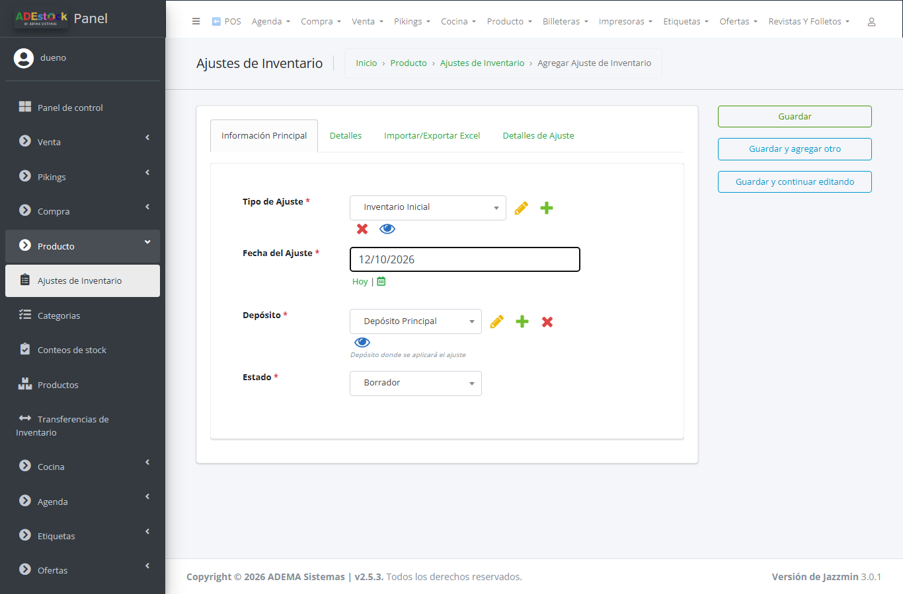
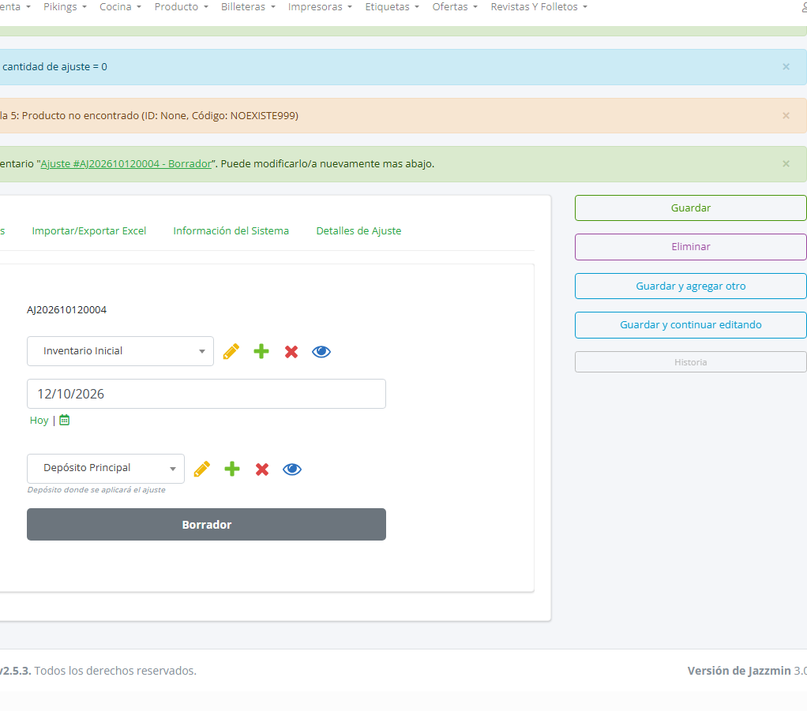
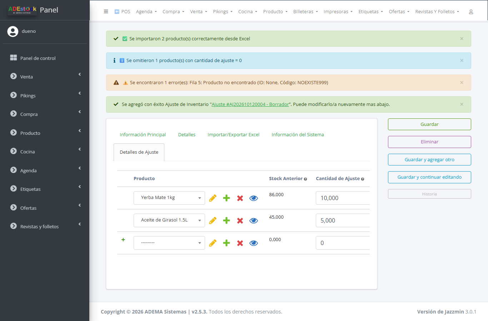
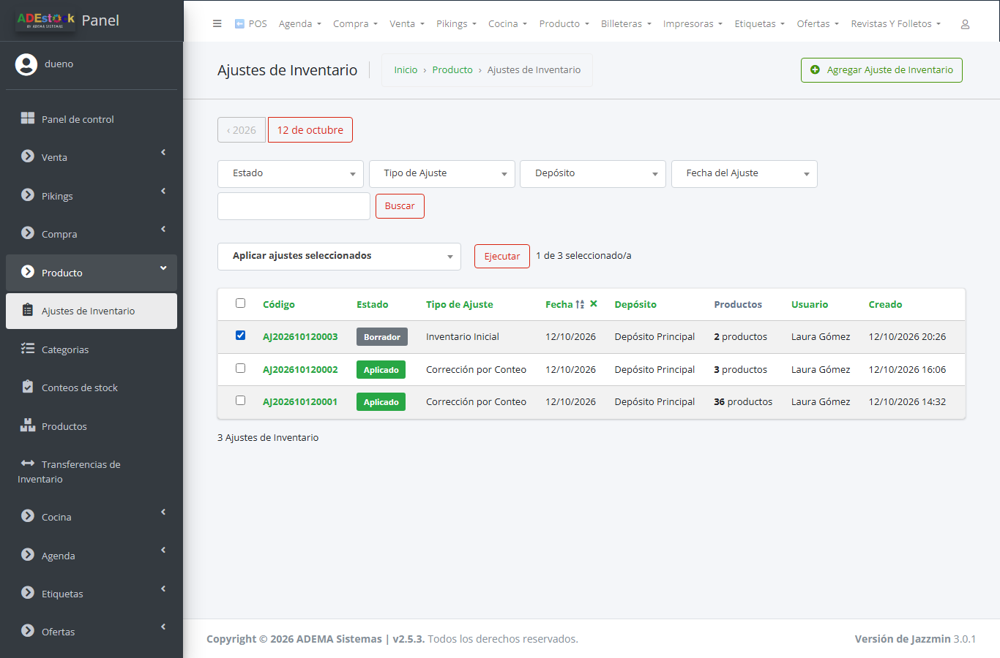

## Qué vas a lograr

Cargar cuánta mercadería tenés de cada producto, en un depósito, usando una planilla en lugar de producto por producto.

> **Primero los productos, después el stock.** Esta guía supone que tus productos ya están cargados (a mano o con la guía de importar productos desde Excel). Si un producto no existe, la fila da error: **no lo crea**.

## Cómo funciona (leelo antes de empezar)

- La columna **Cantidad Ajuste** es una **diferencia**, no el stock final: `+10` suma 10 unidades, `-3` resta 3.
- Si el producto **no tenía stock** (recién importado), la diferencia es igual al stock que tenés. Si **ya tenía stock**, lo que cargues **se suma** al que había.
- Un archivo es para **un depósito**. El depósito se elige en el ajuste, no en el Excel.
- El ajuste queda en **Borrador**: el stock **no cambia** hasta que lo **aplicás**.

Ejemplo con datos de demostración, antes y después de aplicar:

| Producto | Stock antes | Cantidad Ajuste | Stock después |
|---|---|---|---|
| Yerba Mate 1kg | 76 | +10 | 86 |
| Aceite de Girasol 1.5L | 42 | +5 | 47 |
| Fideos Spaghetti 500g | 102 | 0 | 102 (la fila se omite) |

## Paso a paso

### 1. Creá el ajuste

En el panel, entrá a **Producto > Ajustes de Inventario** y tocá **Agregar Ajuste de Inventario**. Completá:

- **Tipo de ajuste:** *Inventario Inicial*.
- **Fecha** y **Depósito** donde se aplicará el ajuste (los dos son obligatorios).
- Dejá el estado en **Borrador**.

### 2. Preparalo en Excel

La primera fila del archivo tiene que ser el encabezado, con estas columnas:

| Columna | Qué poner |
|---|---|
| **ID Producto** | El ID del producto en ADEstock (opcional si ponés el código) |
| **Código** | El código de barras del producto |
| **Nombre** | Solo para que te ubiques; no se usa para buscar |
| **Cantidad Ajuste** | Cuánto sumar (o restar con signo menos) |
| **Motivo** | Un texto corto, por ejemplo "Conteo inicial" |

El sistema busca primero por **ID Producto** y, si no lo encuentra, por **Código**. En el formulario del ajuste, la pestaña **Importar/Exportar Excel** tiene un botón para **descargar la plantilla** con tus productos.

### 3. Subí el archivo

En el mismo formulario, elegí el archivo en **Importar desde Excel** y tocá **Guardar y continuar editando**.

El sistema te avisa qué hizo con cada fila:

- **"Se importaron N producto(s) correctamente desde Excel"**: esas filas ya están en el ajuste.
- **"Se omitieron N producto(s) con cantidad de ajuste = 0"**: no hace falta hacer nada.
- **"Se encontraron N error(es): Fila 5: Producto no encontrado…"**: ese producto no existe o el código no coincide. Se muestran hasta 5 errores.

### 4. Revisá los detalles

Entrá a la pestaña **Detalles de Ajuste**. Ves cada producto con su **Stock Anterior** y la **Cantidad de Ajuste**. Corregí lo que haga falta y guardá.

### 5. Aplicá el ajuste

Volvé a la lista de **Ajustes de Inventario**, marcá el ajuste, elegí **Aplicar ajustes seleccionados** y tocá **Ejecutar**.

Vas a ver **"Se aplicaron 1 ajuste(s) correctamente"** y el estado pasa a **Aplicado**.

## Cómo comprobar que salió bien

1. Abrí un producto de la lista y mirá su **stock** en el depósito: tiene que ser el de antes más la cantidad que cargaste.
2. Hacé un **conteo de stock** de unos pocos productos (guía "Cómo contar el stock") para verificar contra la góndola.

## Problemas frecuentes

| Si te pasa… | Es porque… | Qué hacer |
|---|---|---|
| "Producto no encontrado" | El ID o el código no coinciden con ningún producto | Importá primero el producto (guía de importar productos) o corregí el código. Revisá que no haya perdido ceros iniciales |
| "No se encontró la columna "Cantidad Ajuste"" | El encabezado no está en la primera fila o cambió el nombre | Usá la plantilla y no cambies los títulos |
| El stock no cambió | El ajuste sigue en Borrador | Aplicalo desde la lista de ajustes |
| Cargué de más | El ajuste ya se aplicó | Anulalo con **Anular ajustes seleccionados** o hacé otro ajuste con la diferencia en negativo |
| Quedó mal un stock que ya tenía movimientos | Un ajuste suma una diferencia, no fija el stock | Para llevar un producto a una cantidad exacta, usá un conteo de stock |

## Siguiente paso

- Hacer tu primera venta.
- Contar el stock de un depósito.
