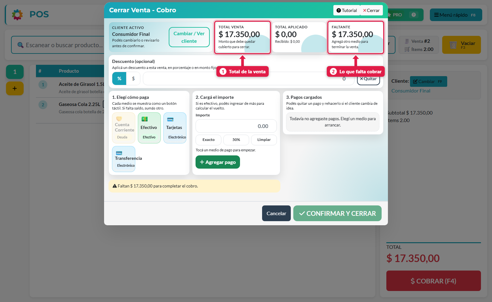
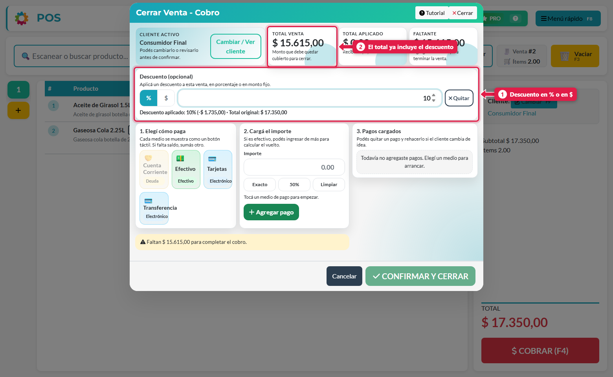
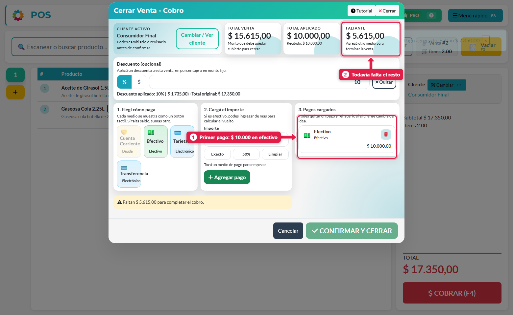
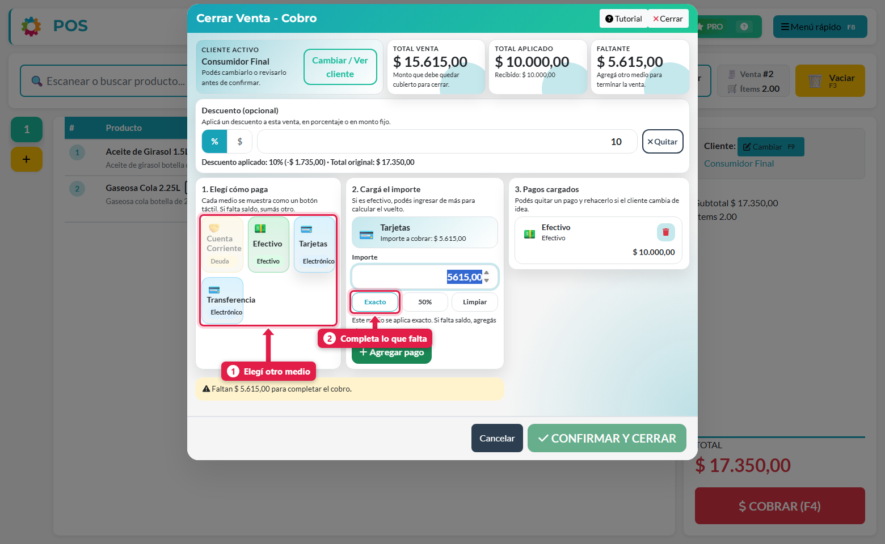
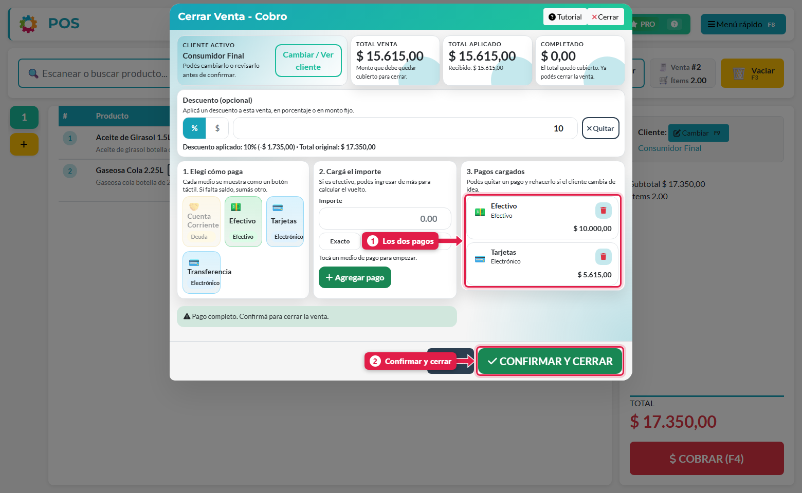
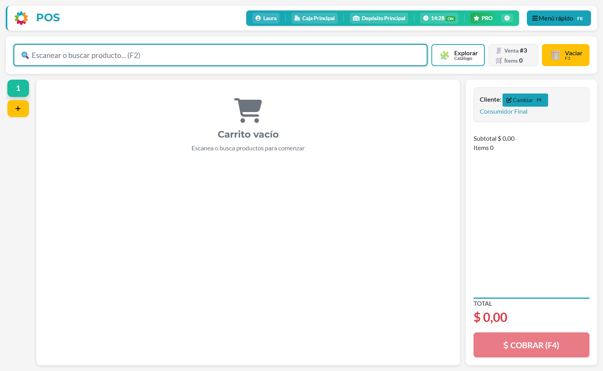

## Qué vas a lograr

Cobrar una misma venta **repartida en varios medios** (por ejemplo, una parte en efectivo y el resto con tarjeta), y aplicar un **descuento** sobre el total.

## Cómo funciona el cobro

El cobro no es "un medio y listo": podés **sumar pagos** hasta cubrir el total. Cada pago que agregás baja el *faltante*. La venta solo se puede cerrar cuando el faltante llega a cero.

Los cuatro recuadros de arriba te acompañan todo el cobro:

| # | Recuadro | Qué muestra |
|---|---|---|
| - | **Cliente activo** | A quién se le vende. Con *Cambiar / Ver cliente* lo cambiás sin salir |
| 1 | **Total venta** | Lo que tiene que quedar cubierto para cerrar |
| - | **Total aplicado** | La suma de los pagos que ya cargaste |
| 2 | **Faltante** | Lo que falta cobrar. Cuando llega a cero cambia a *Completado*. Si el cliente entrega de más en efectivo, muestra el **vuelto** |

## Paso a paso

### 1. (Opcional) Aplicá un descuento

Si hay que hacer un descuento, hacelo **antes** de cargar los pagos. En el panel *Descuento (opcional)* elegí entre **%** (porcentaje) y **$** (monto fijo) y escribí el valor.

El sistema te muestra qué aplicó (*Descuento aplicado: 10 % (−$ 1.735,00) · Total original: $ 17.350,00*) y el **Total venta** ya viene con el descuento. El botón **Quitar** lo elimina.

> Aplicar descuentos requiere el permiso **Puede hacer descuentos**. Sin él, el panel no te deja usarlo.

### 2. Cargá el primer pago

Elegí un medio (por ejemplo **Efectivo**), escribí el importe y tocá **Agregar pago**.

El pago aparece en **3. Pagos cargados** y el faltante baja.

### 3. Cargá el resto con otro medio

Elegí otro medio (por ejemplo **Tarjetas**). Para no calcular el importe a mano, usá los atajos de abajo del campo *Importe*:

| Botón | Qué completa |
|---|---|
| **Exacto** | Todo lo que falta cobrar (incluye el recargo del medio, si tiene) |
| **50 %** | La mitad de lo que falta |
| **Limpiar** | Borra el importe |

Tocá **Agregar pago**.

### 4. Revisá y confirmá

Cuando el faltante llega a cero, el cuadro de aviso cambia a *Pago completo*. Revisá la lista y tocá **CONFIRMAR Y CERRAR**.

Podés **quitar** un pago con el tacho (🗑) y volver a cargarlo si el cliente cambia de idea.

### 5. Listo

La venta se cierra y el POS abre una venta nueva.

## Medios con recargo o descuento

Algunos medios de cobro pueden tener un **recargo o descuento** configurado (por ejemplo, +5 % por pagar con tarjeta). Se configura en *Configuración → Medios de cobro* y se aplica solo: cuando elegís ese medio, el importe ya viene con el recargo y el botón del medio muestra una etiqueta con el porcentaje.

## Qué pasa por detrás

| Qué | Detalle |
|---|---|
| Un registro por pago | Cada pago cargado se guarda por separado, con su medio, su importe y su turno de caja |
| Caja y cierre | En el cierre de caja, el efectivo se cuenta aparte de los medios electrónicos |
| Billeteras | Cada pago alimenta la billetera vinculada a su medio de cobro |
| Descuento | Queda registrado en la venta (tipo y valor) junto con el total original |
| Protección | Si tocás *Confirmar* dos veces, los pagos no se duplican |

## Problemas frecuentes

| Si te pasa… | Es porque… | Qué hacer |
|---|---|---|
| *Confirmar y cerrar* está apagado | Todavía falta cobrar | Agregá otro pago hasta que el faltante sea $ 0 |
| El panel de descuento no deja escribir | Tu usuario no tiene *Puede hacer descuentos* | Pedíselo al dueño |
| El botón *Cuenta Corriente* está apagado | El cliente es Consumidor Final o no tiene cuenta corriente | Cambiá el cliente (ver *Vender a cuenta corriente*) |
| Cargué un pago por error | - | Quitalo con el tacho y cargalo de nuevo |
| El importe de tarjeta es mayor al total | El medio tiene recargo | Es lo esperado: el recargo se suma al importe de ese medio |

## Siguiente paso

- Vender a cuenta corriente
- Turno de caja: apertura, retiros y cierre
