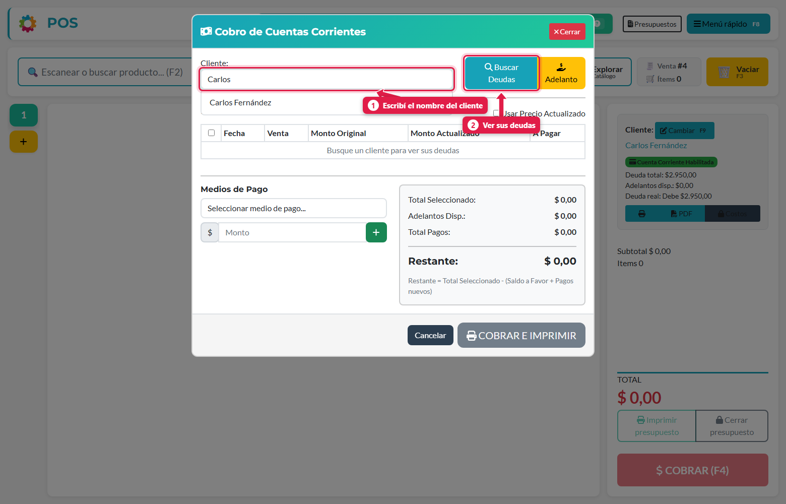
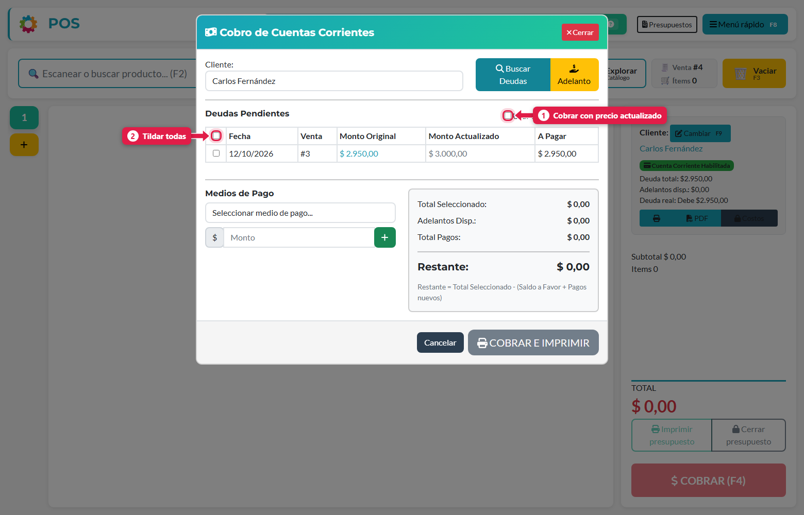
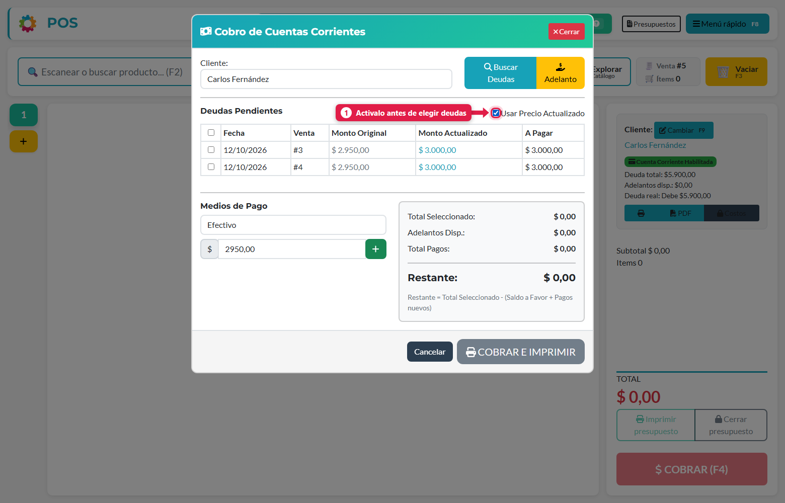
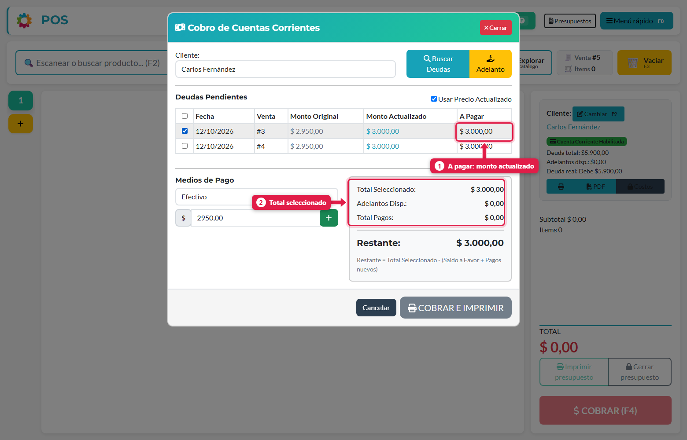
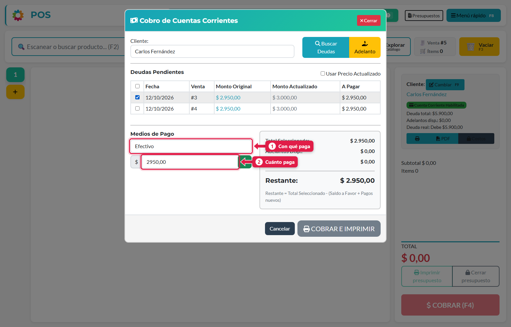
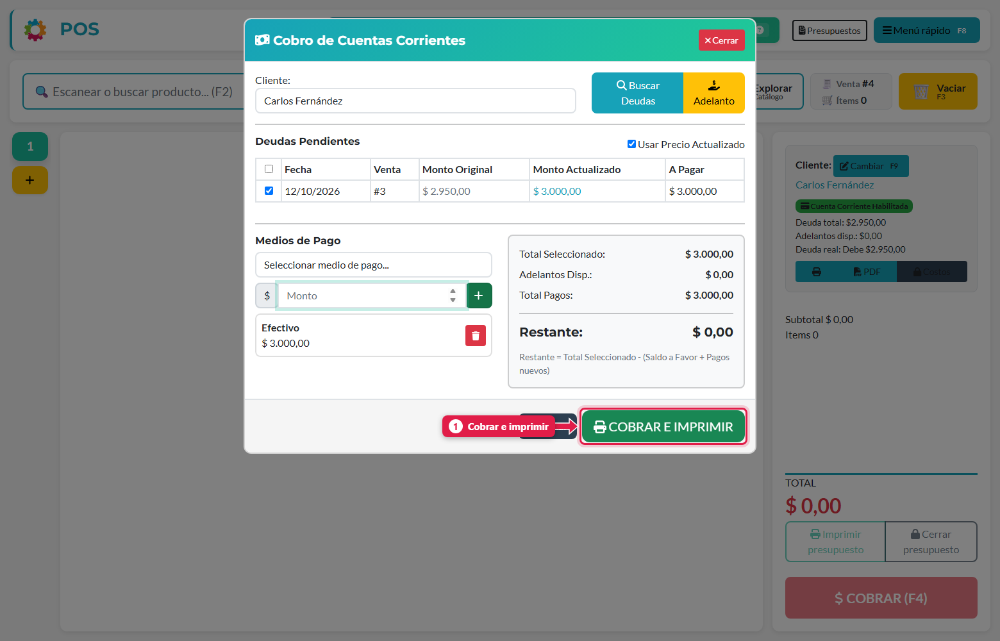
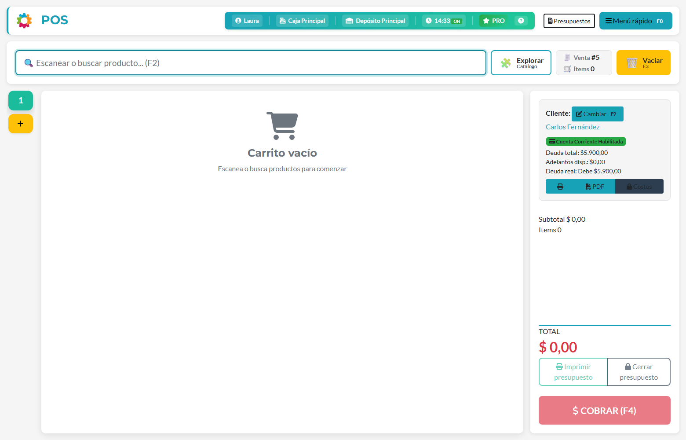
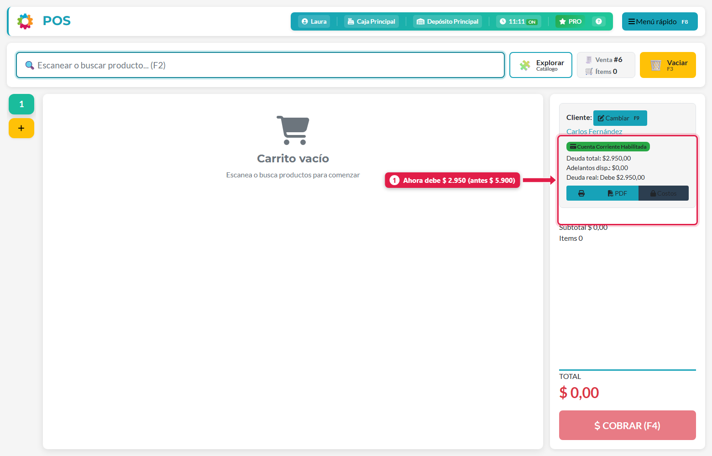

## Qué vas a lograr

Registrar que un cliente **pagó** parte o toda su deuda, eligiendo **qué deudas cancela**, con qué medio paga y si se cobra a **precio original** o **actualizado**.

## Paso a paso

### 1. Abrí el cobro de cuentas corrientes

Menú rápido (**F8**) → **Cobrar a un cliente**. Escribí el nombre del cliente y tocá **Buscar Deudas**.

### 2. Mirá las deudas pendientes

Aparece una fila por **cada venta fiada** que todavía se debe:

| Columna | Qué es |
|---|---|
| **Fecha / Venta** | Cuándo y en qué venta se fió |
| **Monto Original** | Lo que se vendió |
| **Monto Actualizado** | Lo mismo a los precios de hoy (nunca menor al original) |
| **A Pagar** | El monto que se va a cobrar. Depende del interruptor *Usar Precio Actualizado* |

### 3. Decidí: precio original o actualizado

El interruptor **Usar Precio Actualizado** cambia la columna *A Pagar*:

- **Apagado** (por defecto): se cobra el **monto original**.
- **Encendido**: se cobra el **monto actualizado** (a precios de hoy).

> ⚠️ **Activá el interruptor ANTES de elegir las deudas.** Al cambiarlo, el sistema desmarca las deudas seleccionadas.

### 4. Elegí qué deudas se pagan

Tildá la casilla de cada venta que cancela el cliente, o la casilla de arriba para elegirlas **todas**. Abajo ves el **Total Seleccionado**.

### 5. Cargá el pago

Elegí el **medio de pago** (Efectivo, Tarjetas, Transferencia…) y el **monto**, y tocá **+**.

El cuadro de la derecha te muestra la cuenta:

| Línea | Qué es |
|---|---|
| **Total Seleccionado** | Lo que suman las deudas elegidas |
| **Adelantos Disp.** | Saldo a favor del cliente que se descuenta |
| **Total Pagos** | Lo que está pagando ahora |
| **Restante** | `Total Seleccionado − (Saldo a favor + Pagos nuevos)`. Tiene que llegar a $ 0 para poder cobrar |

> **Ojo con el monto sugerido:** revisá que el importe del pago coincida con el **Total Seleccionado**. Si queda un *Restante* distinto de cero, el botón de cobrar no se habilita.

### 6. Cobrá

Cuando el *Restante* es $ 0, tocá **COBRAR E IMPRIMIR**.

El sistema registra el cobro y vuelve al POS (si tenés impresora configurada, imprime el comprobante).

### 7. Verificá el saldo

Volvé a elegir al cliente (F9). El resumen de la derecha muestra su deuda ya descontada:

En el ejemplo, Carlos debía $ 5.900 (dos ventas de $ 2.950) y pagó $ 3.000 por la primera, a precio actualizado: le queda **$ 2.950**.

## Otras opciones

| Botón | Para qué sirve |
|---|---|
| **Adelanto** | El cliente deja plata **a favor** sin deuda que cancelar. Queda como *Adelanto disponible* y se descuenta de sus próximas deudas |
| **Pagos de clientes** (Menú rápido) | Historial de cobros: ver el detalle de un pago y reimprimir el comprobante |

## Qué pasa por detrás

| Qué | Detalle |
|---|---|
| Cobro | Se registra un pago del cliente y se **aplica** a cada deuda elegida |
| Deuda | Las deudas totalmente cubiertas se marcan como canceladas; si el pago es parcial, queda el restante |
| Caja | El efectivo cobrado entra al arqueo del turno (como cobro de deuda) |
| Billetera | El monto entra en la billetera del medio de pago elegido |
| Anulación | Un cobro mal cargado **no se borra**: lo anula un superusuario desde el panel de administración (*Anular cobro*), que restaura las deudas |

> **Importante:** las deudas solo se cancelan desde este flujo (el cobro). Es la única vía que deja respaldo de quién pagó, cuánto y con qué.

## Problemas frecuentes

| Si te pasa… | Es porque… | Qué hacer |
|---|---|---|
| No veo *Cobrar a un cliente* en el menú | Falta el permiso *Puede cobrar Cta. Cte.* | Pedíselo al dueño |
| "Buscar Deudas" no muestra nada | El cliente no tiene deudas pendientes | Verificá en *Gestión de clientes* su saldo |
| El botón *Cobrar e imprimir* está gris | El *Restante* no es $ 0 | Ajustá el monto del pago o las deudas elegidas |
| Me equivoqué en un cobro | - | Pedile al dueño que lo anule desde el panel de administración |

## Siguiente paso

- Registrar un gasto
- Turno de caja: apertura, retiros y cierre
