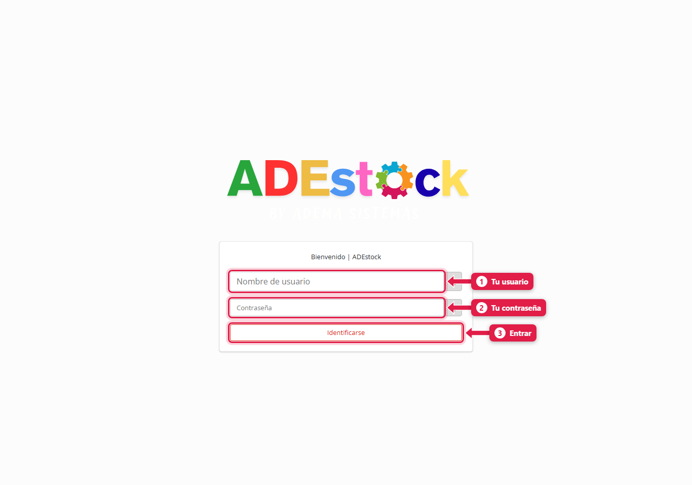
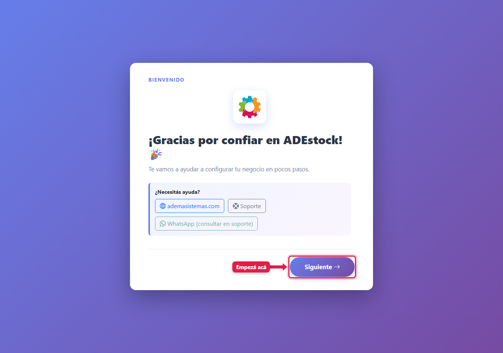
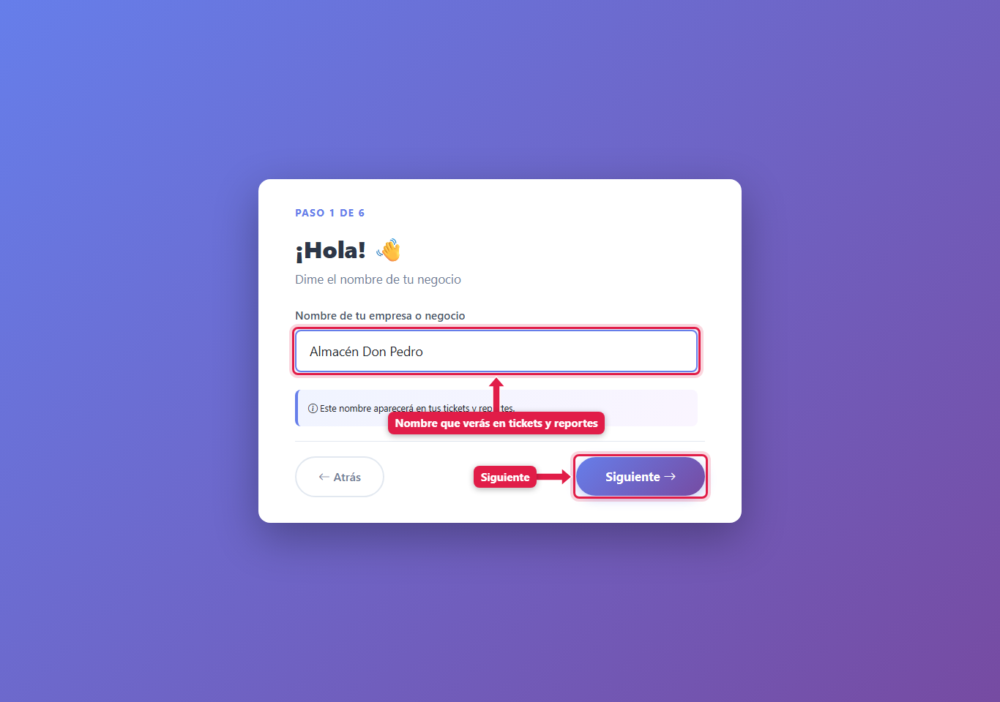
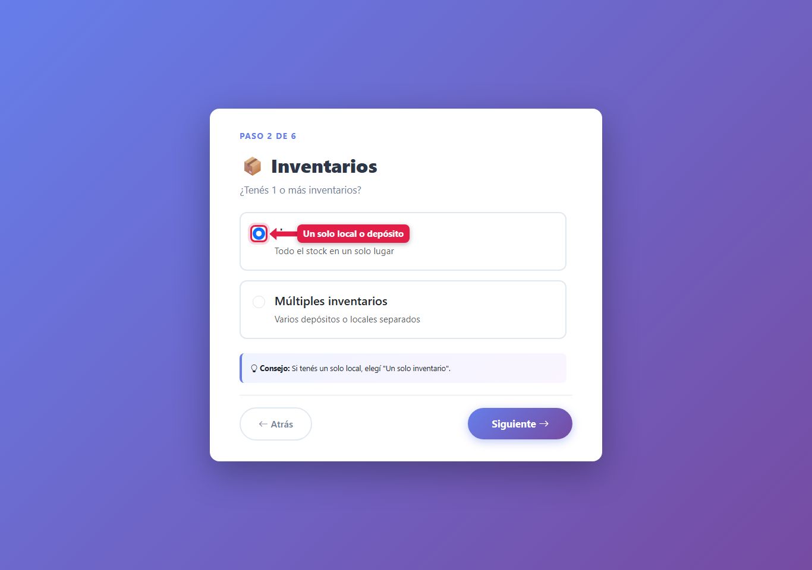
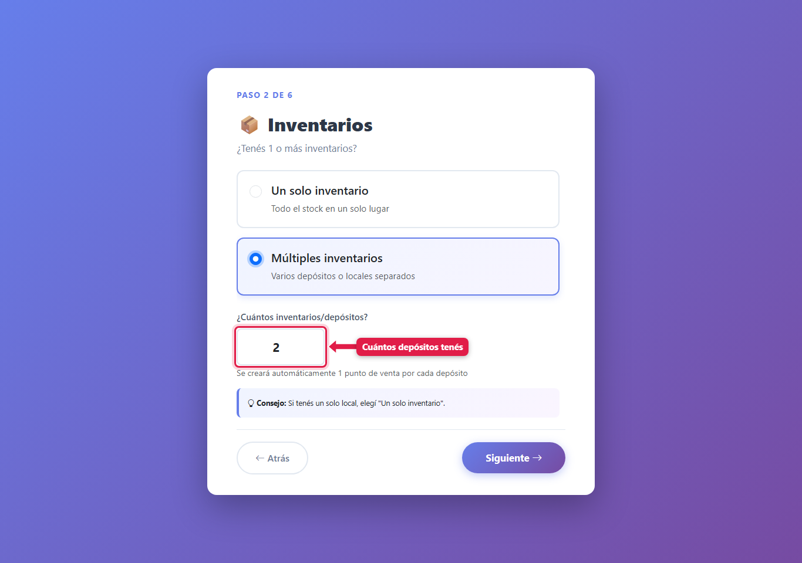
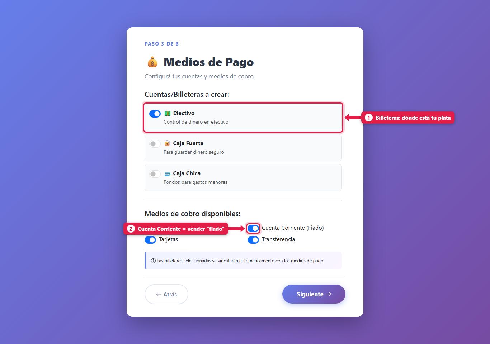
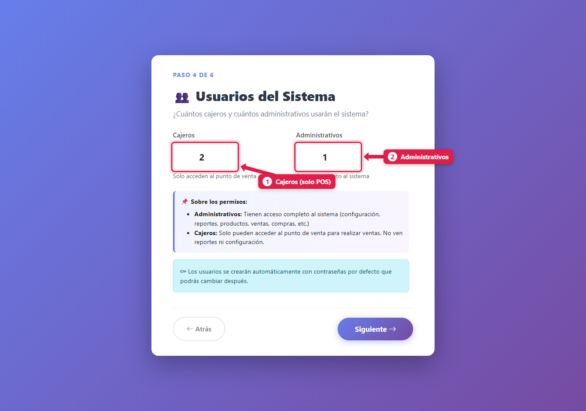
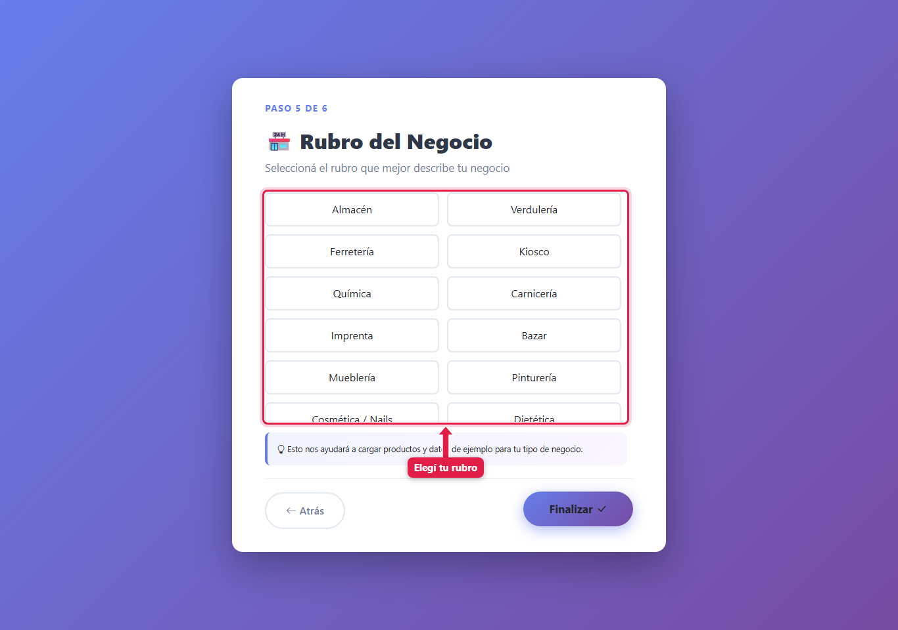
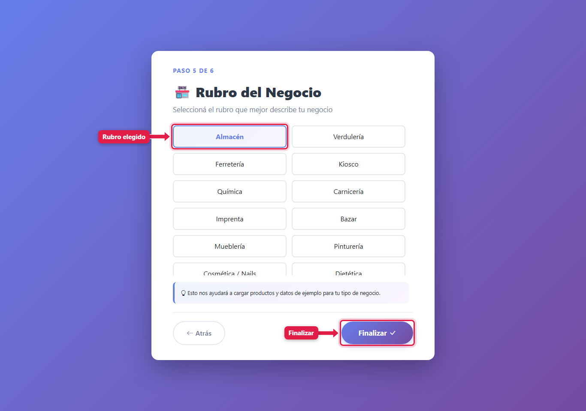
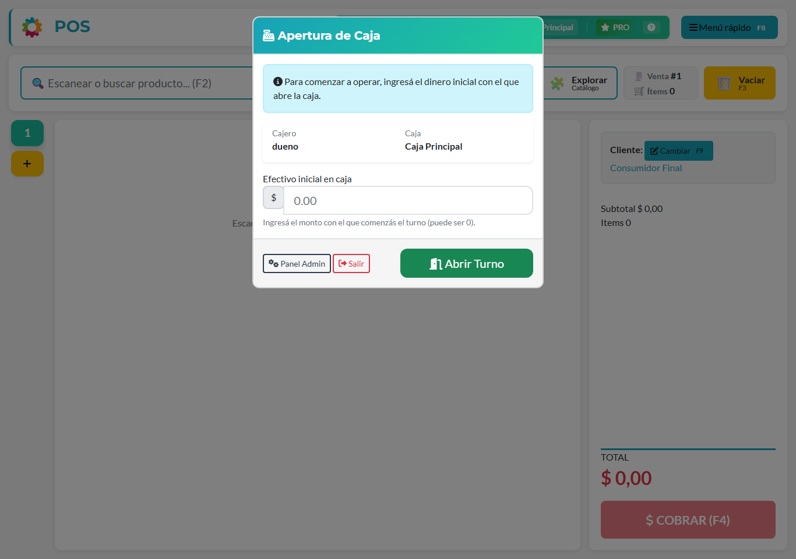

## Para qué sirve

El onboarding sirve para dejar el sistema funcionando sin recorrer decenas de pantallas de configuración. En unos minutos definís cómo se llama tu negocio, dónde guardás la mercadería, con qué cajas y medios de cobro trabajás y quiénes lo van a usar. Se hace **una sola vez**, al empezar. Lo que elijas acá después se ajusta desde la [configuración del POS](/tutoriales/configurar-punto-de-venta/).

## Qué vas a lograr

En esta guía vas a **configurar ADEstock por primera vez**: cargar el nombre de tu negocio, definir depósitos y cajas, elegir medios de cobro y crear usuarios. También podés cargar un catálogo de ejemplo de tu rubro para probar el punto de venta (POS).

Al finalizar el asistente, vas a llegar a la apertura de caja. Desde ahí podés abrir tu primer turno y empezar a probar el sistema.

El asistente aparece **una sola vez**. Cuando termina, si volvés a entrar a `/onboarding/` el sistema te lleva directo al POS.

## Paso a paso

### 1. Ingresá al sistema

Escribí tu usuario (1), tu contraseña (2) y presioná **Identificarse** (3).

### 2. Pantalla de bienvenida

Es solo una presentación. Abajo tenés los contactos de soporte de ADEMA Sistemas. Presioná **Siguiente**.

### 3. Paso 1: el nombre de tu negocio

Escribí el nombre de tu empresa o negocio. **Aparece en los tickets y en los reportes**, así que escribilo como querés que lo vean tus clientes.

### 4. Paso 2: inventarios (depósitos)

Elegí cuántos lugares físicos donde guardás mercadería tenés.

- **Un solo inventario**: tenés un local o un depósito. Es lo más común, y lo que te recomendamos si dudás.

- **Múltiples inventarios**: tenés varios depósitos o locales. Indicá cuántos (de 2 a 20). El sistema crea **un punto de venta (caja) por cada depósito**.

> Más adelante podés agregar o cambiar depósitos y cajas desde el engranaje del POS (⚙).

### 5. Paso 3: billeteras y medios de cobro

Acá definís **dónde está tu plata** y **cómo te pagan**.

**1. Billeteras.** Son las "cuentas" donde el sistema lleva el saldo.
- **Efectivo**: viene activada. Es el dinero de la caja.
- **Caja Fuerte**: para el dinero que guardás aparte.
- **Caja Chica**: para gastos menores.

**2. Medios de cobro.** Son las formas en que te pagan en el POS.
- **Efectivo**: siempre está (no se puede sacar).
- **Tarjetas** y **Transferencia**.
- **Cuenta Corriente (Fiado)**: permite vender y que el cliente pague después. Si fiás a algún cliente, dejala activada.

> El medio *Efectivo* queda vinculado a la billetera *Efectivo*. Así, cada venta en efectivo suma automáticamente a esa billetera.

### 6. Paso 4: usuarios

Indicá cuántas personas van a usar el sistema.

1. **Cajeros**: solo acceden al punto de venta. No ven reportes ni configuración.
2. **Administrativos**: acceso a funciones de gestión, según los permisos asignados. Revisá sus accesos en [Usuarios y permisos](/tutoriales/usuarios-y-permisos/).

El sistema crea los usuarios con contraseñas de arranque:

| Tipo | Usuarios que crea | Contraseña inicial |
|---|---|---|
| Cajeros | `cajero1`, `cajero2`, … | `Cajero123.` |
| Administrativos | `admin1`, `admin2`, … | `Admin123.` |

> ⚠️ **Cambiá esas contraseñas apenas termines.** Son iguales para todos los negocios. Mirá el tutorial de *Usuarios y permisos*.

Si tenés varios depósitos, los cajeros se reparten entre las cajas en orden (cajero1 → Caja Principal, cajero2 → Caja 2, …).

### 7. Paso 5: el rubro

Elegí el rubro que mejor describe tu negocio.

Al elegirlo, queda resaltado. Cuando tocás **Finalizar**, el sistema carga **productos, categorías, un proveedor y un cliente de ejemplo** de ese rubro, para que puedas probar el POS enseguida.

Rubros disponibles: Almacén, Verdulería, Ferretería, Kiosco, Química, Carnicería, Imprenta, Bazar, Mueblería, Pinturería, Cosmética / Nails y Dietética.

> Los datos de ejemplo se pueden borrar o reemplazar por los tuyos. Mirá [Cargar tus primeros productos](/tutoriales/cargar-productos/).

### 8. Listo: llegás al POS

Al finalizar, el sistema te lleva al **POS**. Lo primero que ves es la **Apertura de caja**: ingresá con cuánto efectivo empezás el turno (puede ser 0) y presioná **Abrir Turno**.

## Qué pasa por detrás

Al presionar **Finalizar**, el sistema crea de una sola vez (si algo falla, no queda nada a medias):

| Qué | Detalle |
|---|---|
| Configuración | Nombre del negocio, moneda **$ (Pesos)**, precio de venta automático, **permite vender con stock negativo**, guías activadas |
| Grupos de seguridad | *Administrativos* y *Cajeros* |
| Billeteras | Las que tildaste (todas de tipo efectivo, saldo inicial 0) |
| Medios de cobro | Efectivo, y los que tildaste. Más los medios de **compra** (Efectivo, Transferencia, Cuenta Corriente Proveedor) |
| Depósitos y cajas | `Depósito Principal` / `Caja Principal`; si hay varios: `Depósito 2` / `Caja 2`, etc. Todos los medios de cobro quedan disponibles en todas las cajas |
| Estados de seguimiento | Pendiente, Confirmado, Entregado, Cancelado |
| Tu usuario | Pasa al grupo *Administrativos*, con la primera caja y **todos los permisos del POS** |
| Usuarios | Los cajeros y administrativos que pediste, con permisos básicos (los cajeros: solo el scanner de precios) |
| Datos del rubro | Se cargan en segundo plano; pueden tardar unos segundos en aparecer |

Detalle: si elegís **Ferretería**, los módulos de *Picking (armado de pedidos)* y *Cocina/fabricación* quedan **desactivados**. En el resto de los rubros quedan activados.

## Problemas frecuentes

| Si te pasa… | Es porque… | Qué hacer |
|---|---|---|
| Entro a `/onboarding/` y me manda al POS | El asistente ya se completó | Es lo esperado: ya está configurado. Cambiá cosas desde el engranaje del POS |
| No aparecen los productos de ejemplo apenas termino | La carga corre en segundo plano | Esperá unos segundos y actualizá el POS |
| No elegí rubro | Es opcional para el sistema, pero no se cargan datos de ejemplo | Cargá tus productos a mano |
| Quiero más cajas o depósitos | El asistente solo crea los iniciales | Engranaje ⚙ del POS → Puntos de venta |

## Siguiente paso

- [Cargar productos, stock y precios](/tutoriales/cargar-productos/)
- [Crear usuarios y asignar permisos](/tutoriales/usuarios-y-permisos/)
- [Conocer el POS y sus atajos de teclado](/tutoriales/usar-punto-de-venta/)
