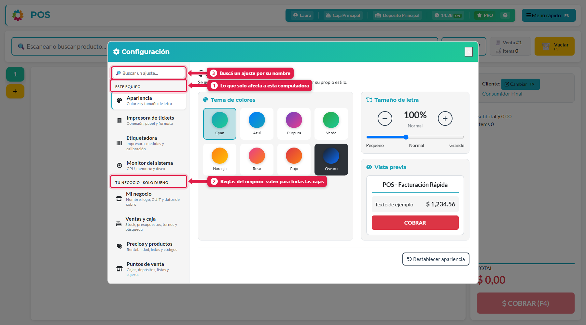
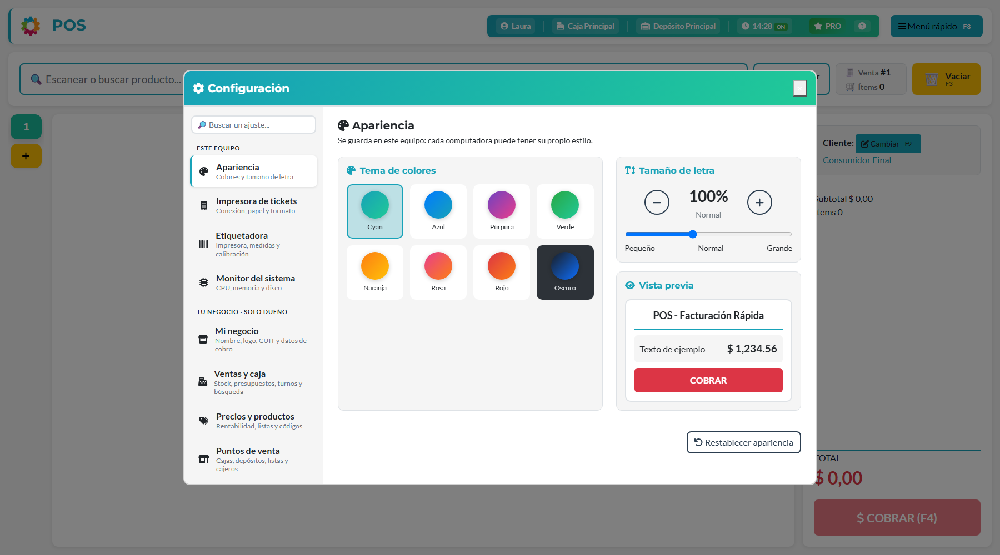
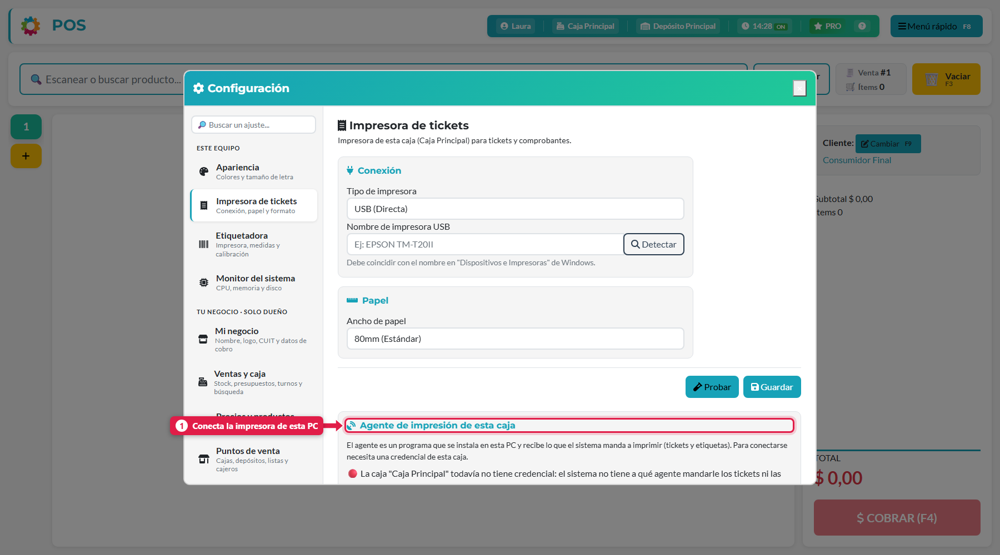
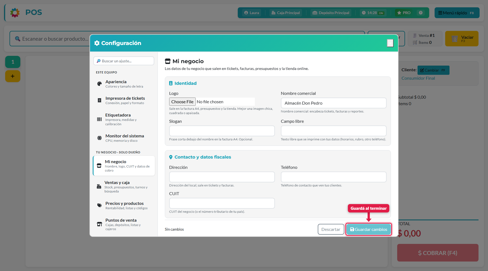
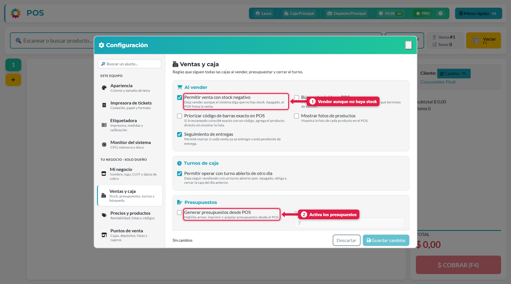
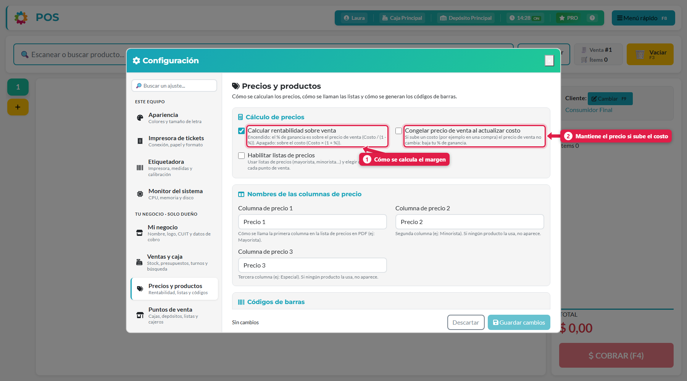
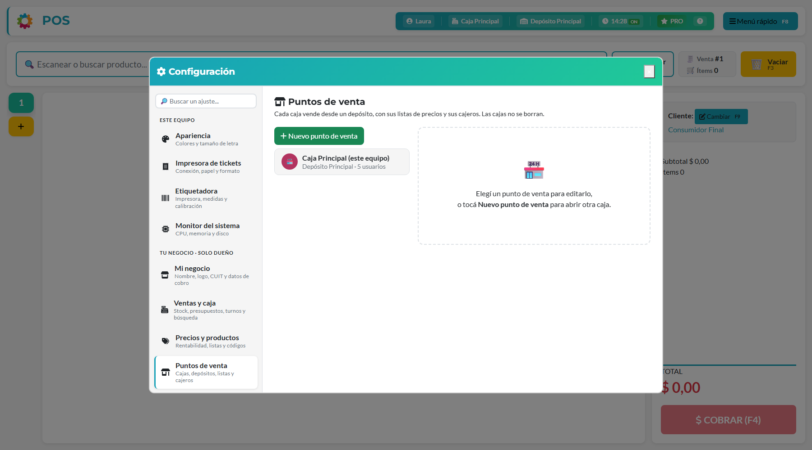
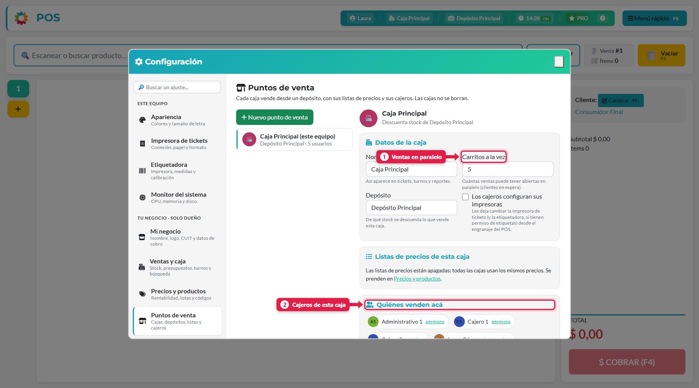
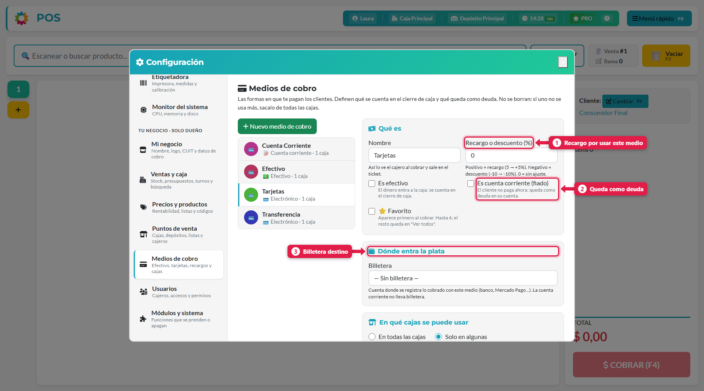
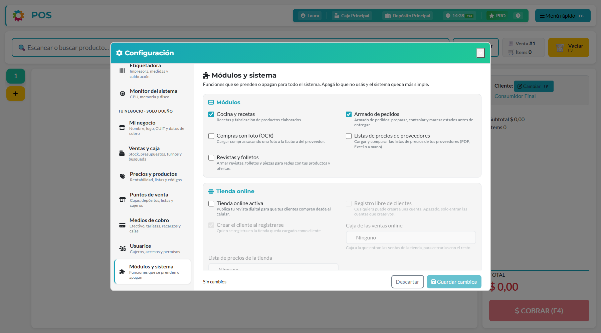

## Qué vas a lograr

Saber dónde se cambia cada cosa del negocio **sin salir del POS**: datos del negocio, reglas de venta, precios, cajas, medios de cobro, usuarios e impresoras.

## Cómo se abre

**Menú rápido (F8) → Configuración**. Se abre un panel con un menú a la izquierda y el contenido a la derecha.

| # | Zona | Qué es |
|---|---|---|
| 1 | **Este equipo** | Ajustes que solo afectan a **esta computadora**: apariencia, impresora, etiquetadora, monitor |
| 2 | **Tu negocio · solo dueño** | Reglas del negocio: valen para **todas las cajas**. Solo las ve el dueño |
| 3 | **Buscador** | Escribí el nombre de un ajuste y te lleva a él |

En las secciones de "Tu negocio" aparece abajo una barra con **Guardar cambios** y **Descartar**. Indica *Sin cambios* hasta que modifiques algo. **Nada se aplica hasta que guardás.**

---

## Este equipo

### Apariencia

Elegí el **tema de colores** (Cyan, Azul, Púrpura, Verde, Naranja, Rosa, Rojo, Oscuro) y el **tamaño de letra**. Se guarda en este equipo: cada computadora puede tener su propio estilo.

### Impresora de tickets

- **Conexión:** USB (el nombre tiene que coincidir con el de "Dispositivos e impresoras" de Windows) o Red. El botón *Detectar* busca las impresoras.
- **Papel:** 80 mm (estándar) o 58 mm (angosto). Probar imprime un ticket de prueba.
- **Agente de impresión de esta caja (1):** es un programa que se instala en la PC y recibe lo que el sistema manda a imprimir. Necesita una **credencial** de la caja: *Crear credencial para esta caja*.
- **Formato de impresión (todas las cajas):** ticket en A4 o rollo, usar comandera, imprimir el ticket al cobrar, mostrar el saldo de cuenta corriente en el ticket, formato de etiquetas y texto de pie de la factura A4.

### Etiquetadora
Impresora de etiquetas de esta caja, independiente de la de tickets: tipo de conexión, medidas de la etiqueta, resolución, calibración y una etiqueta de prueba.

### Monitor del sistema
Muestra CPU, memoria, disco, temperatura y tiempo encendido del servidor, en vivo.

---

## Tu negocio (solo dueño)

### Mi negocio

Los datos que salen en **tickets, facturas, presupuestos y la tienda online**: logo, nombre comercial, slogan, dirección, teléfono, CUIT, datos para cobros por transferencia (banco, alias o CBU/CVU, titular), redes sociales y **monedas** (principal, secundaria y tipo de cambio).

### Ventas y caja

Reglas que siguen **todas las cajas** al vender, presupuestar y cerrar el turno.

| Grupo | Ajuste | Para qué sirve |
|---|---|---|
| Al vender | **Permitir venta con stock negativo** (1) | Deja vender aunque el sistema diga que no hay stock. Apagado, el POS frena la venta |
| | Búsqueda rápida en POS | Busca mientras tipeás (desde 2 letras) |
| | Priorizar código de barras exacto | Si lo escaneado coincide exacto con un código, agrega el producto directo |
| | Mostrar fotos de productos | Muestra la foto de cada producto en el POS |
| | Seguimiento de entregas | Permite marcar si cada venta ya se entregó o está pendiente |
| Turnos de caja | Permitir operar con turno abierto de otro día | Apagado, **obliga a cerrar la caja del día anterior** antes de seguir |
| Presupuestos | **Generar presupuestos desde POS** (2) | Habilita armar, imprimir y aceptar presupuestos. Mientras esté apagado, no aparece el botón *Presupuestos* |
| | Días de vigencia | Durante cuántos días se respetan los precios presupuestados |
| | Controlar vencimiento | Bloquea cobrar un presupuesto vencido |
| | Cajeros ven presupuestos de todos | Apagado, cada cajero ve solo los suyos |
| Fabricación al vender | Generar la fabricación al vender | Al vender productos con receta, genera la fabricación sola |
| | Cómo se arman las fabricaciones | Agrupar (una por receta) o separar (una por línea vendida) |
| | Avisar si una receta no tiene stock | Antes de cobrar |

### Precios y productos

| Ajuste | Qué hace |
|---|---|
| **Calcular rentabilidad sobre venta** (1) | Encendido: el % de ganancia es sobre el precio de venta (`costo ÷ (1 − %)`). Apagado: sobre el costo (`costo × (1 + %)`) |
| **Congelar precio de venta al actualizar costo** (2) | Si sube un costo (por ejemplo, en una compra) **el precio de venta no cambia**: baja tu % de ganancia |
| Habilitar listas de precios | Usar listas (mayorista, minorista…) y elegir cuáles ve cada punto de venta |
| Nombres de las columnas de precio | Cómo se llaman las columnas en la lista de precios en PDF |
| Códigos de barras | Generar códigos automáticamente, patrón del código y código por presentación |
| Stock y vencimientos | Días de alerta de vencimiento; unificar inventarios (solo visual) |
| Costos de producción | Precio del kWh para calcular el costo eléctrico de las recetas |

### Puntos de venta

Cada **caja** vende desde un **depósito**, con sus listas de precios y sus cajeros. Las cajas no se borran. Tocá una para editarla:

| # | Campo | Qué es |
|---|---|---|
| 1 | **Carritos a la vez** | Cuántas ventas puede tener abiertas en paralelo (clientes en espera) |
| — | **Depósito** | De qué stock se descuenta lo que vende la caja. Se puede crear un depósito nuevo desde acá |
| — | Los cajeros configuran sus impresoras | Les deja cambiar la impresora de tickets y la etiquetadora desde el POS |
| 2 | **Quiénes venden acá** | Los usuarios de la caja. Cada usuario vende en **una sola caja**: si lo sumás acá, deja la anterior |

> Para sumar otra caja usá **Nuevo punto de venta**. Es lo que necesitás para abrir un segundo local o una segunda caja en el mismo local.

### Medios de cobro

Las formas en que te pagan. **Definen qué se cuenta en el cierre de caja y qué queda como deuda.** No se borran: si uno no se usa más, sacalo de todas las cajas.

| # | Campo | Qué hace |
|---|---|---|
| — | Nombre | Cómo lo ve el cajero al cobrar y sale en el ticket |
| 1 | **Recargo o descuento (%)** | Positivo = recargo (5 → +5 %). Negativo = descuento (−10 → −10 %). 0 = sin ajuste |
| — | Es efectivo | El dinero entra a la caja: se cuenta en el cierre de caja |
| 2 | **Es cuenta corriente (fiado)** | El cliente no paga ahora: queda como deuda en su cuenta |
| — | ⭐ Favorito | Aparece primero al cobrar (hasta 6; el resto queda en "Ver todos") |
| 3 | **Billetera** | Cuenta donde se registra lo cobrado (banco, Mercado Pago…). La cuenta corriente no lleva billetera |
| — | En qué cajas se puede usar | En todas las cajas (incluye las que abras más adelante) o solo en algunas |

### Usuarios
Alta de cajeros y administrativos y sus permisos. Está explicado en [Crear usuarios y asignar permisos](04-usuarios-y-permisos.md).

### Módulos y sistema

Funciones que se **prenden o apagan** para todo el sistema. Apagá lo que no usás y el sistema queda más simple.

| Grupo | Qué controla |
|---|---|
| **Módulos** | Cocina y recetas · Armado de pedidos (picking) · Compras con foto (OCR) · Listas de precios de proveedores · Revistas y folletos |
| **Tienda online** | Tienda activa · registro libre de clientes · crear el cliente al registrarse · caja de las ventas online · lista de precios de la tienda |
| **Herramientas** | Scanner de precios · monitor del sistema para todos |
| **Panel de administración** | Guías de ayuda · tablero liviano · meses que procesa el tablero |

## Qué pasa por detrás

| Qué | Detalle |
|---|---|
| Dónde se guarda | Los ajustes de "Tu negocio" se guardan en la configuración general del sistema y valen para todos los usuarios y cajas |
| Cuándo aplican | Al tocar **Guardar cambios**. Si cerrás sin guardar, se descartan |
| Cajas y medios | Las cajas y los medios de cobro **no se borran**: dejan de usarse (se sacan de las cajas) para conservar el historial |

## Problemas frecuentes

| Si te pasa… | Es porque… | Qué hacer |
|---|---|---|
| No veo "Tu negocio" | Tu usuario no es el dueño | Pedile al dueño que haga el cambio |
| No aparece el botón *Presupuestos* | *Generar presupuestos desde POS* está apagado | Activalo en Ventas y caja y guardá |
| El POS no me deja vender sin stock | *Permitir venta con stock negativo* está apagado | Activalo en Ventas y caja |
| No puedo seguir vendiendo, pide cerrar caja | El turno es de otro día y no se permite operar con él | Cerrá la caja del día anterior, o activá *Permitir operar con turno abierto de otro día* |
| Una opción del Menú rápido no aparece | El módulo está apagado en *Módulos y sistema* o falta un permiso | Revisalo en Módulos y en los permisos del usuario |
| Los tickets no salen | La caja no tiene credencial del agente de impresión | Impresora de tickets → *Crear credencial para esta caja* |

## Siguiente paso

- Hacer una venta
- Turno de caja: apertura, retiros y cierre
