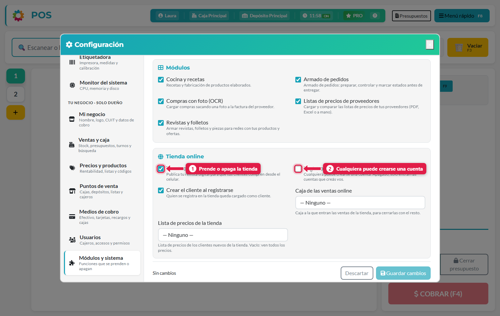
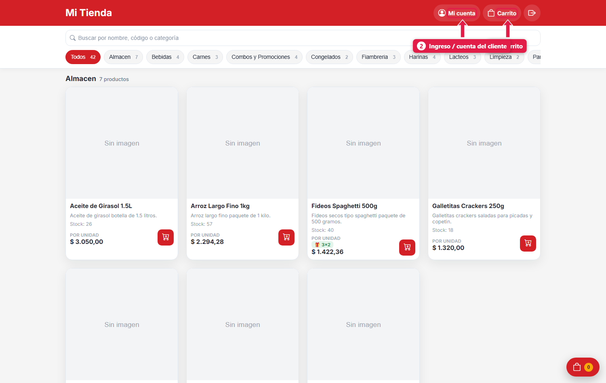
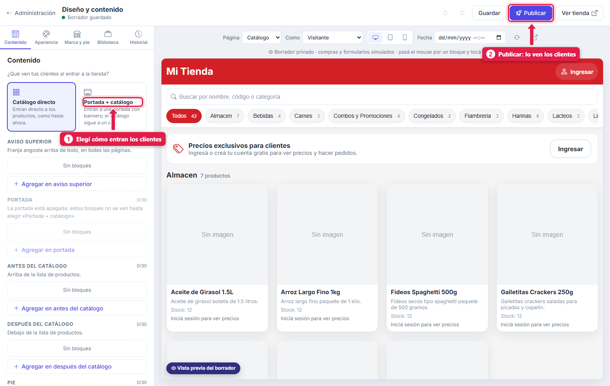
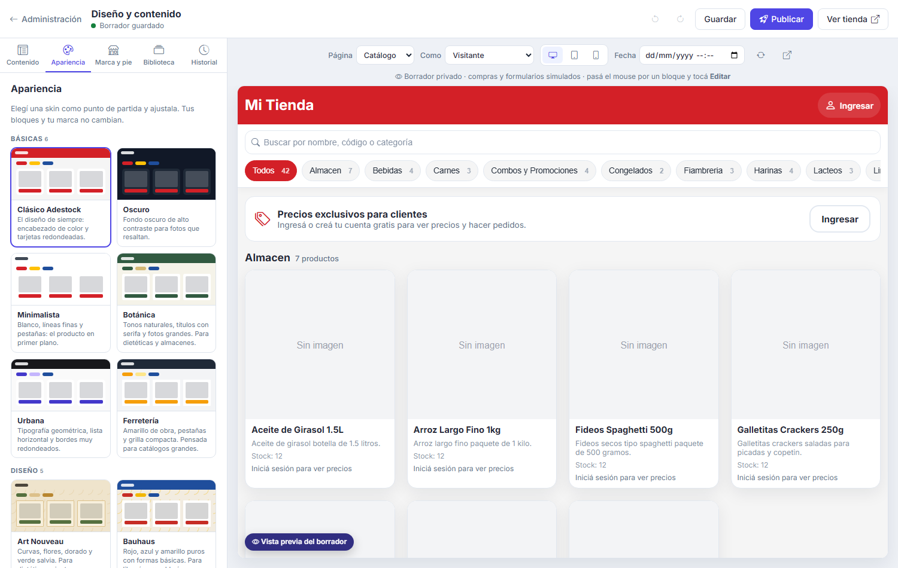
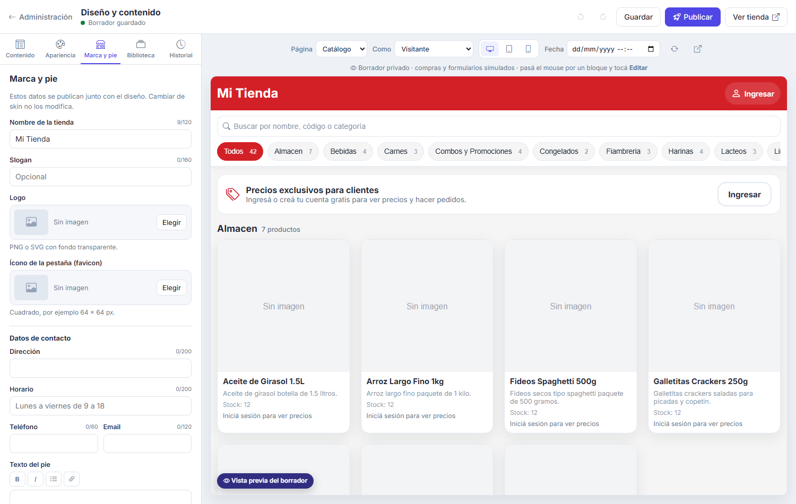
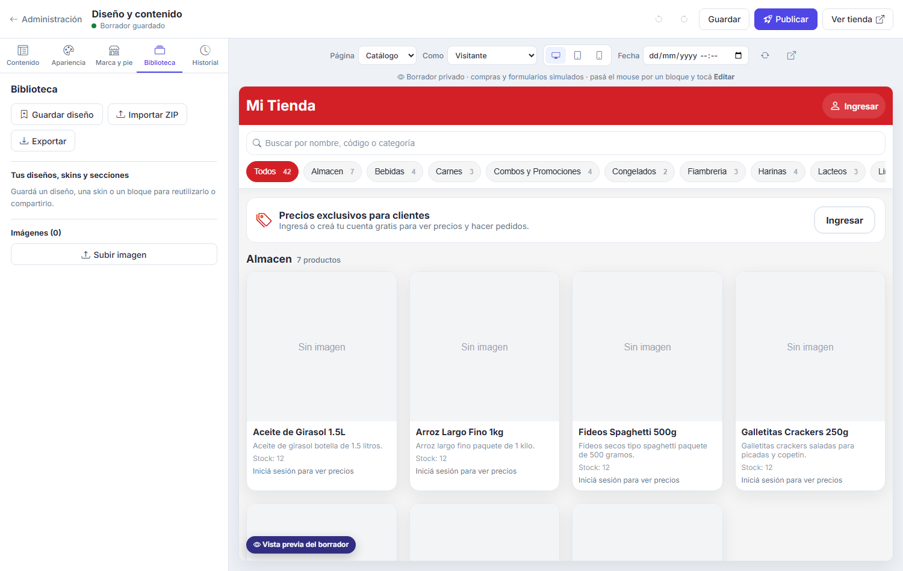
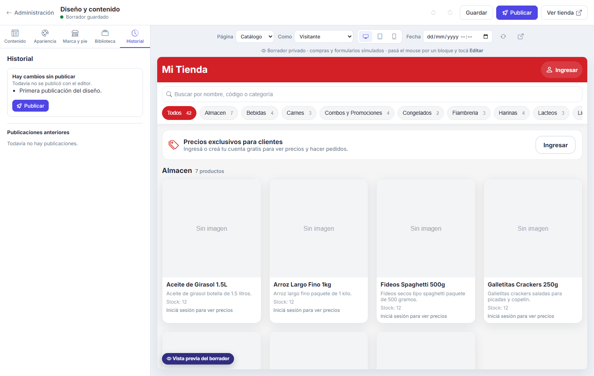

## Para qué sirve

La tienda online sirve para que tus clientes **vean tu catálogo y hagan pedidos** desde el celular, sin que tengas que pasarles los precios uno por uno. Usa los mismos productos, precios y ofertas que el sistema, y la diseñás a tu gusto sin tocar código. Los pedidos los preparás con el [armado de pedidos](/tutoriales/armar-pedidos-picking/).

## Qué vas a lograr

Vas a **activar y configurar la tienda online de ADEstock** para que tus clientes consulten el catálogo, vean precios al iniciar sesión y hagan pedidos. Elegí la caja de ventas online, las listas de precios y las opciones de registro.

Después podés personalizar portada, banners, colores, logo y datos de contacto desde el editor. El diseño se guarda como borrador y llega a los clientes cuando lo publicás.

## Conceptos

| Concepto | Qué es |
|---|---|
| **Tienda** | La web pública, en la dirección `/revista/` de tu sistema |
| **Visitante** | Quien entra sin cuenta. Ve el catálogo, pero en lugar del precio dice *Iniciá sesión para ver precios* |
| **Cliente de la tienda** | Quien se registró. Ve precios y ofertas y puede comprar |
| **Pedido web** | Lo que arma un cliente en su carrito. Entra **En revisión** |
| **Borrador / Publicado** | Lo que editás en el editor es un borrador privado; los clientes ven lo **publicado** |

## Paso a paso

### 1. Prendé la tienda

Menú rápido (**F8**) → **Configuración** → **Módulos y sistema** → sección **Tienda online**:

| # | Opción | Qué hace |
|---|---|---|
| 1 | **Tienda online activa** | Publica tu revista digital para que tus clientes compren desde el celular |
| 2 | **Registro libre de clientes** | Encendido: cualquiera puede crearse una cuenta. Apagado: solo entran las cuentas que creás vos |
| - | **Crear el cliente al registrarse** | Quien se registra queda cargado como **cliente** de tu negocio |
| - | **Caja de las ventas online** | La caja a la que entran las ventas de la tienda, para cerrarlas con el resto. **Sin caja, la tienda no puede tomar pedidos** |
| - | **Lista de precios de la tienda** | Qué precios ven los clientes nuevos. Vacío: ven todos los precios |

Tocá **Guardar cambios**.

### 2. Mirá cómo la ve el cliente

Abrí `/revista/` en tu navegador (o el botón **Ver tienda** del editor):

| # | Elemento | Qué es |
|---|---|---|
| 1 | **Carrito** | Los productos que va sumando el cliente |
| 2 | **Mi cuenta** | Sus datos, sus pedidos y sus mensajes |

El cliente **busca** por nombre, código o categoría, filtra por **categorías** (con la cantidad de productos de cada una) y ve **stock**, **precio por presentación** y las **ofertas vigentes** con su etiqueta (por ejemplo *3×2*), las mismas que cargaste en *Ofertas*.

### 3. Entrá al editor de diseño

Desde el **Panel de administración** (Menú rápido → Panel de administración) abrí **Diseño de la tienda**. También se llega directo por `/tienda/diseno/`.

A la izquierda está el **panel de edición** y a la derecha la **vista previa en vivo**, con selector de página, de tipo de visitante, de dispositivo (computadora, tablet, celular) y de fecha para ver cómo se vería otro día.

El editor **guarda solo** (*Borrador guardado*). Los clientes **no ven nada** hasta que tocás **Publicar**.

### 4. Pestaña Contenido: cómo entran tus clientes

| # | Opción | Qué hace |
|---|---|---|
| 1 | **Catálogo directo** | Entran directo a la lista de productos |
| 1 | **Portada + catálogo** | Entran a una portada con banners y bloques; el catálogo sigue debajo |
| 2 | **Publicar** | Manda el borrador a la tienda |

Los bloques se agregan en **zonas**, con **Agregar en …**:

| Zona | Dónde sale |
|---|---|
| **Aviso superior** | Franja angosta arriba de todo, en todas las páginas |
| **Portada** | La portada (solo si elegiste *Portada + catálogo*) |
| **Antes del catálogo** | Arriba de la lista de productos |
| **Después del catálogo** | Debajo de la lista de productos |
| **Pie** | Al final de la página |

Cada zona tiene un máximo de bloques (el contador, por ejemplo *0/30*, te lo muestra).

### 5. Pestaña Apariencia: elegí una skin

Una **skin** es un diseño de partida que podés ajustar. Hay **básicas** (*Clásico Adestock*, *Oscuro*, *Minimalista*, *Botánica*, *Urbana*, *Ferretería*) y de **diseño** (*Art Nouveau*, *Bauhaus* y otras). **Cambiar de skin no borra tus bloques ni tu marca.**

### 6. Pestaña Marca y pie

Acá cargás el **nombre de la tienda**, un **eslogan**, el **logo** (PNG o SVG con fondo transparente), el **ícono de la pestaña** y los **datos de contacto**: dirección, horario, teléfono, email y texto del pie. Se publican junto con el diseño y **no cambian al cambiar de skin**.

### 7. Pestaña Biblioteca

| Botón | Para qué sirve |
|---|---|
| **Guardar diseño** | Guarda un diseño, una skin o un bloque para reutilizarlo |
| **Importar ZIP** / **Exportar** | Compartir un diseño entre negocios o hacer un respaldo |
| **Subir imagen** | Sumar imágenes (banners, logo) para usar en los bloques |

### 8. Pestaña Historial y Publicar

El **Historial** muestra los **cambios sin publicar** y las **publicaciones anteriores**. Cuando estés conforme, tocá **Publicar** (arriba a la derecha): desde ese momento lo ven los clientes.

## Qué pasa cuando un cliente hace un pedido

1. El cliente arma su carrito y **confirma el pedido** con teléfono, dirección y observaciones.
2. El sistema calcula los precios con las **ofertas** y respeta el *máximo por ticket* de cada una.
3. Se crea un **pedido web** en estado **En revisión**, una **venta provisional** con código `WEB-n` en la **caja de las ventas online**, y un **armado de pedido** para prepararlo.
4. El pedido recorre los estados **En revisión → Confirmado → En preparación → Listo → En camino → Entregado** (o **Cancelado**).

Los pedidos y los mensajes de los clientes se ven en el **Panel de administración** (*Pedidos Web* y *Tickets de mensajes*).

> **Atención:** si falta la **Caja de las ventas online**, el cliente recibe el aviso *La tienda online no tiene un punto de venta configurado* y no puede pedir.

## Qué pasa por detrás

| Qué | Detalle |
|---|---|
| Cliente | Al registrarse, si está prendida la opción, se crea o vincula un **cliente** con sus datos |
| Precios | Los de la **lista de precios** del cliente; si no tiene, los de la lista por defecto de la tienda |
| Stock | Sale del depósito de la caja de las ventas online |
| Diseño | El borrador es privado; *Publicar* lo envía a la tienda y queda en el historial |
| Ofertas | Misma regla que en el POS: si hay varias vigentes, gana la más barata |

## Problemas frecuentes

| Si te pasa… | Es porque… | Qué hacer |
|---|---|---|
| `/revista/` no abre | La tienda está apagada | *Configuración → Módulos y sistema → Tienda online activa* |
| El cliente no ve los precios | No inició sesión | Que ingrese o se registre |
| Nadie puede registrarse | *Registro libre* apagado | Prendelo, o creá vos las cuentas |
| Cambié el diseño y no se ve | Quedó en **borrador** | Tocá **Publicar** |
| El cliente no puede confirmar | No hay caja para las ventas online | Elegí la **Caja de las ventas online** |
| No aparece la portada | Está en *Catálogo directo* | Elegí **Portada + catálogo** en *Contenido* |

## Cómo comprobar que salió bien

Abrí **Ver tienda** y revisá las vistas de visitante y cliente registrado, tanto en computadora como en celular. Verificá los precios, las ofertas y los datos de contacto. Antes de recibir pedidos, confirmá que esté asignada la **Caja de las ventas online** y que los cambios de diseño estén publicados.

## Siguiente paso

- [crear ofertas, descuentos y promociones 3×2 en ADEstock](/tutoriales/crear-ofertas-y-promociones/)
- [preparar pedidos con picking móvil en ADEstock](/tutoriales/armar-pedidos-picking/)
- [crear revistas y folletos de ofertas en ADEstock](/tutoriales/crear-revista-ofertas/)
