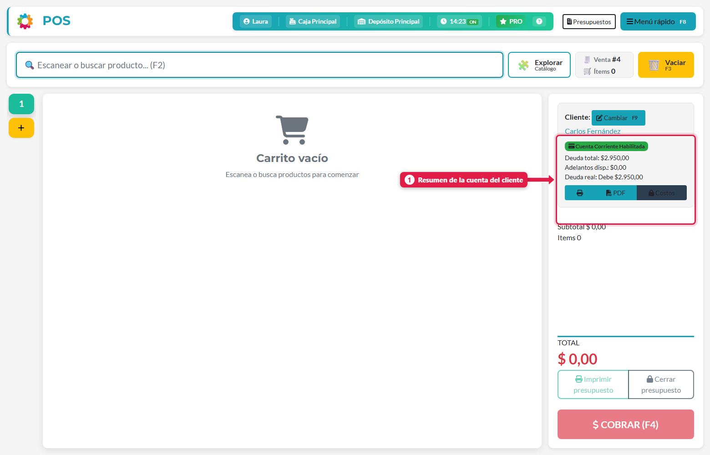
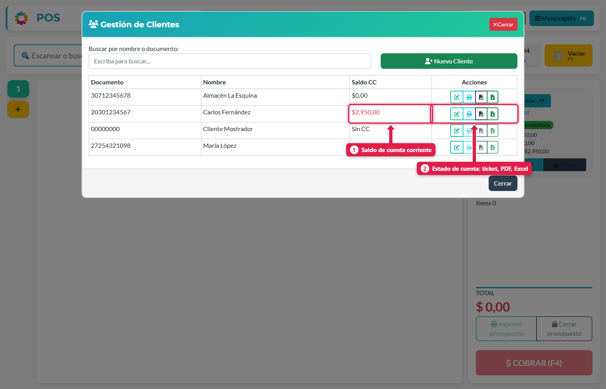
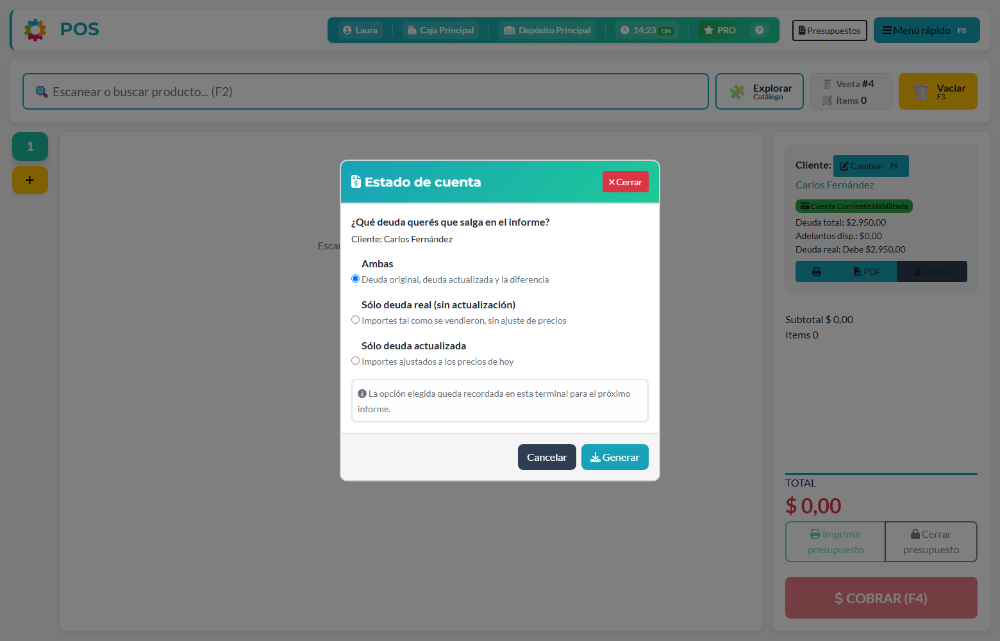

## Para qué sirve

Cuando vendés fiado, la deuda queda en la cuenta corriente del cliente. Esta pantalla sirve para responder la pregunta de todos los días: **¿cuánto me debe?** Además muestra dos saldos distintos (lo que se le vendió y ese mismo saldo a los precios de hoy), y conviene entender la diferencia antes de cobrar.

## Qué vas a lograr

Vas a **consultar la cuenta corriente de un cliente en ADEstock** y generar su estado de cuenta en ticket, PDF o Excel. Aprendé a leer la deuda pendiente, los adelantos disponibles y la diferencia entre el saldo original y el actualizado a precios de hoy.

El saldo actualizado se calcula al consultar. Elegir qué mostrar en el informe no registra un pago ni cancela la deuda.

## Qué significa actualizar una deuda

> Cuando le vendés a un cliente "fiado", la deuda queda con el **precio de ese día**. Si pasan los días y la mercadería sube, el sistema puede mostrar esa deuda **actualizada a los precios de venta vigentes**. **Pero si el precio baja, la deuda no baja: solo se actualiza hacia arriba.**

## Saldo normal vs. saldo actualizado

| | Saldo normal (deuda real) | Saldo actualizado |
|---|---|---|
| Qué es | Lo que se le vendió, tal cual | Esa misma mercadería, valuada con los **precios actuales** |
| Cuándo cambia | Solo cuando hay una venta nueva o un cobro | También cuando cambian los precios de los productos |
| Puede ser menor al normal | - | **Nunca**: si los precios bajaron, se mantiene el saldo normal |

### Ejemplo con números

Carlos Fernández compró fiado Fideos ($ 1.150) y Detergente ($ 1.800): **$ 2.950**. Después el fideo subió a $ 1.400 y el detergente bajó a $ 1.600.

| Producto | Vendido a | Precio hoy |
|---|---|---|
| Fideos | $ 1.150 | $ 1.400 |
| Detergente | $ 1.800 | $ 1.600 |
| **Total** | **$ 2.950** (saldo normal) | **$ 3.000** (saldo actualizado) |

La deuda actualizada es **$ 3.000** porque la suma a precios de hoy (1.400 + 1.600) supera el original.

> **Regla del piso:** el sistema calcula la deuda actualizada para **cada venta fiada completa**. Si el resultado es **menor** que lo que se vendió, se mantiene el original. Dentro de una misma venta, un producto que bajó puede compensar a otro que subió, pero el total **nunca queda por debajo** de lo vendido.

## Paso a paso

### 1. Mirá el resumen en el POS

Elegí al cliente en la venta (**F9**). En el panel de la derecha ves su cuenta:

| Dato | Significado |
|---|---|
| **Deuda total** | Saldo normal pendiente |
| **Adelantos disp.** | Plata a favor que todavía no se aplicó |
| **Deuda real** | `Deuda total − Adelantos` |

### 2. Consultá el saldo de todos los clientes

Menú rápido (**F8**) → **Gestión de clientes**. La columna **Saldo CC** muestra lo que debe cada uno (en rojo si debe).

A la derecha están los iconos de **estado de cuenta**: ticket (🖨), PDF (📄) y Excel (📊).

### 3. Generá el estado de cuenta

Al tocar PDF o Excel, el sistema te pregunta **qué deuda querés que salga en el informe**:

| Opción | Qué muestra |
|---|---|
| **Ambas** | Deuda original, deuda actualizada y la **diferencia** |
| **Sólo deuda real (sin actualización)** | Importes tal como se vendieron |
| **Sólo deuda actualizada** | Importes ajustados a los precios de hoy |

La opción que elegís queda recordada en esa terminal para el próximo informe.

> **Consejo:** para hablar con el cliente, usá **Ambas**: así ve lo que debe y cuánto cambió por la suba de precios.

## Cómo se calcula la actualización

1. Para cada producto de la venta fiada, el sistema toma su **precio actual** (el que hoy figura en la lista).
2. Multiplica por la cantidad vendida, y por la **proporción de la venta que quedó a cuenta corriente** (si se pagó la mitad en efectivo, solo se actualiza la otra mitad).
3. Suma todo. Si da **menos** que el saldo original, se queda con el original.

Los productos que estaban **en oferta** al venderse se actualizan manteniendo el mismo % de descuento sobre el precio de hoy.

## Qué pasa por detrás

| Qué | Detalle |
|---|---|
| Saldo normal | Es la suma de lo que falta cobrar de cada venta fiada |
| Saldo actualizado | Se calcula **al momento de consultar**, con los precios vigentes; no se guarda |
| Adelantos | Son saldo a favor del cliente: se descuentan de sus deudas al cobrar |
| Pagos | Cuando el cliente paga, el cobro se aplica a las deudas que elijas (ver [Cobrar la deuda de un cliente](/tutoriales/cobrar-deuda-cliente/)) |

## Problemas frecuentes

| Si te pasa… | Es porque… | Qué hacer |
|---|---|---|
| El saldo actualizado es igual al normal | El total calculado a precios actuales no supera el original | Es lo esperado: nunca queda por debajo del original |
| Los iconos de estado de cuenta están apagados | El cliente no tiene cuenta corriente habilitada | Habilitala en *Editar cliente* |
| Hay diferencia entre este saldo y el ticket | El ticket muestra el saldo normal (deuda real) | Para ver el actualizado, generá el PDF/Excel con *Ambas* |

## Cómo comprobar que salió bien

Generá el estado de cuenta con **Ambas** para comparar importes originales y actualizados. Verificá que corresponda al cliente elegido y revisá sus adelantos disponibles. Para registrar un pago, continuá desde **Cobrar a un cliente** en el POS.

## Siguiente paso

- [vender fiado a cuenta corriente en ADEstock](/tutoriales/vender-fiado-cuenta-corriente/)
- [cobrar deudas de clientes en ADEstock](/tutoriales/cobrar-deuda-cliente/)
- [crear y editar clientes en ADEstock](/tutoriales/crear-y-editar-clientes/)
