## Qué vas a lograr

Encontrar rápido cualquier dato del negocio (una venta, un pago, un gasto, una compra), **filtrarlo**, **exportarlo a Excel** y sacar el **reporte de costos** de una venta.

> **Para ver cómo viene el negocio en general** (ventas, ganancia, deudas, productos), usá la [app del dueño](/tutoriales/usar-app-del-dueno/): es más rápida y ya viene calculada. El panel de administración sirve para **buscar el detalle** y **exportar**.

## Cómo es cualquier listado del panel

> **Los listados de pagos, cobros, gastos, retiros y turnos son de consulta.** Esas operaciones se registran **solo desde el POS**, con el turno abierto: el panel no permite cargarlas ni editarlas. Sí podés **filtrarlas y exportarlas**.

Todos los listados del panel (ventas, compras, gastos, etc.) funcionan igual. Ejemplo con **Venta → Ventas**:

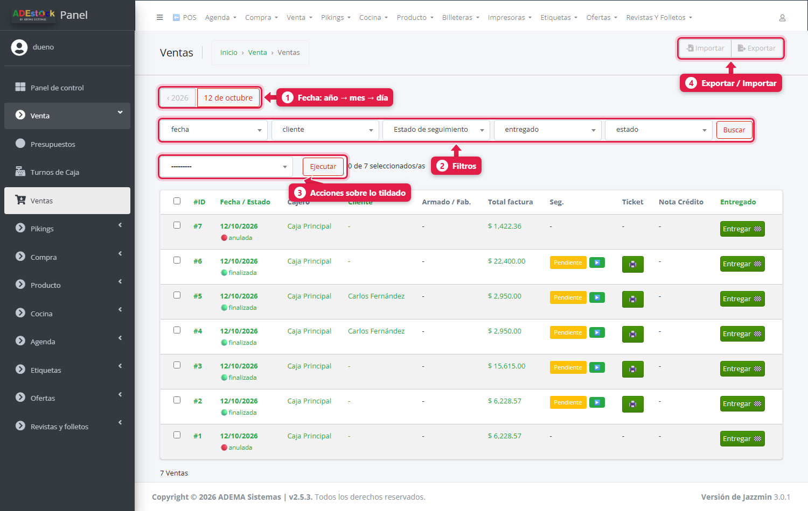

| # | Elemento | Qué hace |
|---|---|---|
| 1 | **Fecha (año → mes → día)** | Navegás por la fecha: tocás el año, después el mes y después el día. Está en los listados que tienen fecha |
| 2 | **Filtros** | Cada desplegable acota la lista (por cliente, estado, medio de pago…). Tocá **Buscar** para aplicarlos |
| 3 | **Acciones** | Tildás una o más filas a la izquierda, elegís una acción y tocás **Ejecutar** |
| 4 | **Exportar / Importar** | Baja el listado a un archivo, o carga datos desde uno |

Cada listado muestra abajo cuántos registros hay (por ejemplo *6 Ventas*). En Ventas, de a **15 por página**, y las ventas en estado *creada* (aún sin cobrar, borradores) **no aparecen** salvo que filtres por ese estado.

### Filtrar

Elegí un valor en cualquier desplegable y la lista se reduce. Por ejemplo, las ventas de un cliente:

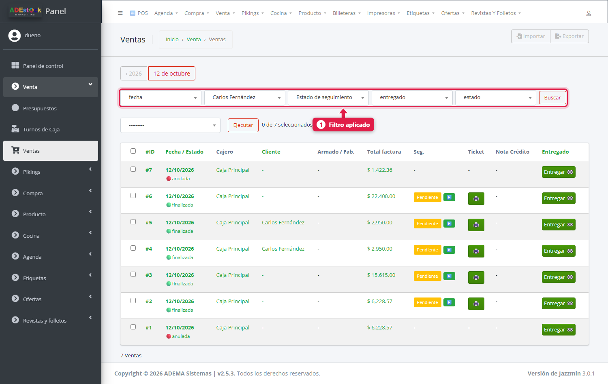

Podés combinar varios filtros. Para sacarlos, volvé a elegir la opción vacía o entrá de nuevo al listado desde el menú.

Algunos listados también tienen una **caja de búsqueda** por texto (por ejemplo, Turnos de caja y Retiros de caja).

### Exportar a Excel

Tocá **Exportar** (arriba a la derecha). Se abre la pantalla de exportación, con la lista de campos que podés incluir (todos vienen tildados):

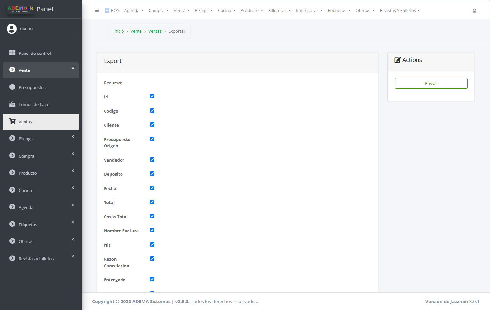

Destildá los que no quieras y, **al final de la página**, elegí el formato:

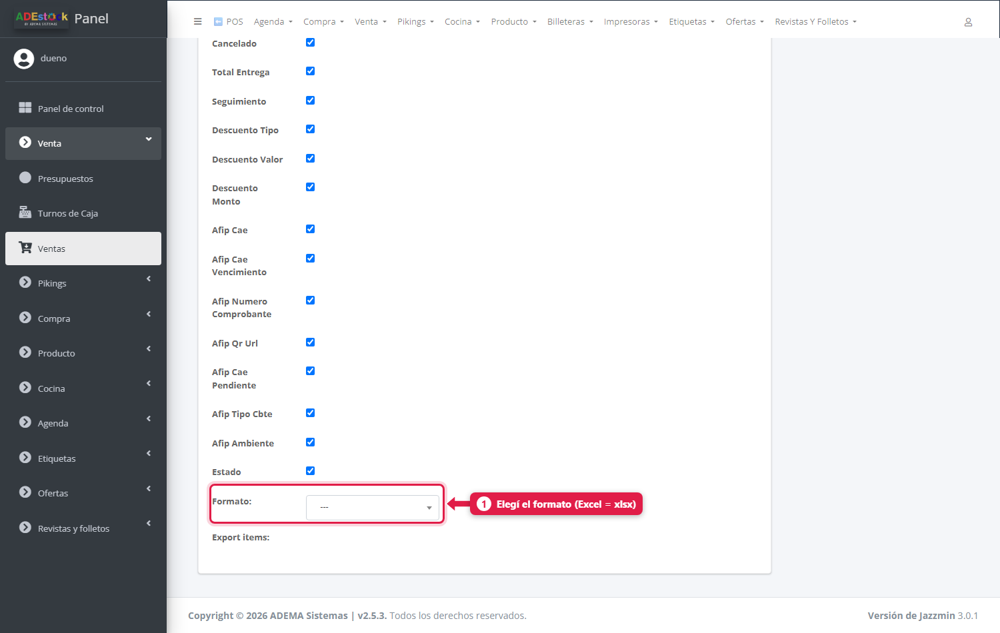

| Formato | Para qué |
|---|---|
| **xlsx** | Excel (lo más común) |
| **csv** / **tsv** | Texto separado por comas o tabulaciones |
| **json** / **yaml** / **html** | Para sistemas o páginas web |

Después tocá **Enviar** y se descarga el archivo. Si tildaste filas y usaste la acción *Exportar … seleccionados* (en los listados de pagos), exporta **solo esas filas**.

### Elegir qué columnas ver

Cada persona puede mostrar u ocultar columnas **en su propio usuario**, sin afectar a los demás. Tildá cualquier fila, elegí la acción **⚙️ Configurar columnas visibles** y **Ejecutar**:

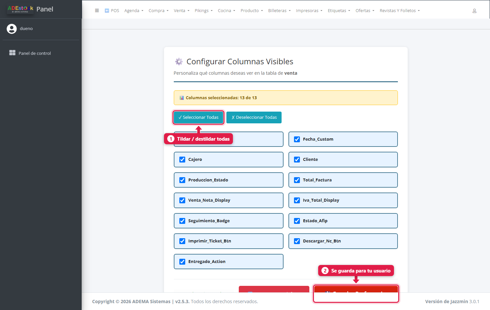

Tildá las columnas que querés ver y tocá **Guardar Preferencias** (1 y 2 en la imagen). **Restaurar por defecto** vuelve a las columnas originales. Esta opción existe en la mayoría de los listados.

## Los listados más usados

### Ventas y lo que se vendió

| Listado | Dónde está | Para qué sirve |
|---|---|---|
| **Ventas** | Venta → Ventas | Cada venta con su fecha, cajero, cliente, total, seguimiento y ticket. Desde acá se **anulan** ventas y se imprimen tickets (ver [Anular una venta](/tutoriales/anular-venta-y-reimprimir-ticket/)) |
| **Productos vendidos** | Venta → Productos vendidos | **Una fila por cada producto vendido**: cantidad, precio, **costo unitario**, costo total y precio final. Ideal para ver qué se vendió y con qué margen |

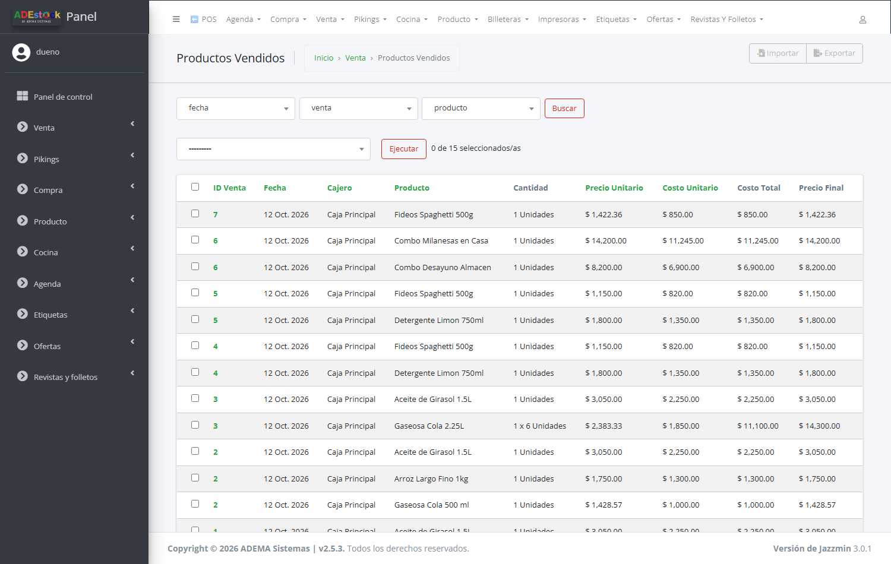

### Plata que entró

| Listado | Dónde está | Para qué sirve |
|---|---|---|
| **Ingresos Ventas** | Venta → Ingresos Ventas | **Cómo se cobró** cada venta: una fila por cada medio de pago (efectivo, tarjeta, cuenta corriente…) y si está *Cobrado* o *Pendiente de Cobro* |
| **Cobro Deudas** | Venta → Cobro Deudas | Los cobros de cuenta corriente: cliente, deuda, monto cobrado y si fue anulado. Se puede **anular un cobro** desde acá (solo superusuario) |

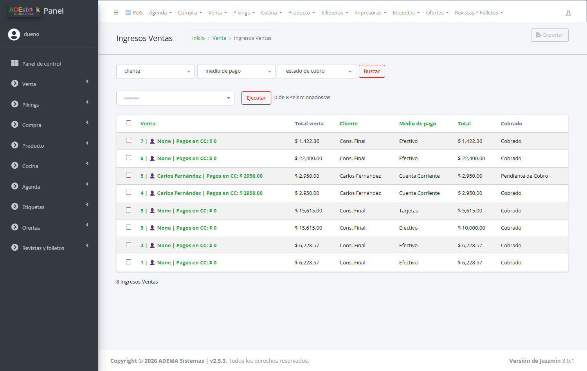

> Una venta cobrada con **dos medios** (por ejemplo efectivo y tarjeta) aparece **dos veces** en *Ingresos Ventas*, una por cada medio. La venta a **cuenta corriente** figura como *Pendiente de Cobro* hasta que el cliente pague.

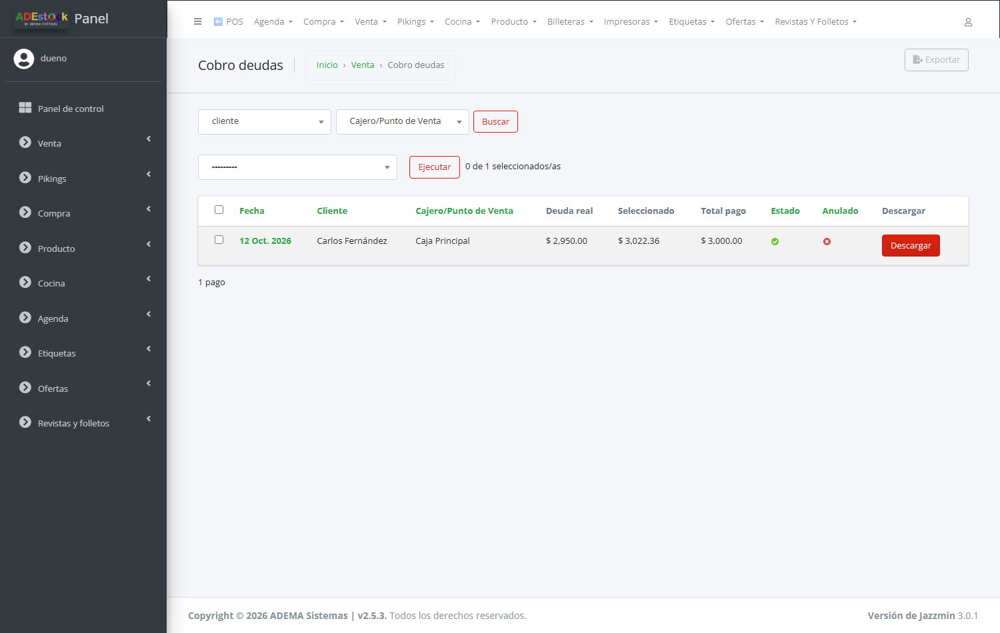

### Plata que salió

| Listado | Dónde está | Para qué sirve |
|---|---|---|
| **Gastos** | Agenda → Gastos | Los gastos cargados (fecha, categoría, medio de pago, caja, importe y si está confirmado). Filtrá por categoría o medio de pago |
| **Compras** | Compra → Compras | Cada compra con su proveedor, total de productos, **fletes** y total general; descarga el PDF de la compra. Las compras se cargan desde el POS y acá se **consultan y se confirman** (acción *Confirmar compra*) |
| **Productos comprados** | Compra → Productos comprados | **Una fila por producto comprado**: cantidad y precio unitario pagado |
| **Egresos por Compras** | Compra → Egresos por Compras | **Cómo se pagó** cada compra, qué está *Pago Realizado* y qué queda *Pendiente* |
| **Pagos Masivos a Prov.** | Compra → Pagos Masivos a Prov. | Los pagos a proveedores que repartieron un monto entre varias compras |

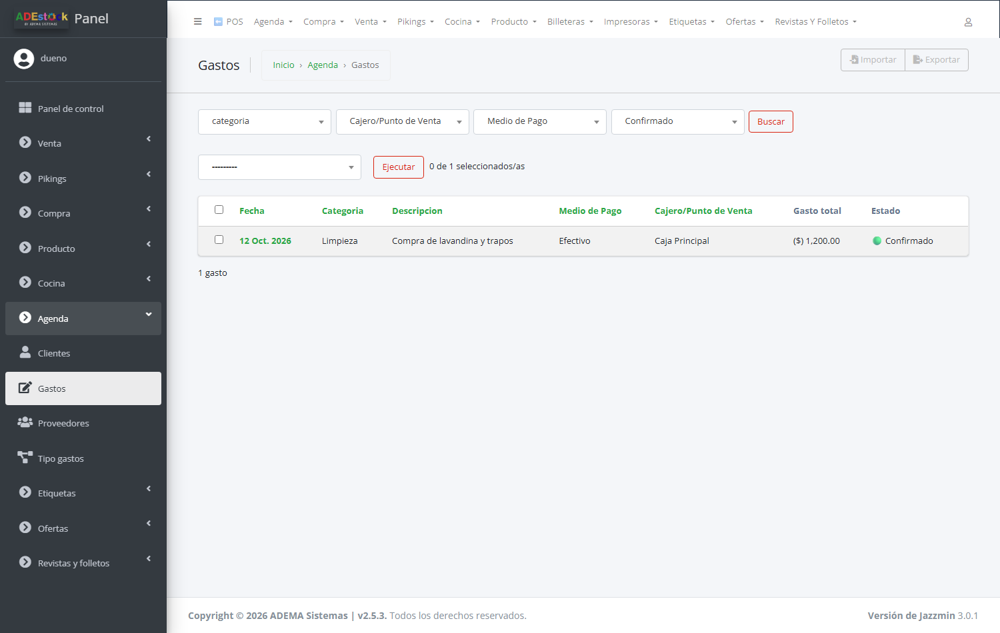

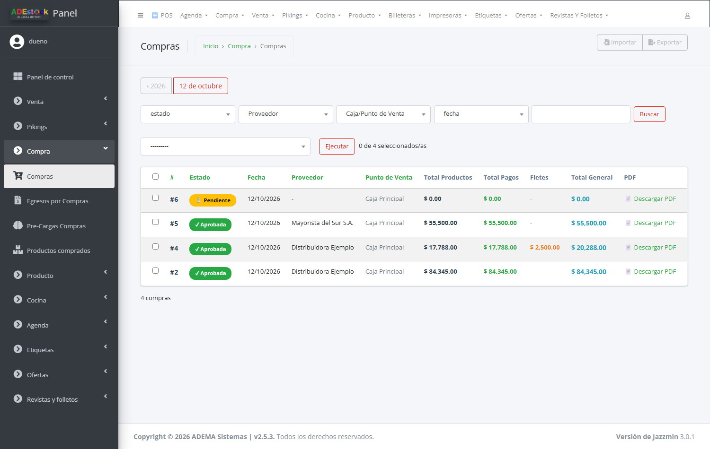

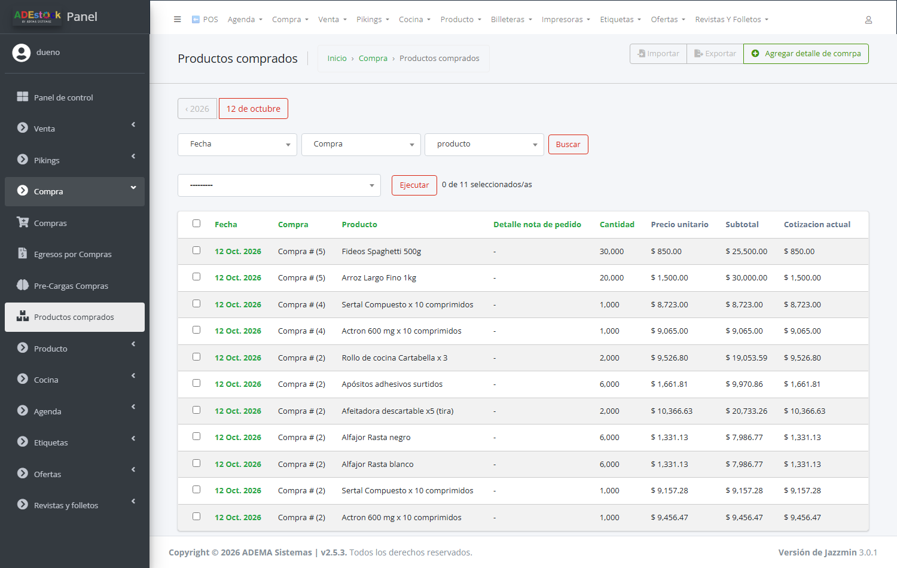

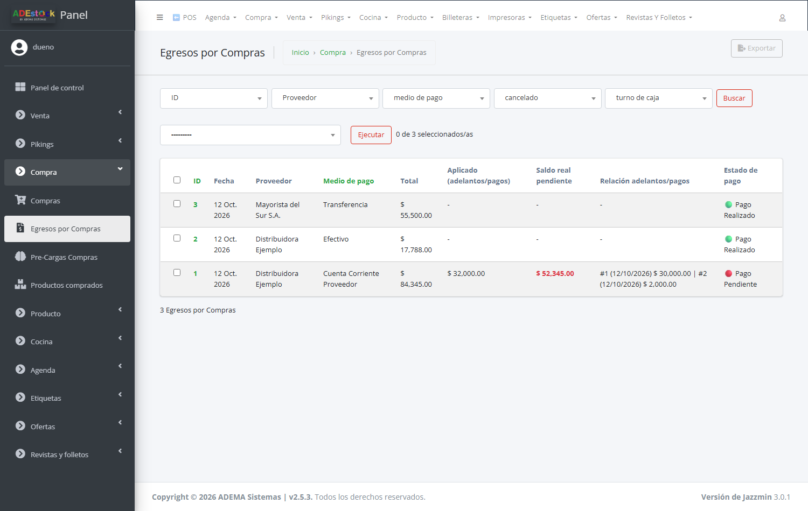

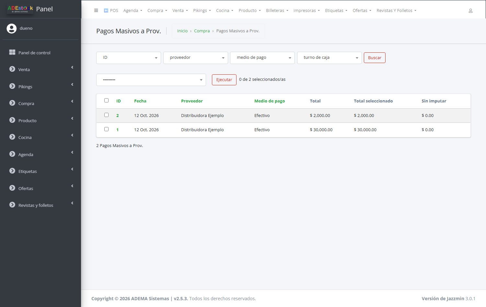

### Cómo cambió el costo de cada producto

**Producto → Historial de costos de productos** registra **cada vez que cambió el costo** de un producto: costo anterior, costo nuevo, de qué proveedor y por qué (por ejemplo, *Compra #5 confirmada*). Sirve para ver cuánto te subió un proveedor.

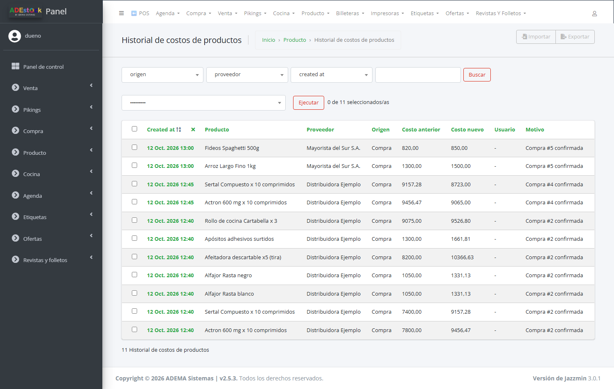

## El reporte de costos de una venta

Responde: **«lo que vendí, ¿cuánto me costó entonces y cuánto me costaría reponerlo hoy?»**

1. Entrá a **Venta → Ventas**.
2. Tildá **una sola** venta (1).
3. En el desplegable de acciones elegí **reporte de costos** (2).
4. Tocá **Ejecutar** (3). Se descarga un **PDF**.

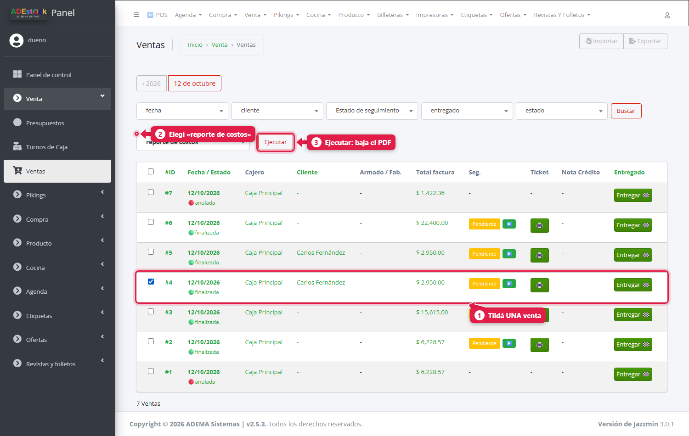

Si tildás más de una venta, el sistema avisa *«Seleccione solo un pedido para generar el informe»*.

El PDF muestra los datos de la venta (número, cliente) y, por cada producto: **cantidad**, **costo original** (el de cuando se vendió), **costo actual** (el de hoy) y la **diferencia**. Al pie:

| Total | Qué es |
|---|---|
| **Costo al momento de la venta** | Lo que te costó la mercadería cuando la vendiste |
| **Costo actual (hoy)** | Lo que te costaría reponerla hoy |
| **Diferencia de costo** | La diferencia, en pesos y en porcentaje |
| **Costos de envío** | El envío de esa venta |

## Qué pasa por detrás

| Qué | Detalle |
|---|---|
| Columnas visibles | Se guardan **por usuario** en la base de datos |
| Exportar | Genera el archivo en el momento, con los datos y los filtros del listado |
| Reporte de costos | Compara el costo guardado en cada renglón de la venta contra el costo actual de cada producto |
| Ventas en estado *creada* | Se ocultan del listado hasta que se filtra por ese estado |

## Problemas frecuentes

| Si te pasa… | Es porque… | Qué hacer |
|---|---|---|
| No encuentro una venta | Está en estado *creada* (nunca se cobró) o el filtro de fecha no la incluye | Filtrá por *estado = creada* o quitá el filtro de fecha |
| Una venta aparece dos veces en *Ingresos Ventas* | Se cobró con dos medios de pago | Es lo esperado: una fila por medio |
| «Seleccione solo un pedido…» | Tildaste más de una venta | Tildá una sola para el reporte de costos |
| Una columna que usaba desapareció | Alguien la ocultó en **tu** usuario (o la guardaste vos) | Acción *Configurar columnas visibles* → **Restaurar por defecto** |
| El Excel tiene muchas columnas que no necesito | Se exportan todos los campos tildados | En la pantalla de exportación, destildá los campos que no quieras |

## Siguiente paso

- [Controlar un turno de caja desde el panel](/tutoriales/controlar-turnos-caja-panel/)
- [La app del dueño](/tutoriales/usar-app-del-dueno/)
