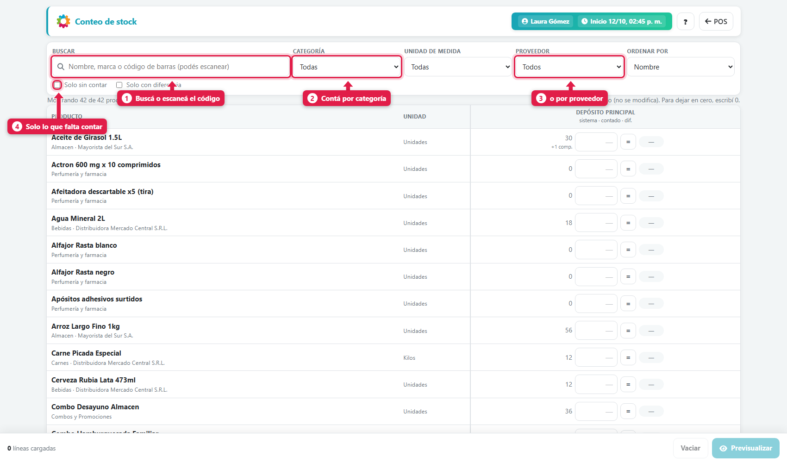
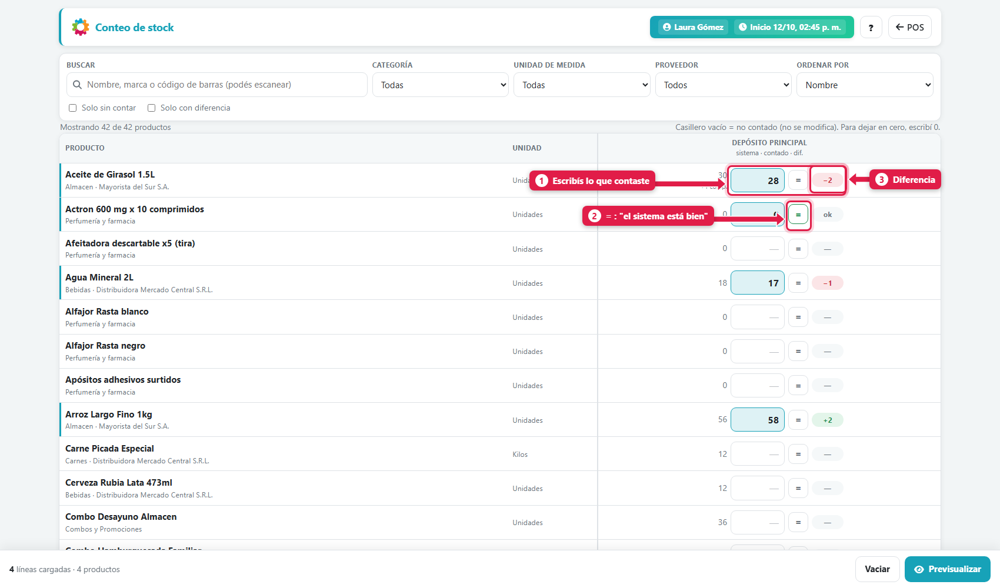
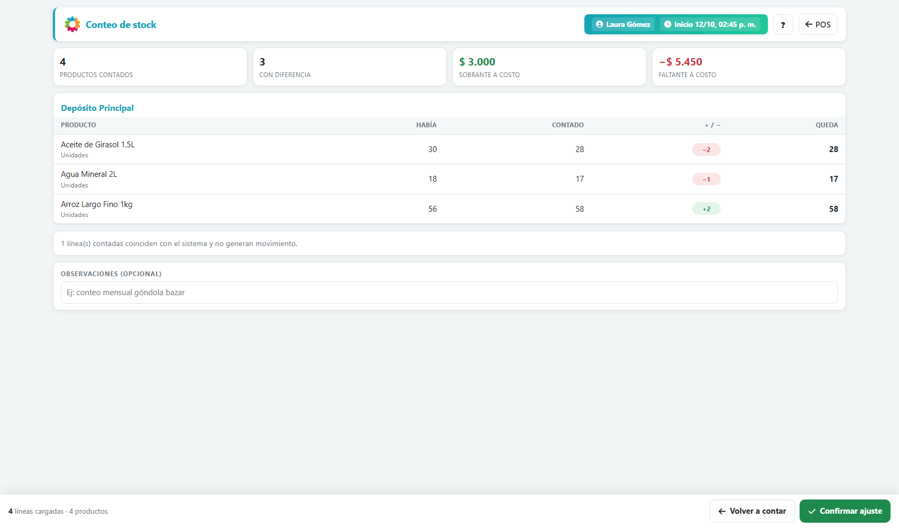
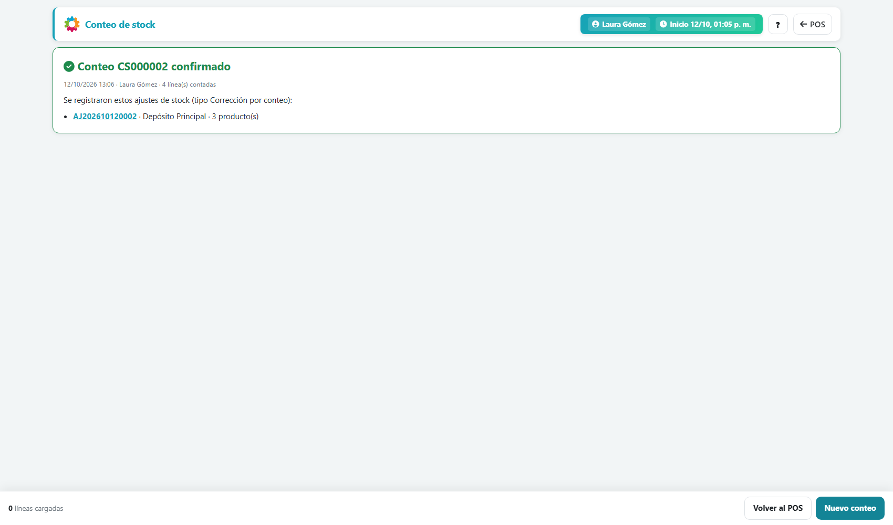
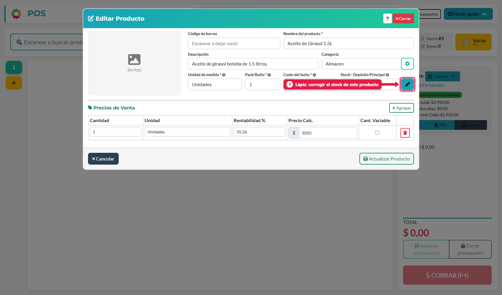
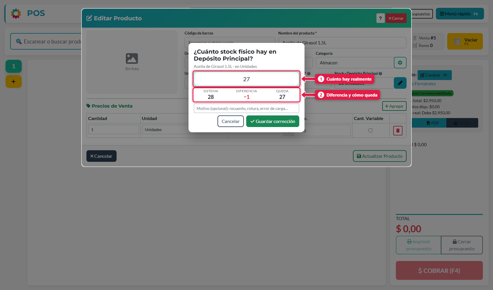
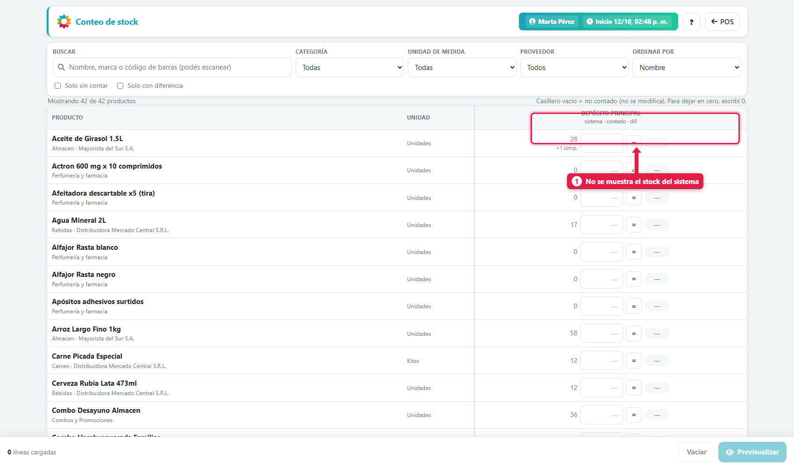

## Para qué sirve

Con el tiempo, el stock del sistema se aleja de la realidad: ventas sin cargar, mercadería que se rompió, errores de carga. Contar sirve para **comparar lo que hay en el local con lo que dice el sistema** y corregir las diferencias en un solo paso, dejando registro de quién lo hizo y cuándo. Conviene hacerlo cada tanto, por sección o por depósito, o cuando algo no te cierra.

## Qué vas a lograr

Vas a **hacer un conteo de stock en ADEstock**, comparar la mercadería física con el inventario del sistema y confirmar las diferencias. Podés trabajar por categoría, proveedor o depósito, desde una computadora o un celular.

La guía también explica cómo corregir un solo producto con el lápiz de stock y cómo funciona el conteo a ciegas para usuarios que no deben ver las cantidades del sistema.

Hay dos herramientas, según lo que necesites:

| Herramienta | Cuándo usarla |
|---|---|
| **Conteo de stock** (Menú rápido) | Contar **muchos** productos, por categoría, proveedor o depósito |
| **Lápiz** en el producto | Corregir **un** producto al instante |

## Conteo de stock

### 1. Abrí la pantalla

Menú rápido (**F8**) → **Conteo de stock**. Funciona igual desde la PC o el celular.

| # | Filtro | Para qué sirve |
|---|---|---|
| 1 | **Buscar** | Por nombre, marca o **código de barras** (podés escanear) |
| 2 | **Categoría** | Contá un sector a la vez: bebidas, limpieza… |
| 3 | **Proveedor** | Contá por proveedor |
| 4 | **Solo sin contar** / **Solo con diferencia** | Para ver qué te falta contar o qué difiere |

También filtrás por unidad de medida y ordenás por nombre, categoría o código.

> **Casillero vacío = no contado:** no se modifica. Podés contar **por partes**, un sector por vez. Para dejar un producto **en cero**, escribí **0**.

### 2. Cargá lo que contaste

Cada fila muestra el **stock del sistema** y un casillero para escribir lo **contado**.

| # | Elemento | Qué hace |
|---|---|---|
| 1 | **Contado** | Escribís lo que hay realmente |
| 2 | **=** | Atajo: "el sistema está bien" (copia el stock del sistema) |
| 3 | **Diferencia** | Aparece sola: `−2` falta, `+2` sobra, `ok` coincide |

Detalles útiles:

- Se cuenta en la **unidad del producto** (unidades sueltas, no bultos; kilos, litros…). Admite coma decimal.
- Donde dice `+2 comp.` hay mercadería **comprometida** (vendida pero todavía no entregada): sigue físicamente en la góndola, por eso se cuenta igual.
- Abajo ves cuántas **líneas cargadas** tenés. El conteo se guarda como borrador en tu navegador si cerrás sin confirmar.

### 3. Previsualizá

Tocá **Previsualizar**. El sistema te muestra **qué va a cambiar** antes de tocar nada:

| Dato | Qué es |
|---|---|
| **Productos contados / con diferencia** | Cuántos cargaste y cuántos difieren |
| **Sobrante a costo / Faltante a costo** | Lo que valen las diferencias (a costo) |
| **Había / Contado / ± / Queda** | Por producto, el antes y el después |
| *Líneas que coinciden* | No generan movimiento |

Podés agregar **observaciones** (por ejemplo, *Conteo semanal de góndola*). Si algo no cierra, **Volver a contar**.

### 4. Confirmá

Tocá **Confirmar ajuste**.

Queda registrado el **conteo** (`CS000002`) y un **ajuste de inventario** por cada depósito con diferencias (`AJ…`), tipo *Corrección por conteo*, con tu usuario, fecha y hora.

## Corregir un producto con el lápiz

En **Explorar** (o *Editar producto*), el modal del producto muestra el **stock físico** del depósito de tu caja con un **lápiz**.

Tocá el lápiz, escribí **cuánto hay** y confirmá:

Ves **Sistema / Diferencia / Queda** antes de guardar. La corrección se aplica **al instante** (no hace falta *Actualizar producto*) y queda registrada como *Corrección por conteo*, con un motivo opcional.

> Para otros depósitos o muchos productos a la vez, usá el **Conteo de stock**.

## Conteo a ciegas

Si al usuario se le activa **Contar sin ver el stock** (en *Configuración → Usuarios*), ve la pantalla así:

- Aparece la etiqueta **Conteo a ciegas**.
- **No ve** el stock del sistema (ni en la lista, ni en la previsualización, ni con el lápiz), y no tiene el botón **=**.
- Solo escribe lo que contó. Las **diferencias las ve el administrador** en *Ajustes de inventario*.

Es la forma de evitar que el que cuenta "ajuste" lo que ve a lo que dice el sistema.

## Reglas importantes

| Regla | Qué significa |
|---|---|
| Se compara contra el **stock físico** | Lo vendido pero no entregado sigue contando como físico: así no aparecen sobrantes falsos |
| **Siempre corrección**, nunca merma | El conteo corrige; las roturas o vencimientos se registran como mermas aparte |
| Mientras contás se puede seguir vendiendo | El sistema toma una "foto" del stock al cargar la fila y aplica solo la diferencia sobre el stock del momento de confirmar. Si hubo movimientos, la previsualización lo marca |
| Se puede anular | Un ajuste de conteo no se borra: se **anula** desde el panel de administración y el stock vuelve a lo anterior |

## Qué pasa por detrás

| Qué | Detalle |
|---|---|
| Conteo | Se crea un registro con quién contó, cuándo y cuántas líneas |
| Ajuste | Por depósito con diferencias, un ajuste con impacto directo en stock (sin compras virtuales) |
| Producto nuevo | Si cargás stock con el lápiz al crear un producto, queda como stock inicial |
| Seguridad | La confirmación es atómica: o se aplican todas las diferencias o ninguna |

## Problemas frecuentes

| Si te pasa… | Es porque… | Qué hacer |
|---|---|---|
| No veo *Conteo de stock* | Falta el permiso *Puede modificar stock* | Pedíselo al dueño |
| No veo el lápiz | Falta ese permiso, o no abriste el producto en *Editar* | Verificá el permiso y el permiso de gestionar productos |
| Un producto no aparece | No es contable (servicio u horas) o está fusionado | Esos productos no se cuentan |
| Contó otra persona y no puedo ver su diferencia | Conteo a ciegas | El administrador la ve en *Ajustes de inventario* |
| Me equivoqué en un conteo | - | Anulá el ajuste desde el panel de administración |

## Cómo comprobar que salió bien

Después de confirmar, revisá el código del conteo y los ajustes generados por depósito. Las filas vacías deben quedar sin modificar y las cantidades ingresadas deben reflejar las diferencias previsualizadas. En un conteo a ciegas, el administrador consulta esas diferencias desde **Ajustes de inventario**.

## Siguiente paso

- [ajustar stock, registrar mermas y transferir entre depósitos](/tutoriales/ajustar-stock-mermas-transferencias/)
- [cargar el stock inicial desde Excel en ADEstock](/tutoriales/cargar-stock-inicial-excel/)
- [crear usuarios y asignar permisos en ADEstock](/tutoriales/usuarios-y-permisos/)
