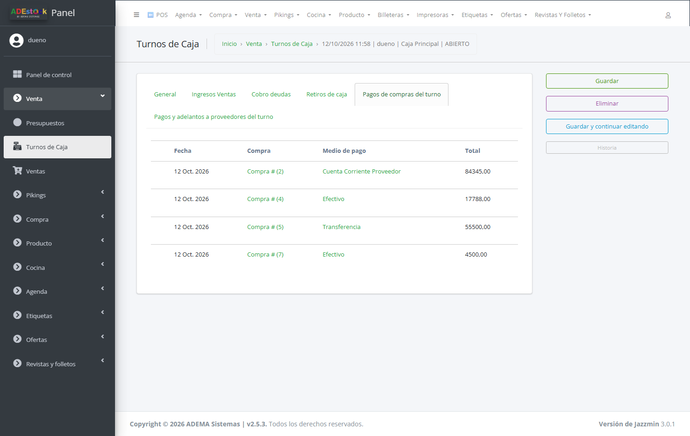
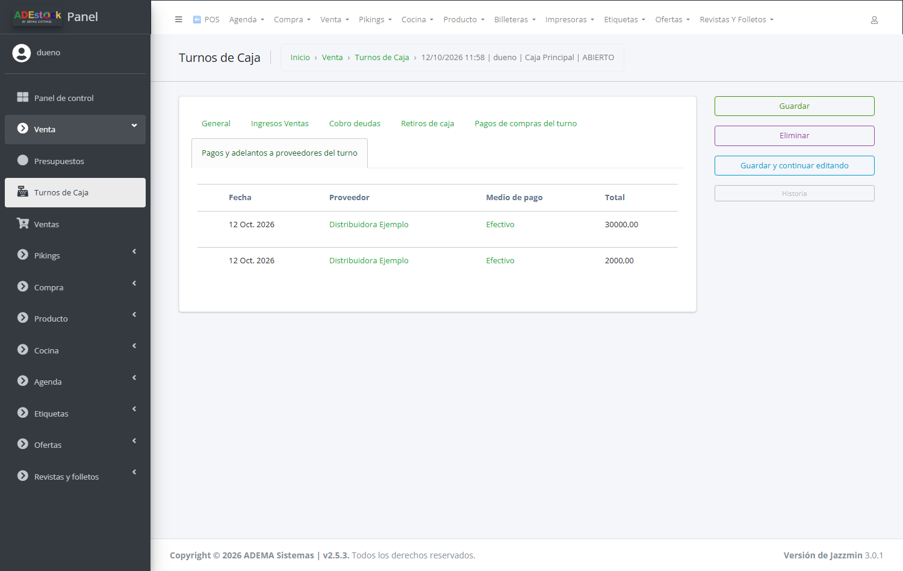

## Qué vas a lograr

Revisar **todos los turnos de caja** del negocio: quién los abrió, cuánta plata debía haber, cuánta se contó, **cuánto faltó o sobró**, y qué ventas, cobros y retiros tuvo cada uno. También bajar el **PDF del cierre**.

El cajero abre y cierra su turno desde el POS (ver [Turno de caja: apertura y cierre](/tutoriales/abrir-y-cerrar-caja/)). Esta pantalla es la **vista del dueño** para controlar esos cierres.

## Paso a paso

### 1. Abrí la lista de turnos

En el panel: **Venta → Turnos de Caja**.

| # | Columna | Qué es |
|---|---|---|
| 1 | **Estado** | *Abierto* (el cajero está trabajando), *Cerrado* o *Anulado* |
| - | **Apertura / Cierre** | Fecha y hora en que se abrió y se cerró |
| - | **Cajero** y **Punto de Venta** | Quién y en qué caja |
| - | **Efectivo Inicial** | La plata con la que se abrió la caja |
| 2 | **Efectivo Esperado (Sistema)** | Lo que **debería haber** en la caja, según el sistema |
| 3 | **Efectivo Real (Declarado)** | Lo que el cajero **contó** al cerrar |
| 4 | **Diferencia** | Real − Esperado. **Negativo = faltante**, **positivo = sobrante** |
| 5 | **PDF** | El comprobante del cierre |

Un turno **abierto** todavía no tiene efectivo real ni diferencia (queda en *«-»* y *0,00*).

Para encontrar un turno, usá la **fecha** (año → mes → día), los filtros por **estado**, **punto de venta** y **cajero**, o la caja de búsqueda (por usuario del cajero o nombre de la caja). Más sobre listados en [Consultar, filtrar y exportar](/tutoriales/consultar-reportes-y-exportar/).

### 2. Entrá a un turno

Tocá el número de turno para ver el detalle:

| # | Zona | Qué muestra |
|---|---|---|
| 1 | **Caja y cajero** | A qué punto de venta y a qué usuario pertenece |
| 2 | **Estado y horas** | Cuándo se abrió y se cerró |
| 3 | **Pestañas** | Las ventas, cobros y retiros que tuvo el turno |

Más abajo está el **arqueo**:

| # | Dato | Qué es |
|---|---|---|
| 1 | **Ingresos Efectivo** | Lo que entró en **efectivo**: ventas cobradas en efectivo y cobros de deudas en efectivo |
| 2 | **Egresos Efectivo** | Lo que salió en **efectivo**: retiros, gastos y pagos de compras en efectivo |
| 3 | **Efectivo Esperado** | Efectivo inicial + ingresos − egresos |
| 4 | **Diferencia** | Efectivo real − esperado |

Y abajo, el **Detalle de movimientos/totales**: el resumen **por medio de pago** que quedó guardado (ventas por efectivo, tarjeta y cuenta corriente, cobranzas, retiros, gastos…). Es un texto técnico; sirve para consultas puntuales.

> **Solo el efectivo cuenta para el arqueo.** Las ventas con tarjeta, transferencia o cuenta corriente aparecen en el detalle, pero no entran en lo que "debería haber" en el cajón. La fórmula completa está en [Turno de caja: apertura y cierre](/tutoriales/abrir-y-cerrar-caja/).

### 3. Revisá qué pasó en el turno (las pestañas)

Las pestañas son de **solo lectura**: sirven para auditar, no para modificar. **Los turnos se abren y se cierran desde el POS**; en el panel no se crean ni se editan (solo se consultan, y se agregan observaciones).

**Ingresos Ventas** - cada pago de venta del turno, con su medio y si está cobrado (✔) o pendiente (✘, por ejemplo una venta a cuenta corriente que todavía no se pagó):

**Cobro deudas** - los cobros de cuentas corrientes hechos durante el turno:

**Retiros de caja** - la plata que se sacó de la caja durante el turno:

**Pagos de compras del turno** - los pagos de compras registrados en este turno (compra, medio de pago e importe). Solo el **efectivo** de compras **confirmadas** entra en el arqueo.

En el ejemplo, la *Compra #7* tiene un pago de $ 4.500 en efectivo en este turno, pero como todavía **no está confirmada** no descuenta del efectivo esperado (y bloquearía el cierre).

**Pagos y adelantos a proveedores del turno** - los pagos de deuda y adelantos a proveedores hechos desde el POS en este turno (proveedor, medio e importe). El efectivo resta del efectivo esperado.

### 4. Descargá el PDF del cierre

En la lista de turnos, tocá **PDF** en la fila del turno. Es el **reporte de cierre de caja** (una hoja) con:

| Sección | Qué trae |
|---|---|
| **Información general** | Cajero, caja, apertura, cierre y estado |
| **Resumen de operaciones** | Facturación total del turno, cuánto fue a crédito (cuenta corriente), ingresos por ventas al contado, recupero de deuda y total de ingresos reales |
| **Arqueo de caja (efectivo)** | Fondo inicial, ingresos y salidas en efectivo, **efectivo esperado**, **efectivo declarado** y la **diferencia** (indica si es faltante o sobrante) |
| **Pago de gastos** y **Pagos de compras** | Por medio de pago, separando efectivo de no efectivo |
| **Desglose total por medio de pago** | Cuánto entró por cada medio |
| **Firmas** | Espacio para la firma del cajero y del supervisor |

> **El PDF de un turno cerrado siempre muestra los mismos números**: son los que quedaron guardados al cerrar, iguales a los del ticket impreso, y las horas de apertura y cierre aparecen en **hora local**. Descargarlo más tarde no modifica el turno.

### 5. Retiros de caja

Para ver **todos los retiros** de todos los turnos: **Venta → Retiros de Caja**. Podés filtrar por fecha, cajero, punto de venta, turno y medio de pago, y bajar el comprobante de cada retiro en PDF.

Los retiros se cargan desde el POS (ver [Registrar un gasto y un retiro de caja](/tutoriales/registrar-gastos-y-retiros/)).

## Qué pasa por detrás

| Qué | Detalle |
|---|---|
| Cada pago, cobro, retiro y gasto | Se guarda asociado al turno del cajero |
| **Pagos de compras** y **pagos o adelantos a proveedores** | Se asocian al **turno en el que se registró el pago** (cuando salió la plata) y no se pasan a otro turno. Los pagos de compras **descuentan del arqueo recién cuando la compra está confirmada**, y el turno **no se puede cerrar** con compras pagadas sin confirmar (ver [Turno de caja](/tutoriales/abrir-y-cerrar-caja/#antes-de-cerrar-las-compras-pagadas-tienen-que-estar-confirmadas)) |
| **Pagos y cobros** | Se registran **solo desde el POS**, con turno abierto: el panel no permite cargarlos. Por eso todo movimiento tiene turno y caja |
| **Anular una venta** | Desde el panel (*Venta → Ventas → Anular Venta*). Si la venta tenía cobros que movieron plata, el sistema pide **a qué turno abierto** se imputa la devolución; el turno original **no se modifica**. Sin ningún turno abierto no se puede anular |
| Efectivo esperado | Se recalcula mientras el turno está abierto. Al cerrarlo **queda congelado**: descargar el PDF más tarde no lo cambia |
| Detalle por medio | Queda guardado con el turno en *Detalle de movimientos/totales* |
| Auto-creado | Marca los turnos que el sistema abrió solo para evitar errores por falta de turno |

> **Dos turnos distintos en la misma caja el mismo día** ya no se mezclan: cada pago de compra o a proveedor cuenta solo en el turno donde se hizo.

## Problemas frecuentes

| Si te pasa… | Es porque… | Qué hacer |
|---|---|---|
| El turno tiene faltante y no sé por qué | Falta registrar un retiro, un gasto o un cobro; o hay un pago de compra o a proveedor en efectivo | Revisá las pestañas del turno (incluye *Pagos de compras* y *Pagos a proveedores*) |
| Un pago antiguo a un proveedor no figura en ningún turno | Es anterior a esta versión (entonces no se asociaba al turno) | En *Compras → Pagos Masivos a Prov.* filtrá por **Sin turno** para ver esos pagos históricos |
| Necesito corregir un turno cerrado | Los cerrados no se recalculan solos | Un superusuario puede usar la acción **Recalcular turno** (queda anotado en observaciones) |
| El turno aparece *Abierto* de un día anterior | El cajero no lo cerró | Pedile que lo cierre desde el POS (ver [Turno de caja](/tutoriales/abrir-y-cerrar-caja/)) |
| No puedo modificar los números de un turno | Los totales son de solo lectura | Es a propósito: se calculan solos |
| Veo una venta anulada entre los ingresos del turno | El cobro original queda en su turno; la devolución figura en el turno abierto que se eligió al anular | Revisá la venta en *Venta → Ventas* y la devolución en el turno que corresponda |
| No puedo anular una venta | No hay ningún turno de caja abierto para imputar la devolución | Abrí un turno desde el POS y volvé a intentar |
| No encuentro cómo agregar un turno o un pago desde el panel | Ya no se puede: se hace todo desde el POS | Abrí el turno o registrá el pago desde el POS |

## Siguiente paso

- [Billeteras y cuentas: dónde está tu plata](/tutoriales/billeteras-y-cuentas/)
- [Consultar, filtrar y exportar información](/tutoriales/consultar-reportes-y-exportar/)
