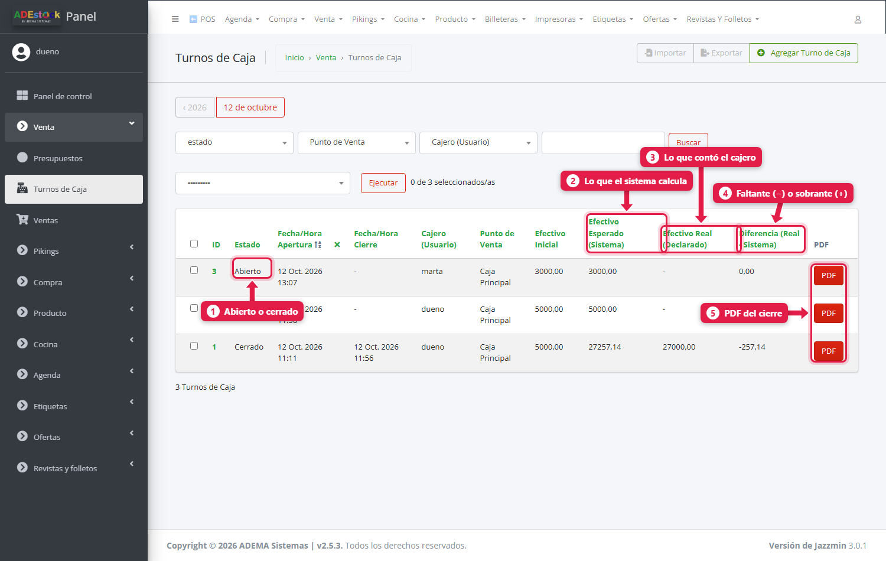
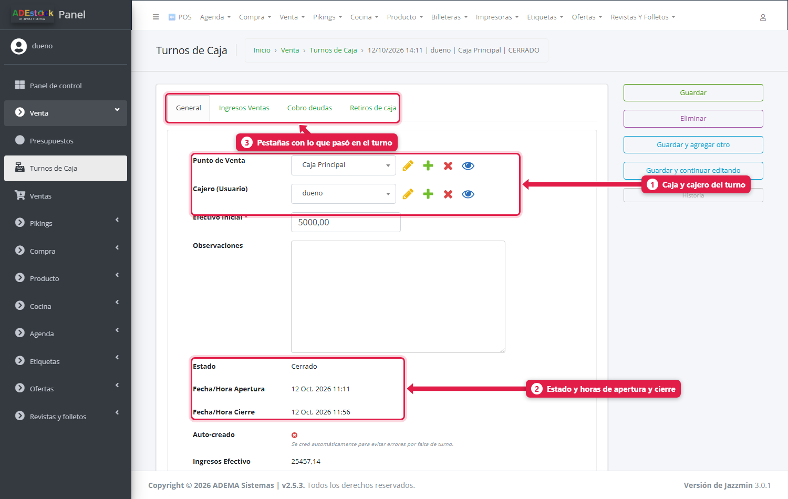
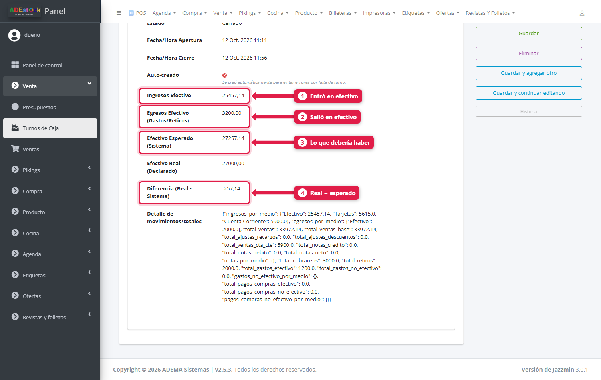
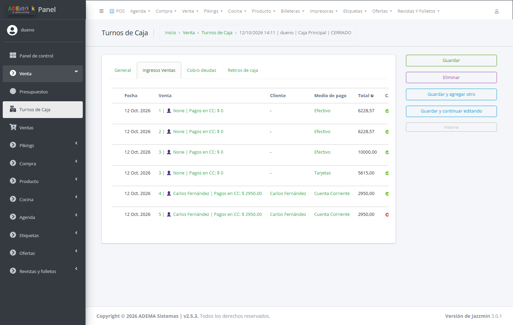
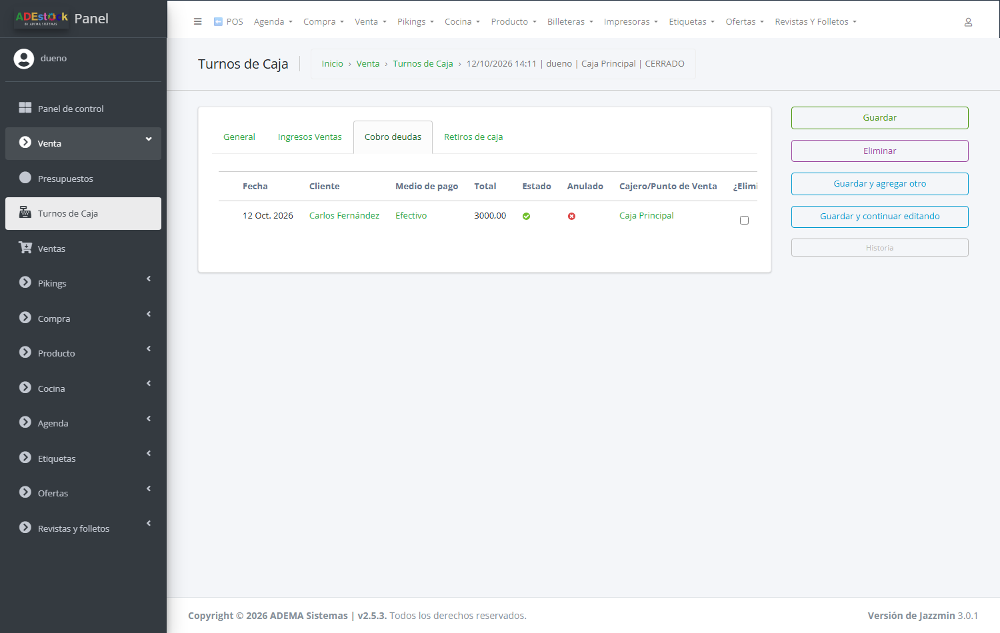
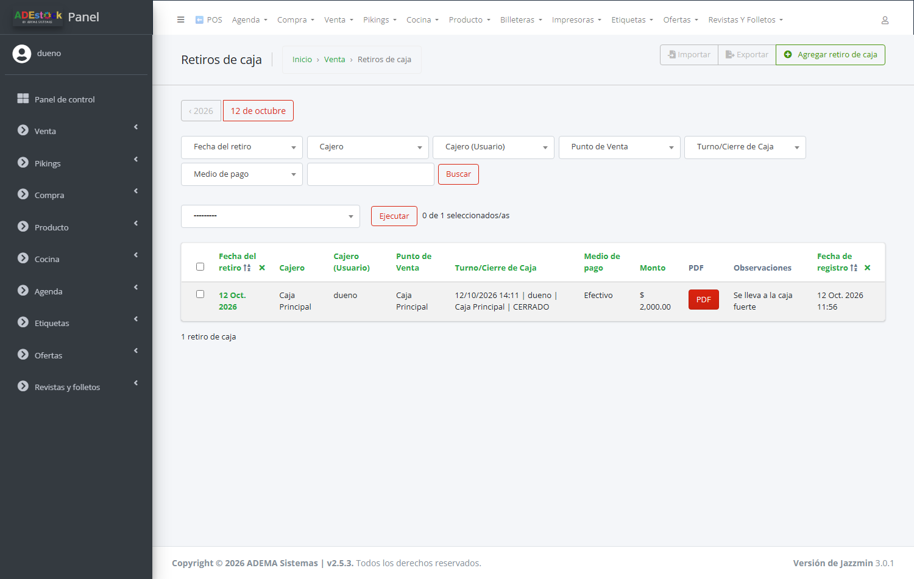

## Qué vas a lograr

Revisar **todos los turnos de caja** del negocio: quién los abrió, cuánta plata debía haber, cuánta se contó, **cuánto faltó o sobró**, y qué ventas, cobros y retiros tuvo cada uno. También bajar el **PDF del cierre**.

El cajero abre y cierra su turno desde el POS (ver [Turno de caja: apertura y cierre](12-turno-de-caja-apertura-y-cierre.md)). Esta pantalla es la **vista del dueño** para controlar esos cierres.

## Paso a paso

### 1. Abrí la lista de turnos

En el panel: **Venta → Turnos de Caja**.

| # | Columna | Qué es |
|---|---|---|
| 1 | **Estado** | *Abierto* (el cajero está trabajando), *Cerrado* o *Anulado* |
| — | **Apertura / Cierre** | Fecha y hora en que se abrió y se cerró |
| — | **Cajero** y **Punto de Venta** | Quién y en qué caja |
| — | **Efectivo Inicial** | La plata con la que se abrió la caja |
| 2 | **Efectivo Esperado (Sistema)** | Lo que **debería haber** en la caja, según el sistema |
| 3 | **Efectivo Real (Declarado)** | Lo que el cajero **contó** al cerrar |
| 4 | **Diferencia** | Real − Esperado. **Negativo = faltante**, **positivo = sobrante** |
| 5 | **PDF** | El comprobante del cierre |

Un turno **abierto** todavía no tiene efectivo real ni diferencia (queda en *«-»* y *0,00*).

Para encontrar un turno, usá la **fecha** (año → mes → día), los filtros por **estado**, **punto de venta** y **cajero**, o la caja de búsqueda (por usuario del cajero o nombre de la caja). Más sobre listados en [Consultar, filtrar y exportar](31-consultas-y-reportes-del-admin.md).

### 2. Entrá a un turno

Tocá el número de turno para ver el detalle:

| # | Zona | Qué muestra |
|---|---|---|
| 1 | **Caja y cajero** | A qué punto de venta y a qué usuario pertenece |
| 2 | **Estado y horas** | Cuándo se abrió y se cerró |
| 3 | **Pestañas** | Las ventas, cobros y retiros que tuvo el turno |

Más abajo está el **arqueo**:

| # | Dato | Qué es |
|---|---|---|
| 1 | **Ingresos Efectivo** | Lo que entró en **efectivo**: ventas cobradas en efectivo y cobros de deudas en efectivo |
| 2 | **Egresos Efectivo** | Lo que salió en **efectivo**: retiros, gastos y pagos de compras en efectivo |
| 3 | **Efectivo Esperado** | Efectivo inicial + ingresos − egresos |
| 4 | **Diferencia** | Efectivo real − esperado |

Y abajo, el **Detalle de movimientos/totales**: el resumen **por medio de pago** que quedó guardado (ventas por efectivo, tarjeta y cuenta corriente, cobranzas, retiros, gastos…). Es un texto técnico; sirve para consultas puntuales.

> **Solo el efectivo cuenta para el arqueo.** Las ventas con tarjeta, transferencia o cuenta corriente aparecen en el detalle, pero no entran en lo que "debería haber" en el cajón. La fórmula completa está en [Turno de caja: apertura y cierre](12-turno-de-caja-apertura-y-cierre.md).

### 3. Revisá qué pasó en el turno (las pestañas)

Las pestañas son de **solo lectura**: sirven para auditar, no para modificar.

**Ingresos Ventas** — cada pago de venta del turno, con su medio y si está cobrado (✔) o pendiente (✘, por ejemplo una venta a cuenta corriente que todavía no se pagó):

**Cobro deudas** — los cobros de cuentas corrientes hechos durante el turno:

**Retiros de caja** — la plata que se sacó de la caja durante el turno:

### 4. Descargá el PDF del cierre

En la lista de turnos, tocá **PDF** en la fila del turno. Es el **reporte de cierre de caja** (una hoja) con:

| Sección | Qué trae |
|---|---|
| **Información general** | Cajero, caja, apertura, cierre y estado |
| **Resumen de operaciones** | Facturación total del turno, cuánto fue a crédito (cuenta corriente), ingresos por ventas al contado, recupero de deuda y total de ingresos reales |
| **Arqueo de caja (efectivo)** | Fondo inicial, ingresos y salidas en efectivo, **efectivo esperado**, **efectivo declarado** y la **diferencia** (indica si es faltante o sobrante) |
| **Pago de gastos** y **Pagos de compras** | Por medio de pago, separando efectivo de no efectivo |
| **Desglose total por medio de pago** | Cuánto entró por cada medio |
| **Firmas** | Espacio para la firma del cajero y del supervisor |

> **Importante:** el PDF **vuelve a calcular el turno** con los movimientos que existan **en el momento en que lo descargás**. Si después de cerrar se cargó algo que impacta en ese turno (por ejemplo, una compra pagada en efectivo ese mismo día desde la misma caja), el PDF puede mostrar números **distintos** a los que quedaron guardados al cerrar. Para comparar con lo que firmó el cajero, usá el **ticket de cierre** que salió impreso al cerrar.

### 5. Retiros de caja

Para ver **todos los retiros** de todos los turnos: **Venta → Retiros de Caja**. Podés filtrar por fecha, cajero, punto de venta, turno y medio de pago, y bajar el comprobante de cada retiro en PDF.

Los retiros se cargan desde el POS (ver [Registrar un gasto y un retiro de caja](13-registrar-un-gasto-y-retiro-de-caja.md)).

## Qué pasa por detrás

| Qué | Detalle |
|---|---|
| Cada pago, cobro, retiro y gasto | Se guarda asociado al turno del cajero |
| **Pagos de compras** | No tienen un turno directo: el sistema los atribuye al turno por **fecha y punto de venta** (cuenta las compras confirmadas de esa caja entre el día de apertura y el de cierre) |
| Efectivo esperado | Se recalcula cada vez que se guarda el turno, y al cerrar queda guardado |
| Detalle por medio | Queda guardado con el turno en *Detalle de movimientos/totales* |
| Auto-creado | Marca los turnos que el sistema abrió solo para evitar errores por falta de turno |

> **Si trabajás con dos turnos distintos en la misma caja el mismo día**, los pagos de compras en efectivo de ese día **se cuentan en los dos**, porque se atribuyen por fecha. Tenelo en cuenta si ves una diferencia que no podés explicar.

## Problemas frecuentes

| Si te pasa… | Es porque… | Qué hacer |
|---|---|---|
| El turno tiene faltante y no sé por qué | Falta registrar un retiro, un gasto o un cobro; o hay una compra en efectivo del día | Revisá las pestañas del turno y los *Gastos* y *Compras* del día |
| El PDF muestra otros números que el ticket | El PDF recalcula con los movimientos de hoy | Usá el ticket impreso al cerrar como referencia |
| El turno aparece *Abierto* de un día anterior | El cajero no lo cerró | Pedile que lo cierre desde el POS (ver [Turno de caja](12-turno-de-caja-apertura-y-cierre.md)) |
| No puedo modificar los números de un turno | Los totales son de solo lectura | Es a propósito: se calculan solos |
| Veo una venta anulada entre los ingresos del turno | La anulación se hizo después de cobrarla | Revisá la venta en *Venta → Ventas* |

## Siguiente paso

- [Billeteras y cuentas: dónde está tu plata](33-billeteras-y-cuentas.md)
- [Consultar, filtrar y exportar información](31-consultas-y-reportes-del-admin.md)
