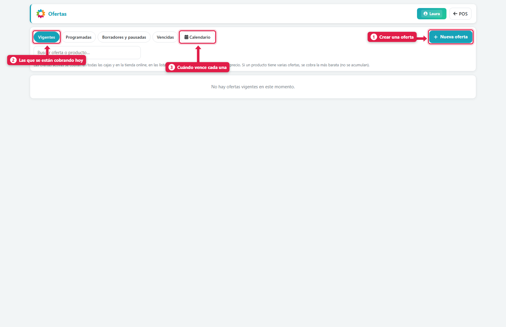
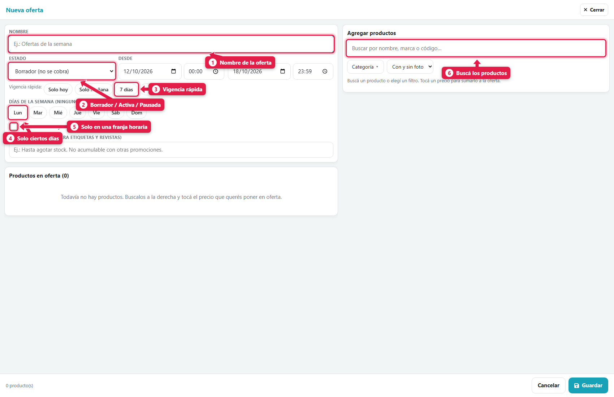
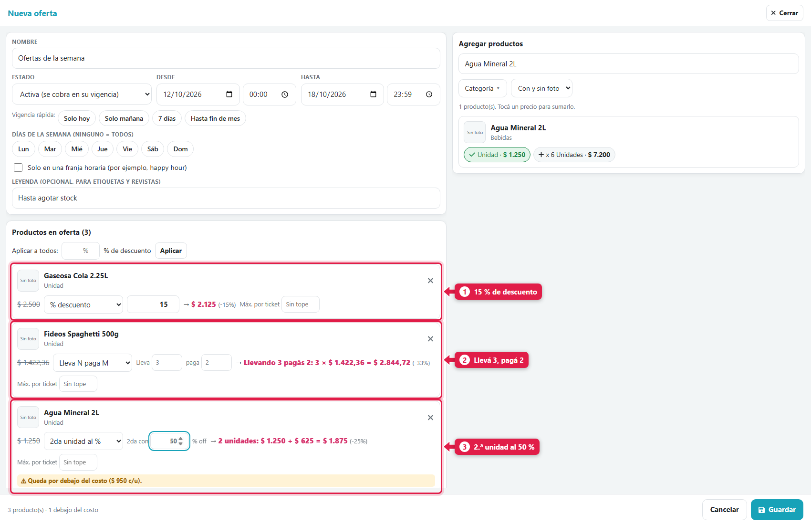
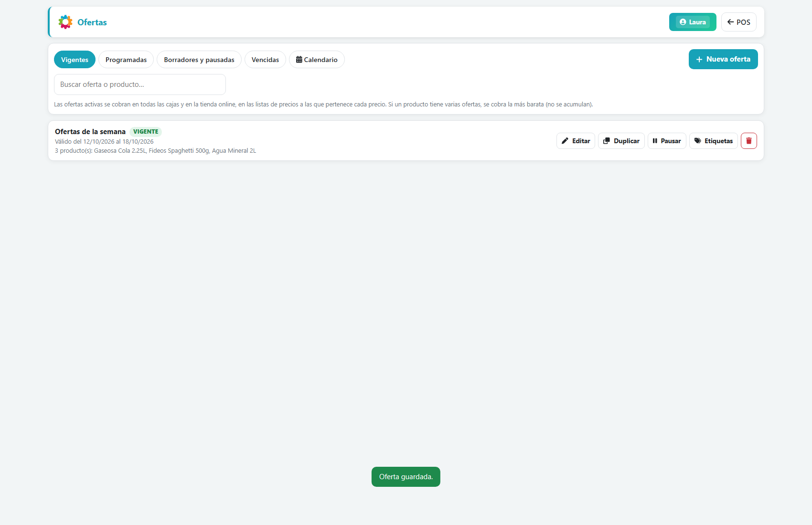
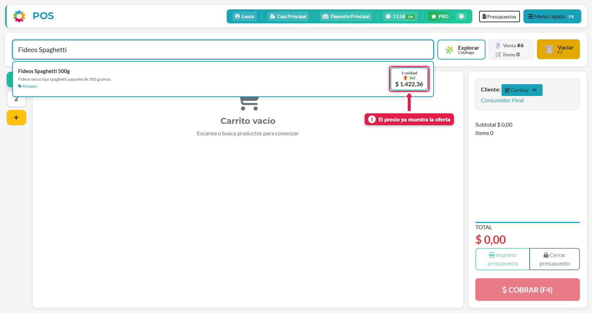
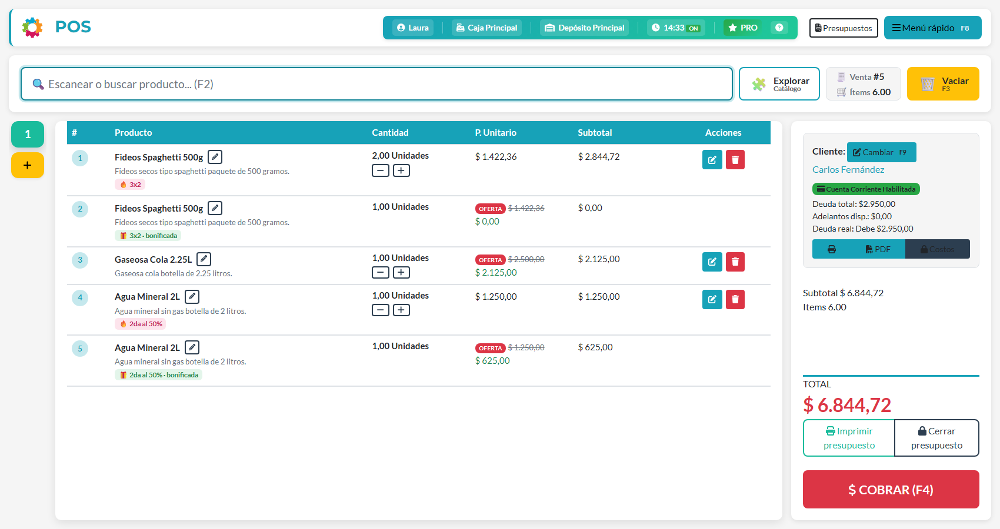

## Para qué sirve

Una oferta sirve para vender más sin andar cambiando precios a mano. La armás una vez, con sus productos, el tipo de promoción y la fecha de vigencia, y **el POS la aplica solo** al cobrar, en todas las cajas y en la tienda online.

## Qué vas a lograr

Vas a **crear ofertas y promociones en ADEstock** con precio fijo, porcentaje de descuento, 3×2 o segunda unidad con descuento. Elegí las presentaciones de cada producto, definí fechas, días y horarios, y revisá el precio resultante antes de activar.

Las promociones vigentes se aplican en el POS y la tienda online. Si coinciden varias ofertas para un producto, se utiliza la más barata, sin acumularlas.

## Conceptos

| Concepto | Qué es |
|---|---|
| **Oferta** | Un "paquete" de promociones con nombre y vigencia (por ejemplo, *Ofertas de la semana*) |
| **Producto en oferta** | Una **presentación** de un producto (unidad, pack de 6…) con su regla de precio |
| **Variante** (tipo de regla) | Cómo se calcula el precio: precio fijo, % de descuento, 3×2, etc. |
| **Vigencia** | Desde y hasta cuándo, qué días de la semana y en qué horario |

> **Si un producto tiene varias ofertas vigentes, se cobra la más barata** (no se acumulan).

## Paso a paso

### 1. Abrí Ofertas

Menú rápido (**F8**) → **Ofertas**.

| # | Elemento | Qué es |
|---|---|---|
| 1 | **Nueva oferta** | Crea una oferta |
| 2 | **Vigentes** | Las que se cobran hoy. Las otras solapas: *Programadas*, *Borradores y pausadas* y *Vencidas* |
| 3 | **Calendario** | Cuándo empieza y termina cada una |

### 2. Completá los datos de la oferta

| # | Campo | Qué es |
|---|---|---|
| 1 | **Nombre** | Cómo la reconocés (y cómo sale en revistas y etiquetas) |
| 2 | **Estado** | *Borrador* (no se cobra) · *Activa* (se cobra en su vigencia) · *Pausada* (no se cobra) |
| 3 | **Desde / Hasta** + **Vigencia rápida** | Fechas y horas. Los botones *Solo hoy*, *Solo mañana*, *7 días* y *Hasta fin de mes* las completan |
| 4 | **Días de la semana** | Para que valga solo ciertos días. **Sin ninguno = todos los días** |
| 5 | **Franja horaria** | Para promociones tipo *happy hour* |
| 6 | **Buscador de productos** | Para sumar productos a la oferta |

La **leyenda** es un texto opcional que sale en las etiquetas y revistas (por ejemplo, *Hasta agotar stock*).

### 3. Agregá los productos

Escribí el nombre en el buscador de la derecha y **tocá el precio** que querés poner en oferta. Cada producto muestra un botón **por presentación** (Unidad, pack de 6…): elegís cuál entra.

### 4. Elegí la variante de cada producto

Cada producto agregado tiene su regla. Se elige en el desplegable:

| Variante | Qué hace | Ejemplo |
|---|---|---|
| **Precio fijo** | Un precio nuevo | La unidad pasa a $ 2.000 |
| **% descuento** | Un porcentaje menos | **15 %**: de $ 2.500 a **$ 2.125** |
| **Lleva N paga M** | Pagás menos unidades de las que llevás | **Llevá 3, pagá 2** (3×2): 3 fideos a $ 2.844,72 en lugar de $ 4.267,08 (−33 %) |
| **2da unidad al %** | La segunda unidad con descuento | **2.ª unidad al 50 %**: 2 aguas a $ 1.875 en lugar de $ 2.500 (−25 %) |
| **Llevando N, c/u a $** | Un precio unitario si llevás N | Llevando 2, c/u a $ 1.100 |

Para cada una, el sistema te muestra **al instante cómo queda** (la flecha `→`), con el ahorro en %.

Opciones útiles:

- **Aplicar a todos: % de descuento:** pone el mismo porcentaje a todos los productos de la lista.
- **Máx. por ticket:** limita cuántas unidades por venta entran en la oferta (*Sin tope* por defecto).

> ⚠️ **Aviso de costo:** si una promoción deja un producto **por debajo de su costo**, el sistema te lo marca (*"Queda por debajo del costo ($ 950 c/u)"*) y lo cuenta abajo (*1 debajo del costo*). Podés guardarla igual, pero revisá si es lo que querés.

### 5. Guardá

Tocá **Guardar**. Si el estado es *Activa* y estás dentro de la vigencia, queda **VIGENTE**:

Cada oferta tiene sus acciones: **Editar**, **Duplicar**, **Pausar** y **Etiquetas** (para imprimir las etiquetas de los productos en oferta).

## Cómo se ve en el POS

Apenas la oferta está vigente, el precio **ya aparece con la promoción** al buscar el producto:

Y al agregar productos, el carrito aplica las reglas solo:

| Producto | Cantidad | Qué pasó |
|---|---|---|
| Fideos Spaghetti | 3 | **3×2**: 2 con precio y 1 **bonificada** ($ 0) |
| Gaseosa Cola 2.25L | 1 | **15 %**: $ 2.500 → **$ 2.125** |
| Agua Mineral 2L | 2 | **2.ª al 50 %**: 1 a $ 1.250 y la segunda **bonificada** a $ 625 |

El cajero **no tiene que hacer nada**: las líneas llevan una etiqueta (🔥 *3×2*, 🎁 *bonificada*, *OFERTA*) para que el cliente vea de dónde sale el precio.

## Qué pasa por detrás

| Qué | Detalle |
|---|---|
| Alcance | Se cobra en **todas las cajas** y en la tienda online, en las listas de precios a las que pertenece cada precio |
| Prioridad | Con varias ofertas sobre el mismo producto, gana **la más barata** |
| Vigencia | Se evalúa por fecha, día de la semana y franja horaria |
| Cuenta corriente | Una deuda vendida en oferta se **actualiza** manteniendo el mismo % de descuento sobre el precio de hoy |
| Stock | La oferta no mueve stock: solo cambia el precio de la venta |

## Problemas frecuentes

| Si te pasa… | Es porque… | Qué hacer |
|---|---|---|
| No veo *Ofertas* en el menú | Falta el permiso *Puede gestionar ofertas* | Pedíselo al dueño |
| La oferta no se cobra | Está en *Borrador* o *Pausada*, o fuera de vigencia (fecha, día u hora) | Activala y revisá la vigencia en el Calendario |
| Se cobra una oferta que no esperaba | Hay otra oferta vigente más barata para ese producto | Pausá o editá la otra oferta |
| La promoción da pérdida | La regla deja el precio bajo el costo | Mirá el aviso amarillo y corregí el valor |
| Un producto no aparece al buscar | Solo se pueden poner en oferta productos con precio de venta | Cargale un precio de venta |

## Cómo comprobar que salió bien

Buscá el producto en el POS y agregá las cantidades necesarias para activar la regla. Por ejemplo, probá tres unidades para un 3×2. Revisá la etiqueta de oferta, el total, la vigencia y el máximo por ticket. Si el precio difiere, comprobá si hay otra oferta vigente más barata.

## Siguiente paso

- [crear revistas y folletos de ofertas en ADEstock](/tutoriales/crear-revista-ofertas/)
- [imprimir etiquetas de precios y códigos en ADEstock](/tutoriales/imprimir-etiquetas/)
- [activar y diseñar tu tienda online en ADEstock](/tutoriales/configurar-tienda-online/)
