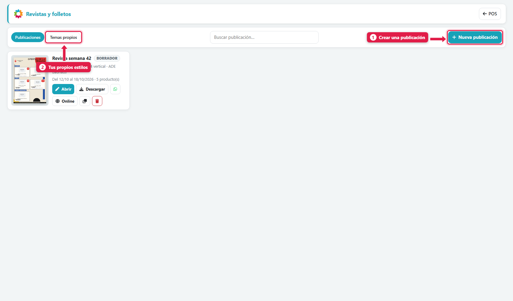
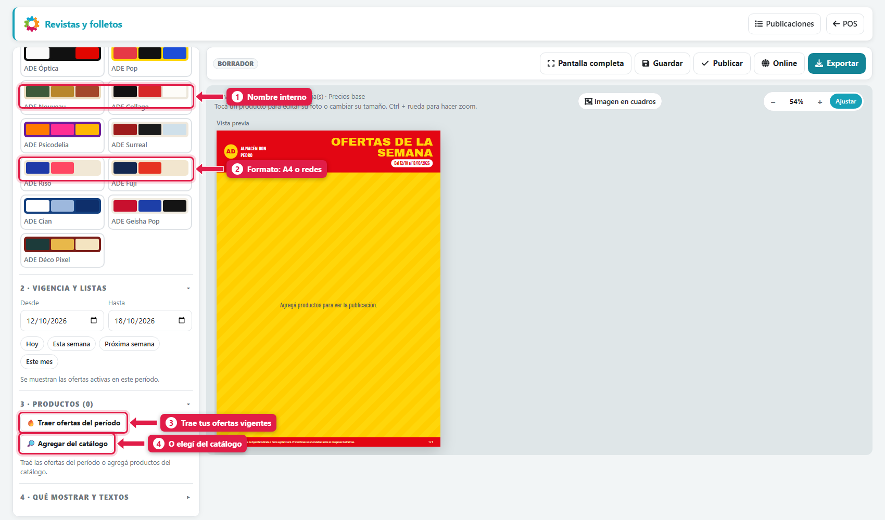
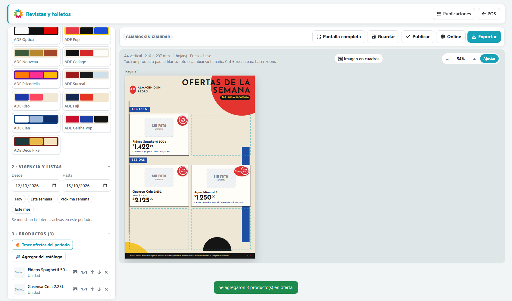
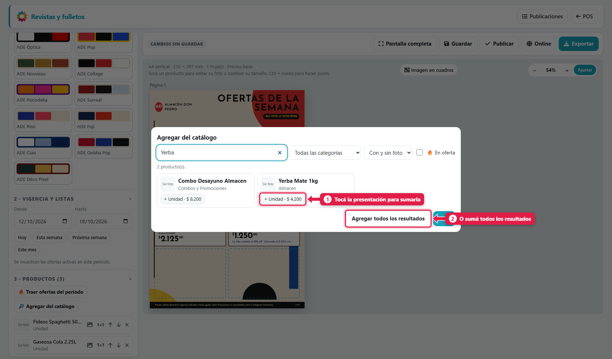
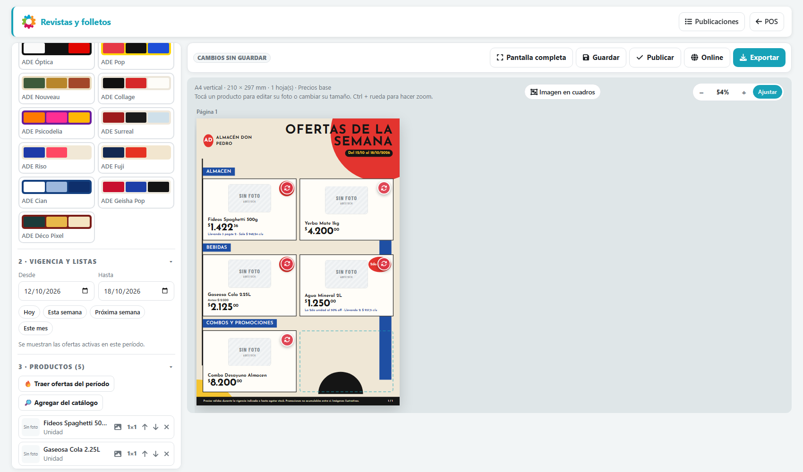
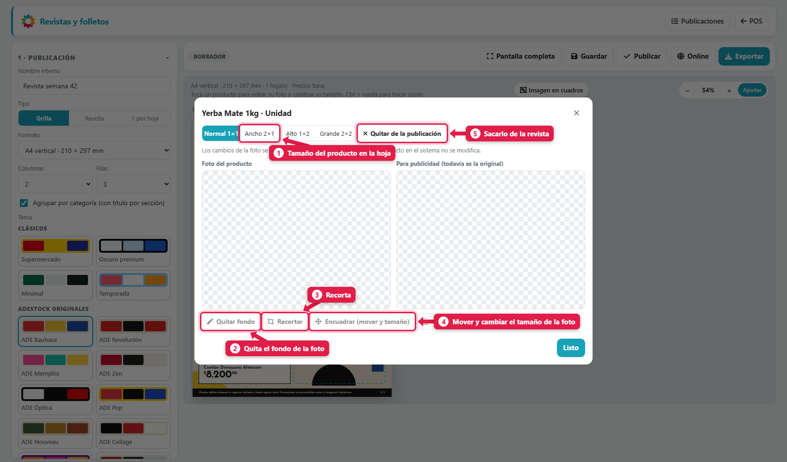
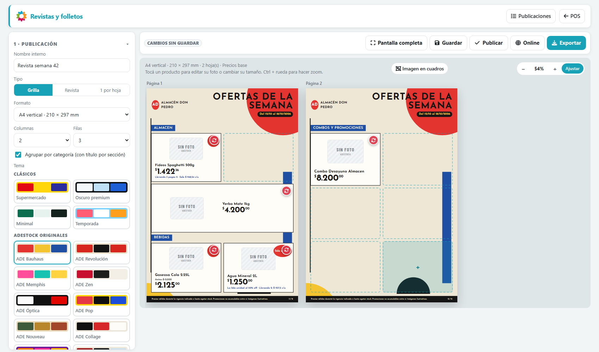
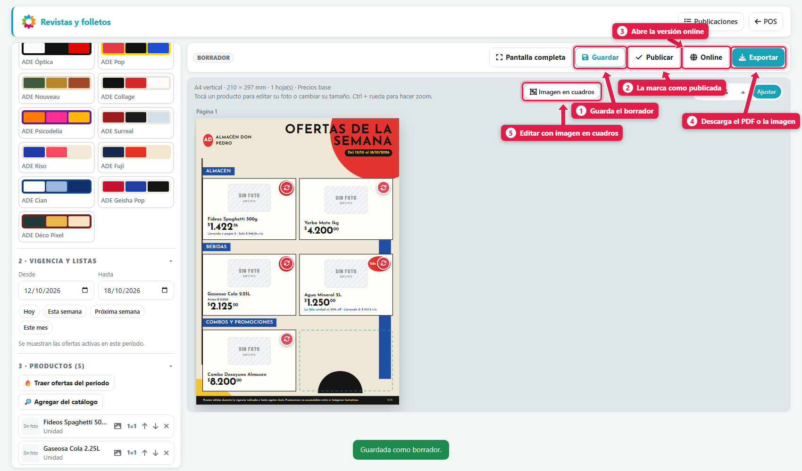
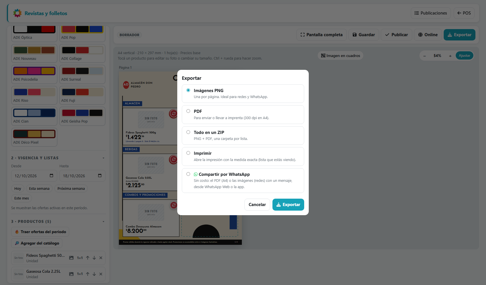
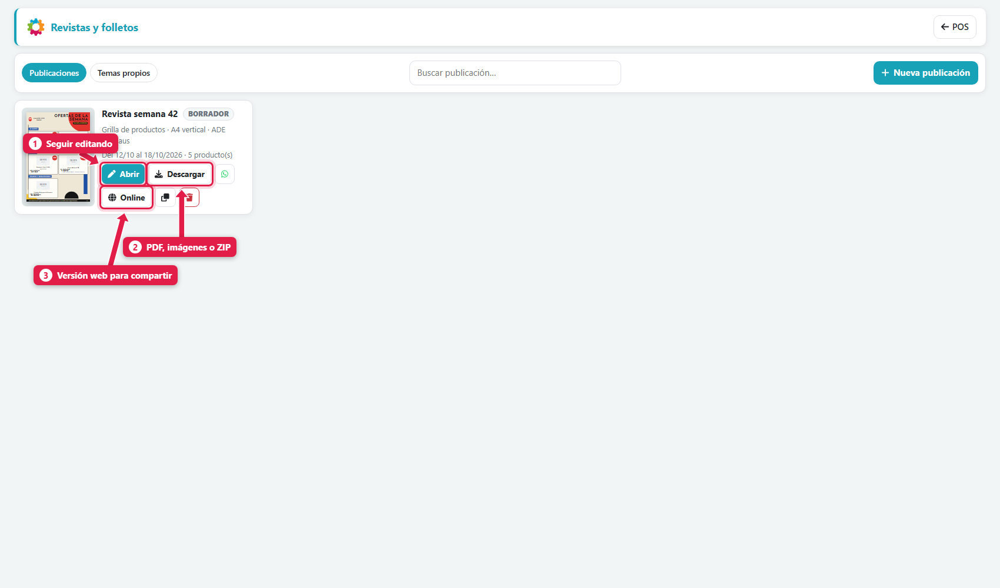

## Para qué sirve

Sirve para **comunicar tus ofertas** a los clientes sin contratar a un diseñador: armás una revista para imprimir o un post para redes con tus productos, precios y promociones, y la exportás como PDF o imágenes, o la compartís por WhatsApp. Los productos y los precios salen de tu catálogo, no hay que volver a escribirlos.

## Qué vas a lograr

Vas a **crear una revista o un folleto de ofertas en ADEstock** usando los productos, precios y promociones de tu catálogo. Podés elegir A4 para imprimir o formatos de publicaciones e historias para redes sociales.

La guía recorre el diseño, la selección de ofertas, la edición de fotos y la exportación en PDF o imágenes. También explica cómo publicar la versión web y compartir el material por WhatsApp.

## Antes de empezar

El dueño activa el módulo en **Menú rápido → Configuración → Módulos y sistema → Revistas y folletos**. Después aparece **Revistas y folletos** en el Menú rápido.

## Paso a paso

### 1. Abrí Revistas y folletos

Menú rápido (**F8**) → **Revistas y folletos**.

| # | Elemento | Qué es |
|---|---|---|
| 1 | **Nueva publicación** | Crea una revista o folleto |
| 2 | **Temas propios** | Estilos de diseño que armás vos |

### 2. Elegí formato y diseño

El editor tiene el **panel a la izquierda** y la **vista previa en vivo** a la derecha.

| # | Elemento | Qué es |
|---|---|---|
| 1 | **Nombre interno** | Cómo la encontrás en el listado (ej.: *Revista semana 42*) |
| 2 | **Formato** | **A4 vertical** u **horizontal** para imprimir; **post cuadrado**, **post vertical** o **historia** para redes |
| - | **Tipo** | *Grilla* (varios productos por hoja) o *Revista* (1 por hoja) |
| - | **Columnas y filas** | Cuántos productos entran por hoja (ej.: 2 × 3) |
| - | **Agrupar por categoría** | Pone un título por sección (Almacén, Bebidas…) |
| - | **Tema** | El diseño: *Supermercado*, *Oscuro premium*, *Minimal*, *Temporada* y los **ADE** (Bauhaus, Zen, Pop, Riso, Fuji…) |

### 3. Elegí la vigencia

En **Vigencia y listas** indicás **Desde / Hasta** (o *Hoy*, *Esta semana*, *Próxima semana*, *Este mes*). Se usan para **traer las ofertas** de ese período.

### 4. Cargá los productos

| # | Botón | Qué hace |
|---|---|---|
| 3 | **🔥 Traer ofertas del período** | Agrega **todas las ofertas vigentes** en esas fechas, con su precio y promoción |
| 4 | **🔎 Agregar del catálogo** | Te deja elegir cualquier producto |

Al traer las ofertas, la revista se arma sola: ves los productos con el **precio antes tachado**, el **descuento** y la **leyenda de la promoción** (*"Llevando 3 pagás 2 · Sale $ 948,24 c/u"*, *"La 2.ª unidad al 50 % off"*).

Para sumar más productos, abrí **Agregar del catálogo**:

Buscá, filtrá por categoría o foto, o tocá **🔥 En oferta**. **Tocá la presentación** (Unidad, pack…) para sumarla, o usá **Agregar todos los resultados**. Terminás con **Listo**.

### 5. Qué mostrar y los textos

En **Qué mostrar y textos** elegís qué aparece en cada producto: **precio**, **precio anterior ("antes")**, **referencia**, **precio sin impuestos**, **código**. Y editás el **título**, el **texto de vigencia** y el **pie legal** (por defecto: *Precios válidos durante la vigencia indicada o hasta agotar stock…*).

El **logo y el nombre del negocio** salen de *Configuración → Mi negocio*.

## Editar las fotos y el tamaño de cada producto

En la vista previa, **tocá un producto**:

| # | Opción | Para qué sirve |
|---|---|---|
| 1 | **Tamaño** (*Normal 1×1*, *Ancho 2×1*, *Alto 1×2*, *Grande 2×2*) | Cuánto lugar ocupa en la hoja. Los productos destacados, más grandes |
| 2 | **Quitar fondo** | Recorta el fondo de la foto automáticamente |
| 3 | **Recortar** | Recorta la foto a mano |
| 4 | **Encuadrar** (mover y tamaño) | Mueve y agranda la foto dentro de su marco |
| 5 | **Quitar de la publicación** | Saca el producto de esta revista |
| - | **Subir otra foto** | Reemplaza la foto solo para la revista |

> **Importante:** los cambios de foto **se usan solo en esta revista o folleto**. La foto del producto en el sistema **no se modifica**.

Ejemplo: **Yerba Mate** en tamaño **Ancho 2×1**:

Otras ayudas del editor: el **zoom** (*−* / *+* / *Ajustar*, o Ctrl + rueda), **Pantalla completa**, y el modo **Imagen en cuadros** para repartir una imagen (por ejemplo un banner) en varios cuadros de la grilla.

## Guardar, publicar y compartir

| # | Botón | Qué hace |
|---|---|---|
| 1 | **Guardar** | Guarda como **borrador** (podés seguir después) |
| 2 | **Publicar** | La marca como publicada |
| 3 | **Online** | Abre la **versión web** de la revista para compartir por link |
| 4 | **Exportar** | Descarga o imprime |
| 5 | **Imagen en cuadros** | Modo de edición por cuadros |

**Exportar** ofrece:

| Opción | Para qué |
|---|---|
| **Imágenes PNG** | Una por página. Ideal para redes y WhatsApp |
| **PDF** | Para enviar o llevar a imprenta (300 dpi en A4) |
| **Todo en un ZIP** | PNG + PDF juntos |
| **Imprimir** | Abre la impresión con la medida exacta |
| **Compartir por WhatsApp** | Manda el PDF (A4) o las imágenes (redes) con un mensaje |

## Tus publicaciones guardadas

Cada tarjeta muestra la miniatura, el estado (*Borrador*, *Publicada*), el formato, el tema y la vigencia, con accesos a **Abrir**, **Descargar**, **WhatsApp**, **Online**, **Duplicar** (para armar la de la semana que viene en dos clics) y **Eliminar**.

## Qué pasa por detrás

| Qué | Detalle |
|---|---|
| Precios | Se toman de tus precios vigentes y **ofertas activas** del período |
| Fotos | Las ediciones (fondo, recorte, encuadre) se guardan **en la publicación**, no en el producto |
| Datos de ejemplo | Los productos sin foto salen con la imagen genérica *Sin foto* |
| Tienda online | Si la tienda está activa, la revista digital puede mostrarse allí |

## Problemas frecuentes

| Si te pasa… | Es porque… | Qué hacer |
|---|---|---|
| No veo *Revistas y folletos* | Módulo apagado o falta el permiso | Configuración → Módulos y sistema · permisos del usuario |
| *Traer ofertas* no trae nada | No hay ofertas vigentes en esas fechas | Creá una oferta o cambiá el período |
| Salen productos "Sin foto" | El producto no tiene foto cargada | **Subir otra foto** desde el editor, o cargala en el producto |
| El precio no es el que esperaba | La oferta cambió o venció | Volvé a **Traer ofertas** para actualizar |
| La hoja quedó muy cargada | Muchos productos por página | Bajá columnas/filas o usá más hojas |

## Cómo comprobar que salió bien

Revisá todas las páginas de la vista previa: productos, presentaciones, precios, vigencia y datos del negocio. Abrí el PDF o las imágenes exportadas para comprobar que coincidan con el diseño. Si vas a compartir la versión web, usá **Online** y comprobá la publicación que verán tus clientes.

## Siguiente paso

- [crear ofertas, descuentos y promociones 3×2 en ADEstock](/tutoriales/crear-ofertas-y-promociones/)
- [imprimir etiquetas de precios y códigos en ADEstock](/tutoriales/imprimir-etiquetas/)
- [activar y diseñar tu tienda online en ADEstock](/tutoriales/configurar-tienda-online/)
