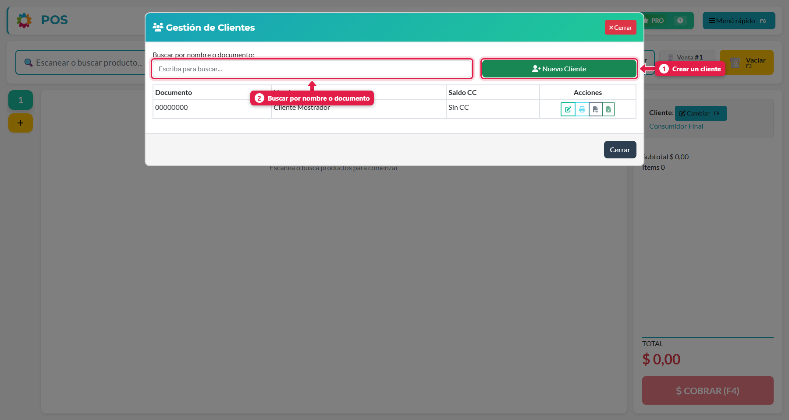
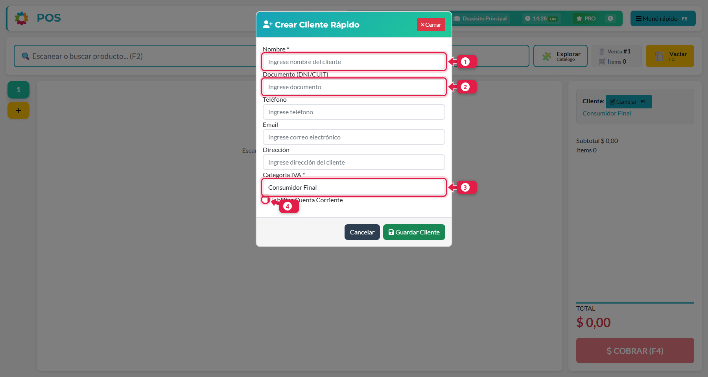
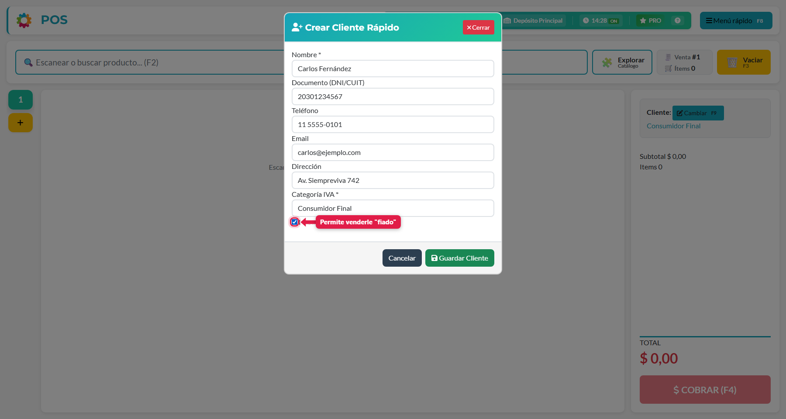
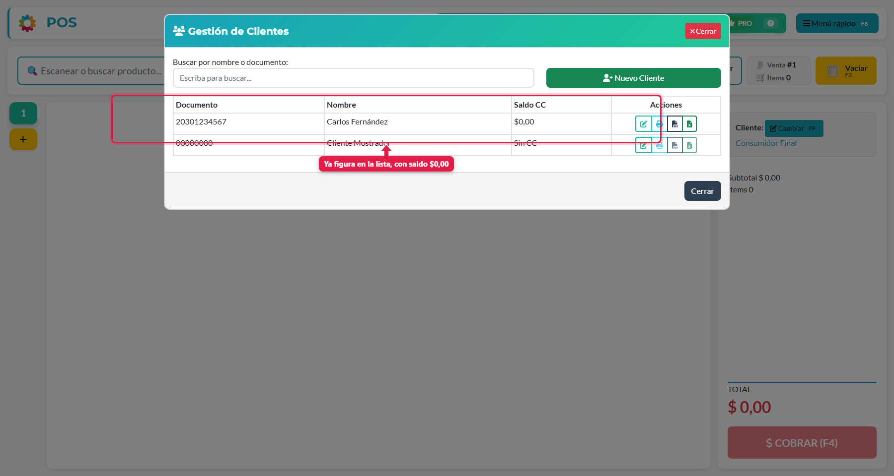

## Qué vas a lograr

Registrar a un cliente para poder **asignarle ventas**, **venderle a cuenta corriente (fiado)** y llevar su historial y su saldo.

> Si el cliente no necesita nada de eso, no hace falta registrarlo: se vende a **Consumidor Final** (es el cliente por defecto de cada venta).

## Paso a paso

### 1. Abrí la gestión de clientes

Menú rápido (**F8**) → **Gestión de clientes**.

1. **Nuevo Cliente**: abre el formulario de alta.
2. **Buscador**: encontrá un cliente por nombre o documento.

La tabla muestra el **documento**, el **nombre**, el **saldo de cuenta corriente** y las acciones de cada cliente. Un cliente sin cuenta corriente aparece como *Sin CC*.

### 2. Completá el formulario

Tocá **Nuevo Cliente**.

| # | Campo | Qué poner |
|---|---|---|
| 1 | **Nombre** *(obligatorio)* | Nombre o razón social. Es el único dato imprescindible |
| 2 | **Documento (DNI/CUIT)** | Sirve para identificarlo y para facturar. Es lo que podés usar para buscarlo |
| — | Teléfono, Email, Dirección | Datos de contacto. Opcionales |
| 3 | **Categoría IVA** *(obligatorio)* | *Consumidor Final*, *Monotributista*, *Responsable Inscripto* o *Exento*. Se usa para **discriminar el IVA** en tickets y facturas A4 |
| 4 | **Habilitar Cuenta Corriente** | Activalo si le vas a vender "fiado". Si está apagado, el POS no te deja cobrarle con cuenta corriente |

### 3. Habilitá la cuenta corriente (si corresponde)

Para un cliente de confianza, tildá **Habilitar Cuenta Corriente**.

> Habilitarla **no genera deuda**: solo permite que el cliente pueda quedar debiendo. La deuda aparece cuando le hacés una venta a cuenta corriente (ver *Vender a cuenta corriente*).

### 4. Guardá

Tocá **Guardar Cliente**. Aparece en la lista, con saldo $0,00.

## Crear un cliente en plena venta

No hace falta ir al menú: en la pantalla de venta, el botón **Cambiar** del cliente (**F9**) abre el selector, y desde ahí podés crear un cliente nuevo y asignárselo a la venta sin perder el carrito.

## Editar un cliente

En la lista, tocá el primer icono de acciones (lápiz). Se abre el mismo formulario con los datos cargados; cambiás lo que necesites y tocás **Guardar Cambios**.

## Los iconos de acciones

| Icono | Qué hace |
|---|---|
| ✏️ Editar | Modifica los datos del cliente |
| 🖨️ Estado de cuenta (ticket) | Imprime en la ticketera su estado de cuenta |
| 📄 Estado de cuenta (PDF A4) | Descarga el estado de cuenta en PDF |
| 📊 Estado de cuenta (Excel) | Descarga el estado de cuenta en Excel |

Estos iconos están deshabilitados para *Cliente Mostrador* (el cliente genérico) y para los clientes sin cuenta corriente. Cómo se lee ese estado de cuenta está en el tutorial *Revisar la cuenta corriente de un cliente*.

## Qué pasa por detrás

| Qué | Detalle |
|---|---|
| Cliente | Se crea en la agenda del sistema, visible para todas las cajas |
| Cuenta corriente | El cliente queda habilitado para recibir ventas con el medio de cobro *Cuenta Corriente* |
| Consumidor Final | Es un cliente genérico que ya viene creado: no necesita datos |

## Problemas frecuentes

| Si te pasa… | Es porque… | Qué hacer |
|---|---|---|
| El botón de cuenta corriente aparece apagado al cobrar | El cliente de la venta no tiene la cuenta corriente habilitada, o la venta es a Consumidor Final | Cambiá el cliente (F9) y habilitale la cuenta corriente desde *Editar* |
| No encuentro a un cliente | Lo buscás por un dato que no cargaste | Probá con nombre o documento |
| Los iconos de estado de cuenta están apagados | El cliente no tiene cuenta corriente | Habilitala desde *Editar* |

## Siguiente paso

- Hacer una venta
- Vender a cuenta corriente
- Revisar la cuenta corriente de un cliente
