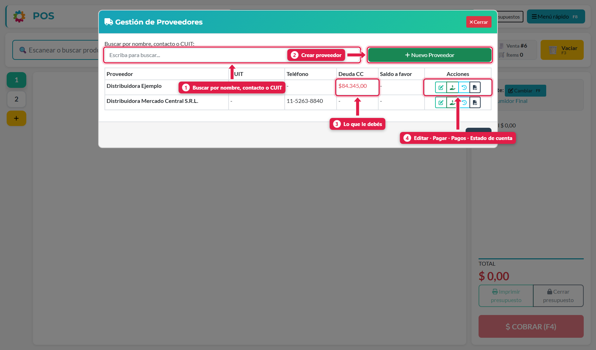
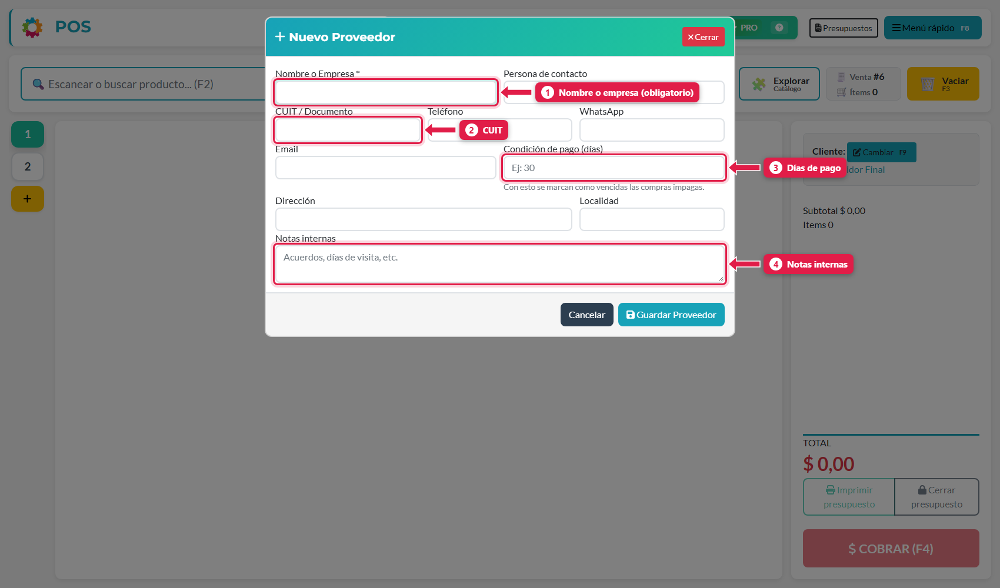
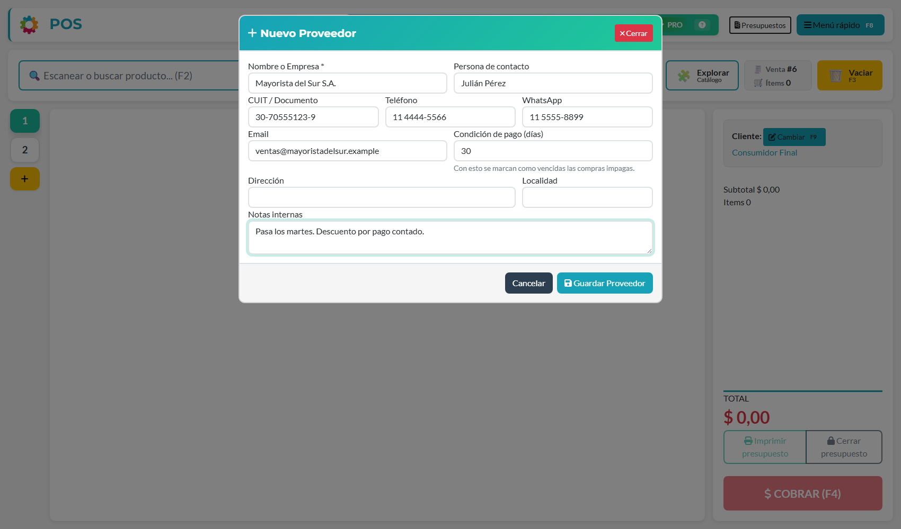
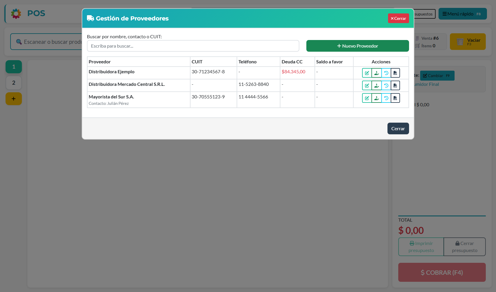

## Qué vas a lograr

Registrar a tus proveedores para poder **cargarles compras**, llevar **lo que les debés** y **pagarles** (en efectivo, transferencia o a cuenta corriente).

## Paso a paso

### 1. Abrí la gestión de proveedores

Menú rápido (**F8**) → **Gestión de proveedores**.

| # | Elemento | Qué es |
|---|---|---|
| 1 | **Buscador** | Filtra por nombre, contacto o CUIT |
| 2 | **Nuevo Proveedor** | Abre el formulario de alta |
| 3 | **Deuda CC** | Lo que **le debés** al proveedor (en rojo). *Saldo a favor* es plata que le adelantaste |
| 4 | **Acciones** | Editar · Pagar deuda o registrar adelanto · Ver pagos realizados · Estado de cuenta en PDF |

### 2. Completá el formulario

Tocá **Nuevo Proveedor**.

| # | Campo | Qué poner |
|---|---|---|
| 1 | **Nombre o Empresa** *(obligatorio)* | Como lo conocés. Es lo que vas a buscar al comprar |
| — | Persona de contacto, Teléfono, WhatsApp, Email, Dirección, Localidad | Datos de contacto. Opcionales |
| 2 | **CUIT / Documento** | Sirve para identificarlo y para reconocerlo en las boletas |
| 3 | **Condición de pago (días)** | En cuántos días le pagás (30, por ejemplo). Con esto el sistema marca como **vencidas** las compras impagas |
| 4 | **Notas internas** | Acuerdos, días de visita, descuentos… |

### 3. Guardá

Tocá **Guardar Proveedor**. Aparece en la lista, sin deuda.

## Otras formas de crear un proveedor

- **Al cargar una compra con foto:** si el proveedor de la boleta es nuevo, lo creás ahí mismo (*＋ Nuevo proveedor*), con solo la empresa y el CUIT.
- **Al pagar a un proveedor:** el botón **Nuevo** de la pantalla de pagos.

## Editar un proveedor

En la lista, tocá el primer icono de **Acciones** (lápiz). Cambiás lo que necesites y **Guardar Proveedor**.

## Qué hace cada icono de Acciones

| Icono | Qué hace |
|---|---|
| ✏️ **Editar proveedor** | Modifica sus datos |
| 💵 **Pagar deuda o registrar adelanto** | Abre el pago de cuentas corrientes de ese proveedor (ver *Pagar a un proveedor*) |
| 🕘 **Ver pagos realizados** | Historial de pagos hechos a ese proveedor |
| 📄 **Estado de cuenta PDF** | Descarga lo que le debés, compra por compra |

## Qué pasa por detrás

| Qué | Detalle |
|---|---|
| Deuda CC | Es la suma de lo que falta pagar de cada compra hecha a cuenta corriente |
| Saldo a favor | Plata que le pagaste de más o por adelantado y todavía no se aplicó |
| Vencimiento | Se calcula con la *Condición de pago (días)* desde la fecha de cada compra |
| Alias OCR | Cuando cargás compras con foto, el sistema guarda cómo figura el proveedor en sus boletas |

## Problemas frecuentes

| Si te pasa… | Es porque… | Qué hacer |
|---|---|---|
| No veo la deuda de un proveedor | La compra se pagó en efectivo, o todavía está pendiente de confirmar | Las compras a cuenta corriente suman deuda cuando se **confirman** |
| El proveedor no aparece al cargar la compra | Está mal escrito o creado dos veces | Buscalo por CUIT; editá el nombre si hace falta |
| No encuentro cómo borrar un proveedor | Desde el POS no hay botón para borrarlos | Dejá de usarlo; el historial de compras y pagos se conserva |

## Siguiente paso

- Cargar una compra manual y pagarla
- Pagar a un proveedor y revisar su cuenta corriente
