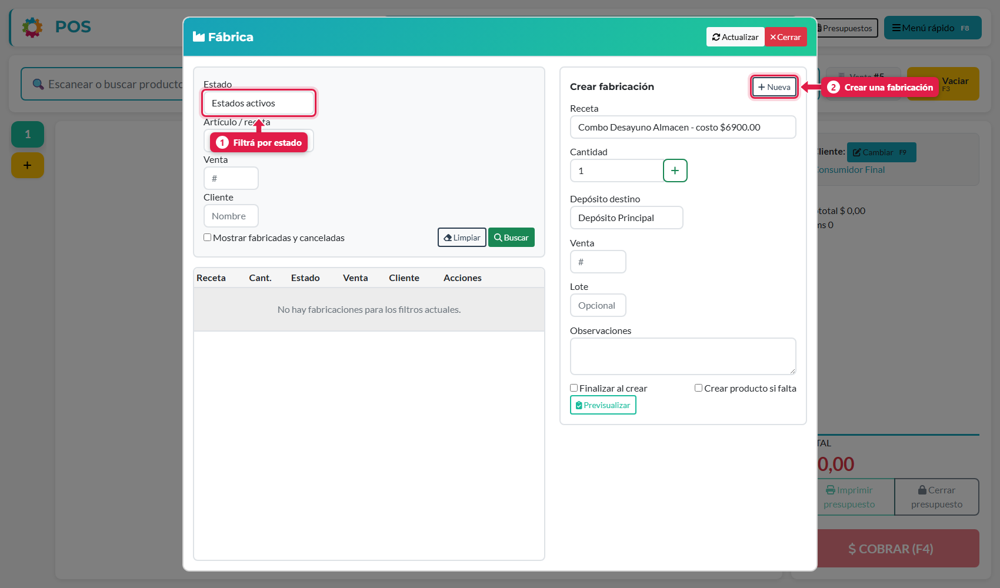
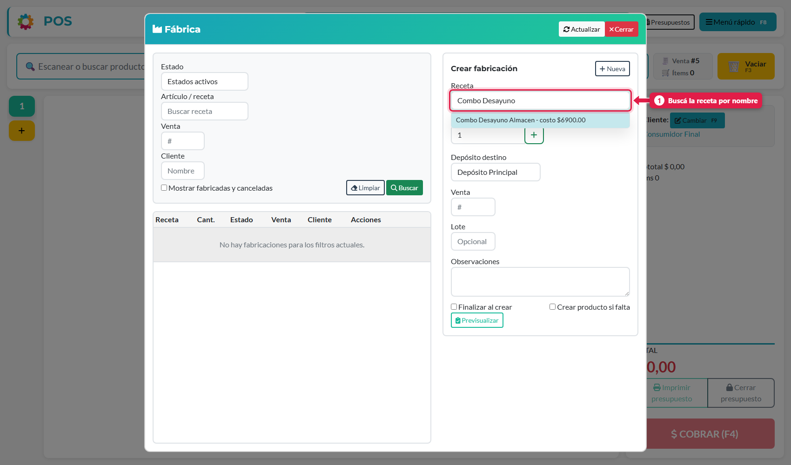
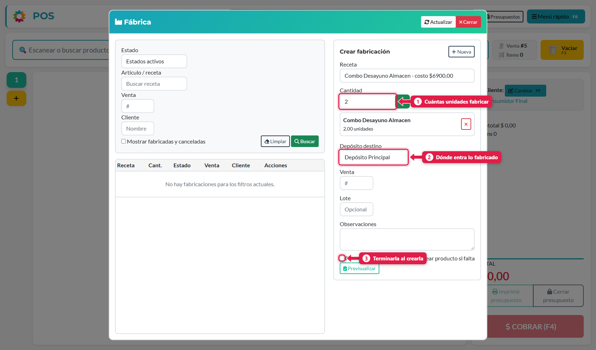
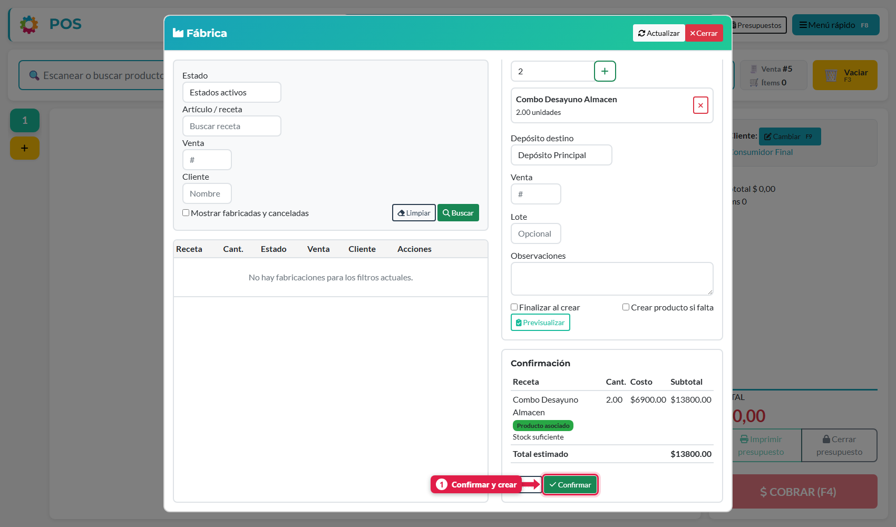
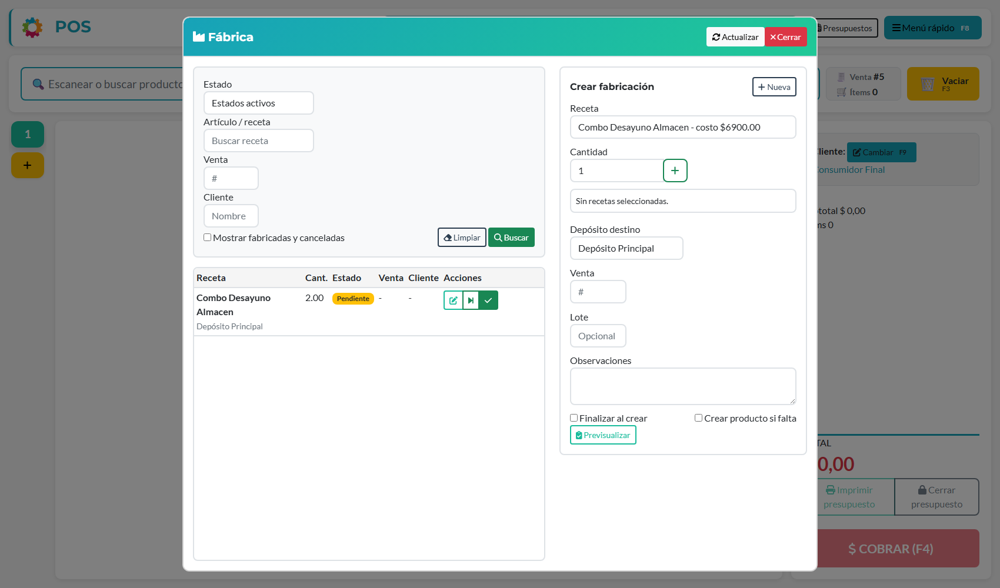

## Qué vas a lograr

Registrar una **orden de fabricación** de un producto con receta: el sistema calcula el costo, verifica que haya insumos y, al terminarla, **suma el producto elaborado al stock** y descuenta lo que se consumió.

## Conceptos básicos

| Concepto | Qué es |
|---|---|
| **Receta** | La "fórmula" de un producto: qué insumos lleva y en qué cantidad |
| **Fabricación** | Una orden para producir N unidades de una receta |
| **Insumo** | Producto que se consume al fabricar (harina, huevos, packaging) |
| **Producto asociado** | El producto vendible que se genera con la receta |

> Si una venta incluye un producto con receta, el sistema puede **generar la fabricación solo** (ajuste *Generar la fabricación al vender* en Configuración → Ventas y caja). Esta pantalla es para fabricar **por adelantado**, por ejemplo la producción del día.

## Paso a paso

### 1. Abrí la Fábrica

Menú rápido (**F8**) → **Fábrica**.

La pantalla tiene dos mitades:

- **Izquierda:** la lista de fabricaciones, con filtros por **estado** (1), receta, venta y cliente.
- **Derecha:** el formulario *Crear fabricación* (2).

Por defecto solo muestra las fabricaciones **activas**. Para ver también las terminadas y canceladas tildá *Mostrar fabricadas y canceladas*.

### 2. Elegí la receta

Escribí parte del nombre en el campo *Receta*. Aparece la lista con el **costo** de cada una.

### 3. Indicá cantidad y destino

Escribí cuántas unidades fabricar y tocá **+** para agregarla. Podés sumar **varias recetas** en la misma orden.

| # | Campo | Qué es |
|---|---|---|
| 1 | **Cantidad** | Unidades a fabricar |
| 2 | **Depósito destino** | Dónde entra el producto terminado |
| 3 | **Finalizar al crear** | Si lo tildás, la fabricación se completa en el momento (útil si ya lo produjiste) |
| — | **Venta** | Opcional: asociarla a una venta (por número) |
| — | **Lote / Observaciones** | Datos opcionales de trazabilidad |
| — | **Crear producto si falta** | Si la receta no tiene producto vendible asociado, lo crea |

### 4. Previsualizá

Tocá **Previsualizar**. El sistema te muestra una confirmación antes de crear nada:

| Dato | Qué significa |
|---|---|
| **Costo / Subtotal** | Costo de la receta por unidad y total de la orden |
| **Producto asociado** | Confirma que hay un producto vendible vinculado |
| **Stock suficiente** | Avisa si **falta algún insumo** para fabricar |
| **Total estimado** | Costo total de la producción |

Si todo está bien, tocá **Confirmar**. Con **Volver** corregís antes de crear.

### 5. Seguí la fabricación

La orden aparece en la lista como **Pendiente**.

Los botones de la fila:

| Icono | Acción | Para qué |
|---|---|---|
| ✏️ | **Editar** | Cambiar cantidad u observaciones mientras esté pendiente |
| ⏭ | **Avanzar a Fabricado** | Pasa la orden al siguiente estado del proceso |
| ✔ | **Finalizar** | Da por terminada la fabricación: el stock se actualiza |

## Qué pasa por detrás

| Qué | Detalle |
|---|---|
| Costo | Se calcula con el costo actual de cada insumo de la receta |
| Stock | El stock de un producto suma lo fabricado y resta el consumo de insumos de las fabricaciones finalizadas |
| Aviso de insumos | La previsualización informa si el stock alcanza antes de crear la orden |
| Fabricar con stock negativo | Depende del ajuste *Permitir fabricar con stock negativo* (Configuración → Ventas y caja) |

## Problemas frecuentes

| Si te pasa… | Es porque… | Qué hacer |
|---|---|---|
| No veo *Fábrica* en el menú | El módulo *Cocina y recetas* está apagado | Activalo en Configuración → Módulos y sistema |
| La receta no aparece | No existe o no está activa | Cargala desde el panel de administración |
| Dice "Stock insuficiente" | Falta algún insumo | Cargá una compra o ajustá el stock del insumo, o fabricá una cantidad menor |
| No encuentro una fabricación terminada | El filtro muestra solo las activas | Tildá *Mostrar fabricadas y canceladas* |

## Siguiente paso

- Ajustar el stock con un conteo
- Cargar una compra
