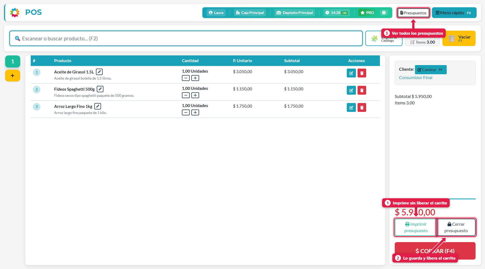
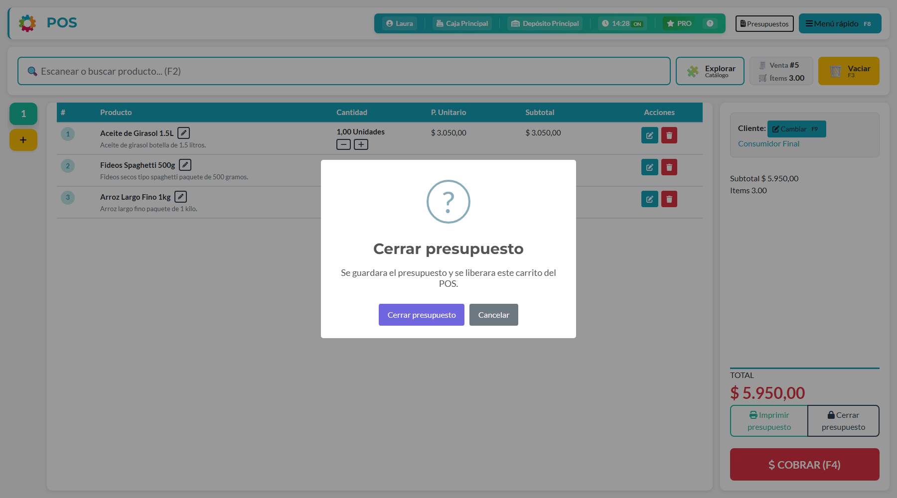
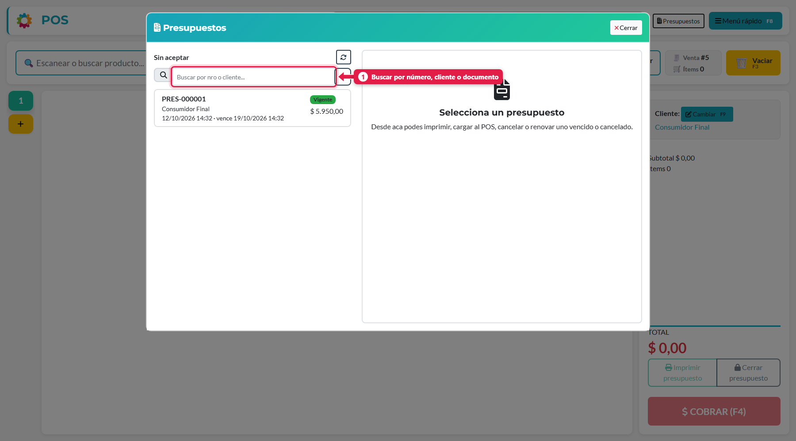
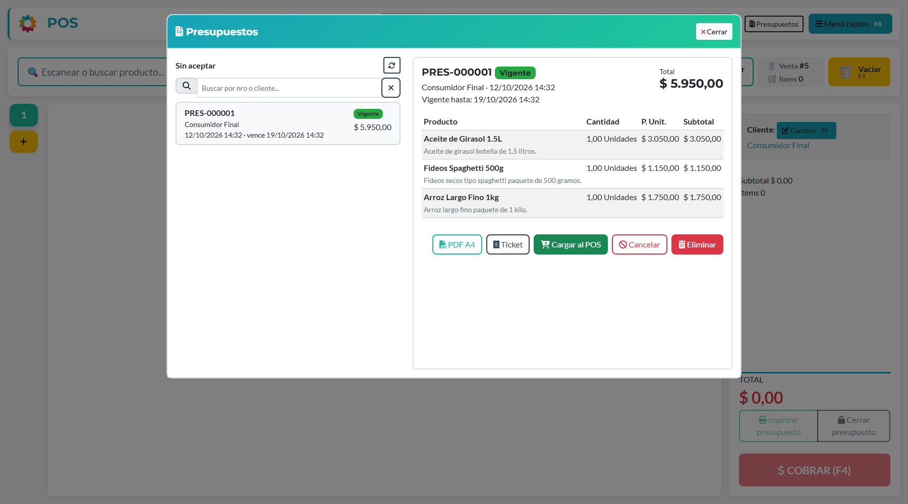
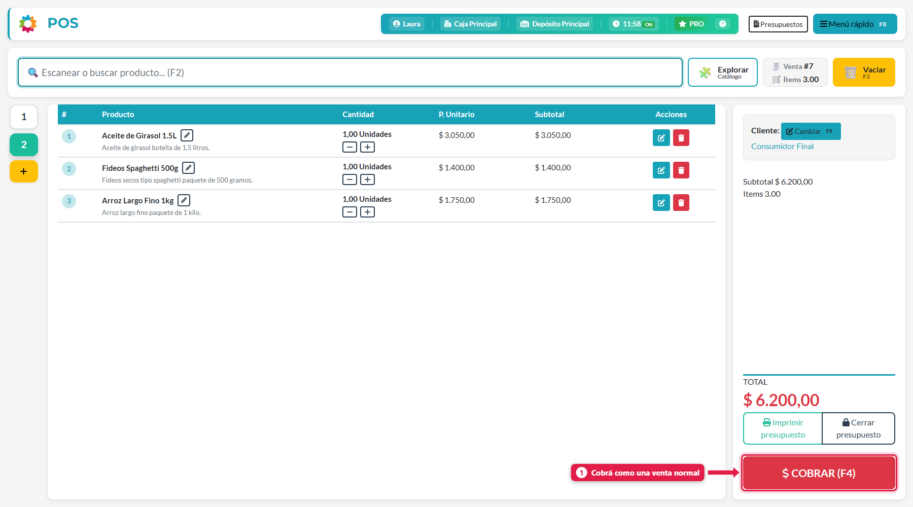

## Qué vas a lograr

Armar un carrito, **dárselo al cliente como presupuesto** (con precios respetados por unos días) sin descontar stock ni cobrar, y más tarde **convertirlo en venta** con un clic.

## Qué es (y qué no es) un presupuesto

| Un presupuesto… | |
|---|---|
| No es una venta | No crea pagos ni deuda |
| No descuenta stock | Tampoco lo compromete |
| **Respeta los precios** | Mientras esté vigente, al cargarlo al POS se mantienen los precios presupuestados |
| Vence | Dura los días que configure el dueño (por ejemplo, 7). Pasada la fecha, hay que renovarlo con precios actuales |
| Se acepta solo | Cuando la venta generada desde él se cobra, pasa a *Aceptado* |

## Antes de empezar: activar los presupuestos (dueño)

Los presupuestos vienen **apagados**. El dueño los activa en:

**Menú rápido → Configuración → Ventas y caja → Presupuestos → Generar presupuestos desde POS** y toca **Guardar cambios**.

En esa misma sección configura los **días de vigencia**, si se **controla el vencimiento** y si **cada cajero ve los presupuestos de todos** o solo los suyos.

Al activarlo aparecen tres botones nuevos en el POS.

## Paso a paso

### 1. Armá el carrito

Cargá los productos y, si corresponde, asignale el **cliente** (F9). El cliente queda anotado en el presupuesto.

### 2. Elegí cómo guardarlo

Con productos cargados aparecen dos botones debajo del total:

| # | Botón | Qué hace |
|---|---|---|
| 1 | **Imprimir presupuesto** | Crea el presupuesto, lo imprime (PDF A4) y **deja el carrito abierto** |
| 2 | **Cerrar presupuesto** | Crea el presupuesto, lo deja pendiente y **libera el carrito** para atender a otro cliente |
| 3 | **Presupuestos** (arriba) | Abre la lista de presupuestos sin aceptar |

> Si imprimís y después cerrás sin cambiar nada, se usa **el mismo** presupuesto. Si cambiaste el carrito, se genera uno nuevo con los precios actuales.

### 3. Confirmá el cierre

Al tocar **Cerrar presupuesto**, el sistema te pide confirmación: *Se guardará el presupuesto y se liberará este carrito del POS*.

### 4. Consultá los presupuestos

Tocá **Presupuestos** (arriba a la derecha) o Menú rápido → *Ver presupuestos*.

Cada presupuesto tiene un número (`PRES-000001`), cliente, fecha, vencimiento, estado y total. Con el **buscador** (1) encontrás por número, cliente o documento.

### 5. Abrí el detalle

Tocá un presupuesto para ver sus productos y las acciones disponibles.

| Botón | Para qué sirve |
|---|---|
| **PDF A4** | Imprime el presupuesto en hoja A4 |
| **Ticket** | Imprime una versión corta en ticket |
| **Cargar al POS** | Lo convierte en un carrito para cobrar (solo si está vigente) |
| **Cancelar** | Lo descarta (si todavía no fue aceptado) |
| **Eliminar** | Lo borra (si no fue aceptado ni cargado a una venta) |

### 6. Cobralo

Cuando el cliente acepta, tocá **Cargar al POS**. Se abre una pestaña de venta nueva con los productos del presupuesto y sus precios.

Revisá el cliente de la venta y cobrá como cualquier venta (ver *Hacer una venta*). Al cobrarla, el presupuesto pasa a **Aceptado** solo.

## Estados de un presupuesto

| Estado | Qué significa | Qué se puede hacer |
|---|---|---|
| **Pendiente / Vigente** | Generado y dentro de su plazo | Cargar al POS, imprimir, cancelar, eliminar |
| **Vencido** | Pasó su fecha de vencimiento | **Renovar**: crea uno nuevo con los precios de hoy |
| **Aceptado** | Ya se convirtió en venta | Solo consultar e imprimir |
| **Cancelado** | Descartado a mano | Renovarlo con precios actuales (o reabrirlo, si el dueño lo permite) |

## Qué pasa por detrás

| Qué | Detalle |
|---|---|
| Datos guardados | Una foto de los productos y precios al momento de presupuestar |
| Stock y caja | No se mueven: el presupuesto no es una venta |
| Visibilidad | Según la configuración: cada cajero ve los suyos o todos ven todos |
| Vencimiento | Si el control está apagado, un presupuesto vencido se puede cobrar igual |

## Problemas frecuentes

| Si te pasa… | Es porque… | Qué hacer |
|---|---|---|
| No veo los botones de presupuesto | La función está apagada | El dueño la activa en Configuración → Ventas y caja |
| No puedo cargar el presupuesto al POS | Está vencido o cancelado | Renovalo: se genera uno nuevo con precios actuales |
| El presupuesto salió con precios distintos | Se generó de nuevo al cambiar el carrito | Es lo esperado: toma los precios del momento |
| No encuentro un presupuesto de otro cajero | La opción *Cajeros ven presupuestos de todos* está apagada | El dueño puede activarla |

## Siguiente paso

- Hacer una venta
- Cobrar con varios medios de pago
