## Qué vas a lograr

Armar el carrito, cobrar en efectivo con vuelto y cerrar la venta. Es el flujo más común del día; los demás (varios medios de pago, cuenta corriente) son variantes de este.

## Antes de empezar

- Tené el **turno abierto** (si no, el POS te lo pide al ingresar).
- Si la venta es para un cliente registrado, podés cambiarlo con **F9** antes de cobrar. Si no, queda como *Consumidor Final*.

## Paso a paso

### 1. Buscá el producto

Hacé clic en el buscador (o apretá **F2**) y escribí parte del nombre, o **escaneá el código de barras**.

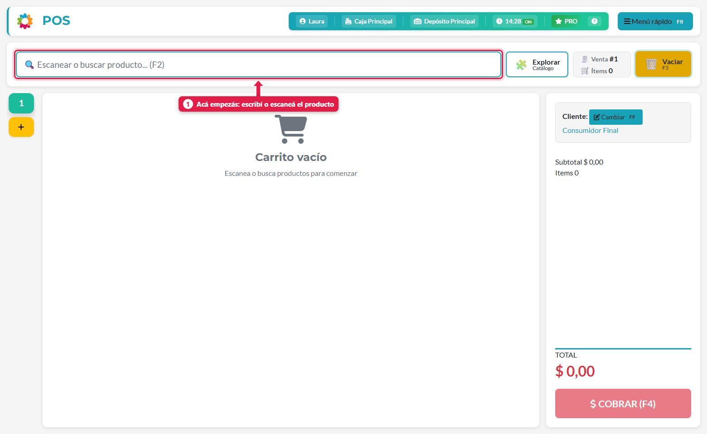

### 2. Elegí la presentación

Aparece una lista con los productos que coinciden. Cada producto muestra **un botón por cada precio** que tiene cargado (por unidad, por pack, por kilo…). Tocá el que corresponda.

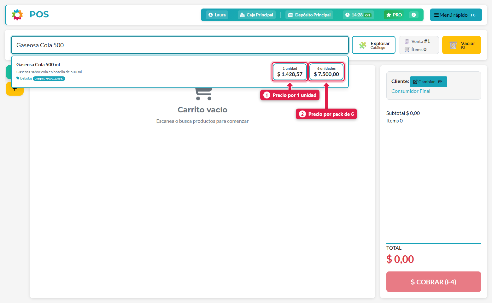

| # | Botón | Qué agrega al carrito |
|---|---|---|
| 1 | **1 unidad** | Una unidad, al precio unitario |
| 2 | **6 unidades** | Un pack de 6, al precio del pack |

> Si el producto tiene un solo precio y es el único resultado, **Enter** lo agrega directo sin tocar nada.

### 3. Repetí con el resto de los productos

Cada producto queda como una línea del carrito.

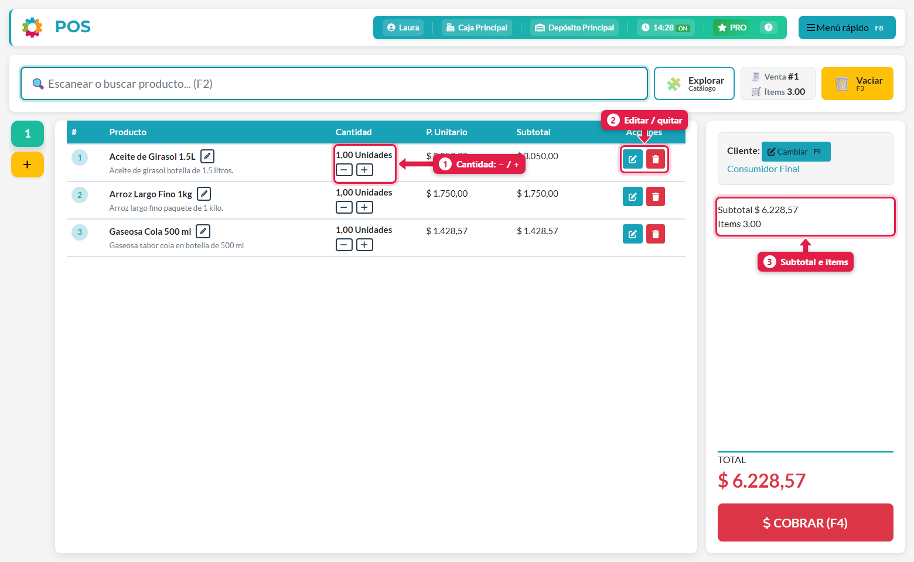

| # | Elemento | Para qué sirve |
|---|---|---|
| 1 | **− / +** | Baja o sube la cantidad de esa línea de a una |
| 2 | **Editar / quitar** | El lápiz abre la edición de la línea (cantidad, y precio si tenés permiso); el tacho la elimina |
| 3 | **Subtotal e ítems** | Resumen de lo que va en la venta |

El **TOTAL** de abajo a la derecha se actualiza solo.

### 4. Cobrá

Apretá **COBRAR** o la tecla **F4**. Se abre la pantalla de cobro.

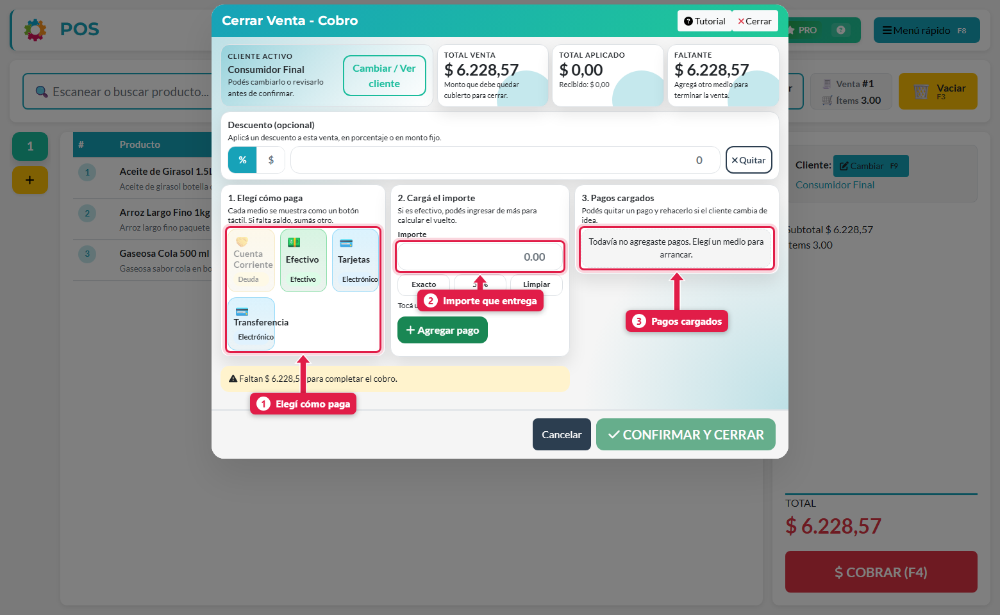

La pantalla se lee de izquierda a derecha en tres pasos:

1. **Elegí cómo paga:** cada medio de cobro es un botón (Efectivo, Tarjetas, Transferencia, Cuenta Corriente…).
2. **Cargá el importe:** cuánto entrega el cliente con ese medio. Los botones *Exacto* y *50 %* lo completan por vos.
3. **Pagos cargados:** la lista de lo que ya agregaste.

Arriba ves siempre cuatro datos: el **cliente**, el **total de la venta**, el **total aplicado** (lo ya cobrado) y lo que **falta** (o el **vuelto**).

### 5. Efectivo con vuelto

Tocá **Efectivo** y escribí cuánto entrega el cliente. Si entrega de más, el sistema calcula el vuelto.

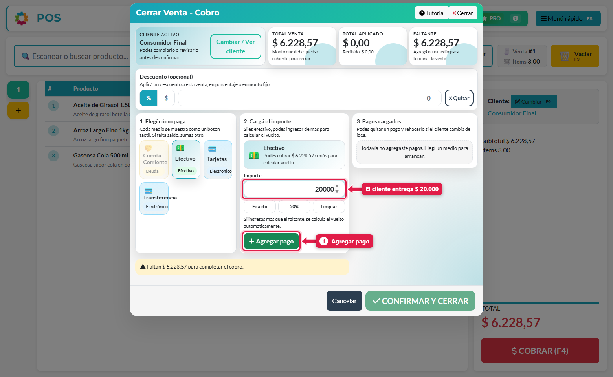

Tocá **Agregar pago**. El pago queda en la lista, con lo recibido y el vuelto.

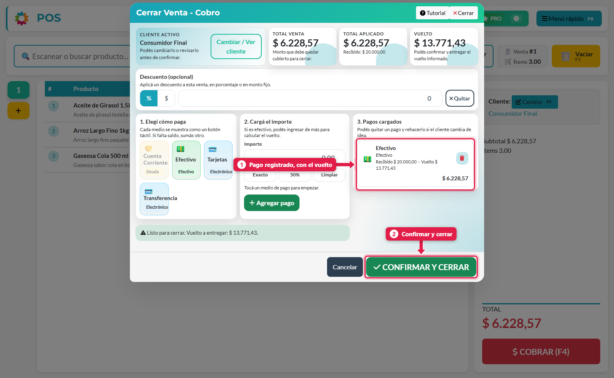

### 6. Confirmá y cerrá

Cuando el cuadro dice *Listo para cerrar*, tocá **CONFIRMAR Y CERRAR**. Si hay vuelto, el sistema te lo muestra grande para que lo entregues.

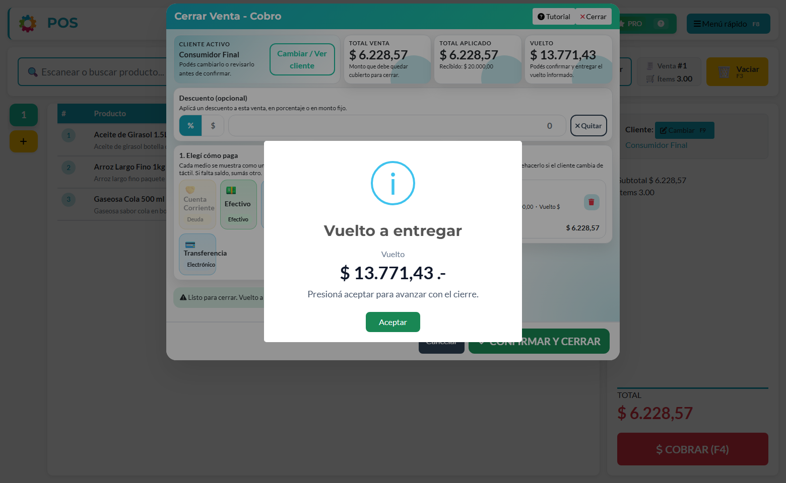

Entregá el vuelto y tocá **Aceptar**.

### 7. Listo

La venta queda cerrada y el POS abre una **venta nueva** (acá, la *#2*) con el carrito vacío, lista para el próximo cliente.

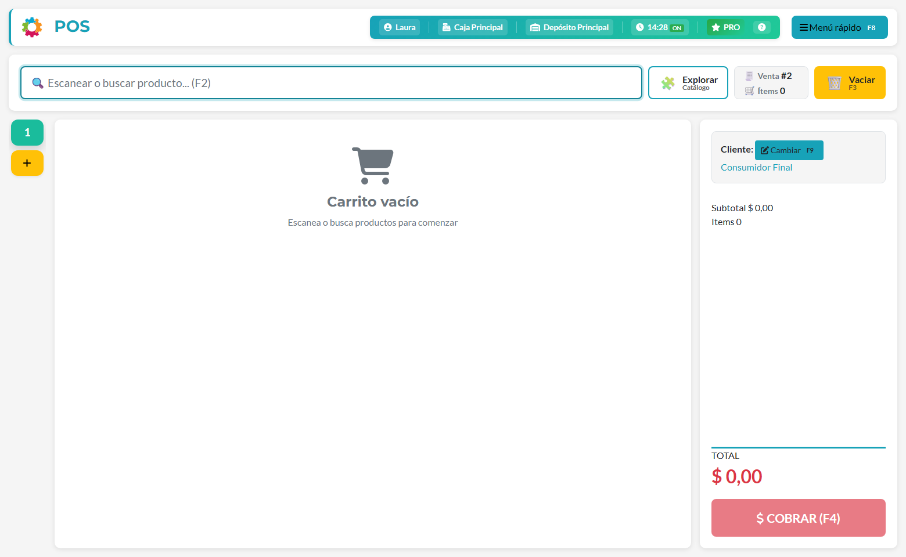

## Productos que se venden por peso (cantidad variable)

Algunos productos (carne, fiambre, granel) se venden por kilo y la cantidad cambia en cada venta. Se reconocen porque al tocar su precio el POS **te pide la cantidad**.

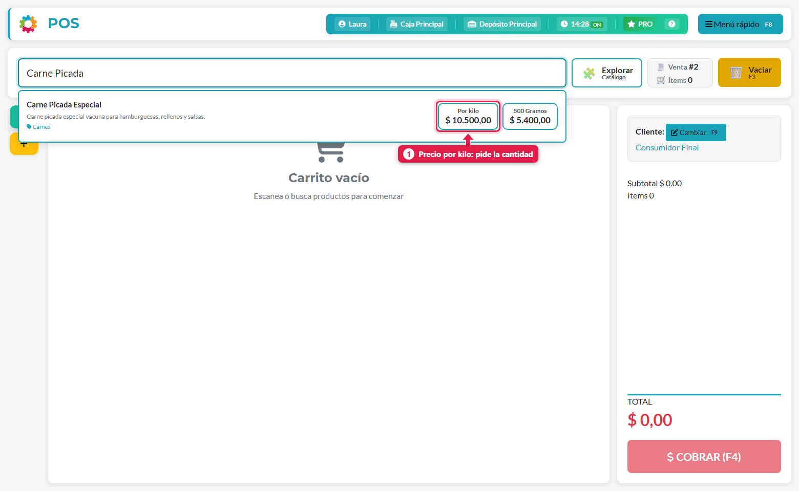

Se abre la ventana *Ingresar cantidad*. Tenés dos formas de cargarla:

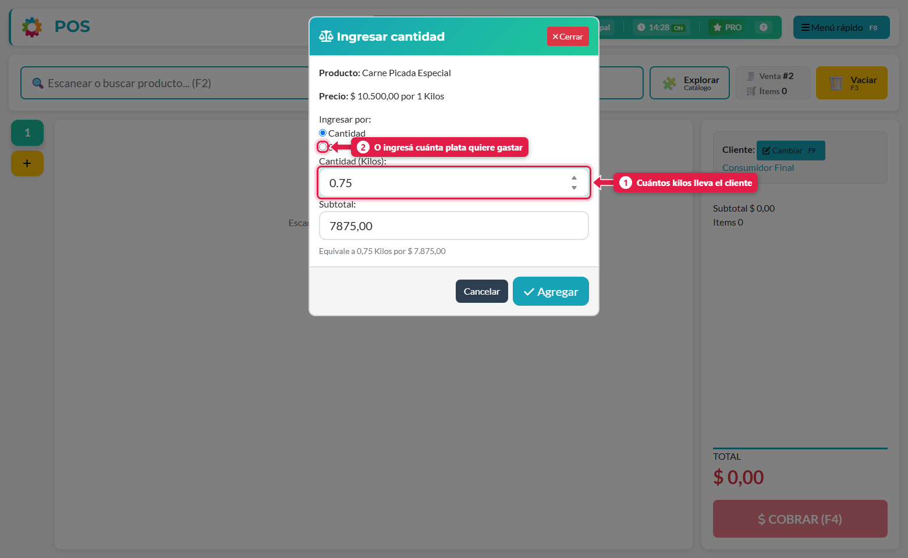

| # | Modo | Cuándo usarlo |
|---|---|---|
| 1 | **Cantidad** | El cliente pide una cantidad exacta (0,75 kg). El sistema calcula el importe |
| 2 | **Subtotal** | El cliente dice cuánta plata quiere gastar ($ 5.000). El sistema calcula los kilos |

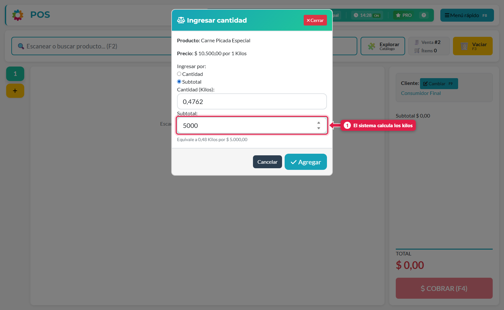

Al tocar **Agregar**, la línea queda con el peso resultante. Si ingresaste por subtotal, el sistema **ajusta el precio unitario** para que el subtotal sea exactamente el monto pedido (verás el precio de lista tachado y el ajustado debajo).

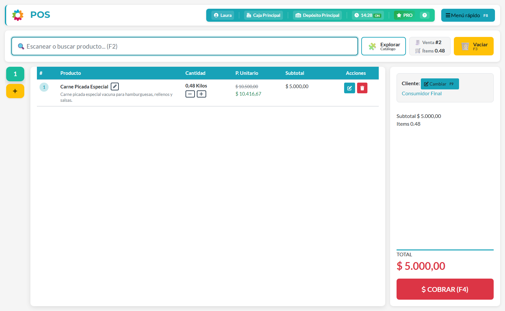

> Para que un producto pida la cantidad al vender, en su precio hay que tildar **Cant. Variable** (ver *Cargar tus primeros productos*).

## Ver o reimprimir una venta ya cerrada

Menú rápido (**F8**) → **Ventas anteriores**. Ves las ventas con su número, fecha, cliente, caja y total, y por cada una podés reimprimir el **Ticket** o la **Hoja A4**.

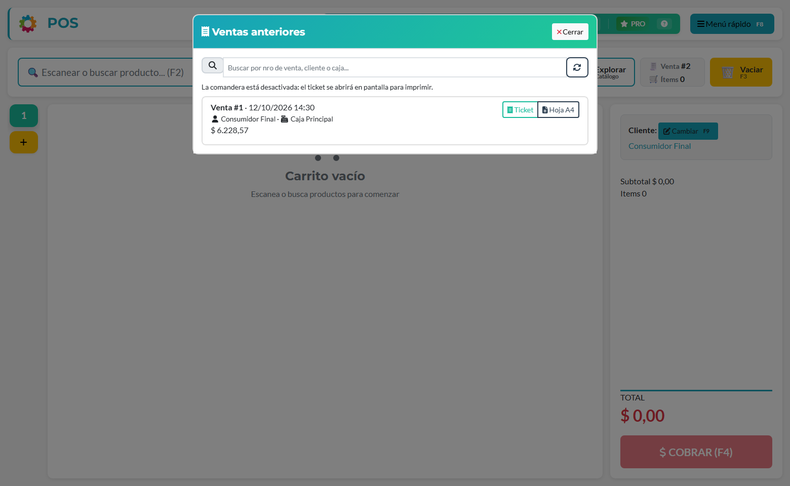

> Un cajero ve solo las ventas de **su turno actual**. Para ver las de todas las cajas y turnos necesita el permiso *Puede ver todos los tickets*.

## Qué pasa por detrás

Al confirmar, el sistema hace todo junto (si algo falla, no queda nada a medias):

| Qué | Detalle |
|---|---|
| Stock disponible | Lo vendido **deja de estar disponible** en el momento, en el depósito de tu caja |
| Stock físico | Depende del ajuste *Seguimiento de entregas* (viene activado): con él, el stock físico se descuenta recién cuando la venta se marca como **entregada** y mientras tanto figura como *comprometido*. Apagado, se descuenta al vender |
| Caja | Cada pago queda asociado a tu **turno de caja**: se ve en el arqueo y el cierre |
| Billeteras | Por cada pago, el sistema registra el movimiento en la billetera vinculada al medio de cobro |
| Cuenta corriente | Si parte de la venta fue a cuenta corriente, queda como deuda del cliente |
| Recetas | Si el producto tiene receta y la fabricación automática está activada, genera la fabricación |
| Ticket | Se imprime solo si está activado *Imprimir el ticket al cobrar* y hay impresora; si no, se abre en pantalla |

El sistema protege la venta contra **doble clic**: si se toca *Confirmar* dos veces, o falla la conexión y se reintenta, el pago no se duplica.

## Problemas frecuentes

| Si te pasa… | Es porque… | Qué hacer |
|---|---|---|
| El botón *Cobrar* está apagado | El carrito está vacío | Agregá al menos un producto |
| "Debe abrir la caja para poder cobrar" | No abriste el turno | Ingresá el efectivo inicial y tocá *Abrir Turno* |
| El POS no me deja vender un producto sin stock | El ajuste *Permitir venta con stock negativo* está apagado | El dueño puede activarlo en Configuración → Ventas y caja |
| No puedo cambiar el precio | Tu usuario no tiene *Puede modificar precios* | Pedíselo al dueño |
| No puedo hacer descuento | Falta el permiso *Puede hacer descuentos* | Pedíselo al dueño |
| El botón de cuenta corriente está apagado | El cliente de la venta es *Consumidor Final* o no tiene cuenta corriente | Cambiá el cliente (F9) a uno con cuenta corriente habilitada |

## Siguiente paso

- Cobrar con varios medios de pago
- Vender a cuenta corriente
- Turno de caja: apertura, retiros y cierre
