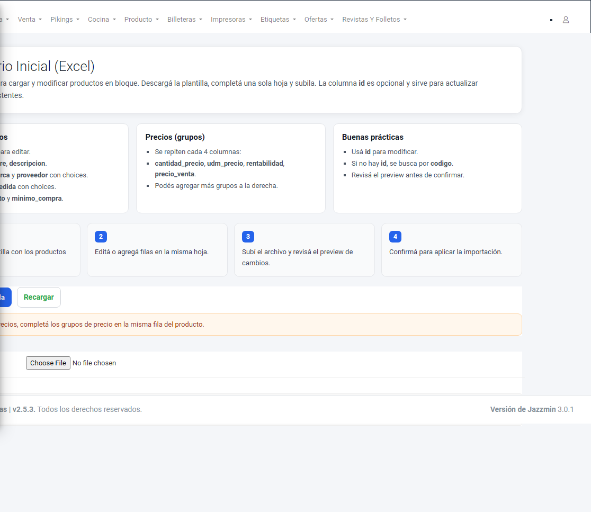
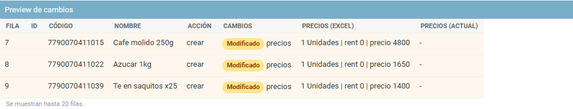

## Qué vas a lograr

Pasar tu lista de productos, costos y precios de venta de una planilla a ADEstock, en bloque y revisando antes lo que va a cambiar.

> Esta herramienta carga **productos y precios**. **No carga cuánta mercadería tenés**: el stock se carga con un ajuste de inventario (guía de stock inicial por Excel).

## Antes de empezar

- Tené a mano tus productos con **código de barras**, nombre, categoría, costo y precio de venta.
- Si ya tenés productos cargados, **descargá primero la plantilla**: trae tu catálogo actual y te sirve de copia de resguardo antes de cambiar nada.

## Paso a paso

### 1. Abrí la pantalla

En el panel, entrá a **Producto > Inventario Inicial (Excel)**.

### 2. Descargá la plantilla

Tocá **Descargar plantilla**. Se baja un Excel con tus productos actuales y las columnas que el sistema espera.

| Columna | Qué poner |
|---|---|
| **codigo** | El código de barras. Es lo que identifica al producto |
| **nombre**, **descripcion** | Cómo lo ves en el sistema |
| **categoria** | Si no existe, se crea |
| **cantidad** y **unidad_de_medida** | La presentación sobre la que está expresado el costo (por ejemplo, un bulto de 12). **No es el stock** |
| **costo** | Costo de esa presentación |
| **cantidad_precio_1**, **udm_precio_1**, **rentabilidad_precio_1**, **precio_venta_1** | Un precio de venta. Para más precios, repetí el grupo hacia la derecha (_2, _3…) |

### 3. Completá la planilla

- Cargá **un producto por fila** y **siempre el código**.
- Guardá el archivo como **.xlsx**.
- No cambies los nombres de las columnas.

### 4. Subí el archivo y revisá la vista previa

Elegí el archivo y tocá el botón para subirlo. Antes de aplicar nada, el sistema te muestra qué va a hacer con cada fila:

| Columna | Qué te dice |
|---|---|
| **Acción** | *crear* si el código es nuevo, o *actualizar* si ya existe |
| **Precios (Excel)** / **Precios (actual)** | Lo que vas a cargar contra lo que hay hoy |

Mirá que las filas y los precios sean los que esperás.

### 5. Confirmá

Si está todo bien, tocá **Confirmar importación**. Al terminar vas a ver un resumen con **productos creados, actualizados, precios y errores**.

## Antes de confirmar: lo que pisa la importación

Estos puntos los comprobamos con el importador de ADEstock 2.5.3 en una base de prueba:

- **Los precios de venta de cada producto se reemplazan por los del archivo.** Si el archivo no trae columnas de precio, el producto queda **sin precios de venta**.
- **Una categoría vacía deja el producto sin categoría**, y un **costo vacío lo deja en 0**.
- **Si una fila no tiene código, se crea un producto nuevo cada vez que importás.** Importar dos veces el mismo archivo sin códigos te duplica todo.
- **El código tiene que ser el mismo texto.** Si en Excel guardás el código como número, pierde los ceros del principio (`0012345` pasa a `12345`) y el sistema lo toma como otro producto. Formateá la columna **codigo** como **Texto** antes de pegar los códigos.
- **No hay deshacer.** Por eso conviene tener la plantilla descargada antes de importar.

## Cómo comprobar que salió bien

1. Abrí **Producto > Productos** y buscá un par de códigos del archivo.
2. Revisá que el **nombre**, la **categoría** y el **costo** sean los esperados.
3. Abrí uno y mirá que tenga sus **precios de venta**.
4. En el POS, buscá el producto: tiene que aparecer con su precio.

## Problemas frecuentes

| Si te pasa… | Es porque… | Qué hacer |
|---|---|---|
| "El archivo no tiene las columnas requeridas. Usá la plantilla." | Falta alguna columna obligatoria (codigo, nombre, descripcion, categoria, cantidad, unidad_de_medida, costo) o cambió su nombre | Volvé a descargar la plantilla y copiá tus datos ahí |
| "No se pudo leer el archivo" | No es un Excel válido (.xlsx) | Guardalo de nuevo como **.xlsx** |
| Se duplicaron los productos | Las filas no tenían código | Completá el código y reimportá. Los duplicados ya creados hay que borrarlos a mano |
| Productos sin precio | El archivo no tenía columnas de precio | Reimportá con los grupos de precio completos |
| El producto aparece como nuevo en vez de actualizado | El código cambió (por ejemplo, sin ceros iniciales) | Corregí el formato de la columna **codigo** a **Texto** |

## Siguiente paso

- Cargar las existencias iniciales por depósito.
- Hacer tu primera venta.
- Contar el stock de un depósito.
