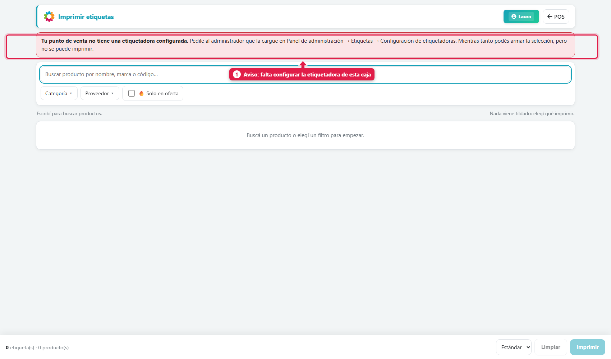
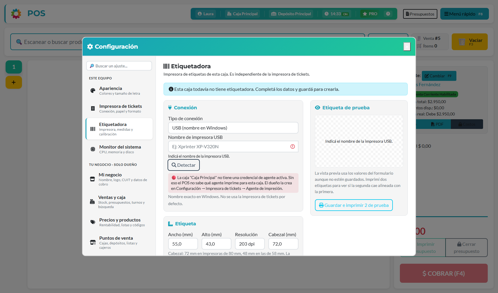
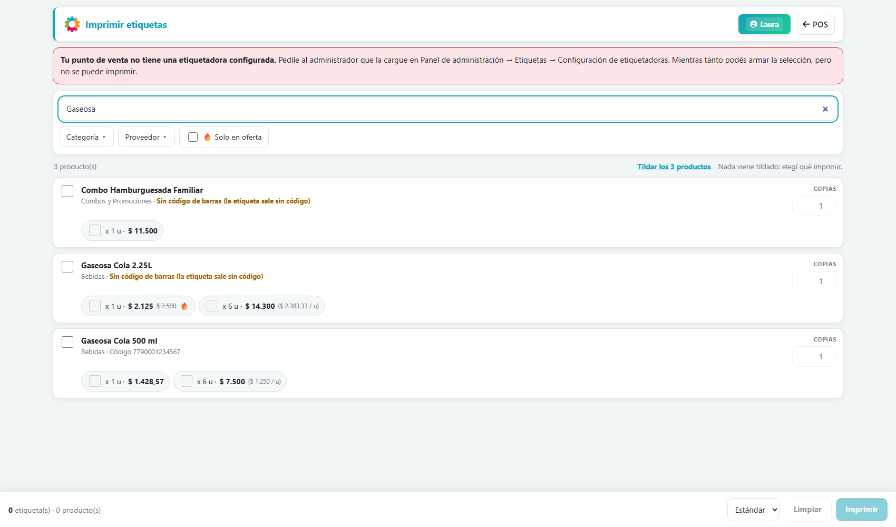
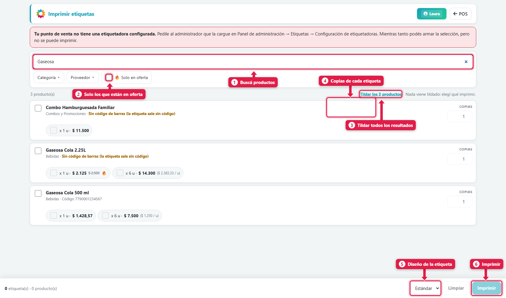

## Qué vas a lograr

Imprimir etiquetas con **nombre, precio y código de barras** para tus productos (o solo para los que están **en oferta**), eligiendo cuántas copias de cada presentación.

## Antes de empezar: configurar la etiquetadora

Cada **caja** tiene su propia etiquetadora, independiente de la impresora de tickets. Si no está configurada, la pantalla te avisa:

> *Tu punto de venta no tiene una etiquetadora configurada. Mientras tanto podés armar la selección, pero no se puede imprimir.*

El dueño la configura en **Menú rápido → Configuración → Etiquetadora** (o en *Panel de administración → Etiquetas → Configuración de etiquetadoras*):

| Dato | Qué es |
|---|---|
| **Conexión** | USB (nombre exacto de la impresora en Windows) o Red (IP) |
| **Etiqueta** | Ancho y alto en mm, y resolución (203 o 300 dpi) |
| **Calibración** | Corrimiento horizontal y ajuste de alto, si la etiqueta sale corrida |
| **Al terminar cada etiqueta** | Nada, avanzar a la próxima o avance fijo; y si corta al final de la tanda |
| **Etiqueta de prueba** | Imprime 2 de prueba para verificar el alineado |

> Como el sistema imprime a través del **agente de impresión** de la caja, la caja también necesita su credencial de agente (ver *La configuración del POS*).

## Paso a paso

### 1. Abrí Imprimir etiquetas

Menú rápido (**F8**) → **Imprimir etiquetas**.

### 2. Buscá los productos

Escribí nombre, marca o código. Cada producto muestra **todas sus presentaciones** con su precio (por unidad, por pack de 6…), el precio de **oferta** si tiene (🔥) y su **código de barras**.

> Si un producto **no tiene código de barras**, la etiqueta sale **sin código** (con nombre y precio). Podés darle código desde *Editar producto*, o dejar que el sistema genere uno (*Configuración → Precios y productos → Códigos de barras*).

### 3. Elegí qué imprimir

| # | Elemento | Qué hace |
|---|---|---|
| 1 | **Buscador** | Por nombre, marca o código |
| 2 | **Solo en oferta** | Muestra únicamente los productos con oferta vigente |
| 3 | **Tildar todos** | Marca todos los resultados |
| 4 | **Copias** | Cuántas etiquetas de esa presentación |
| 5 | **Plantilla** | El diseño de la etiqueta (*Estándar*) |
| 6 | **Imprimir** | Manda la tanda a la etiquetadora |

También podés filtrar por **categoría** y por **proveedor**. **Nada viene tildado**: elegís vos qué imprimir, y abajo ves el total (*N etiqueta(s) · N producto(s)*).

### 4. Imprimí

Tocá **Imprimir**. La tanda se manda al **agente de impresión** de tu caja, que la imprime en la etiquetadora configurada.

## Etiquetas desde las ofertas

En **Ofertas**, cada oferta tiene un botón **Etiquetas** que arma la tanda con los productos de esa oferta (usando la **leyenda** que cargaste, por ejemplo *Hasta agotar stock*).

## Qué pasa por detrás

| Qué | Detalle |
|---|---|
| Cola de impresión | Cada tanda se encola y el agente local la toma y la imprime |
| Código por presentación | Si está activado *Código de barras por presentación*, cada presentación (500 g, 1 kg…) tiene su propio código y al escanearlo entra esa presentación |
| Etiquetadora | Es por caja; la impresora de tickets es otra configuración |
| Ofertas | La etiqueta muestra el precio de oferta y el anterior tachado |

## Problemas frecuentes

| Si te pasa… | Es porque… | Qué hacer |
|---|---|---|
| No veo *Imprimir etiquetas* | Falta el permiso *Puede imprimir etiquetas* | Pedíselo al dueño |
| Dice que no hay etiquetadora | La caja no tiene una configurada | Configuración → Etiquetadora |
| No puedo tildar productos | No hay etiquetadora configurada | Configurala primero |
| No sale nada | La caja no tiene credencial del agente de impresión, o el agente no está corriendo | Configuración → Impresora de tickets → *Agente de impresión* |
| La segunda etiqueta sale desalineada | Falta calibrar | En *Etiquetadora* usá **Guardar e imprimir 2 de prueba** y ajustá el corrimiento |
| La etiqueta sale sin código | El producto no tiene código de barras | Cargale uno en *Editar producto* |

## Siguiente paso

- Tienda online
