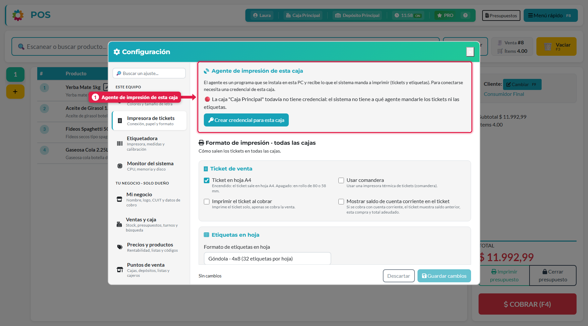
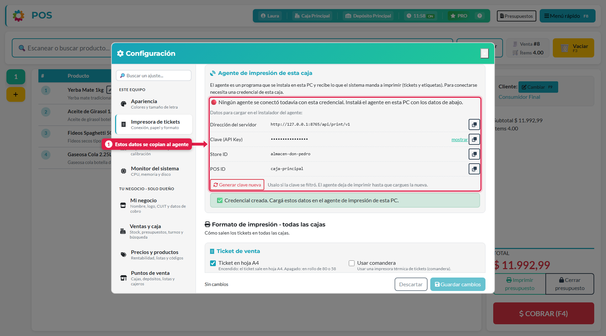
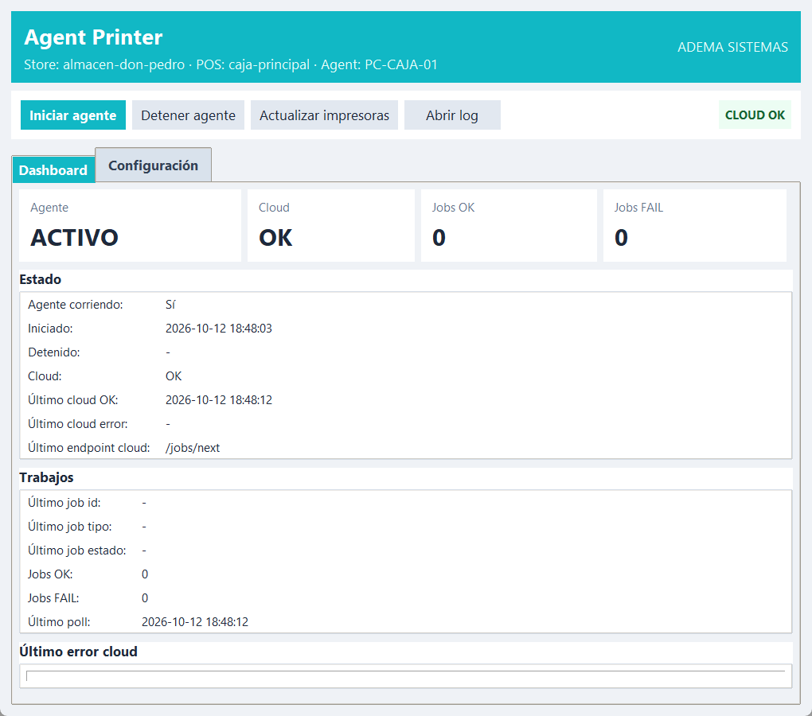
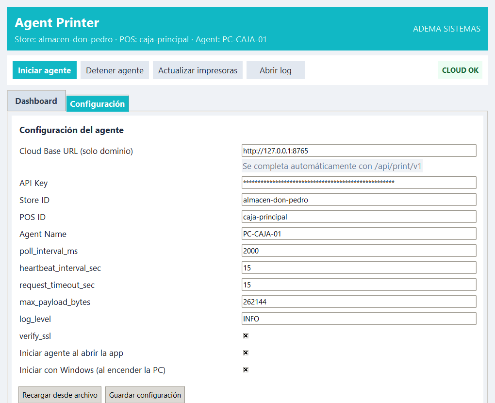

## Para qué sirve

El sistema arma los tickets y las etiquetas, pero alguien tiene que mandarlos a la impresora. El **agente de impresión** es un programa chico que corre en la PC de la caja y hace ese trabajo, para que lo que arma ADEstock **salga por la impresora de tu mostrador** aunque el sistema esté en la nube o en otra PC. Se instala **una sola vez** en esa PC.

## Qué vas a lograr

Vas a **instalar y conectar Agent Printer con ADEstock** para imprimir tickets y etiquetas en la PC de la caja, aunque el sistema funcione en la nube o en otra computadora del local.

El agente recibe los trabajos de impresión de su caja y los envía a la impresora local. Necesitás crear la credencial de esa caja, cargarla en el agente y comprobar la conexión antes de imprimir.

El **agente** es un programa chico que vive en la PC de la caja: le pregunta al sistema «¿hay algo para imprimir?», lo imprime en la impresora local y avisa si salió bien. Hace falta cuando imprimís **desde la nube**, o cuando la impresora está en otra PC del local que no es la del sistema.

```
Sistema ADEstock  →  cola de impresión  →  Agent Printer (PC de la caja)  →  impresora
```

## Antes de empezar

- La impresora térmica tiene que estar **instalada y funcionando en Windows** (la ves en *Dispositivos e impresoras*), o responder por **red** (IP y puerto 9100).
- Descargá el [instalador de Agent Printer 1.0.7](https://github.com/ademasistemas/agent-printer/releases/download/1.0.7/AgentPrinter_Setup_v1.0.7.exe), la versión utilizada en esta guía.
- Cada **caja** necesita su propia **credencial** (así sabés qué PC imprime qué).

## Paso a paso

### 1. Creá la credencial de la caja (en el POS)

1. En el POS entrá a **Menú rápido → Configuración → Impresora de tickets**.
2. Bajá hasta **Agente de impresión de esta caja**. Si la caja no tiene credencial, aparece el aviso en rojo: *«La caja … todavía no tiene credencial»*.



3. Tocá **Crear credencial para esta caja**.

Aparecen los **datos que vas a cargar en el agente**:



| Dato | Para qué sirve |
|---|---|
| **Dirección del servidor** | A dónde se conecta el agente (termina en `/api/print/v1`) |
| **Clave (API Key)** | La «contraseña» del agente. Tocá *mostrar* para verla; el botón de al lado la **copia** |
| **Store ID** | Identifica el local |
| **POS ID** | Identifica la caja |

> Solo el **dueño** ve este bloque. Cada caja tiene sus propios datos: no los mezcles entre PC.

### 2. Instalá el agente en la PC de la caja

1. Ejecutá `AgentPrinter_Setup_v1.0.7.exe` **como administrador**.
2. Completá el formulario del instalador con los datos del paso anterior:

| Campo del instalador | Qué poner |
|---|---|
| **Cloud URL** | La *Dirección del servidor* (alcanza con el dominio; el programa agrega solo `/api/print/v1`) |
| **API Key** | La *Clave* copiada |
| **Store ID** | El *Store ID* |
| **POS ID** | El *POS ID* |
| **Agent Name** | Un nombre para reconocer la PC, por ejemplo `PC-CAJA-01` |

3. Dejá tildada la opción **Iniciar Agent Printer automáticamente al encender la PC** y terminá.

El programa queda en `C:\Program Files\AgentPrinter\`, guarda su configuración en `%APPDATA%\AgentPrinter\config.yaml` y sus registros (logs) en `%APPDATA%\AgentPrinter\logs\`.

### 3. Mirá que esté conectado

Abrí **Agent Printer** (acceso directo o ícono junto al reloj). En la pestaña **Dashboard**:



| Dato | Qué tiene que decir |
|---|---|
| **Agente** | **ACTIVO** |
| **Cloud** | **OK** (el sistema respondió) y arriba a la derecha *CLOUD OK* |
| **Último cloud OK** | Una hora reciente, que se actualiza sola |
| **Jobs OK / FAIL** | Los trabajos impresos bien y con error |
| **Impresoras detectadas** | Las impresoras de Windows que el agente ve |

Si estaba detenido, tocá **Iniciar agente**. **Actualizar impresoras** vuelve a leer las de Windows; **Abrir log** abre el archivo de registro.

### 4. La pestaña Configuración (si hay que corregir algo)



| Campo | Qué es |
|---|---|
| **Cloud Base URL** | Solo el dominio; completa `/api/print/v1` |
| **API Key / Store ID / POS ID / Agent Name** | Los mismos del paso 1 |
| **poll_interval_ms** | Cada cuánto pregunta si hay trabajos (2000 = 2 segundos) |
| **heartbeat_interval_sec** | Cada cuánto avisa que está vivo |
| **verify_ssl** | Verificar el certificado HTTPS. Dejalo tildado |
| **Iniciar agente al abrir la app** | Empieza a imprimir apenas se abre el programa |
| **Iniciar con Windows** | Arranca solo al encender la PC (minimizado, junto al reloj) |

Para guardar cambios **primero tocá *Detener agente***, después **Guardar configuración** y volvé a iniciarlo. Si el agente está corriendo, no deja guardar.

### 5. Elegí la impresora y probá

De vuelta en el POS, en **Impresora de tickets**:

1. **Tipo de impresora:** *USB* (poné el nombre exacto de Windows, o tocá **Detectar**) o *Red* (IP y puerto 9100; **Escanear** busca impresoras en la red).
2. **Ancho de papel:** 80 mm o 58 mm.
3. Tocá **Probar**: tiene que salir un ticket de prueba. Después **Guardar**.

Con el agente conectado, el bloque *Agente de impresión de esta caja* muestra su estado en vez del aviso rojo.

## Qué pasa por detrás

1. El POS no imprime directamente: crea un **trabajo de impresión** en la cola (ticket de venta, etiqueta…).
2. El agente de **esa caja** lo toma (cada 2 segundos), lo manda a la impresora y reporta **éxito o error**.
3. Si falla, el sistema **reintenta** algunas veces; si sigue fallando, el trabajo queda como *muerto* (lo ves en el panel).
4. En el panel, menú **Impresoras**, ves los **agentes** conectados, los **trabajos** y las **credenciales** (con la opción de regenerar la clave).

## Problemas frecuentes

| Si te pasa… | Es porque… | Qué hacer |
|---|---|---|
| El POS dice «la caja todavía no tiene credencial» | Falta el paso 1 | **Crear credencial para esta caja** |
| El agente dice *Cloud: ERROR* o error 401/403 | La clave o la URL están mal, o la credencial se regeneró | Copiá de nuevo los datos del POS (paso 1) y guardalos |
| «Detené el agente antes de guardar cambios» | Está corriendo | **Detener agente** → guardar → **Iniciar agente** |
| El ticket no sale pero el agente figura OK | Nombre de impresora USB incorrecto o impresora apagada/sin papel | Revisá **Impresoras detectadas** y el nombre en el POS; probá de nuevo |
| Se filtró la clave | - | En el POS tocá **Generar clave nueva** y cargala en el agente: el viejo deja de imprimir |
| Dos PC imprimen lo mismo | Usan la misma credencial | Una credencial por caja |

## Nota sobre capturas

Las pantallas del agente (3 y 4) son de la versión 1.0.7 corriendo. **Pendiente:** la captura del formulario del instalador, que no se pudo tomar sin instalarlo en esta PC.

## Cómo comprobar que salió bien

Comprobá que el agente indique **ACTIVO**, **Cloud OK** y una hora reciente de conexión. Desde el POS, usá **Probar** y verificá que el ticket salga por la impresora de esa caja. Si no imprime, revisá nombre de impresora, papel y credencial antes de repetir el trabajo.

## Siguiente paso

- [configurar el punto de venta (POS) en ADEstock](/tutoriales/configurar-punto-de-venta/)
- [imprimir etiquetas de precios y códigos en ADEstock](/tutoriales/imprimir-etiquetas/)
- [anular una venta o reimprimir un ticket en ADEstock](/tutoriales/anular-venta-y-reimprimir-ticket/)
