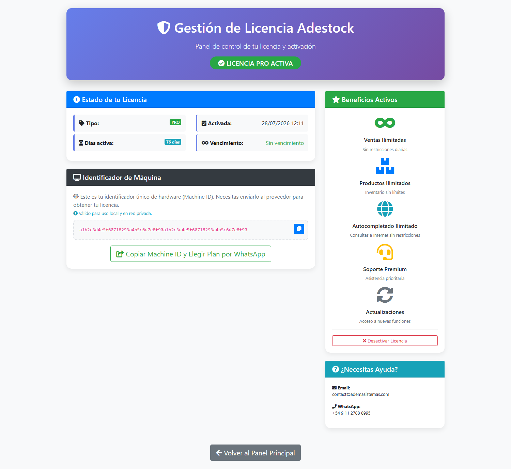

## Qué vas a lograr

Saber **en qué licencia estás**, qué te limita la versión gratuita y cómo **activar la Licencia Pro** con tu *Machine ID*.

## Gratuita vs. Pro

| | **Gratuita** | **Pro** |
|---|---|---|
| Ventas | **5 por día** y **35 por mes** | Ilimitadas |
| Autocompletado desde el catálogo por Internet | Con límite de consultas | Ilimitado |
| Soporte y actualizaciones | Básico | Prioritario y con acceso a nuevas funciones |
| Vencimiento | — | Según la clave: con fecha o **sin vencimiento** |

La licencia queda **atada a la PC** donde se activa (por eso se pide el *Machine ID*). Activarla **no borra ni modifica ningún dato** del negocio.

## Paso a paso

### 1. Mirá en qué licencia estás

En el POS, en la barra superior hay una insignia:

- **GRATUITA 5/5** (con las ventas que te quedan hoy): estás en la versión gratuita. Tocala para ir a la pantalla de licencia.
- **PRO**: la Licencia Pro está activa.

Cuando te queda **1 venta** o **ninguna**, aparece un aviso amarillo con el botón **Activar Licencia Pro**. Al llegar al límite, el POS muestra *«Has alcanzado el límite diario»* y no deja cobrar más ventas ese día.

También podés entrar directo a la pantalla de licencia desde el navegador: **`/license/`**.

### 2. La pantalla de licencia

| Zona | Qué muestra |
|---|---|
| **Insignia superior** | *Licencia Pro activa* o *Versión gratuita* |
| **Estado de tu licencia** | Tipo, fecha de activación, días activa y vencimiento |
| **Identificador de máquina** | Tu *Machine ID*: el código único de esta PC |
| **Beneficios activos** | Qué te da la licencia |
| **¿Necesitás ayuda?** | Email y WhatsApp de ADEMA Sistemas |

> El *Machine ID* de la captura es de ejemplo. El tuyo es distinto en cada PC.

### 3. Pedí la licencia

1. En la pantalla de licencia tocá **Copiar Machine ID y Elegir Plan por WhatsApp**. Copia tu identificador y abre WhatsApp para hablar con ADEMA Sistemas.
2. Elegís el plan y te pasan una **clave de licencia**.

> La clave sirve **solo para esa PC**. Si cambiás la computadora o su placa principal, el *Machine ID* cambia y hay que pedir una clave nueva.

### 4. Activala

En la versión gratuita, la pantalla de licencia tiene el botón **Activar Licencia Pro**. Se abre una ventana con el campo **Código de Licencia**: pegá la clave completa y tocá **Activar**. Si es válida, el sistema avisa y el POS pasa a mostrar **PRO**.

Si la clave no corresponde a esta PC o está mal copiada, muestra un error y sigue en la versión gratuita.

### 5. Desactivarla (casos especiales)

El botón **Desactivar Licencia** quita la clave de esta PC. Se usa, por ejemplo, para **mover la licencia a otra computadora** con soporte. **No uses este botón por curiosidad**: después de desactivar, el sistema vuelve a la versión gratuita y con sus límites.

## Qué pasa por detrás

- El sistema calcula el *Machine ID* a partir de datos de la PC (placa, disco y sistema) y comprueba que la clave coincida con ese identificador.
- La clave se guarda en un archivo de licencia local; no depende de Internet para seguir funcionando.
- El conteo de ventas gratuitas cuenta las ventas **no canceladas** del día y del mes.

## Problemas frecuentes

| Si te pasa… | Es porque… | Qué hacer |
|---|---|---|
| «Licencia no válida para este equipo», «Licencia inválida» o «Formato de licencia corrupto» | La clave es de otra PC o se copió incompleta | Revisá que pegaste toda la clave; si cambiaste de PC, pedí una nueva con el *Machine ID* actual |
| Dice «Machine ID no disponible» (o «La licencia expiró el…» si la clave tenía fecha) | El sistema no pudo leer los datos de la PC | Reiniciá el sistema como administrador; si sigue, avisá al soporte |
| No puedo cobrar: «límite diario» | Estás en la versión gratuita y ya hiciste 5 ventas hoy | Activá la Licencia Pro, o esperá a mañana |
| La licencia Pro dejó de verse tras cambiar de computadora | La licencia está atada a la PC anterior | Pedí una nueva clave con el nuevo *Machine ID* |

## Siguiente paso

- [Respaldos y restauración](/tutoriales/respaldos/)
- [La configuración del POS](/tutoriales/configurar-punto-de-venta/)
