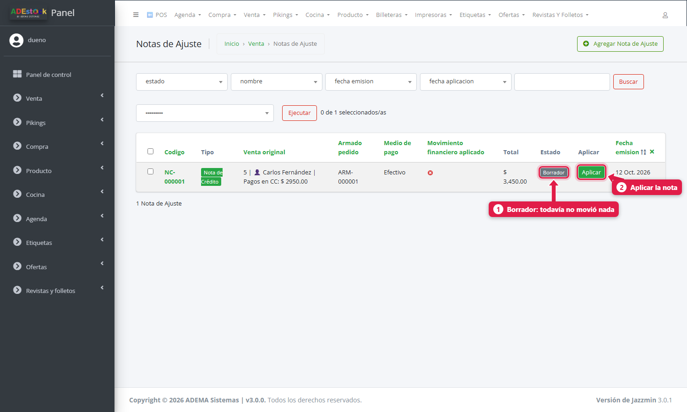
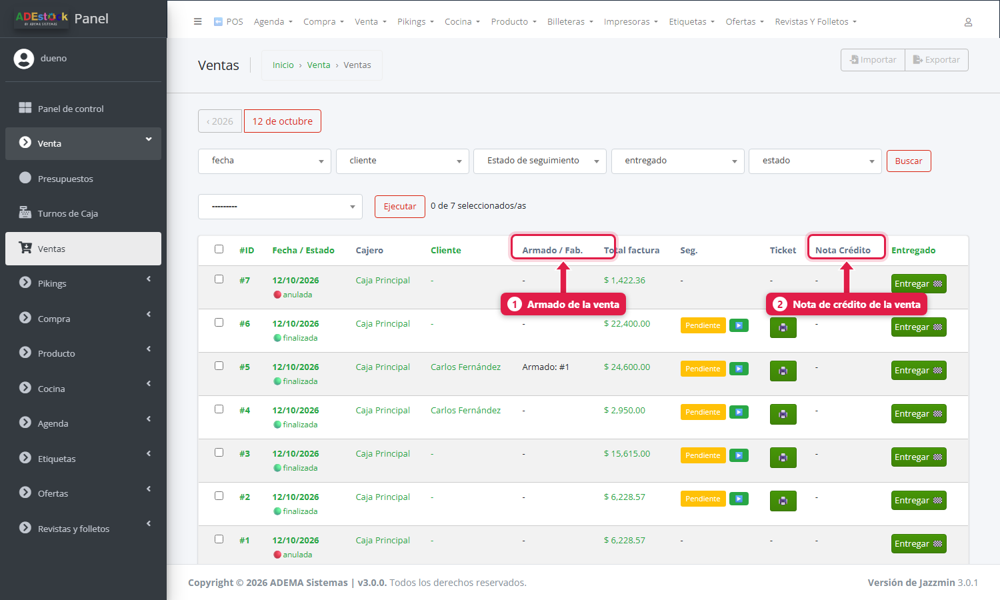
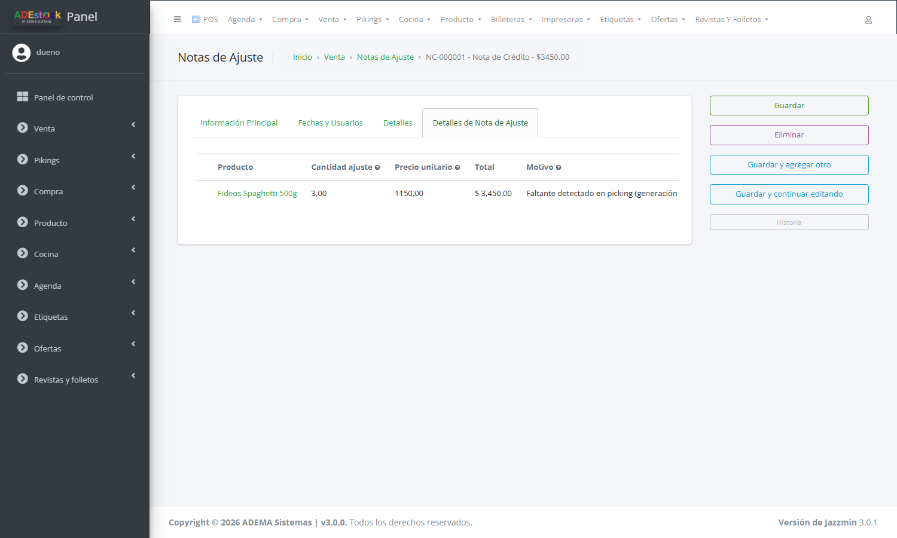
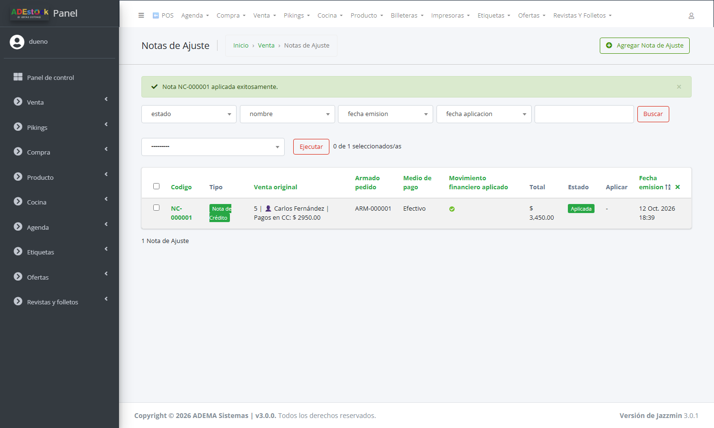
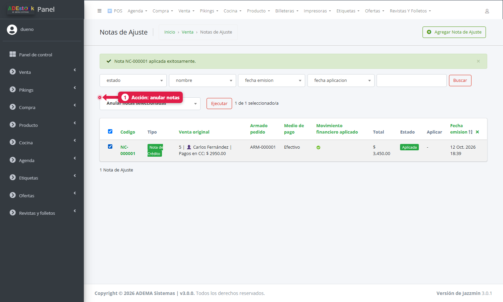
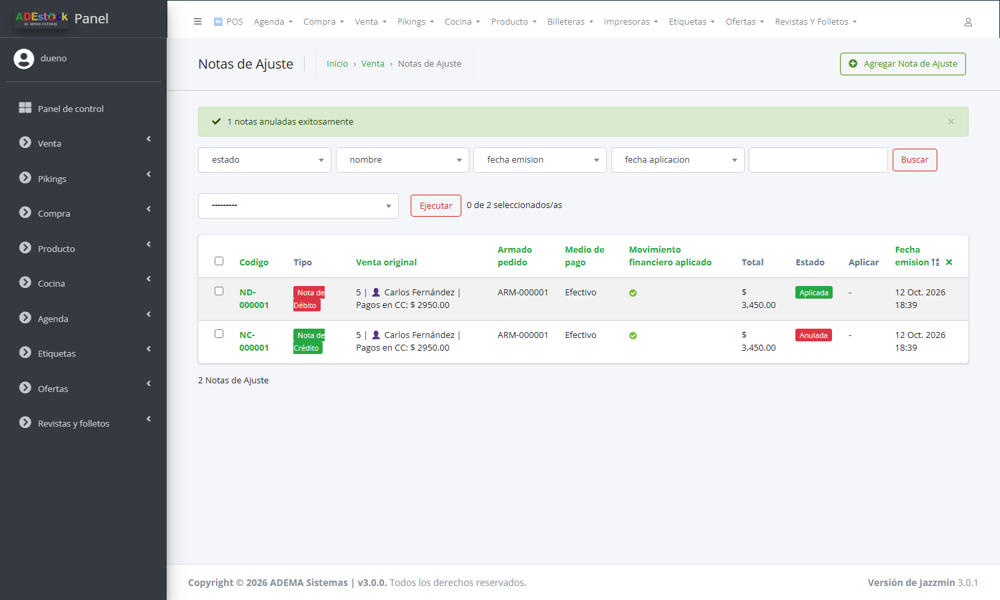

## Qué vas a lograr

Entender y manejar las **notas de ajuste**: el comprobante que corrige una venta cuando **no se entregó todo lo que se cobró**.

| Nota | Cuándo | Qué hace |
|---|---|---|
| **Nota de crédito** (`NC-000001`) | Faltó mercadería al armar el pedido | **Devuelve** esa mercadería al stock y **resta** el dinero de la caja del medio elegido |
| **Nota de débito** (`ND-000001`) | Se anuló una nota de crédito | Hace lo **inverso**: vuelve a sacar la mercadería del stock y a sumar el dinero |

Las notas **no se cargan desde el POS**: nacen del armado de pedidos y se **aplican en el panel**.

## Cómo nace una nota

1. Se arma un pedido y falta mercadería (ver [tutorial 34](/tutoriales/armar-pedidos-picking/)).
2. En el celular, **Generar Nota de Crédito** → se crea en estado **Borrador**.
3. El dueño o administrativo la **revisa y la aplica** en el panel.

Una nota en **borrador no mueve nada**: ni stock ni caja. Recién al **aplicarla** surte efecto.

## Paso a paso

### 1. Ubicá la nota

En el panel: **Venta → Notas de Ajuste**.

| # | Columna | Qué es |
|---|---|---|
| 1 | **Estado** | *Borrador* (sin efecto), *Aplicada* o *Anulada* |
| 2 | **Aplicar** | Botón que aplica la nota (solo en borradores) |
| - | **Codigo / Tipo** | `NC-…` crédito (verde) o `ND-…` débito (rojo) |
| - | **Venta original** y **Armado pedido** | De qué venta y de qué armado viene |
| - | **Medio de pago** | Con qué medio se devuelve (o cobra) el dinero |
| - | **Movimiento financiero aplicado** | Tilde verde cuando el dinero ya impactó en la billetera |
| - | **Total** | Valor de lo que faltó, a precio de venta |

Desde la lista de **ventas**, la columna **Nota Crédito** muestra el botón **NC PDF** cuando la venta tiene una nota de crédito aplicada, para imprimir el comprobante.

### 2. Revisá el detalle

Tocá el código de la nota. En **Información Principal** ves la venta, el armado y el **medio de pago**; en la pestaña **Detalles de Nota de Ajuste**, los productos y cantidades:

Cada línea muestra el producto, la **cantidad** que faltó, el **precio unitario** de la venta original y el **total**. Mientras la nota esté en borrador podés corregir el medio de pago o las líneas. Una vez aplicada, queda **solo de lectura**.

> **Ojo con el medio de pago:** determina **de qué medio se resta el dinero** en el cierre de caja. Si la venta se pagó con transferencia, elegí transferencia; si fue efectivo, efectivo. Una nota de crédito sin medio no se puede aplicar.

### 3. Aplicala

Tocá **Aplicar** en la fila de la nota (o tildala y usá la acción **Aplicar notas seleccionadas**). El sistema confirma: *«Nota NC-000001 aplicada exitosamente»*.

Ahora el estado es **Aplicada**, el botón desaparece y **Movimiento financiero aplicado** queda en verde.

### 4. Anular una nota aplicada

Si la nota estuvo mal, tildala y elegí la acción **Anular notas seleccionadas** → **Ejecutar**.

El sistema **no borra nada**: marca la nota original como **Anulada** y crea automáticamente una **nota inversa** (una *nota de débito* si anulás un crédito) ya aplicada, con las mismas líneas.

Así queda el rastro completo: el crédito, su anulación y la nota que la compensa. Solo se pueden anular notas **aplicadas**.

### 5. Crear una nota a mano (si hace falta)

**Agregar Nota de Ajuste** permite crear una nota sin pasar por el celular. Elegí el **tipo**, la **venta original**, el **armado** (es obligatorio: toda nota cuelga de un armado) y el **medio de pago**; después cargá las líneas en la pestaña de detalles y aplicala. Usalo solo para corregir casos puntuales, por ejemplo cuando se finalizó un pedido **sin** generar la nota de crédito.

## Qué pasa por detrás

| Al aplicar una nota… | Crédito | Débito |
|---|---|---|
| **Stock** | **Suma** las cantidades al stock del depósito del armado | **Resta** |
| **Caja (cierre de turno)** | **Resta** el total del medio elegido, en el turno donde se aplicó | **Suma** |
| **Billetera** | Registra un **egreso** en la billetera del medio (si el medio tiene billetera y no es cuenta corriente) | Registra un **ingreso** |

Detalles útiles:

- El efecto en la **caja** cuenta en el turno **cuyo horario incluye el momento de la aplicación**, para la caja de la venta original. Aplicala con el turno de esa caja **abierto**: si en ese momento no hay turno abierto, la nota no entra en ningún cierre.
- El stock se calcula siempre sumando las notas **aplicadas**; por eso una nota anulada compensada con su débito deja el stock como estaba.
- La nota de crédito resta **a precio de venta**, no a costo.

## Problemas frecuentes

| Si te pasa… | Es porque… | Qué hacer |
|---|---|---|
| La nota existe pero el stock no cambió | Está en **borrador** | Aplicala |
| «La nota de crédito debe tener medio de pago…» | La nota no tiene medio y no se pudo deducir de la venta | Abrila (borrador), elegí el medio y aplicala |
| No puedo editar la nota | Ya está aplicada o anulada | Anulala (genera su inversa) y creá una nueva si corresponde |
| Un pedido cerrado no tiene nota de crédito | Se finalizó sin generarla | Reabrilo en el celular y generá la nota, o creala a mano (paso 5) |
| La caja del día no cuadra por una nota | La nota se aplicó en un turno distinto al de la venta | Mirá el arqueo del turno: las notas aparecen como movimientos del medio (ver [Controlar un turno](/tutoriales/controlar-turnos-caja-panel/)) |

## Siguiente paso

- [Armado de pedidos (picking)](/tutoriales/armar-pedidos-picking/)
- [Billeteras y cuentas](/tutoriales/billeteras-y-cuentas/): dónde se ve el movimiento del dinero
