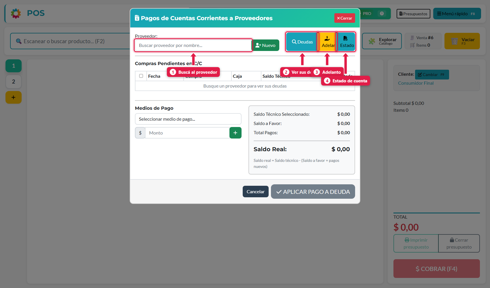
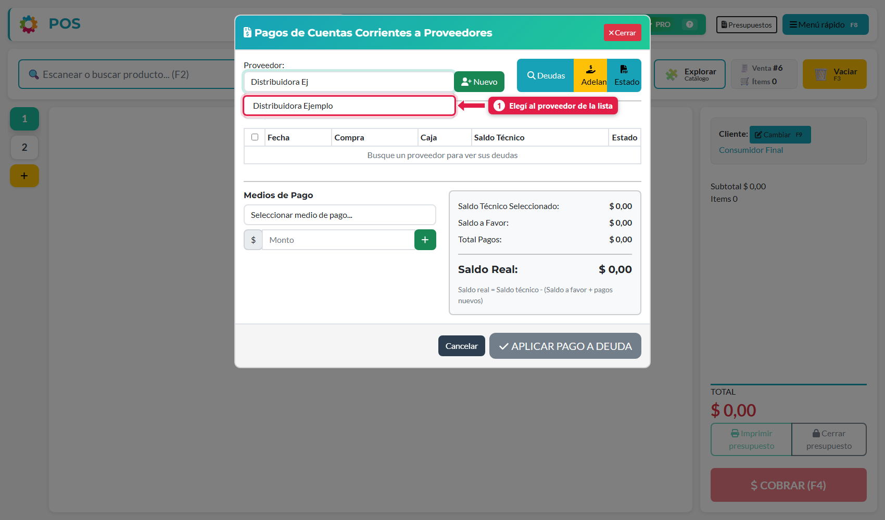
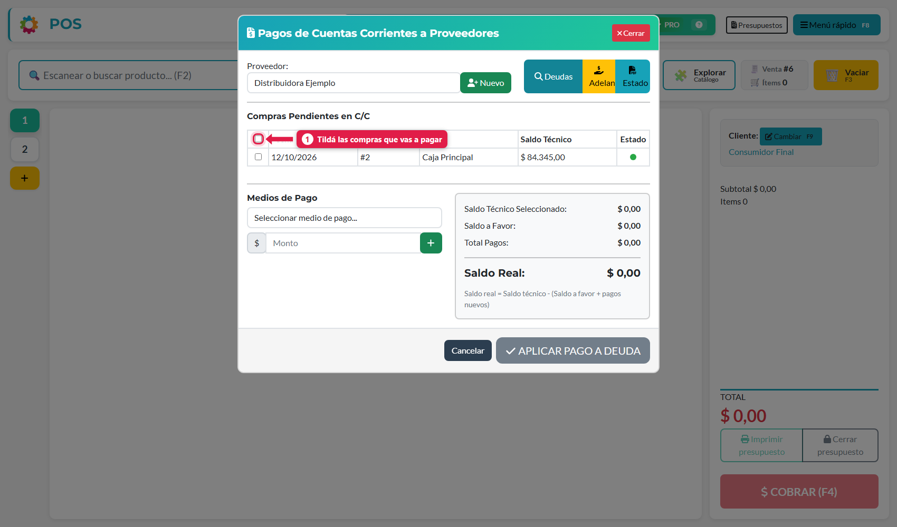
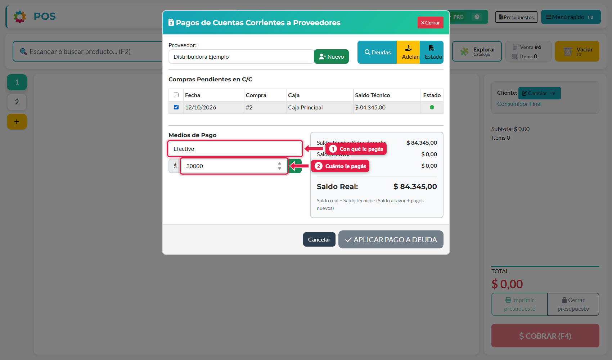
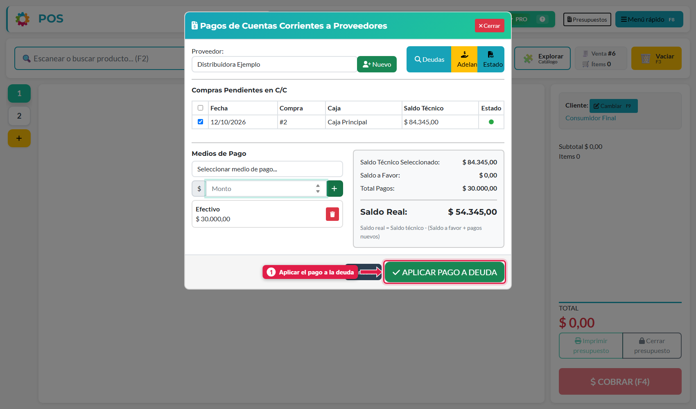
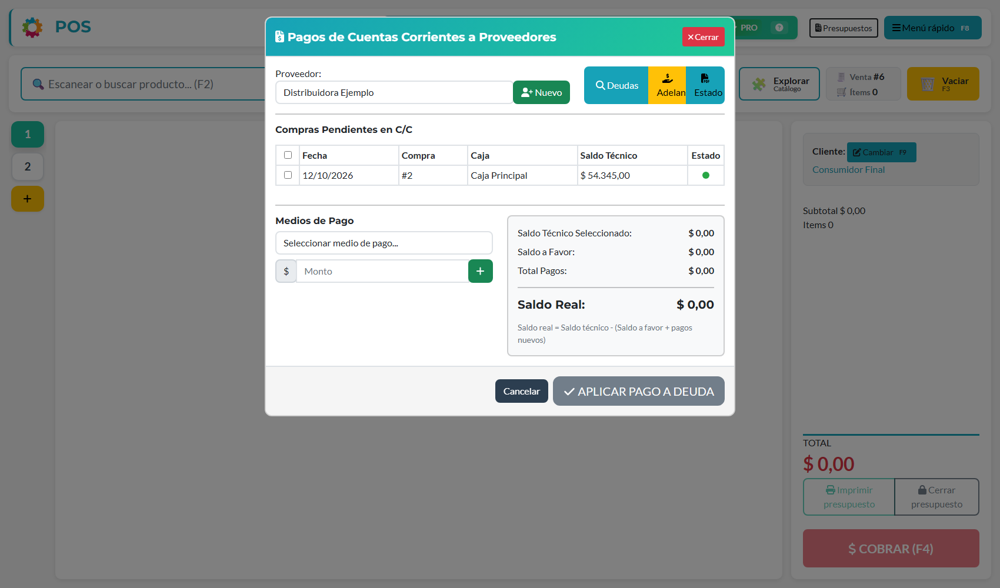

## Para qué sirve

Cuando comprás a cuenta corriente, la deuda con el proveedor queda abierta hasta que la pagues. Esta guía sirve para **saldar esa deuda**, total o parcialmente, eligiendo **qué compras cancelás** y con qué medio, y para ver en cualquier momento cuánto le debés a cada proveedor.

## Qué vas a lograr

Vas a **registrar un pago a un proveedor en ADEstock**, elegir las compras que cancelás y comprobar cuánto queda pendiente. Podés pagar una parte de la deuda, saldarla completa o registrar dinero por adelantado.

Los pagos se cargan desde el POS con un turno abierto. Si pagás en efectivo, el importe resta del arqueo de ese turno sin necesidad de cargar un retiro adicional.

## Cómo se genera una deuda con un proveedor

Le debés plata a un proveedor cuando cargás una compra y elegís pagarla **a cuenta corriente** (*Cuenta Corriente Proveedor*). La deuda **aparece al confirmar** la compra. Si el proveedor además te cobró flete y lo pagás con la compra, ese flete también suma a la deuda (ver [Cargar una compra con la foto de la boleta](/tutoriales/cargar-compras-con-foto-ia/)).

## Paso a paso

### 1. Abrí los pagos a proveedores

Menú rápido (**F8**) → **Pagar a un proveedor**. También podés llegar desde *Gestión de proveedores* con el icono 💵 del proveedor.

| # | Botón | Para qué sirve |
|---|---|---|
| 1 | **Proveedor** | Buscador del proveedor |
| 2 | **Deudas** | Trae las compras que le debés |
| 3 | **Adelanto** | Registra plata que le das **por adelantado**, sin compra |
| 4 | **Estado** | Descarga el estado de cuenta en PDF |

### 2. Buscá al proveedor

Escribí parte del nombre y elegí al proveedor de la lista.

### 3. Mirá sus deudas

Tocá **Deudas**. Aparece una fila por cada **compra pendiente en cuenta corriente**.

| Columna | Qué es |
|---|---|
| **Fecha / Compra / Caja** | Cuándo y en qué compra se generó |
| **Saldo técnico** | Lo que falta pagar de esa compra |
| **Estado** | Indicador de vencimiento, según la *Condición de pago (días)* del proveedor |

Tildá las compras que vas a pagar (o la casilla de arriba para todas).

### 4. Cargá el pago

Elegí el **medio de pago** y el **monto**, y tocá **+**.

En el cuadro de la derecha ves la cuenta:

| Línea | Qué es |
|---|---|
| **Saldo técnico seleccionado** | Suma de las compras tildadas |
| **Saldo a favor** | Plata adelantada al proveedor que se descuenta |
| **Total pagos** | Lo que le estás pagando ahora |
| **Saldo real** | `Saldo técnico − (Saldo a favor + pagos nuevos)`. Lo que **seguís debiendo** |

Podés pagar **menos** que el saldo (pago parcial): el resto queda pendiente.

### 5. Aplicá el pago

Cuando el pago figura en la lista, tocá **APLICAR PAGO A DEUDA**.

El sistema registra el pago y actualiza la deuda. En el ejemplo, de **$ 84.345** se pagaron **$ 30.000** y la compra queda con saldo **$ 54.345**:

## Ver lo pagado y el estado de cuenta

En **Gestión de proveedores**, cada proveedor tiene:

- 🕘 **Ver pagos realizados:** historial de pagos hechos.
- 📄 **Estado de cuenta PDF:** deuda compra por compra.

También está **Pagos a proveedores** en el Menú rápido (historial de pagos).

## Pagar un adelanto

Si le das plata al proveedor **antes** de comprarle, tocá **Adelanto**: queda como **saldo a favor** y se descuenta de sus próximas deudas.

## Qué pasa por detrás

| Qué | Detalle |
|---|---|
| Pago | Se registra un pago al proveedor y se aplica a cada compra elegida |
| Billetera | Si el medio de pago tiene una billetera vinculada, el egreso se registra en ella |
| Arqueo de caja | Los pagos y adelantos **en efectivo** hechos desde esta pantalla **restan del efectivo esperado del turno abierto** del cajero y salen en el ticket y el PDF del cierre. Los pagos con otros medios solo se informan. No hace falta cargar un Retiro de caja aparte |
| Compra | Una compra totalmente pagada deja de figurar como pendiente |
| Protección | El sistema evita que la misma deuda se pague dos veces |

## Problemas frecuentes

| Si te pasa… | Es porque… | Qué hacer |
|---|---|---|
| No aparecen deudas del proveedor | La compra se pagó en efectivo, o quedó **pendiente de confirmar** | Confirmala en el panel de administración (Compra → Compras → *Confirmar compra*) |
| El botón *Aplicar pago* está apagado | Falta cargar un pago, o no tildaste ninguna compra | Elegí medio y monto, y tocá **+** |
| Pagué de más | El pago superó la deuda tildada | Revisá el *Saldo real*: si es negativo, el excedente figura como **saldo a favor** |
| "No hay un turno abierto" al pagar | Los pagos a proveedores salen de la caja del turno abierto | Abrí un turno desde el POS y volvé a pagar. No se pueden cargar pagos desde el panel de administración |
| Me equivoqué en un pago | - | Pedile al dueño que lo revierta desde el panel de administración |

## Cómo comprobar que salió bien

Consultá **Ver pagos realizados** y descargá el estado de cuenta del proveedor. El saldo pendiente debe reflejar el pago aplicado; si adelantaste dinero, revisá el saldo a favor. Comprobá también el egreso en la billetera vinculada al medio de pago, cuando corresponda.

## Siguiente paso

- [crear y editar proveedores en ADEstock](/tutoriales/crear-y-editar-proveedores/)
- [cargar una compra manual en ADEstock](/tutoriales/cargar-compra-manual/)
- [controlar billeteras, cuentas y saldos en ADEstock](/tutoriales/billeteras-y-cuentas/)
