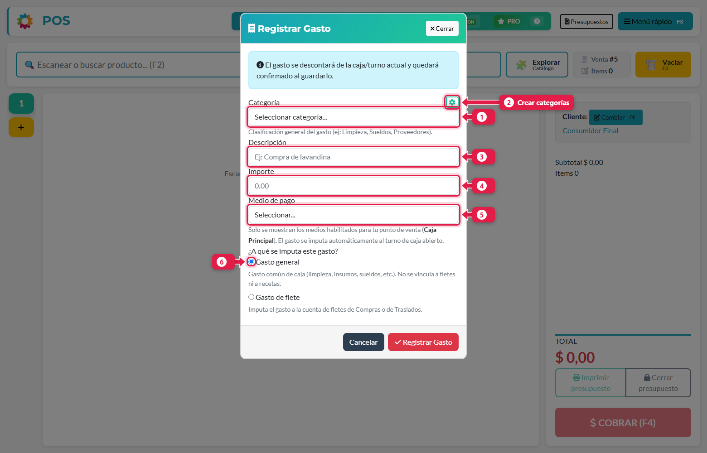
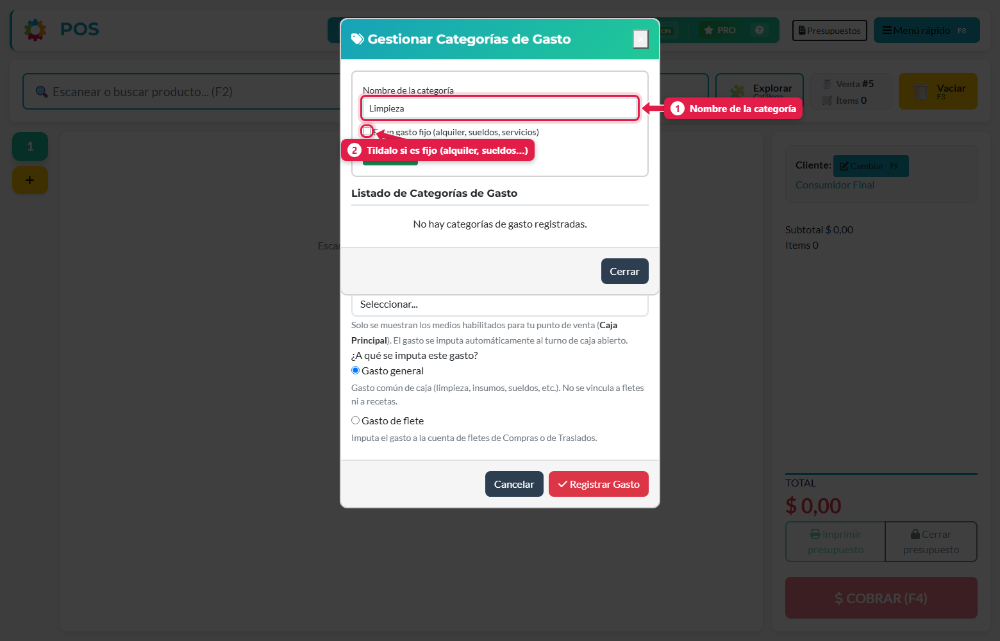
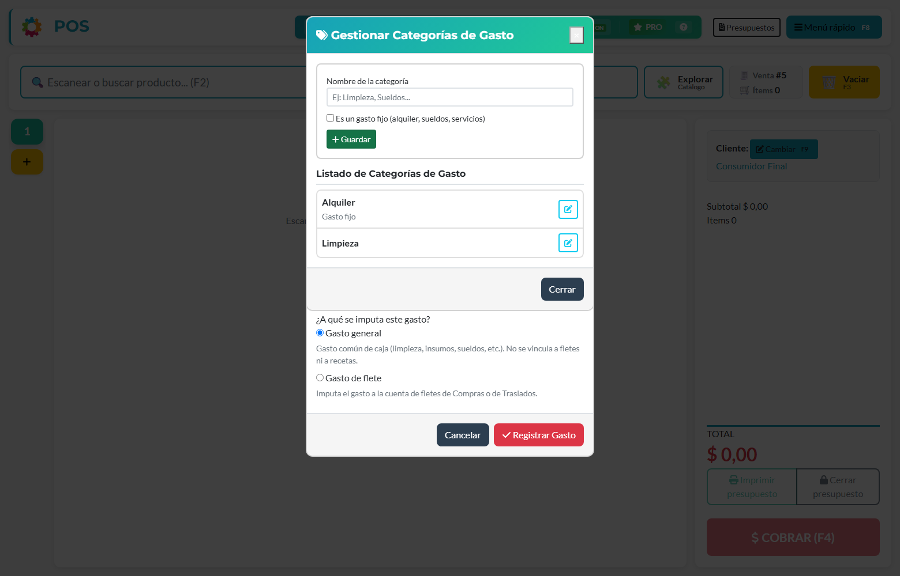
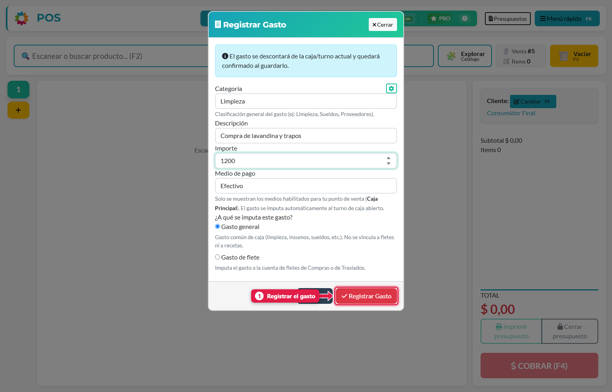
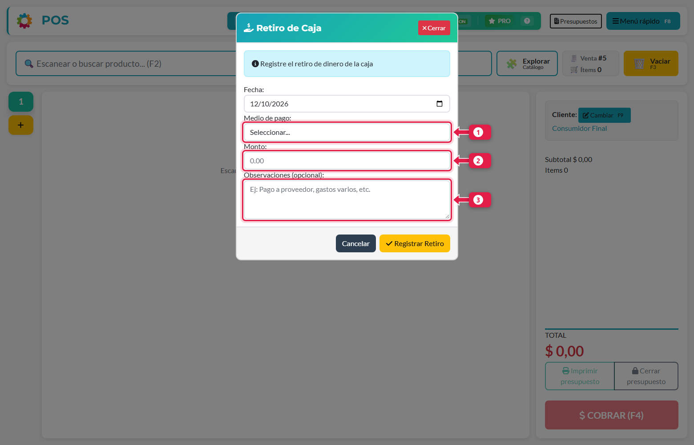

## Qué vas a lograr

Dejar asentada la plata que **sale de la caja**, para que el cierre cierre bien. Hay dos casos distintos:

| | Gasto | Retiro de caja |
|---|---|---|
| Qué es | Pagaste algo del negocio (limpieza, flete, insumos) | Sacaste plata de la caja sin que sea un gasto (llevarla a la caja fuerte, entregarla al dueño) |
| Tiene categoría | Sí | No |
| Con qué se paga | El medio de pago que elijas | El medio que elijas (normalmente efectivo) |
| Afecta el arqueo | Solo si fue en **efectivo** | Si fue en **efectivo** |

> **Los gastos y los retiros se registran solo desde el POS**, con tu turno abierto. **No se cargan desde el panel de administración**: así cada movimiento queda siempre en el turno y la caja donde ocurrió, y el cierre cierra bien. Desde el panel solo se **consultan**.

## Registrar un gasto

### 1. Abrí el formulario

Menú rápido (**F8**) → **Gastos**.

| # | Campo | Qué poner |
|---|---|---|
| 1 | **Categoría** | Clasificación general del gasto (Limpieza, Sueldos, Proveedores…) |
| 2 | **Gestionar categorías** (engranaje) | Crear las categorías que necesites |
| 3 | **Descripción** | Qué se pagó. Ej.: *Compra de lavandina* |
| 4 | **Importe** | Cuánto |
| 5 | **Medio de pago** | Con qué se pagó. Solo aparecen los medios habilitados en tu punto de venta |
| 6 | **¿A qué se imputa?** | *Gasto general* (limpieza, insumos, sueldos) o *Gasto de flete* (se imputa a la cuenta de fletes de Compras o Traslados) |

### 2. Si no hay categorías, creálas

La primera vez la lista está vacía. Tocá el engranaje (2): se abre *Gestionar Categorías de Gasto*.

Escribí el nombre y tocá **Guardar**. Si es un gasto que se repite todos los meses (alquiler, sueldos, servicios), tildá **Es un gasto fijo**.

### 3. Completá y registrá

Tocá **Registrar Gasto**. El gasto se descuenta del turno actual y **queda confirmado** al guardarlo.

> Un gasto confirmado **no se edita desde el POS**. Si te equivocaste, avisale al dueño.

## Registrar un retiro de caja

### 1. Abrí el formulario

Menú rápido (**F8**) → **Retiro de caja**.

| # | Campo | Qué poner |
|---|---|---|
| — | **Fecha** | Se completa sola con la de hoy |
| 1 | **Medio de pago** | Normalmente *Efectivo* |
| 2 | **Monto** | Cuánto sacás. Tiene que ser mayor a cero |
| 3 | **Observaciones** (opcional) | Para qué es. Ej.: *Se lleva a la caja fuerte* |

### 2. Registrá

Tocá **Registrar Retiro**.

## Qué pasa por detrás

| Qué | Detalle |
|---|---|
| Turno | El gasto o retiro queda asociado a tu turno de caja abierto y no se puede mover a otro turno. Sin turno abierto, el POS no te deja registrarlo |
| Panel de administración | Los gastos y retiros figuran en sus listados (*Agenda → Gastos*, *Venta → Retiros de Caja*) y dentro del turno, pero **solo para consultar y exportar** |
| Arqueo | Si es en **efectivo**, resta del efectivo esperado en el cierre. Si el gasto fue con otro medio (tarjeta, transferencia), **no** afecta el efectivo, pero igual figura en el resumen del cierre |

## Problemas frecuentes

| Si te pasa… | Es porque… | Qué hacer |
|---|---|---|
| No veo la opción *Gastos* | Falta el permiso *Puede registrar gastos* | Pedíselo al dueño |
| La lista de categorías está vacía | Todavía no se creó ninguna | Tocá el engranaje y creá las que necesites |
| El medio de pago no aparece | No está habilitado para tu caja | El dueño lo habilita en Configuración → Medios de cobro |
| "El monto debe ser mayor a cero" | Importe vacío o cero | Escribí un monto válido |
| Quiero cargar un gasto o retiro desde el panel de administración | Ya no se puede: solo se registran desde el POS | Registralo desde el POS con el turno abierto |
| El retiro no se refleja en el cierre | Se registró con un medio que no es efectivo | Verificá que el medio sea *Efectivo* |

## Siguiente paso

- Turno de caja: apertura, retiros y cierre
