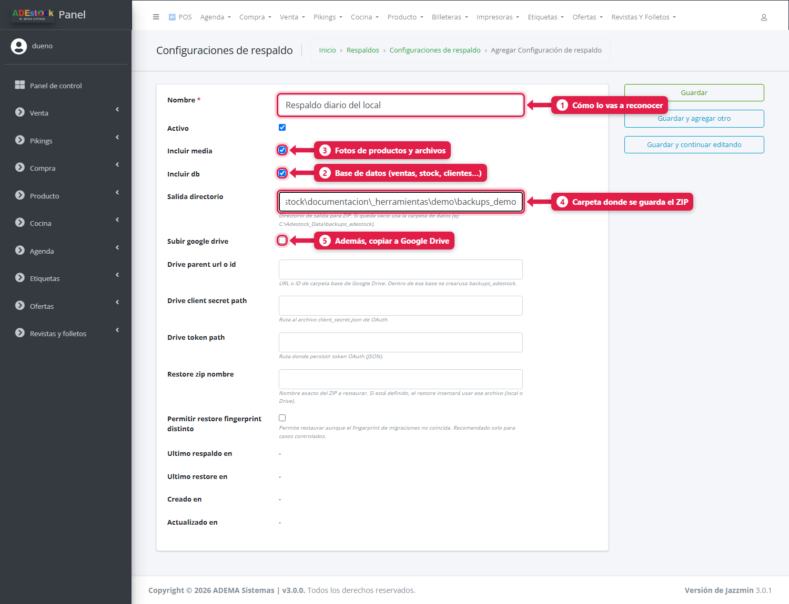
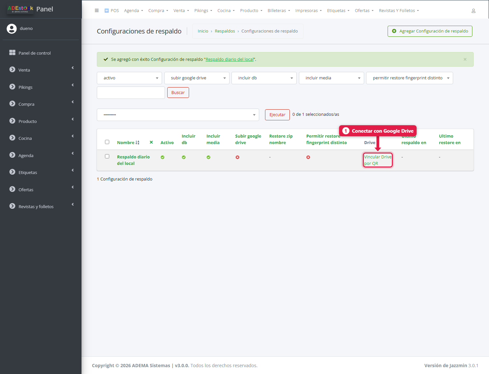
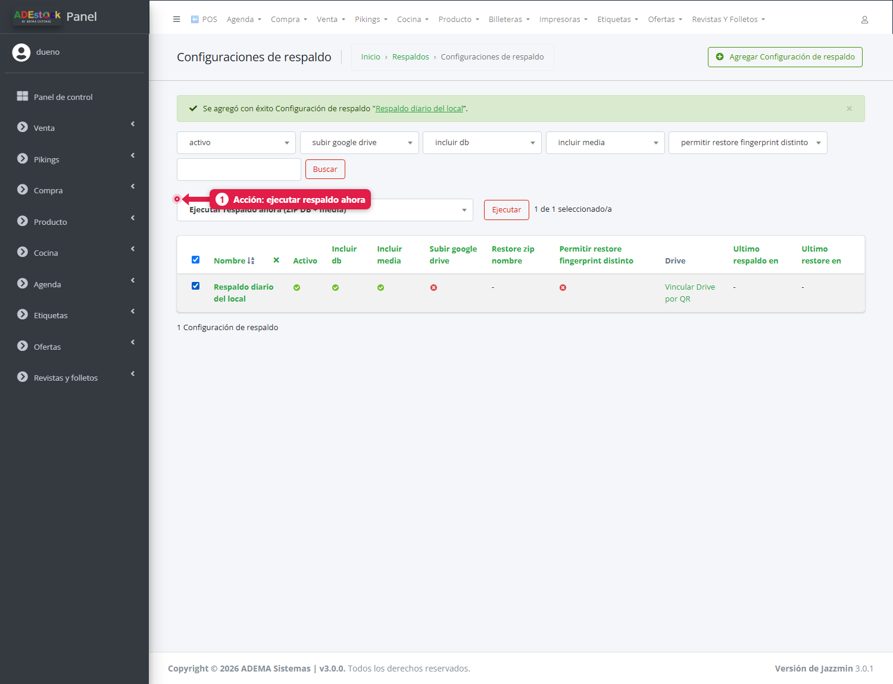
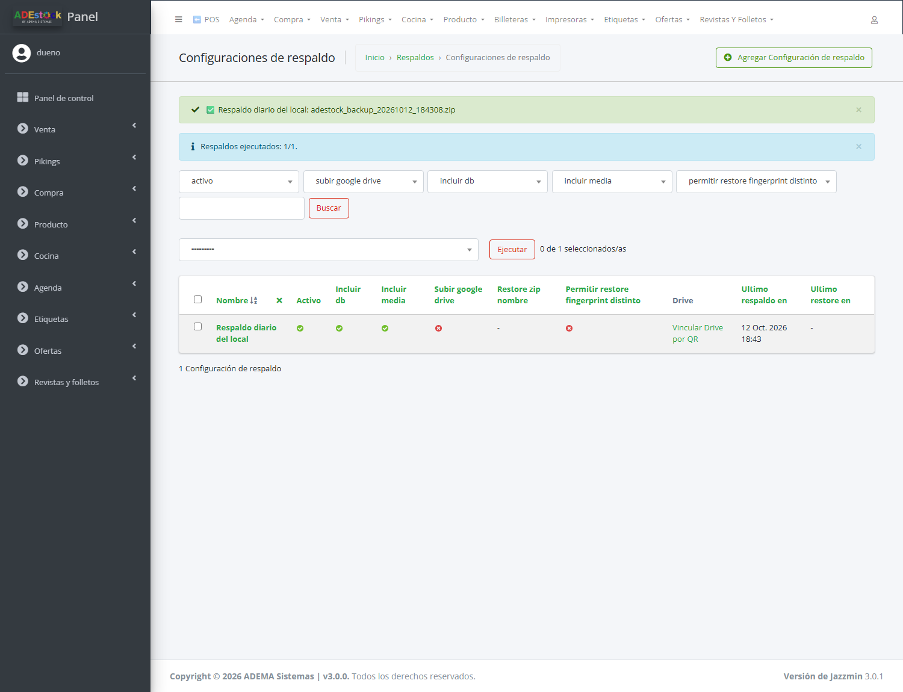
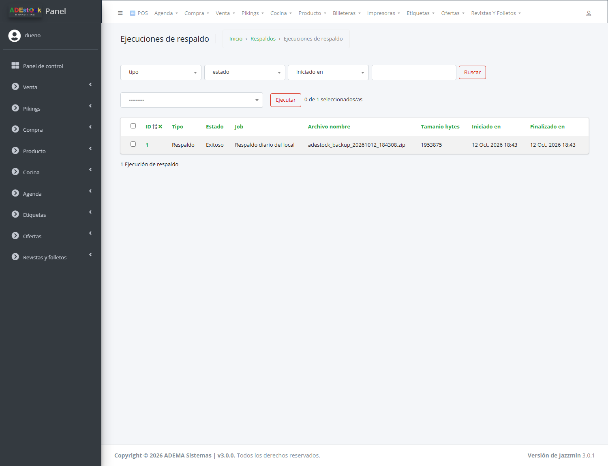
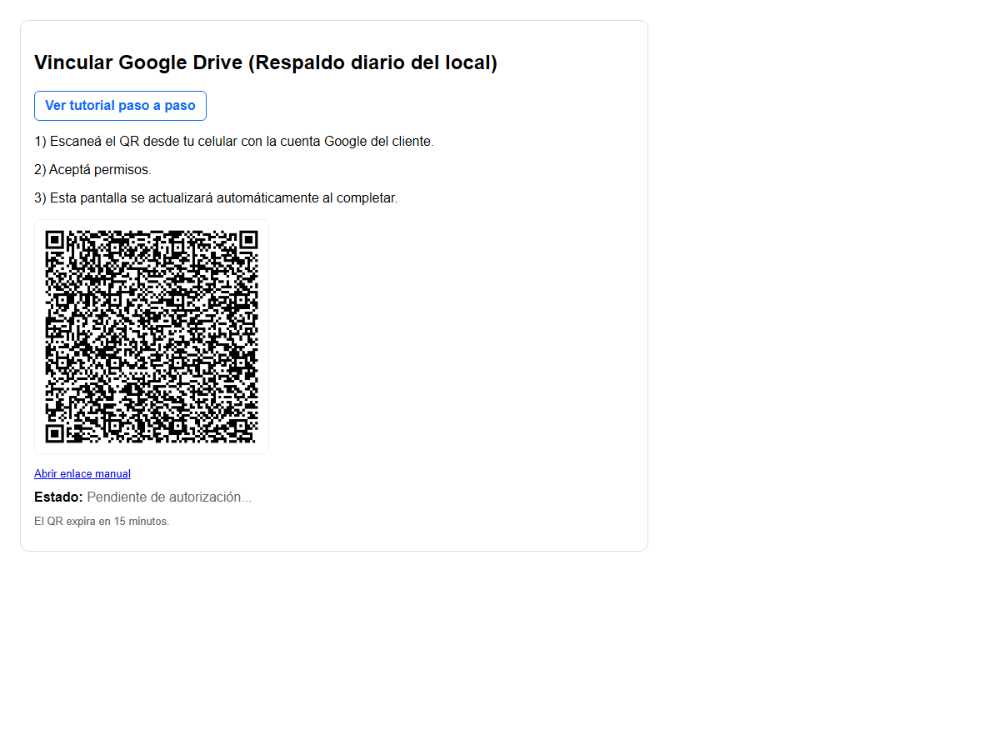

## Qué vas a lograr

Tener una **copia de seguridad** de todo tu negocio (ventas, productos, clientes, stock, fotos) en un archivo ZIP, guardarla en un lugar seguro - incluso en **Google Drive** - y saber cómo **volver atrás** si algo sale mal.

> **Regla de oro:** un respaldo que está solo en la misma PC no te salva si la PC se rompe o te la roban. Guardá siempre una copia **afuera** (Drive o un pendrive).

## Antes de empezar

El módulo vive en el panel, en el menú **Respaldos**, con tres pantallas:

| Pantalla | Para qué sirve |
|---|---|
| **Configuraciones de respaldo** | Definir *qué* se respalda y *dónde* se guarda; ejecutar el respaldo |
| **Ejecuciones de respaldo** | Historial: cuándo se hizo cada respaldo, de qué tamaño, si salió bien |
| **Restauraciones locales (SQL)** | Herramienta técnica para volver a cargar una base desde un archivo `.sql` (la usa el soporte) |

## Paso a paso

### 1. Creá una configuración de respaldo (una sola vez)

**Respaldos → Configuraciones de respaldo → Agregar Configuración de respaldo**.

| # | Campo | Qué poner |
|---|---|---|
| 1 | **Nombre** | Cómo lo vas a reconocer, por ejemplo *Respaldo diario del local* |
| 2 | **Incluir db** | Tildado: guarda la base de datos (ventas, stock, clientes, cuentas corrientes…) |
| 3 | **Incluir media** | Tildado: guarda las fotos de productos y otros archivos |
| 4 | **Salida directorio** | Carpeta donde se guarda el ZIP. Si lo dejás **vacío**, usa la carpeta de datos del sistema (`backups_adestock`) |
| 5 | **Subir google drive** | Tildalo si además querés enviar una copia a Google Drive (ver paso 4) |

Los campos de Google Drive (*carpeta*, *client secret*, *token*) y los de restauración (*nombre del ZIP*, *fingerprint*) pueden quedar **vacíos** salvo que soporte te indique lo contrario. Tocá **Guardar**.

### 2. Ejecutá un respaldo

1. En la lista, tildá la configuración.
2. En *Acción* elegí **Ejecutar respaldo ahora (ZIP DB + media)**.
3. Tocá **Ejecutar**.

Según el tamaño del negocio tarda desde segundos hasta unos minutos. Al terminar aparece el nombre del archivo creado:

El archivo se llama `adestock_backup_AAAAMMDD_HHMMSS.zip` y contiene la base, las fotos y un archivo con los datos del respaldo (fecha, versión, tipo de base).

### 3. Controlá que haya salido bien

**Respaldos → Ejecuciones de respaldo**.

| Columna | Qué mirar |
|---|---|
| **Estado** | *Exitoso*. Si dice *Error*, abrí la ejecución: el campo **mensaje** explica el motivo |
| **Archivo nombre** | El ZIP generado |
| **Tamaño bytes** | Un ZIP de tamaño muy chico o en cero es señal de problema |
| **Iniciado / Finalizado** | Cuándo se hizo |

Cada ejecución guarda además una **huella (SHA256)** para verificar que el archivo no se corrompió al copiarlo.

### 4. Enviar la copia a Google Drive (recomendado)

1. En la configuración, tildá **Subir google drive**.
2. En la lista de configuraciones tocá **Vincular Drive por QR**.
3. Aparece un **código QR**: escanealo con el celular, **iniciá sesión con la cuenta de Google** donde querés guardar las copias y aceptá los permisos.
4. La pantalla se actualiza sola cuando termina («Estado: …»). El QR **vence a los 15 minutos**.

Desde ahí, cada respaldo que ejecutes se sube también a una carpeta **backups_adestock** de ese Drive, y el enlace queda en la ejecución.

> Si el QR no aparece o da error de credenciales, tocá **Ver tutorial paso a paso** en esa misma pantalla, o pedí ayuda a soporte: hace falta que el sistema tenga cargadas las credenciales de Google del cliente.

### 5. Restaurar un respaldo (solo en emergencias)

> **Cuidado.** Restaurar **reemplaza** los datos actuales por los del respaldo: todo lo que se cargó después de esa copia **se pierde**. Hacelo con soporte, y **siempre hacé un respaldo nuevo antes**.

En la lista de configuraciones, la acción **Restaurar desde ZIP** usa el ZIP indicado en *Restore zip nombre* o, si está vacío, **el más reciente**. Antes de pisar nada, el sistema guarda una copia de seguridad de lo actual en la carpeta `_restore_safety`, valida el ZIP y, al terminar, pide **reiniciar la aplicación**.

Por defecto **no restaura** si el ZIP viene de una versión del sistema con migraciones distintas (*fingerprint*). Habilitarlo (*Permitir restore fingerprint distinto*) es una decisión técnica: solo con soporte.

## Qué pasa por detrás

- En una instalación con **SQLite** se hace una foto consistente de la base y se comprime junto con las fotos. En una con **PostgreSQL** se genera un volcado SQL y se comprime igual.
- Cada intento, bueno o malo, queda en *Ejecuciones de respaldo*.
- Para programarlo automáticamente existe el comando `manage.py backup_zip --all-active` (con el Programador de tareas de Windows); consultalo con soporte.

## Problemas frecuentes

| Si te pasa… | Es porque… | Qué hacer |
|---|---|---|
| «No se seleccionaron configuraciones activas» | La configuración está **inactiva** o no tildaste ninguna | Tildá una configuración con *Activo* |
| El respaldo da **Error** | Carpeta de salida inexistente o sin permisos, disco lleno o base bloqueada | Leé el mensaje en la ejecución; probá con la carpeta vacía (usa la de datos) |
| No sube a Drive | Falta vincular la cuenta o venció la autorización | Repetí **Vincular Drive por QR** |
| Restauré y no veo cambios | La aplicación sigue con la base anterior en memoria | Reiniciá el sistema |
| Se me llenó el disco de ZIP | Los respaldos se acumulan | Copiá los viejos afuera y borrá los que ya no necesitás |

## Siguiente paso

- [La licencia](/tutoriales/licencia/)
- [Billeteras y cuentas](/tutoriales/billeteras-y-cuentas/)
