## Para qué sirve

Es la forma de **mirar tu negocio desde el celular**: cuánto vendiste, cuánto ganaste, qué productos mueven la plata, cuánto te deben y a quién le debés, sin sentarte frente a la PC. Es solo para el dueño y administración. Para buscar un dato puntual o exportar, usá el panel ([consultas y reportes](/tutoriales/consultar-reportes-y-exportar/)).

## Qué vas a lograr

Vas a **consultar ventas, márgenes y stock desde el celular con la app de ADEstock**. La guía recorre la instalación, la radiografía del negocio, los productos, las cuentas corrientes y la comparación de proveedores.

Los reportes quedan guardados para volver a consultarlos. Para incluir movimientos recientes, usá **Recalcular**. El acceso corresponde al dueño y a los usuarios del grupo Administrativos.

> Los **cajeros no pueden entrar**: aunque tengan usuario del sistema, la app muestra ventas, márgenes y deudas, y eso es solo para el dueño y administración.

## Cómo funcionan los reportes guardados

La app **no recalcula todo cada vez que la abrís**. Funciona con **reportes guardados**:

1. Elegís un **período** (por ejemplo, "Octubre").
2. La app **calcula una sola vez** cómo se vendió, compró y gastó en ese período y lo **guarda**.
3. Después lo abrís cuando quieras y es **instantáneo**. Si querés ver datos más nuevos, tocás **Recalcular**.

Cada reporte se **compara solo con el período anterior** (los números en **rojo** son los del período anterior). Si el período empieza el día 1, se compara con los mismos días del mes anterior (del 1 al 12 de octubre contra del 1 al 12 de septiembre). Cualquier otro rango se compara con el tramo del mismo largo justo antes.

Las pantallas de **Proveedores** y **Comparar proveedores** son la excepción: se calculan en el momento, porque son rápidas y no dependen de un reporte.

## Paso a paso

### 1. Instalá la app en el celular

Abrí la dirección de tu sistema seguida de `/app/instalar/` (por ejemplo `https://tu-negocio.com/app/instalar/`). Esa página **no pide usuario** y te guía:

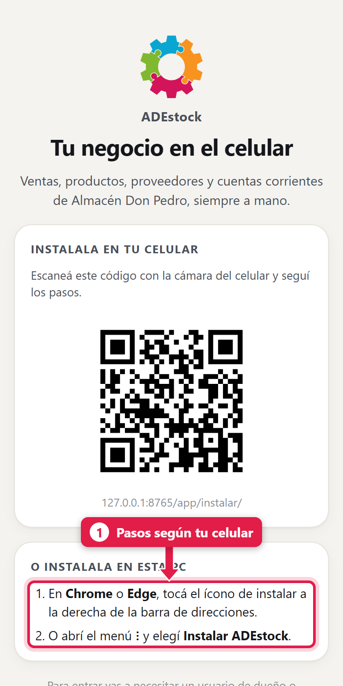

| Si usás… | Pasos |
|---|---|
| **iPhone** | Abrí la página en **Safari** → botón **Compartir** → **Agregar a inicio** → **Agregar** |
| **Android** | Abrí la página en **Chrome** → menú **⋮** → **Instalar app** (o *Agregar a la pantalla principal*) |
| **PC** | En **Chrome** o **Edge**, ícono de instalar a la derecha de la barra de direcciones (o menú **⋮** → *Instalar ADEstock*) |

Si la abrís desde una PC, la página te muestra un **código QR**: escanealo con la cámara del celular y seguí los pasos.

También podés instalarla desde el **menú del usuario** (paso 3) con *Instalar la app en este celular*, o desde el engranaje del POS.

> **Para instalarla hace falta una dirección segura (https://).** Con una dirección `http://` la app funciona igual en el navegador, pero no se puede instalar.

### 2. Ingresá

Abrí la app (`/app/`) e ingresá con tu usuario y clave del sistema:

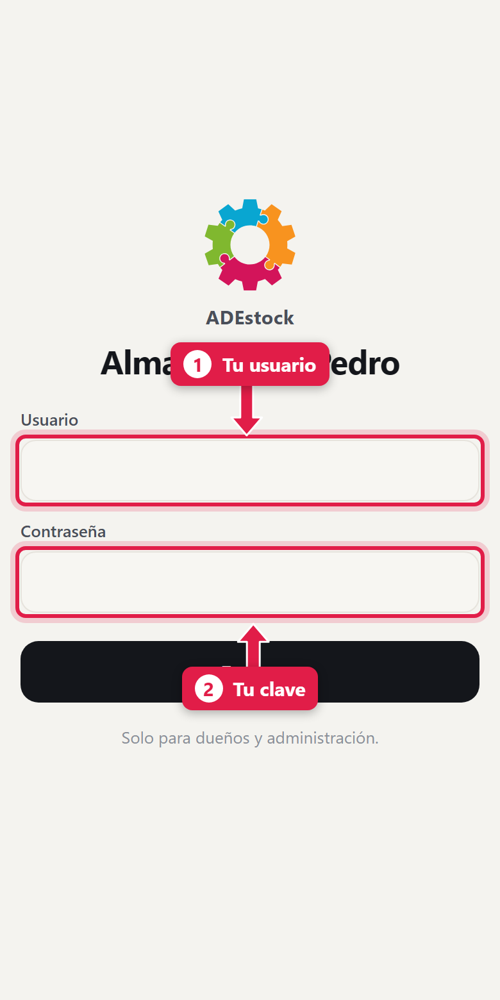

| # | Campo | Qué poner |
|---|---|---|
| 1 | **Usuario** | El mismo que usás en el POS |
| 2 | **Clave** | Tu contraseña |

La sesión **dura 30 días** en ese dispositivo: no te la pide cada vez.

Si tu usuario no tiene permiso, aparece: *«Tu usuario no tiene acceso a esta app. Entrá con un usuario de dueño o administración.»* (ver *Dar acceso a otra persona*, más abajo).

### 3. La pantalla de inicio y tu menú

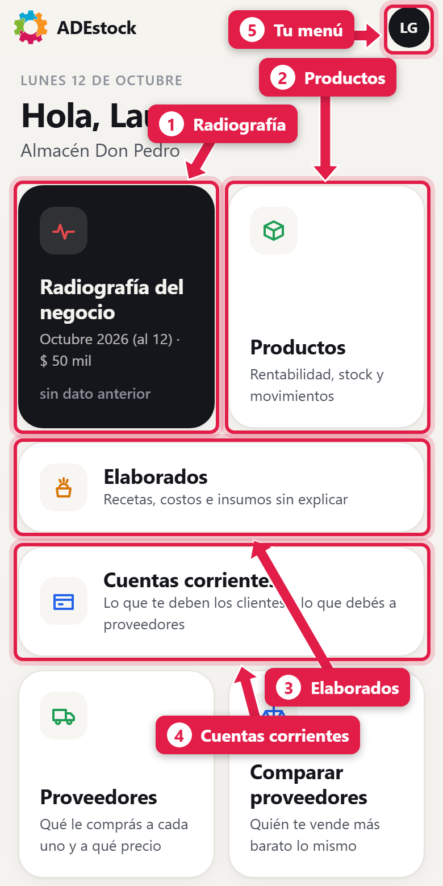

| # | Acceso | Qué te muestra |
|---|---|---|
| 1 | **Radiografía del negocio** | Ventas, compras, gastos y lo que te quedó |
| 2 | **Productos** | Rentabilidad, stock y movimientos de cada producto |
| 3 | **Elaborados** | Recetas, costos e insumos que no cierran |
| 4 | **Cuentas corrientes** | Lo que te deben los clientes y lo que debés a proveedores |
| 5 | **Tu menú** (el círculo con tus iniciales) | Tema, reportes, POS y salir |

Más abajo están **Proveedores** (qué le comprás a cada uno y a qué precio) y **Comparar proveedores** (quién te vende más barato lo mismo). Aparecen otros accesos marcados **PRONTO** (Autorizar pagos, Caja, Cobros, Compras): todavía no están disponibles.

Tocá el círculo de arriba a la derecha para abrir **tu menú**:

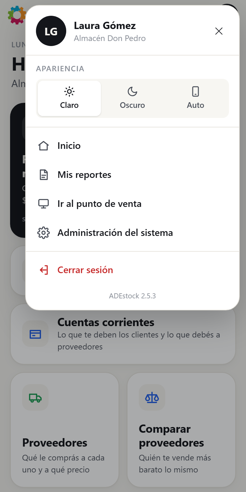

De arriba hacia abajo:

- **Apariencia**: *Claro*, *Oscuro* o *Auto* (sigue la configuración de tu celular).
- **Inicio** y **Mis reportes** (los reportes guardados, paso 9).
- **Ir al punto de venta**: abre el POS.
- **Administración del sistema**: abre el panel de administración.
- **Cerrar sesión**, y al pie la **versión** del sistema.

### 4. La radiografía del negocio

Tocá **Radiografía del negocio**. La primera vez te pide generar un reporte: tocá **Generar mes actual** (o *Elegir otro período*). Queda guardado.

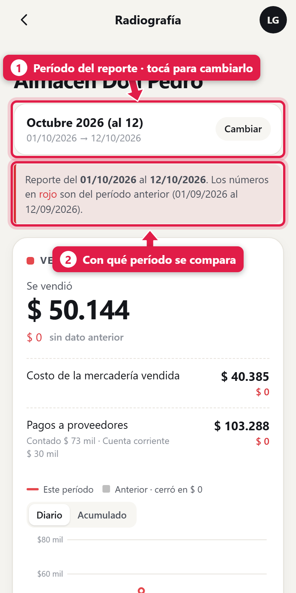

| # | Elemento | Qué es |
|---|---|---|
| 1 | **Período** | El período del reporte. Tocalo (o **Cambiar**) para elegir otro |
| 2 | **Aviso rojo** | Con qué período anterior se está comparando |

Para elegir otro período, tocá **Cambiar**. Se abre una hoja desde abajo:

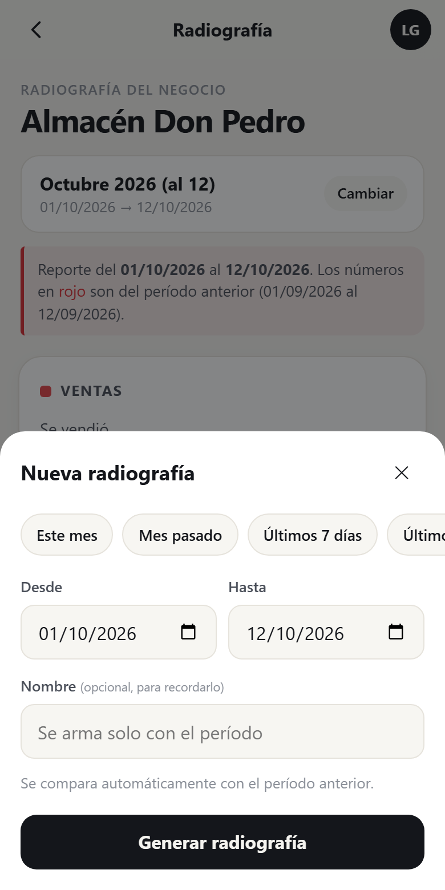

- **Atajos** (fila de botones): *Este mes*, *Mes pasado*, *Últimos 7 días*, *Últimos 30 días* y *Este año*.
- **Desde / Hasta**: para un rango a medida. No se puede elegir una fecha futura.
- **Nombre** (opcional): para reconocer el reporte después; si lo dejás vacío se arma solo con el período.
- **Generar radiografía**: calcula y guarda.

La radiografía se lee de arriba hacia abajo, en cuatro bloques:

**Ventas** - cuánto vendiste en el período, lo que costó la mercadería vendida y lo que pagaste a proveedores (contado y a cuenta corriente). Tiene un **gráfico** con la línea de este período contra el anterior, en modo **Diario** o **Acumulado**.

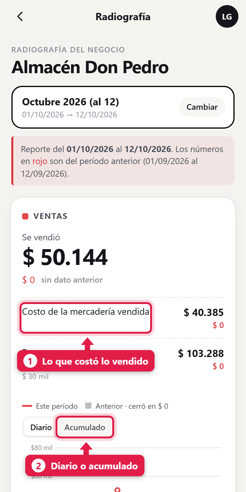

Abajo, cuatro indicadores: la variación contra el período anterior, la **rentabilidad promedio**, el **ticket promedio** (importe promedio por venta) y una **proyección** de cómo cerrarías el mes si seguís a este ritmo.

**Compras de mercadería** - cuánto compraste, y:

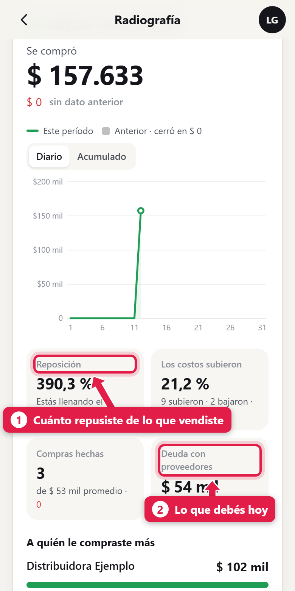

| # | Indicador | Qué significa |
|---|---|---|
| 1 | **Reposición** | Cuánto repusiste respecto de lo que vendiste. Un valor muy alto indica que estás llenando el depósito |
| 2 | **Deuda con proveedores** | Lo que debés hoy (con la hora del cálculo) |

También muestra cuántos costos **subieron** y cuántos bajaron, cuántas compras hiciste y **a quién le compraste más**.

**Gastos por categoría** - cuánto gastaste y en qué rubros (limpieza, alquiler, sueldos…).

**En limpio** - la cuenta final:

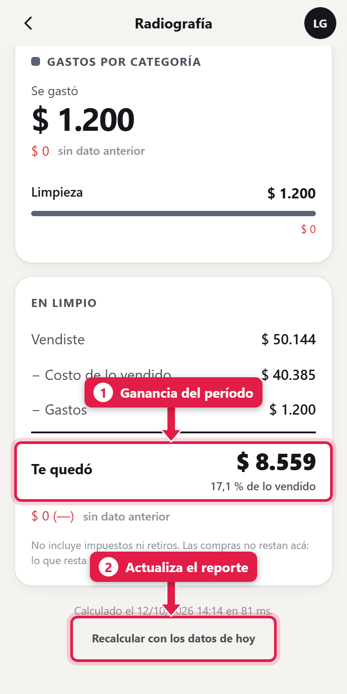

> **Te quedó = Vendiste − Costo de lo vendido − Gastos.** No incluye impuestos ni retiros. Las **compras no restan** acá: lo que resta es el *costo de lo que se vendió*, para no castigar al mes en que repusiste mucho stock.

| # | Elemento | Qué hace |
|---|---|---|
| 1 | **Te quedó** | El resultado calculado del período y su porcentaje sobre lo vendido, sin descontar impuestos ni retiros |
| 2 | **Recalcular con los datos de hoy** | Rehace el reporte con la información actual |

### 5. Productos

Tocá **Productos**. Muestra **cada producto** con su stock, cuánto vendió, su precio y su rentabilidad en el período.

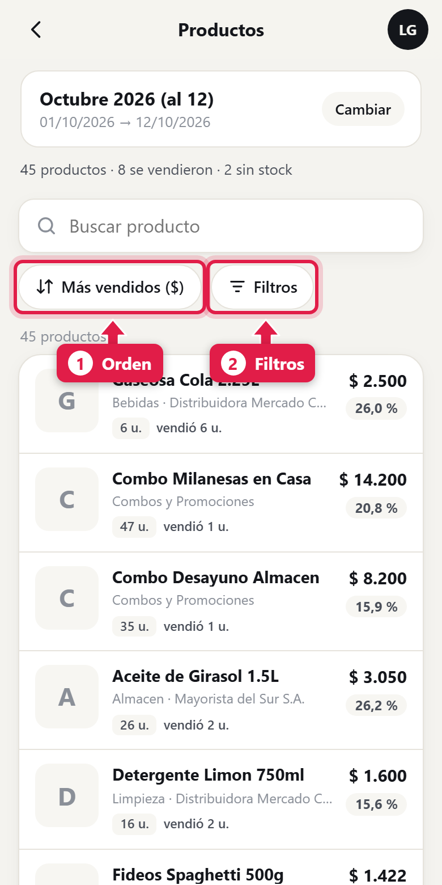

| # | Elemento | Qué hace |
|---|---|---|
| - | **Buscar producto** | Por nombre |
| 1 | **Orden** | *Más vendidos ($)*, *Más unidades vendidas*, *Más rentables*, *Menos rentables*, *Más stock*, *Menos stock* o *Nombre (A-Z)* |
| 2 | **Filtros** | Abre los filtros |

Arriba aparece el resumen: cuántos productos hay, cuántos se vendieron y cuántos están **sin stock**.

Los **Filtros** son:

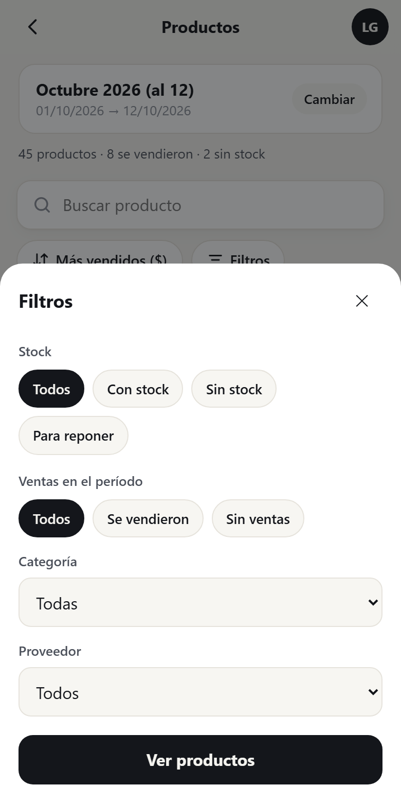

- **Stock**: *Todos*, *Con stock*, *Sin stock* o **Para reponer** (los que están en el stock mínimo o por debajo; solo cuenta los productos que tienen un mínimo cargado).
- **Ventas en el período**: *Todos*, *Se vendieron* o *Sin ventas*.
- **Categoría** y **Proveedor**.

Tocá un producto para ver su **ficha**:

Arriba, el stock a la fecha del reporte (con el desglose por depósito) y **cada presentación** con su precio, su **costo**, cuánto **ganás** y el **margen**. Más abajo, los bloques de **Ventas** y **Compras**, con su gráfico y la comparación contra el período anterior:

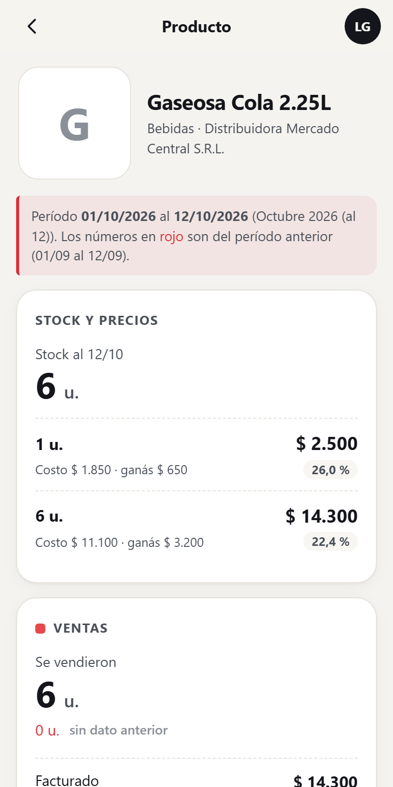

### 6. Elaborados

Para los negocios que **fabrican** (combos, recetas, panadería…). Tocá **Elaborados**:

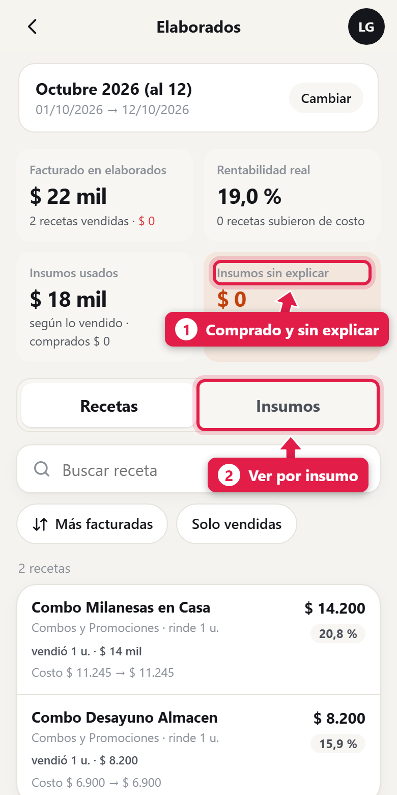

| Indicador | Qué significa |
|---|---|
| **Facturado en elaborados** | Lo que vendiste de productos con receta |
| **Rentabilidad real** | Lo que quedó sobre lo facturado, y cuántas recetas **subieron de costo** |
| **Insumos usados** | Lo que consumieron esas ventas, según la receta, contra lo que **compraste** |
| **Insumos sin explicar** (1) | Plata de insumos que **compraste y no se usó, ni se vendió, ni se tiró**: sospechá de pérdidas, mermas sin registrar o recetas mal cargadas |

Las pestañas (2) cambian la vista: **Recetas** (cada receta con cuánto vendió, su costo y su rentabilidad) o **Insumos** (cada insumo con lo comprado, lo usado y la diferencia). Tocá cualquiera para ver su detalle.

### 7. Cuentas corrientes

Tocá **Cuentas corrientes**. Hay dos pestañas: **Clientes** (lo que te deben) y **Proveedores** (lo que debés).

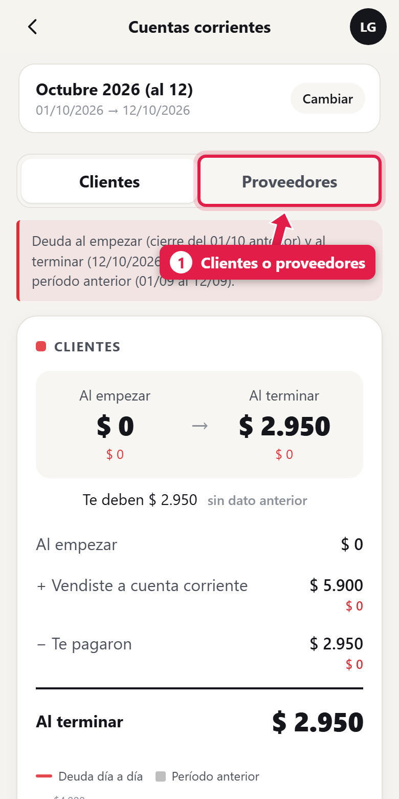

Cada una muestra cómo se movió la deuda en el período: **al empezar**, **más** lo que se vendió a cuenta corriente, **menos** lo que te pagaron, **al terminar**. Además: el porcentaje que **cobraste** de lo que había para cobrar, los **días en la calle** (lo que tardan en promedio en pagarte) y cuánta deuda tiene **más de 30 días**.

Más abajo, el ranking de **los que más deben**:

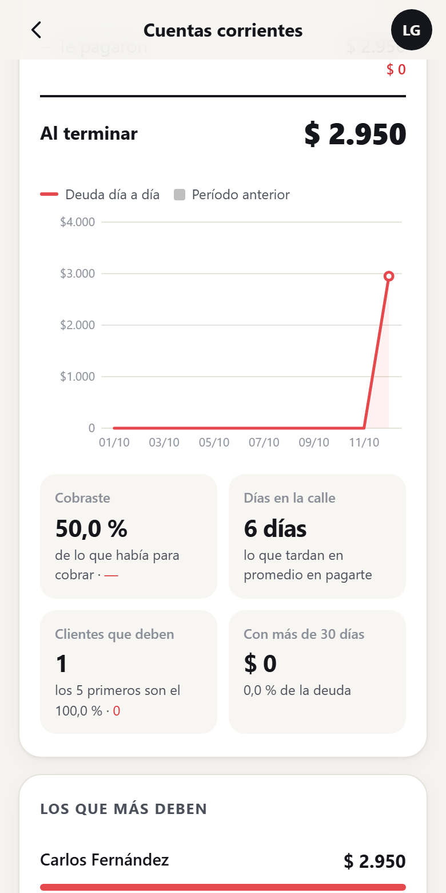

Tocá una persona para ver su detalle: cómo se movió su cuenta y **qué queda pendiente** (cada venta con sus días de antigüedad).

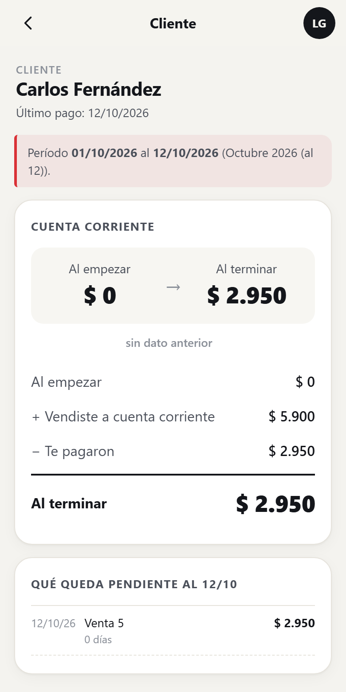

> Esta pantalla refleja el **saldo de cuenta corriente**. Para cobrar la deuda se hace desde el POS (ver [Cobrar la deuda de un cliente](/tutoriales/cobrar-deuda-cliente/)).

### 8. Proveedores y comparar proveedores

**Proveedores** responde: *¿cuánto le compré a cada uno?*

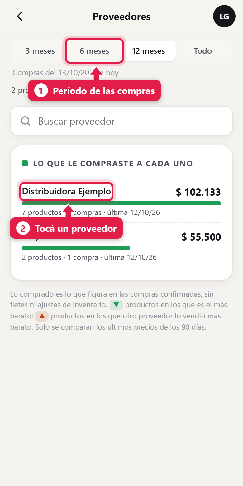

| # | Elemento | Qué hace |
|---|---|---|
| 1 | **3 meses / 6 meses / 12 meses / Todo** | El período de compras que se mira (12 meses por defecto) |
| 2 | **Cada proveedor** | Tocalo para ver los productos que le comprás |

Cuenta solo las **compras confirmadas**, sin fletes ni ajustes de inventario.

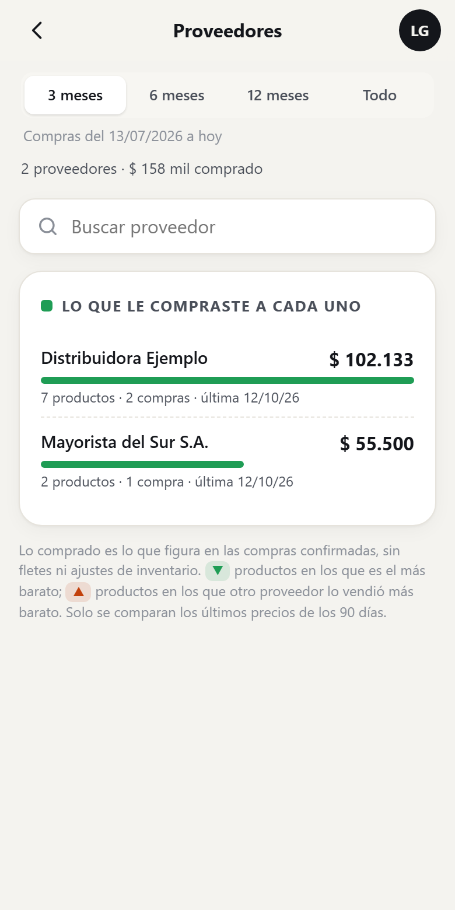

Dentro de un proveedor ves cada producto con su último precio. Dos marcas ayudan a decidir: **▼ verde** = en ese producto es el **más barato**; **▲ naranja** = otro proveedor te lo vendió **más barato**. Solo se comparan los precios de los últimos **90 días**. Al tocar un producto ves su **historial de precios de compra**, con una línea por proveedor.

**Comparar proveedores** muestra los productos que le compraste a **dos o más proveedores**:

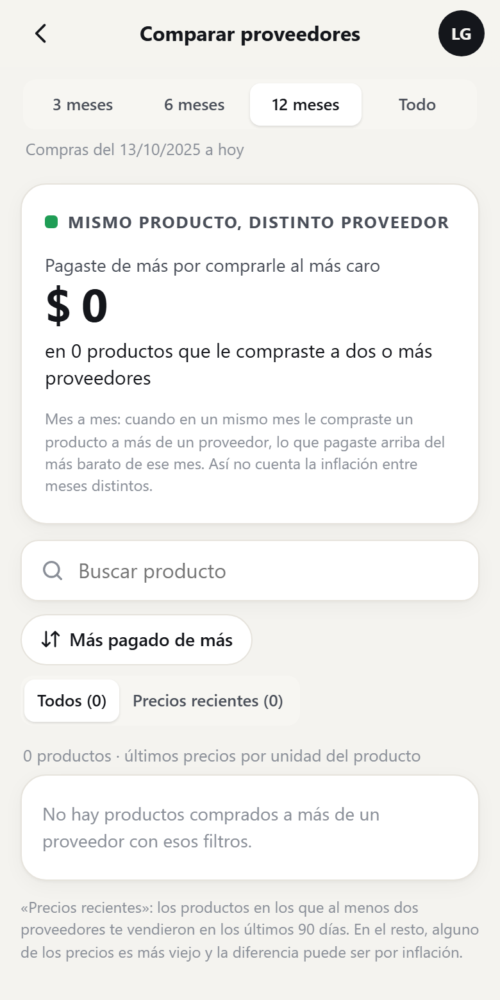

Arriba aparece cuánto **pagaste de más** por comprarle al más caro. Se calcula **mes a mes**: cuando en un mismo mes le compraste el mismo producto a más de un proveedor, se mide lo que pagaste por encima del más barato **de ese mes**, así la inflación entre meses distintos no distorsiona. La pestaña **Precios recientes** deja solo los productos en que al menos dos proveedores te vendieron en los últimos 90 días.

> En esta demo la pantalla aparece vacía porque ningún producto se compró a dos proveedores. En un negocio real se llena con tus compras.

### 9. Mis reportes

Desde tu menú → **Mis reportes** administrás los reportes guardados:

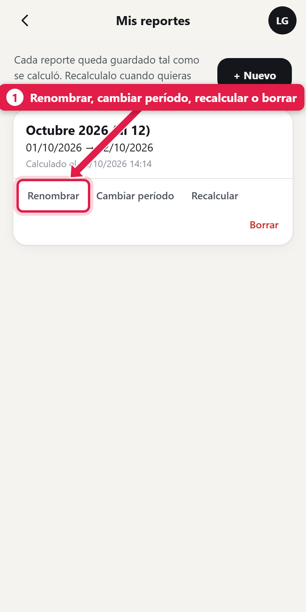

Cada reporte tiene cuatro acciones: **Renombrar**, **Cambiar período**, **Recalcular** (con los datos de hoy) y **Borrar**. Podés tener todos los que quieras: por ejemplo, uno por mes, para comparar a lo largo del año.

## Dar acceso a otra persona

La app la puede usar:

- el **dueño** (superusuario), y
- los usuarios del **grupo Administrativos**.

Para dar acceso, creá el usuario con el rol **Administrativo** desde el POS (Menú rápido → *Usuarios*), como se explica en [Crear usuarios y asignar permisos](/tutoriales/usuarios-y-permisos/):

El campo **Rol** (3) decide el acceso: con **Administrativo** entra a la app; con **Cajero** no. Si ya existe un cajero que pasa a administración, cambiale el rol.

Para **quitar** el acceso, cambiá el rol a *Cajero* o desactivá el usuario (casilla *Usuario activo*).

## Qué pasa por detrás

| Qué | Detalle |
|---|---|
| Ventas del reporte | Ventas finalizadas del período, ya con los descuentos de cierre |
| Costo de lo vendido | El costo de los productos que salieron en esas ventas |
| Reportes guardados | Se calculan al generarlos o recalcularlos; abrirlos no recalcula |
| Elaborados y cuentas | Se calculan la **primera vez que los abrís** y se guardan en el reporte; *Recalcular* los vuelve a calcular |
| Proveedores | Se calculan en cada pedido (tardan una fracción de segundo) |
| Sesión | 30 días en el dispositivo |

## Problemas frecuentes

| Si te pasa… | Es porque… | Qué hacer |
|---|---|---|
| «Tu usuario no tiene acceso a esta app» | El usuario es cajero | Cambiale el rol a *Administrativo* |
| «Usuario o contraseña incorrectos» | Datos mal escritos | Revisá mayúsculas y probá de nuevo |
| Productos / Elaborados / Cuentas piden «generar una radiografía» | Todavía no hay ningún reporte guardado | Tocá **Generar mes actual** |
| Los números no incluyen lo vendido hoy | El reporte se calculó antes | Tocá **Recalcular con los datos de hoy** |
| No me deja instalar la app | La dirección es `http://` | Entrá por `https://` |
| Elaborados está en cero | Todavía no se vendió ningún producto con receta en ese período | Elegí otro período |
| No veo «Para reponer» productos | Los productos no tienen stock mínimo cargado | Cargá el mínimo en cada producto |

## Cómo comprobar que salió bien

Verificá el período del reporte antes de interpretar los indicadores. Si faltan operaciones recientes, tocá **Recalcular con los datos de hoy** y revisá de nuevo. Recordá que **Te quedó** descuenta el costo de lo vendido y los gastos registrados, pero no incluye impuestos ni retiros.

## Siguiente paso

- [consultar reportes y exportar a Excel en ADEstock](/tutoriales/consultar-reportes-y-exportar/)
- [crear usuarios y asignar permisos en ADEstock](/tutoriales/usuarios-y-permisos/)
- [cobrar deudas de clientes en ADEstock](/tutoriales/cobrar-deuda-cliente/)
