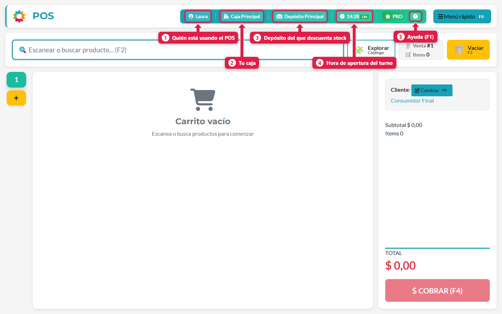
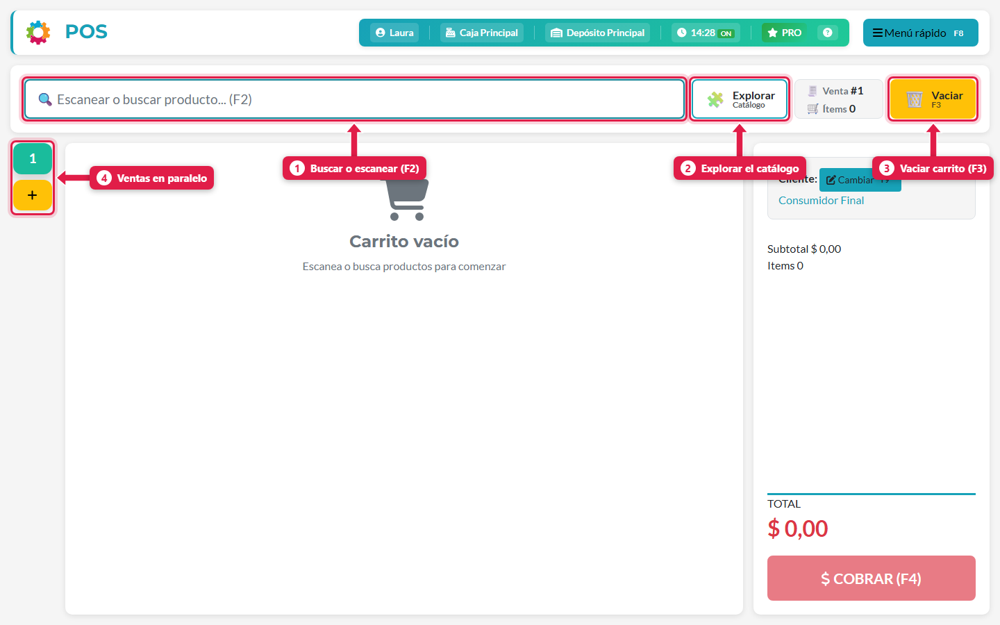
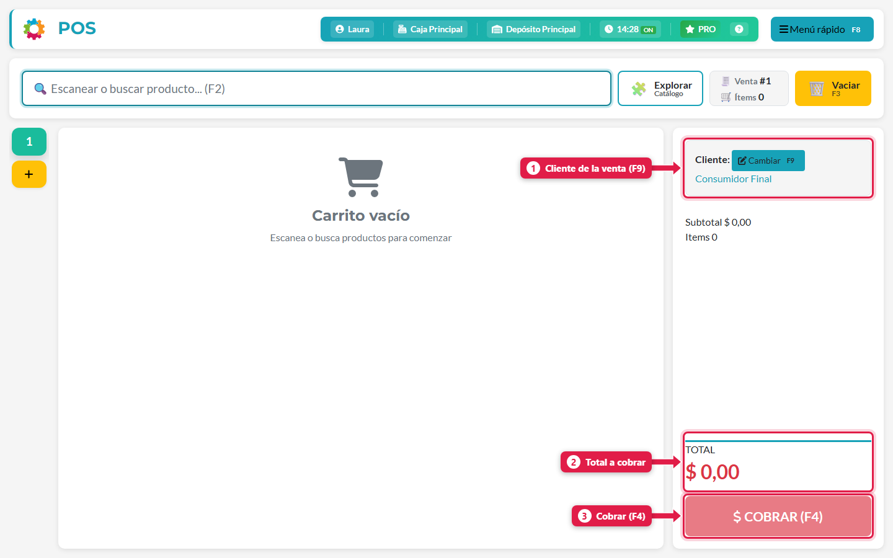
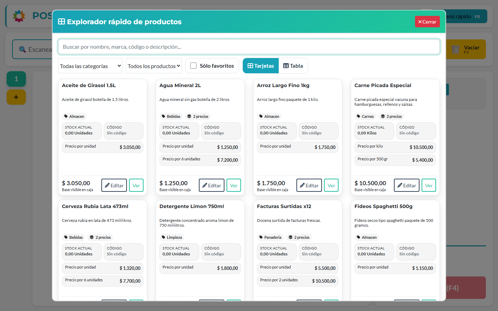
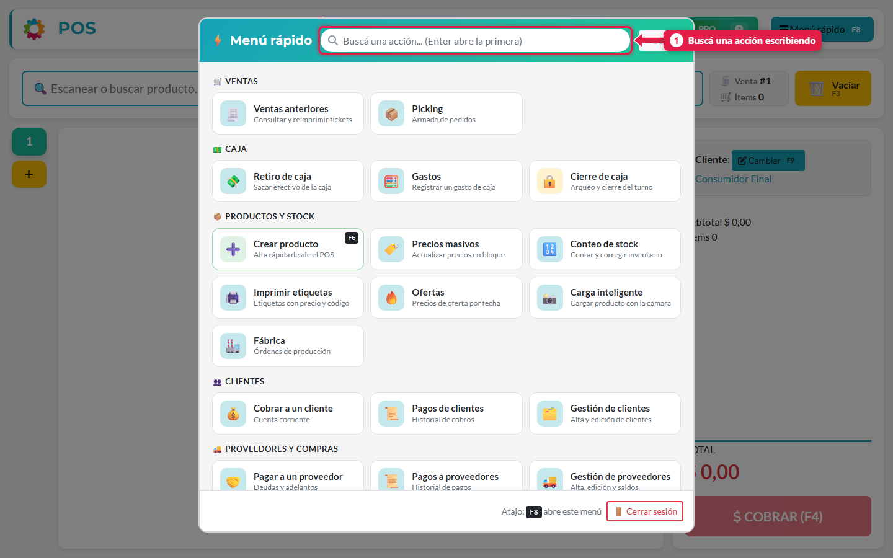
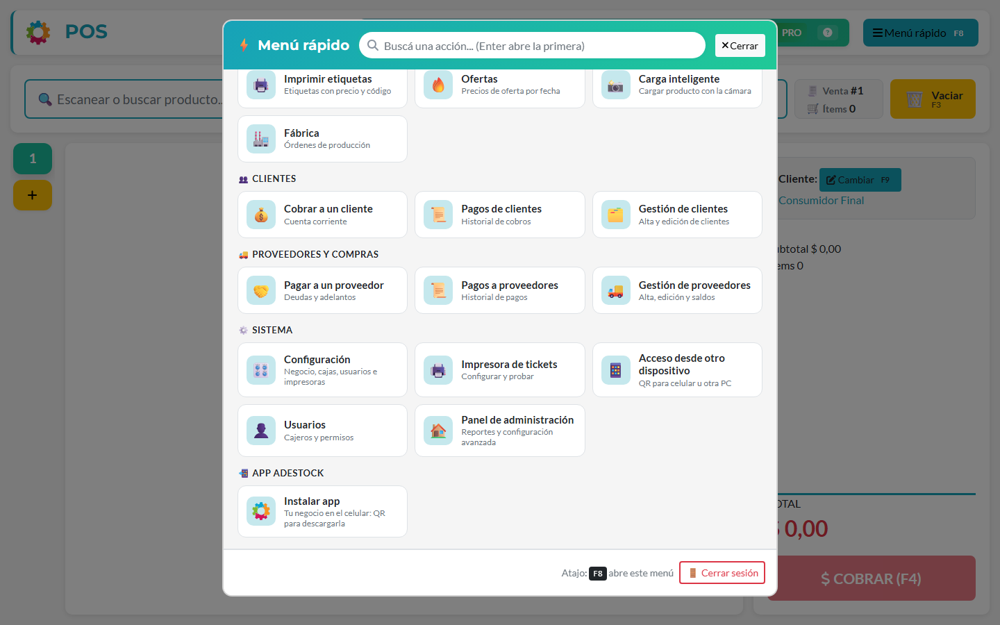

## Para qué sirve

Sirve para conocer la pantalla donde vas a pasar la mayor parte del día. Cuando sabés qué hace cada zona, cada atajo y cada opción del Menú rápido, vendés más rápido y sabés dónde buscar cuando aparece algo que no es una venta común (una compra, el stock, un cliente, la caja). Es la guía para leer **primero** si es tu primera vez en el POS.

## Qué vas a lograr

Aprendé a **usar el punto de venta (POS) de ADEstock**: encontrar productos, recorrer el carrito, elegir un cliente y abrir la pantalla de cobro. Esta guía reúne las funciones del Menú rápido y los atajos de teclado para ubicar cada tarea mientras atendés.

Si es tu primera vez, empezá por la pantalla principal. Si ya usás el POS, podés ir directo a la tabla de atajos o a la sección del menú que necesitás.

## Antes de empezar

El POS no te deja operar hasta que abrís el turno: te pide **cuánto efectivo hay en la caja al empezar** (puede ser 0) y presionás **Abrir Turno**. Si no tenés una caja asignada, el sistema te avisa que le pidas al administrador que te asigne una (se hace en Menú rápido → Usuarios).

## La pantalla principal

### La barra superior

| # | Qué es | Para qué sirve |
|---|---|---|
| 1 | Tu usuario | Muestra quién está operando. Las ventas y los cobros quedan a tu nombre |
| 2 | Tu caja | El punto de venta que tenés asignado |
| 3 | Depósito | De qué depósito se **descuenta el stock** de lo que vendés |
| 4 | Hora + `ON` | A qué hora abriste el turno. `ON` significa que el turno está abierto |
| 5 | `?` | Ayuda: arranca el tutorial guiado dentro del POS (**F1**) |

A su lado verás la **licencia**: `PRO` si está activa, o `GRATUITA n/5` si estás en la versión de prueba (con el contador de ventas que te quedan).

### El buscador y el carrito

1. **Buscador (F2).** Escribí el nombre o el código del producto, o escaneá el código de barras con el lector, y apretá Enter. Se agrega al carrito.
2. **Explorar catálogo.** Abre una vista con todos los productos para elegir con el mouse (ver más abajo).
3. **Vaciar (F3).** Borra todo el carrito de la venta actual.
4. **Pestañas de ventas en paralelo.** Cada número es una venta abierta. Con el **+** abrís otra mientras atendés a alguien más, sin perder la anterior. El límite por defecto es **5 ventas simultáneas** por caja (el administrador puede cambiarlo).

El indicador **Venta #** muestra el número de la venta actual, e **Ítems** cuántos productos lleva.

### El panel de la derecha

1. **Cliente (F9).** Por defecto es *Consumidor Final*. Cambialo si la venta es para un cliente registrado (necesario para vender en cuenta corriente).
2. **Total.** Es lo que tiene que pagar el cliente.
3. **Cobrar (F4).** Abre la pantalla de cobro, donde elegís cómo paga el cliente.

## Explorar el catálogo

Con el botón **Explorar** se abre el explorador de productos.

- Filtrá por **categoría**, por **tipo de producto** o marcá **Sólo favoritos**.
- Alterná entre vista de **Tarjetas** y **Tabla**.
- Cada tarjeta muestra el stock actual, el código y **todos los precios** del producto (por unidad, por pack, por kilo…).
- **Ver** abre el detalle; **Editar** (solo si tenés permiso para gestionar productos) abre la ficha para modificarlo.

## El Menú rápido (F8)

Es el "índice" de todo lo que se hace desde el POS. Se abre con el botón de arriba a la derecha o con **F8**. Arriba tiene un buscador: escribí parte del nombre de una acción y apretá Enter para abrir la primera coincidencia.

### Ventas
| Opción | Para qué sirve |
|---|---|
| **Ventas anteriores** | Consultar ventas pasadas y reimprimir tickets |
| **Picking** | Armado de pedidos (solo si el módulo está activado) |

### Caja
| Opción | Para qué sirve |
|---|---|
| **Retiro de caja** | Sacar efectivo de la caja (por ejemplo, llevarlo a la caja fuerte) |
| **Gastos** | Registrar un gasto pagado con plata de la caja |
| **Cierre de caja** | Hacer el arqueo y cerrar el turno |

### Productos y stock
| Opción | Para qué sirve |
|---|---|
| **Crear producto (F6)** | Dar de alta un producto rápido sin salir del POS |
| **Precios masivos** | Actualizar precios en bloque |
| **Conteo de stock** | Contar y corregir el inventario físico |
| **Imprimir etiquetas** | Etiquetas con precio y código |
| **Ofertas** | Precios de oferta por fecha |
| **Carga inteligente** | Cargar un producto sacándole una foto con la cámara |
| **Fábrica** | Órdenes de producción para productos con receta |

### Clientes
| Opción | Para qué sirve |
|---|---|
| **Cobrar a un cliente** | Registrar el pago de la deuda de un cliente (cuenta corriente) |
| **Pagos de clientes** | Historial de cobros |
| **Gestión de clientes** | Alta y edición de clientes |

### Proveedores y compras
| Opción | Para qué sirve |
|---|---|
| **Pagar a un proveedor** | Pagar deudas o dejar adelantos |
| **Pagos a proveedores** | Historial de pagos |
| **Gestión de proveedores** | Alta, edición y saldos |

### Sistema
| Opción | Para qué sirve |
|---|---|
| **Configuración** | Negocio, cajas, medios de cobro, usuarios e impresoras |
| **Impresora de tickets** | Configurar y probar la impresora |
| **Acceso desde otro dispositivo** | Muestra un QR para abrir el POS desde un celular u otra PC |
| **Usuarios** | Crear cajeros y asignar permisos |
| **Panel de administración** | Reportes y configuración avanzada |

### App ADEstock
| Opción | Para qué sirve |
|---|---|
| **Instalar app** | QR para instalar la app del negocio en el celular |

> **Según los módulos que tengas activados** aparecen además estas opciones: **Presupuestos** (Ventas), **Revistas y folletos** (Productos y stock), **Compras (carga rápida)** y **Listas de proveedores** (Proveedores y compras). Se activan en *Configuración → Módulos y sistema* y en *Ventas y caja*.

> **Importante:** no todos ven todo. Lo que aparece en el menú depende de los **permisos** que tenga tu usuario y de los módulos que estén activados en el negocio.

## Atajos de teclado

| Tecla | Acción |
|---|---|
| **F1** | Ayuda / tutorial del POS |
| **F2** | Buscar producto |
| **F3** | Vaciar carrito |
| **F4** | Cobrar |
| **F6** | Crear producto (si tenés permiso) |
| **F8** | Menú rápido |
| **F9** | Cambiar cliente |
| **Esc** | Cerrar ventanas |

## Problemas frecuentes

| Si te pasa… | Es porque… | Qué hacer |
|---|---|---|
| "Debes abrir el turno de caja antes de operar" | No abriste el turno | Ingresá el efectivo inicial y tocá *Abrir Turno* |
| "No tienes una caja asignada" | Tu usuario no tiene punto de venta | Pedile al dueño que te asigne una (Menú rápido → Usuarios) |
| "Has alcanzado el límite de 5 ventas simultáneas" | Tenés abiertas todas las pestañas permitidas | Terminá o vaciá una venta antes de abrir otra |
| No veo la opción *Ofertas* o *Conteo de stock* | Tu usuario no tiene ese permiso | Pedírselo al dueño |

## Cómo comprobar que salió bien

Revisá en la barra superior que figuren tu usuario, la caja y el depósito correctos. Probá **F2** para buscar un producto y **F8** para abrir el Menú rápido. Las opciones disponibles dependen de los módulos activos y de tus permisos.

## Siguiente paso

- [hacer una venta y cobrar en efectivo en ADEstock](/tutoriales/hacer-una-venta/)
- [cargar productos, stock y precios en ADEstock](/tutoriales/cargar-productos/)
- [abrir, hacer el arqueo y cerrar caja en ADEstock](/tutoriales/abrir-y-cerrar-caja/)
