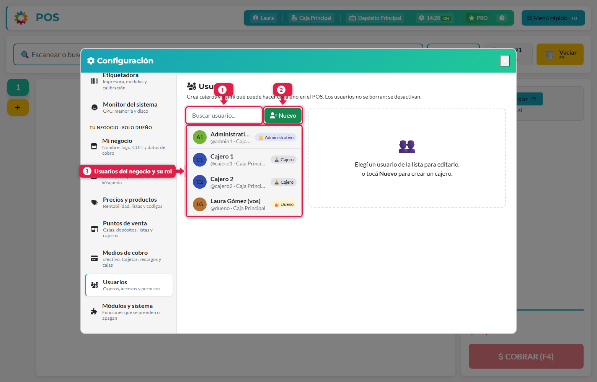
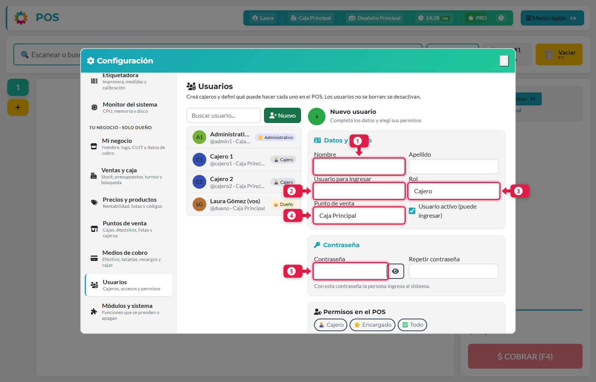
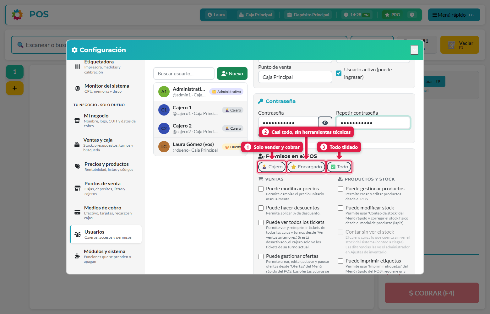
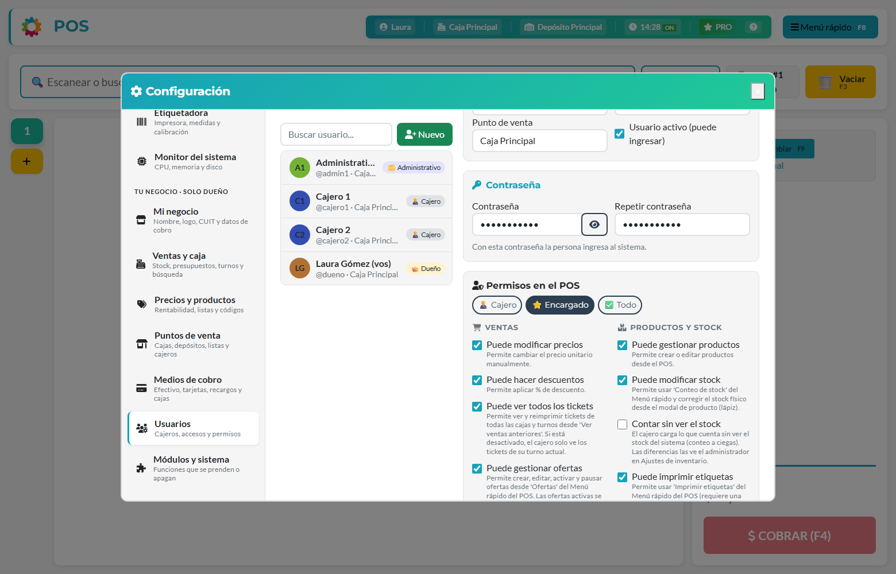
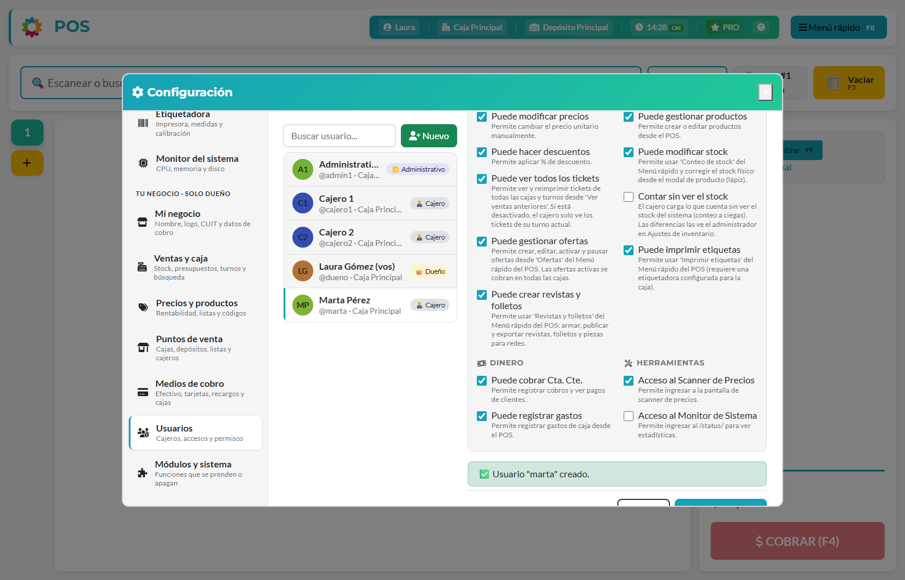

## Qué vas a lograr

Dar de alta a un cajero o a un administrativo, asignarle su **caja** (punto de venta) y decidir **qué puede hacer** en el POS, todo sin salir del sistema.

## Antes de empezar

Cada usuario necesita tres cosas: un **rol**, un **punto de venta** (caja) y un conjunto de **permisos**. Conviene entender la diferencia:

| Concepto | Qué define |
|---|---|
| **Rol** | *Cajero* o *Administrativo*. El administrativo además puede entrar a la **app de gestión** del dueño (`/app/`). El cajero no |
| **Punto de venta** | La caja y el depósito desde el que vende. Define de dónde sale el stock de sus ventas |
| **Permisos** | Qué botones y funciones del POS puede usar (cambiar precios, hacer descuentos, contar stock, etc.) |

> El dueño (superusuario) tiene **todos los permisos siempre** y su ficha no se puede restringir.

## Paso a paso

### 1. Abrí la pantalla de usuarios

Menú rápido (**F8**) → **Usuarios**. Se abre el panel de Configuración, en la sección *Usuarios* (también está en el engranaje, bajo "Tu negocio · solo dueño").

1. **Buscador** para encontrar un usuario por nombre o usuario.
2. **Nuevo**: crea un usuario.
3. **Lista**: cada usuario muestra sus iniciales, nombre, `@usuario`, caja y rol (*Dueño*, *Administrativo*, *Cajero*).

### 2. Completá los datos

Tocá **Nuevo**.

| # | Campo | Qué poner |
|---|---|---|
| 1 | **Nombre** (y Apellido) | El nombre de la persona. El nombre es obligatorio |
| 2 | **Usuario para ingresar** | Con lo que entra al sistema. No puede repetirse. Ej.: `marta` |
| 3 | **Rol** | *Cajero* o *Administrativo* |
| 4 | **Punto de venta** | La caja donde va a trabajar |
| 5 | **Contraseña** | Con la que ingresa. La escribís dos veces. Tiene que ser razonablemente segura (no demasiado corta, ni solo números, ni parecida al usuario) |

La casilla **Usuario activo** permite o impide que ingrese. Es la forma de "dar de baja" a alguien, porque **los usuarios no se borran** (tienen ventas y turnos asociados): se desactivan.

### 3. Elegí los permisos

Más abajo está **Permisos en el POS**. Hay tres perfiles rápidos que tildan todo de una vez:

| # | Perfil | Qué activa |
|---|---|---|
| 1 | **Cajero** | Nada extra: solo vender y cobrar |
| 2 | **Encargado** | Casi todo, sin herramientas técnicas (no incluye *Monitor del sistema* ni *Contar sin ver el stock*) |
| 3 | **Todo** | Todo tildado, excepto *Contar sin ver el stock* (que es una restricción, no un permiso) |

Después de elegir un perfil podés ajustar casilla por casilla:

**Ventas**

| Permiso | Qué permite |
|---|---|
| Puede modificar precios | Cambiar a mano el precio unitario en una venta |
| Puede hacer descuentos | Aplicar un % de descuento |
| Puede ver todos los tickets | Ver y reimprimir tickets de todas las cajas y turnos. Apagado: solo ve los de su turno actual |
| Puede gestionar ofertas | Crear, editar, activar y pausar ofertas (se cobran en todas las cajas) |
| Puede crear revistas y folletos | Armar, publicar y exportar revistas, folletos y piezas para redes |

**Productos y stock**

| Permiso | Qué permite |
|---|---|
| Puede gestionar productos | Crear o editar productos desde el POS |
| Puede modificar stock | Usar *Conteo de stock* y corregir el stock con el lápiz del producto |
| Contar sin ver el stock | Hace que el **conteo sea a ciegas**: el cajero carga lo que cuenta sin ver el stock del sistema. Las diferencias las ve el administrador. Solo se puede activar si tiene *Puede modificar stock* |
| Puede imprimir etiquetas | Usar *Imprimir etiquetas* (requiere una etiquetadora configurada) |

**Dinero**

| Permiso | Qué permite |
|---|---|
| Puede cobrar Cta. Cte. | Registrar cobros de clientes y ver sus pagos |
| Puede registrar gastos | Registrar gastos de caja desde el POS |

**Herramientas**

| Permiso | Qué permite |
|---|---|
| Acceso al Scanner de Precios | Entrar a la pantalla de scanner de precios |
| Acceso al Monitor de Sistema | Ver `/status/` con estadísticas del servidor |

### 4. Guardá

Tocá **Guardar**. Aparece el mensaje *Usuario "marta" creado* y la persona ya figura en la lista.

## Cambiar la contraseña o los permisos de alguien

Elegí al usuario en la lista, cambiá lo que necesites y presioná **Guardar**. Si dejás la contraseña vacía, no se modifica.

> ⚠️ **Los usuarios que creó el asistente de configuración inicial** (`cajero1`, `admin1`…) tienen contraseñas de arranque conocidas (`Cajero123.` / `Admin123.`). Entrá a cada uno y **cambiales la contraseña** apenas empieces a usar el sistema.

## Qué pasa por detrás

| Qué | Detalle |
|---|---|
| Usuario | Se crea con acceso al sistema; lo que ve cada uno lo limitan su grupo y sus permisos |
| Grupo | El rol *Cajero* lo mete en el grupo `Cajeros`; *Administrativo* en `Administrativos`. Solo uno de los dos |
| Asignación | Se guarda la caja y los permisos en la "asignación" del usuario |
| Seguridad | No podés desactivar tu propio usuario. Los usuarios de la tienda online no aparecen en esta lista |

## Problemas frecuentes

| Si te pasa… | Es porque… | Qué hacer |
|---|---|---|
| "Ya existe un usuario con ese nombre" | El usuario para ingresar está repetido (no distingue mayúsculas) | Elegí otro |
| Las contraseñas no coinciden | Escribiste distinto en los dos campos | Volvé a escribirlas |
| La contraseña es rechazada | Es muy corta, muy común o solo números | Usá una más larga y mezclada |
| El cajero entra pero dice que no tiene caja | No se le asignó punto de venta | Editá el usuario y elegí una caja |
| No puedo activar *Contar sin ver el stock* | El usuario no tiene *Puede modificar stock* | Activá primero ese permiso |
| Quiero eliminar a un empleado | Los usuarios no se borran | Desmarcá *Usuario activo* y guardá |

## Siguiente paso

- Configuración del POS (engranaje)
- Hacer una venta
- Ajustar el stock con conteo a ciegas
