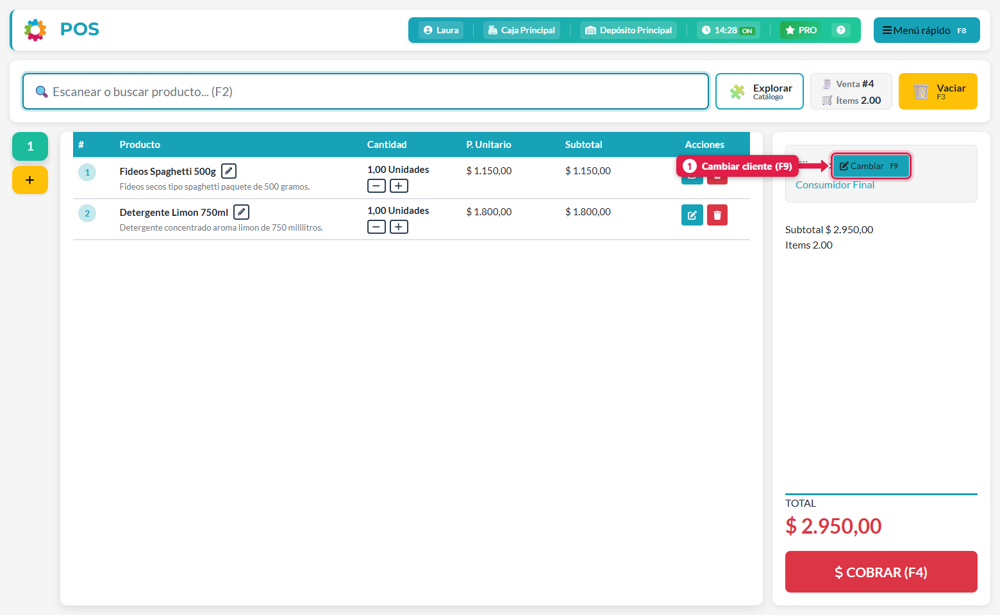
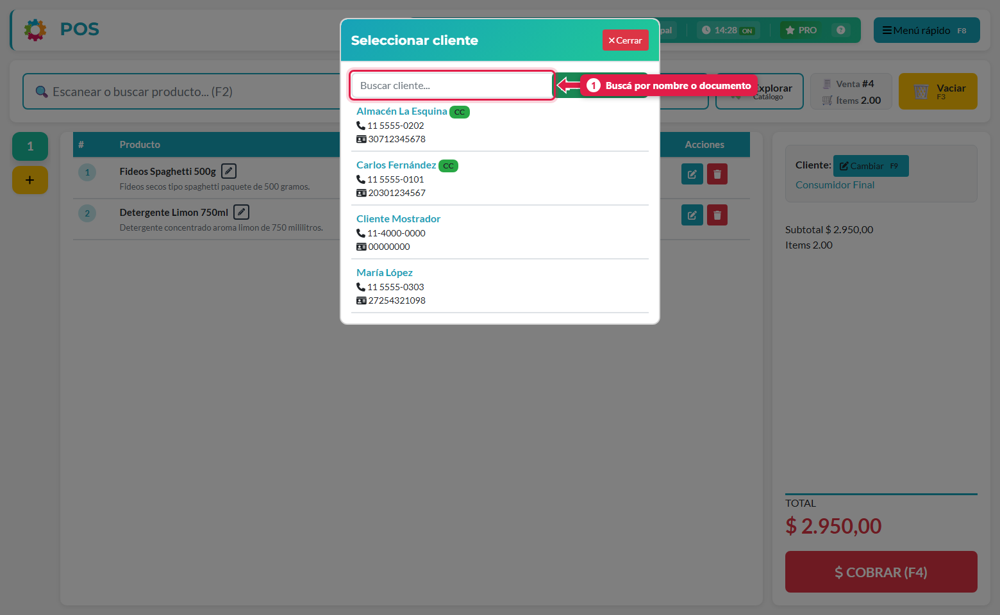
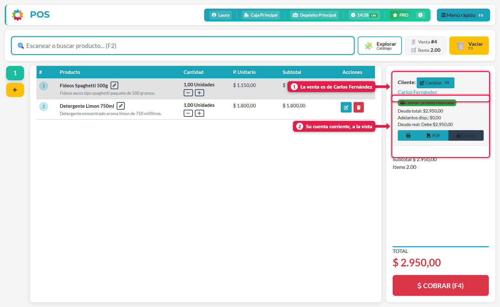
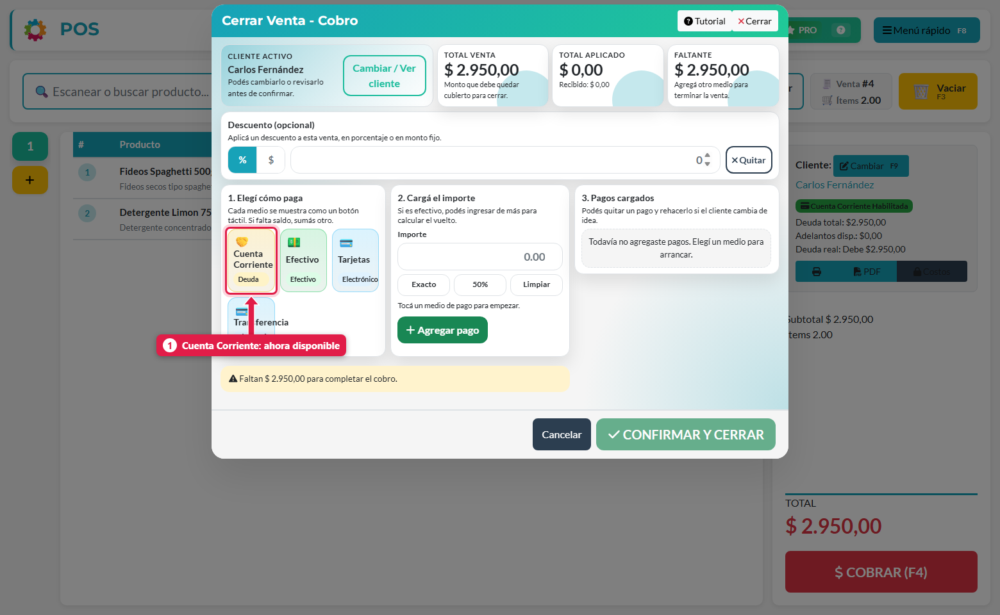
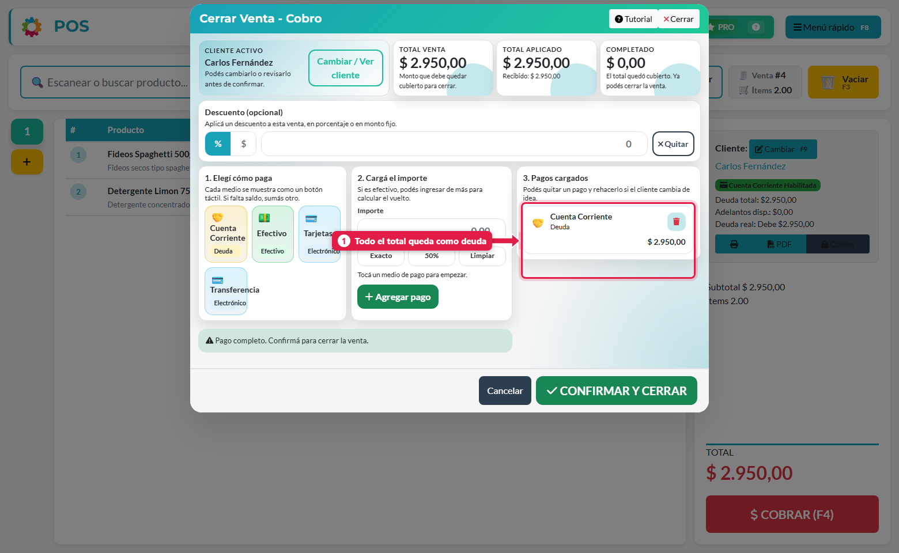
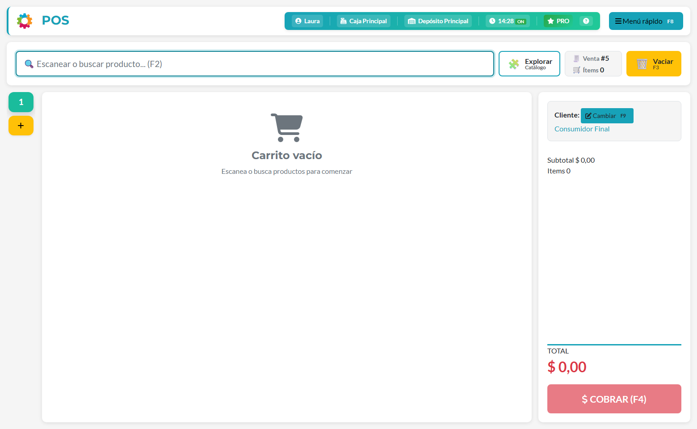

## Qué vas a lograr

Entregar la mercadería **sin cobrar en el momento** y dejar la plata como **deuda** del cliente, para que la pague después.

## Antes de empezar

- El cliente tiene que estar creado y con **Habilitar Cuenta Corriente** tildado.
- La venta no puede ser a *Consumidor Final*: hay que asignarle el cliente.
- El medio de cobro **Cuenta Corriente** tiene que estar activo en tu caja (viene así desde el onboarding).

## Paso a paso

### 1. Armá el carrito

Cargá los productos como en cualquier venta (ver *Hacer una venta*).

### 2. Asignale el cliente a la venta

Tocá **Cambiar** (o **F9**) junto al cliente.

Se abre la lista de clientes. Los que tienen cuenta corriente habilitada llevan la etiqueta **CC**. Buscá por nombre o documento y tocá el cliente.

### 3. Mirá su cuenta antes de cobrar

Apenas elegís un cliente con cuenta corriente, el panel de la derecha muestra un **resumen de su cuenta**:

| Dato | Qué significa |
|---|---|
| **Deuda total** | Lo que el cliente debe hoy, tal como se le vendió |
| **Adelantos disp.** | Plata que dejó a favor (anticipos) y todavía no se aplicó |
| **Deuda real** | `Deuda total − Adelantos`. Es lo que realmente debe: *Debe $…*, *A favor $…* o *Al día* |

### 4. Cobrá con Cuenta Corriente

Tocá **COBRAR** (F4). Con un cliente con cuenta corriente, el botón **Cuenta Corriente** ahora está habilitado (con Consumidor Final aparece apagado).

Elegí **Cuenta Corriente** y tocá **Exacto** para cargar todo el total. Después **Agregar pago**.

> También podés **combinar**: una parte en efectivo y el resto a cuenta corriente. Se hace igual que en *Cobrar con varios medios de pago*.

### 5. Confirmá y cerrá

Tocá **CONFIRMAR Y CERRAR**. La venta se cierra y el total queda como deuda del cliente.

## Qué pasa por detrás

| Qué | Detalle |
|---|---|
| Deuda | Se crea un pago "adeudado" por el monto a cuenta corriente, asociado a la venta y al cliente |
| Caja | Ese monto **no entra** al arqueo de efectivo (no se cobró plata) |
| Stock | Se mueve igual que en cualquier venta |
| Ticket | Si está activada la opción *Mostrar saldo de cuenta corriente en el ticket*, el ticket muestra saldo anterior, esta compra y total adeudado |
| Precios | La deuda guarda el precio de la venta; más adelante puede **actualizarse** si los precios suben (ver *Revisar la cuenta corriente de un cliente*) |

## Problemas frecuentes

| Si te pasa… | Es porque… | Qué hacer |
|---|---|---|
| El botón *Cuenta Corriente* está apagado | El cliente es Consumidor Final, o no tiene cuenta corriente habilitada | Asignale un cliente con CC (F9) o habilitala desde *Gestión de clientes → Editar* |
| No aparece la etiqueta CC en la lista | El cliente no la tiene habilitada | Editá el cliente y tildá *Habilitar Cuenta Corriente* |
| Necesito saber cuánto me debe | — | Ver *Revisar la cuenta corriente de un cliente* |
| El cliente quiere pagar su deuda | — | Ver *Cobrar la deuda de un cliente* |

## Siguiente paso

- Revisar la cuenta corriente de un cliente
- Cobrar la deuda de un cliente
